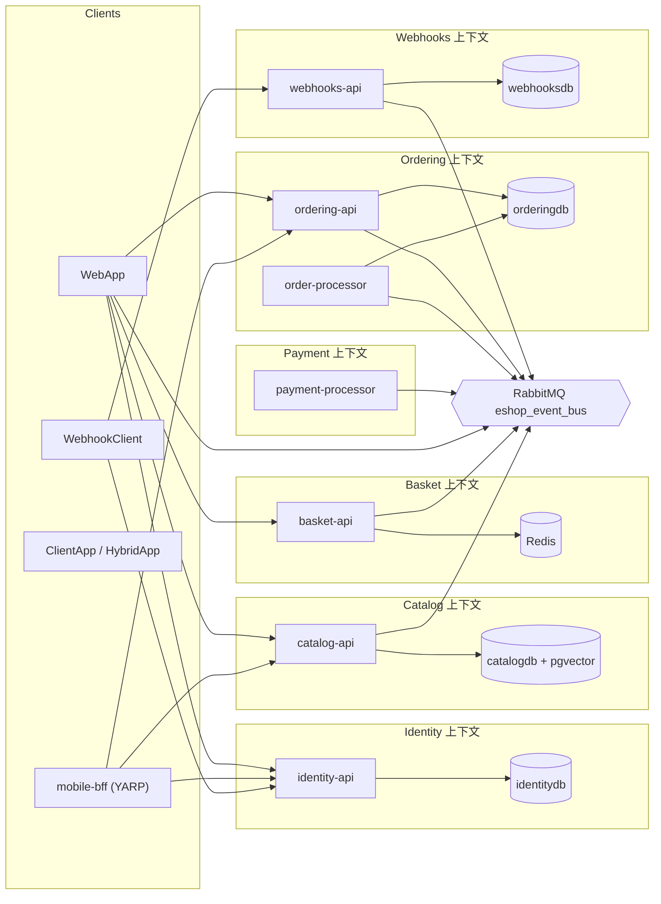
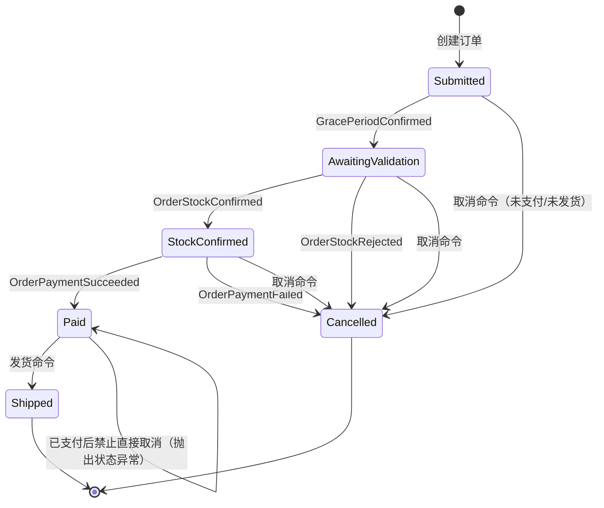
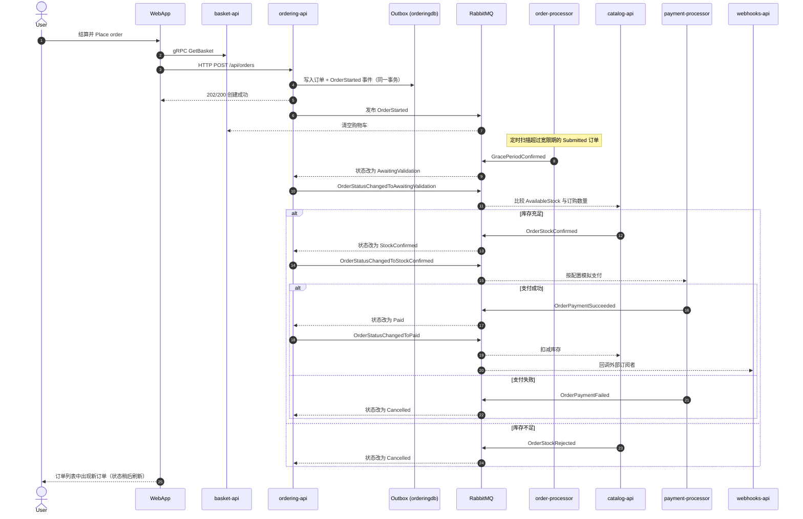

# eShop 微服务架构设计文档（v2）

> 文档版本：v2  
> 对应源码：上游仓库 [dotnet/eShop](https://github.com/dotnet/eShop)，本地检出路径 `/workspace/eShop`，分支 `main`，提交 `913acea66708a59595351174cee9b29f37179d29`（提交时间 2026-10-15 13:52:28 -0700，换算为 Asia/Tokyo 为 2026-10-16 05:52 JST）。  
> 本地编排实测：Step 1–3 在同一台 Linux 机器上完成，`aspire start` 后 17 个资源全部 Running / Healthy。  
> 文档性质：基于源码与本地实测的架构研究，按真实项目规划的写法组织；不是官方文档的翻译，也不是尚未落地的设计草案。

## 版本说明：v2 相对 v1 的变化

v1 文档（`docs/architecture.md`）已经给出了服务清单、事件总线概览、数据存储和部署轮廓，但篇幅偏短，关键机制几乎没有展开，也几乎没有源码。读者读完只能知道“有哪些服务”，很难回答“为什么这样选、代码里具体怎么写、一个新服务该怎么加、测试怎么跑”。

v2 在保留 v1 结论的基础上做了如下加强：

1. **技术选型写全。** 给出完整技术栈表（类别、技术、版本、用在哪里、为什么选），版本全部从 `Directory.Packages.props`、`global.json`、`csproj`、`package.json` 实取；对每一项补充替代方案对比，并标明哪些是源码事实、哪些是架构解读。
2. **项目框架写深。** 给出解决方案目录树、中央包管理、共享库职责，并对比 Catalog 的贫血模型与 Ordering 的 DDD 分层（聚合根、值对象、领域事件、仓储、工作单元），对 `AppHost.cs` 做逐段解读。
3. **服务拆分写细。** 每个运行时服务都有职责、项目结构、依赖、数据模型、API 路由表、关键代码、发布/订阅事件。
4. **通信与可靠性写透。** 同步 REST、gRPC（含 `basket.proto` 全文）、事件总线接口与 RabbitMQ 发布/消费实现、Outbox 与事务行为、完整事件矩阵、订单状态机和下单 Saga 时序图、YARP 路由。
5. **开发、部署、测试写成可执行指南。** 结合 Step 1–3 的实测命令和踩坑；给出“如何新增一个微服务”的仓库约定示例（示例代码明确标注“示例，非仓库代码”）；摘录真实 CI 工作流；在本机实际运行 `dotnet test tests/Ordering.UnitTests` 并把结果写入本文。
6. **所有代码块均为源码摘录。** 标注相对路径和起止行号；可用 `// ...` 省略无关行，但出现的每一行都来自对应文件，不得编造。演示用客户端密钥在摘录中替换为 `<REDACTED_DEMO_SECRET>`。Identity 源码中的开发签名证书等不安全设置会原文引用并明确标注“不可用于生产”。

本文不替代上游 README，也不覆盖尚未在本环境实测的 Azure 部署细节；未实测部分会明确标注。

## 目录

- [1. 技术选型](#1-技术选型)
  - [1.1 选型原则](#11-选型原则)
  - [1.2 完整技术栈表](#12-完整技术栈表)
  - [1.3 关键技术的源码落地](#13-关键技术的源码落地)
  - [1.4 替代方案对比](#14-替代方案对比)
- [2. 项目框架](#2-项目框架)
  - [2.1 解决方案与目录结构](#21-解决方案与目录结构)
  - [2.2 中央包管理与构建约定](#22-中央包管理与构建约定)
  - [2.3 共享库](#23-共享库)
  - [2.4 典型服务内部分层](#24-典型服务内部分层)
  - [2.5 AppHost 编排代码逐段解读](#25-apphost-编排代码逐段解读)
- [3. 服务拆分](#3-服务拆分)
- [4. 模块通信](#4-模块通信)
- [5. 认证与授权](#5-认证与授权)
- [6. 开发](#6-开发)
- [7. 部署](#7-部署)
- [8. 测试](#8-测试)
- [9. 模式总结、优缺点、改进建议与项目规划](#9-模式总结优缺点改进建议与项目规划)
- [附录 A：本文引用的源码文件](#附录-a本文引用的源码文件)

---

## 1. 技术选型

技术选型不是一份“流行技术清单”，而是一组互相约束的决定：目标框架决定能引用哪些包，编排方式决定本地和云上的资源模型，通信方式决定服务契约和故障边界，数据存储决定一致性与扩展方式。eShop 作为 .NET 官方参考应用，选型的第一条线索不是营销材料，而是仓库里的版本文件和项目引用。下面先说明原则，再给出完整表格，然后用源码证明这些技术确实按所述方式被使用。

### 1.1 选型原则

从源码和 AppHost 编排可以归纳出四条原则（这是对代码结构的解读，仓库根目录没有单独的“架构决策记录”文件）：

1. **以 .NET 统一语言和运行时。** 几乎所有后端服务、共享库、Blazor 前端和测试项目都面向 `net10.0`。好处是同一套依赖注入、配置、日志和 OpenTelemetry 抽象可以在所有服务复用；代价是移动客户端（MAUI）与后端版本并不同步，需要单独管理。
2. **以 Aspire 统一本地编排和云部署模型。** 基础设施（Postgres、Redis、RabbitMQ）和服务进程都在 `eShop.AppHost` 中声明，本地用 Docker 跑中间件、用 `dotnet` 跑项目，云上则面向 Azure Container Apps。开发者不需要再维护一份与生产脱节的 docker-compose 作为“真相来源”。
3. **按限界上下文拆服务，按调用性质选通信。** 查询和命令走 HTTP 或 gRPC，跨上下文的状态变化走集成事件。Basket 选择 gRPC，是因为购物车读写频繁、契约稳定、对延迟敏感；下单后续的库存校验、支付、宽限期则走异步事件，以避免同步链路把多个数据库绑在一次 HTTP 请求里。
4. **横切能力下沉到共享库，业务能力留在服务内。** 健康检查、服务发现、HttpClient 韧性、JWT 认证、OpenTelemetry、OpenAPI 默认配置都在 `eShop.ServiceDefaults`；事件抽象在 `EventBus`，RabbitMQ 实现和 Outbox 基础设施分别独立。各业务服务只组合这些能力，而不复制样板代码。

这四条原则贯穿后文。只记技术名词、不记原则，就很难理解 Catalog 为何保持简单 CRUD，而 Ordering 必须上 DDD 和 MediatR。

### 1.2 完整技术栈表

下表版本均摘自仓库，采集日期以本文源码提交为准。说明列中的“用在哪里”是源码事实；“为什么选”是结合用法给出的架构解读，不是上游官方声明。

| 类别 | 技术 | 版本（来源） | 用在哪里 | 为什么选（解读） |
| --- | --- | --- | --- | --- |
| 运行时 / SDK | .NET SDK | `10.0.302`，`rollForward: latestFeature`（`global.json`）。本机实测安装的是 `10.0.303`，符合 rollForward。 | 几乎全部 `net10.0` 项目 | 统一语言、工具链和部署单元，便于 Aspire 编排和共享 ServiceDefaults |
| 编排 | .NET Aspire SDK / CLI | AppHost 使用 `Aspire.AppHost.Sdk/13.6.0`（`eShop.AppHost.csproj`、`aspire.config.json`）；Hosting 组件多为 `13.6.0`，部分预览包为 `13.6.0-preview.1.26479.8`。本机 CLI 为 13.6.5。 | `eShop.AppHost`、功能测试宿主、`aspire run/start/publish/deploy` | 用同一份资源模型覆盖本地和 Azure Container Apps，避免 compose 与云模板分叉 |
| Web 框架 | ASP.NET Core Minimal API | 随 .NET 10 / `Microsoft.AspNetCore.*` `10.0.12` | Catalog、Ordering、Webhooks 的 HTTP 端点 | 端点即函数，适合以 API 为中心的微服务，减少 Controller 样板 |
| UI | Blazor（交互组件） | `Microsoft.AspNetCore.Components.Web` `10.0.12`，QuickGrid `10.0.12` | `WebApp`、`WebhookClient`、`WebAppComponents` | 与后端同语言，便于复用 DTO 和 HttpClient |
| 移动客户端 | .NET MAUI | `ClientApp.UnitTests` 显式引用 `Microsoft.Maui.Controls` `9.0.40`；`ClientApp.csproj` 另有多目标框架。后端已是 .NET 10，MAUI 仍停在 9.x。 | `ClientApp`、`HybridApp`（未纳入 AppHost 默认编排） | 一套 C# UI 覆盖移动与混合场景；版本滞后是需要单独跟踪的风险 |
| RPC | gRPC | `Grpc.AspNetCore` / `Grpc.Net.ClientFactory` / `Grpc.Tools` `2.84.0`；`Google.Protobuf` `3.36.2` | Basket 服务端；WebApp 客户端 | 购物车契约小而稳定，二进制协议与 HTTP/2 适合高频读写 |
| 数据访问 | EF Core + Npgsql | `Microsoft.EntityFrameworkCore.*` `10.0.12`；`Npgsql.EntityFrameworkCore.PostgreSQL` `10.0.3`；Aspire 集成 `Aspire.Npgsql.EntityFrameworkCore.PostgreSQL` `13.6.0` | Catalog、Ordering、Identity、Webhooks 的 PostgreSQL 访问 | 官方 Postgres 提供程序，和 Aspire 连接字符串注入无缝衔接 |
| 向量检索 | pgvector | 镜像 `ankane/pgvector:latest`（AppHost）；包 `Pgvector` `0.3.2`、`Pgvector.EntityFrameworkCore` `0.3.0` | Catalog 商品描述嵌入与语义搜索 | 向量检索与关系数据放在同一数据库，避免再引入专用向量库 |
| 缓存 / 会话态 | Redis | `Aspire.Hosting.Redis` / `Aspire.StackExchange.Redis` `13.6.0` | Basket 的购物车持久化 | 购物车是按用户划分的短期状态，用键值存储比关系数据库更直接 |
| 消息 | RabbitMQ | `Aspire.Hosting.RabbitMQ` / `Aspire.RabbitMQ.Client` `13.6.0` | 集成事件总线交换机 `eshop_event_bus` | 经典的直连交换机加队列绑定模型，和 Outbox 组合可实现至少一次投递 |
| 身份 | Duende IdentityServer | `7.3.2`（含 AspNetIdentity、EntityFramework 等配套包） | `Identity.API` 作为授权服务器；各 API 校验 JWT；WebApp 走 OIDC | 在 ASP.NET Identity 之上提供标准的 OpenID Connect / OAuth 2.0 协议端点 |
| 网关 | YARP | `Aspire.Hosting.Yarp` `13.6.0`；`Microsoft.Extensions.ServiceDiscovery.Yarp` `10.10.0` | `mobile-bff` 将请求路由到 Catalog / Identity / Ordering | 进程内反向代理，路由在 AppHost 用代码声明，能直接引用 Aspire 资源 |
| CQRS 中介 | MediatR | `13.1.0` | Ordering.API 的命令、查询、Pipeline Behavior | 把应用层用例从 Minimal API 端点中拆出，并统一接入校验、日志、事务 |
| 校验 | FluentValidation | `12.1.1`（含 DI 扩展包） | Ordering 的 Command Validator，经 `ValidatorBehavior` 接入管道 | 校验与领域对象解耦，失败时在进入事务前返回 |
| 韧性 | Microsoft.Extensions.Http.Resilience | `10.10.0` | `ServiceDefaults` 中所有 HttpClient 默认 `AddStandardResilienceHandler()` | 官方推荐的 HttpClient 韧性封装（超时、重试、熔断）；不是直接引用名为 Polly 的包 |
| 重试（消息） | Polly（传递依赖） | `EventBusRabbitMQ` 和 `Identity.API` 的代码使用 `Polly` / `Polly.Retry`，但 `Directory.Packages.props` **没有** `PackageVersion Include="Polly"`。版本随传递依赖变化，本文不臆造数字。 | `RabbitMQEventBus` 发布重试 | 消息发布面对的是 Broker 瞬断，需要独立于 HttpClient 的重试策略 |
| 可观测性 | OpenTelemetry | Exporter/Hosting `1.19.1`；AspNetCore/Http/Runtime 仪表 `1.19.0`；gRPC 客户端仪表 `1.15.0-beta.1` | 全部通过 ServiceDefaults 启用的服务 | 日志、指标、追踪三位一体，Aspire Dashboard 可直接消费 |
| API 版本 | Asp.Versioning | `Asp.Versioning.Http` `10.2.3`，Mvc.ApiExplorer `10.2.1`，OpenApi `10.2.3`，测试客户端 `10.2.0` | Catalog（同时暴露 1.0 与 2.0）、Ordering、Webhooks | 允许路由与契约演进，而不打断旧客户端 |
| OpenAPI UI | Scalar + ASP.NET OpenAPI | Scalar `2.17.10`；`Microsoft.AspNetCore.OpenApi` `10.0.12`；`Microsoft.OpenApi` `2.12.2` | 开发环境的 API 文档页 | 替代传统 Swagger UI，仍基于 ASP.NET 的 OpenAPI 文档生成 |
| 服务发现 | Microsoft.Extensions.ServiceDiscovery | `10.10.0` | HttpClient / YARP 把 `http://catalog-api` 这类逻辑名解析为实际地址 | 开发与部署使用同一套服务名，避免把端口写死在配置里 |
| AI | Microsoft.Extensions.AI（传递使用）+ Aspire AI 集成 | 代码 `using Microsoft.Extensions.AI`；包层面是 `Aspire.Azure.AI.OpenAI` `13.6.0-preview.1.26479.8`、`CommunityToolkit.Aspire.OllamaSharp` / Hosting `13.1.1`。中央包文件未单独列出 `Microsoft.Extensions.AI` 版本。 | Catalog 文本嵌入与语义搜索；WebApp 聊天 | 用统一抽象切换 Foundry/OpenAI 与 Ollama，避免业务代码绑死某一家 SDK |
| 查询（只读） | Dapper | `2.1.89` | Ordering 的部分查询 | 在 CQRS 的查询侧用轻量 SQL，避免为只读 DTO 强行走仓储 |
| 测试 | MSTest.Sdk / MSTest | `global.json` 中 `MSTest.Sdk` `4.0.2`；`Directory.Packages.props` 中 `MSTest` `4.0.2` | 多数单元测试项目 | 与 SDK 风格测试项目集成，配合 Microsoft.Testing.Platform |
| 测试 | xunit.v3.mtp-v2 | `3.2.2` | Catalog / Ordering / Basket / Webhooks 的 FunctionalTests | 功能测试使用 xUnit v3 与 Aspire 测试宿主 |
| 测试替身 | NSubstitute | `5.3.0`（分析器 `1.0.17`） | Ordering、Basket、Application 等单元测试 | 为仓储、事件总线等接口提供替身 |
| E2E | Playwright | `package.json` 中 `@playwright/test` `^1.62.1`，`@types/node` `^26.1.2`，`dotenv` `^17.4.2` | `e2e/` 目录；GitHub Actions `playwright.yml` | 从浏览器模拟登录、加购、下单，覆盖真实用户路径 |
| 容器基础镜像 | Postgres + pgvector、Redis、RabbitMQ | AppHost 指定 Postgres 镜像为 `ankane/pgvector:latest`；其余由 Aspire 组件默认镜像提供 | 本地 Docker 与（设计上的）云端容器 | 中间件与语言栈解耦，服务本身用 `dotnet publish` 容器化 |

需要单独说明、避免误读的点：

- **没有名为 “Polly” 的中央包版本。** 文档若只写“用了 Polly”而不加限定，会让人以为可以在 `Directory.Packages.props` 里查到版本。Http 路径上实际锁定的是 `Microsoft.Extensions.Http.Resilience` 10.10.0；RabbitMQ 发布路径确实调用了 Polly API，但版本是传递依赖。
- **Microsoft.Extensions.AI 是编程模型，不是中央包条目。** Catalog 与 WebApp 通过该命名空间使用嵌入生成器和聊天客户端，具体实现由 Aspire 的 OpenAI 或 Ollama 集成注册。
- **当前源码中的 `mobile-bff` 没有把 Basket 配进 YARP 路由。** 路由只覆盖 Catalog、Ordering 和 Identity。若文档或旧印象里写过“BFF 转发购物车 gRPC”，与本次检出的 `ConfigureMobileBffRoutes` 不符，以源码为准。

### 1.3 关键技术的源码落地

下面用源码证明表格中的关键项不是“计划使用”，而是已经写进项目。

#### 1.3.1 运行时与 SDK 锁定

`global.json` 锁定 SDK 主版本，并指定测试运行器为 Microsoft.Testing.Platform，同时给出 MSTest SDK 版本：
摘自 `global.json` 第 1–13 行：

```json
{
  "sdk": {
    "version": "10.0.302",
    "rollForward": "latestFeature",
    "allowPrerelease": false
  },
  "test": {
    "runner": "Microsoft.Testing.Platform"
  },
  "msbuild-sdks": {
    "MSTest.Sdk": "4.0.2"
  }
}
```

`aspire.config.json` 把 AppHost 项目路径和 Aspire SDK 版本写死，CLI 会读取它来定位编排入口：
摘自 `aspire.config.json` 第 1–8 行：

```json
{
  "appHost": {
    "path": "src/eShop.AppHost/eShop.AppHost.csproj"
  },
  "sdk": {
    "version": "13.6.0"
  }
}
```

本机 Step 1 安装的 SDK 是 10.0.303，与 `10.0.302` 处于同一 feature band，`rollForward: latestFeature` 会接受它。只装 .NET 9 的机器将无法构建。把 `global.json` 提交进仓库，就是为了让构建环境可复现。

#### 1.3.2 中央包版本与 Aspire 组件

`Directory.Packages.props` 开启中央包管理，所有 `PackageReference` 不再写 Version。下面摘录与架构关系最大的一组版本（文件共 92 行，此处仅保留开头关键条目，其余版本已汇总在 1.2 节表格中）：
摘自 `Directory.Packages.props` 第 1–22 行：

```xml
<Project>
  <PropertyGroup>
    <ManagePackageVersionsCentrally>true</ManagePackageVersionsCentrally>
    <CentralPackageTransitivePinningEnabled>true</CentralPackageTransitivePinningEnabled>
  </PropertyGroup>
  <ItemGroup>
    <!-- Version together with Aspire -->
    <PackageVersion Include="Aspire.Hosting.Dotnet" Version="13.6.0-preview.1.26479.8" />
    <PackageVersion Include="Aspire.Hosting.Azure.AppContainers" Version="13.6.0" />
    <PackageVersion Include="Aspire.Hosting.Foundry" Version="13.6.0-preview.1.26479.8" />
    <PackageVersion Include="Aspire.Hosting.PostgreSQL" Version="13.6.0" />
    <PackageVersion Include="Aspire.Hosting.RabbitMQ" Version="13.6.0" />
    <PackageVersion Include="Aspire.Hosting.Redis" Version="13.6.0" />
    <PackageVersion Include="Aspire.Hosting.Yarp" Version="13.6.0" />
    <PackageVersion Include="Aspire.Npgsql" Version="13.6.0" />
    <PackageVersion Include="Aspire.Npgsql.EntityFrameworkCore.PostgreSQL" Version="13.6.0" />
    <PackageVersion Include="Aspire.RabbitMQ.Client" Version="13.6.0" />
    <PackageVersion Include="Aspire.StackExchange.Redis" Version="13.6.0" />
    <PackageVersion Include="Aspire.Azure.AI.OpenAI" Version="13.6.0-preview.1.26479.8" />
    <!-- Version together with Asp.Versioning -->
    <PackageVersion Include="Asp.Versioning.Http" Version="10.2.3" />
    <PackageVersion Include="Asp.Versioning.Http.Client" Version="10.2.0" />
```

AppHost 项目本身只引用 Hosting 组件，SDK 属性写在项目文件第一行：
摘自 `src/eShop.AppHost/eShop.AppHost.csproj` 第 1–27 行：

```xml
<Project Sdk="Aspire.AppHost.Sdk/13.6.0">
  
  <PropertyGroup>
    <OutputType>Exe</OutputType>
    <TargetFramework>net10.0</TargetFramework>
    <Nullable>enable</Nullable>
    <IsPackable>false</IsPackable>
    <UserSecretsId>b99dbce4-17d4-41d2-858a-2b0529d60bb8</UserSecretsId>
    <AspireUseCliBundle>true</AspireUseCliBundle>
  </PropertyGroup>

  <ItemGroup>
    <PackageReference Include="Aspire.Hosting.Dotnet" />
    <PackageReference Include="Aspire.Hosting.Azure.AppContainers" />
    <PackageReference Include="Aspire.Hosting.RabbitMQ" />
    <PackageReference Include="Aspire.Hosting.Redis" />
    <PackageReference Include="Aspire.Hosting.PostgreSQL" />
    <PackageReference Include="Aspire.Hosting.Foundry" />
    <PackageReference Include="Aspire.Hosting.Yarp" />
    <PackageReference Include="CommunityToolkit.Aspire.Hosting.Ollama" />
  </ItemGroup>

  <ItemGroup>
    <InternalsVisibleTo Include="eShop.AppHost.UnitTests" />
  </ItemGroup>

</Project>
```

注意 `UserSecretsId` 的存在：本地连接字符串、Foundry 密钥这类敏感配置应走 user-secrets 或环境变量，而不是提交到 Git。本文不会摘录任何密钥值。

#### 1.3.3 Minimal API、API 版本与 OpenAPI

Catalog 和 Ordering 的 `Program.cs` 几乎是同一套路：`AddServiceDefaults` → `AddApplicationServices` → `AddApiVersioning` → `AddDefaultOpenApi` → 映射端点 → `UseDefaultOpenApi`。以 Catalog 为例：
摘自 `src/Catalog.API/Program.cs` 第 1–29 行：

```csharp
using Microsoft.Extensions.FileProviders;

var builder = WebApplication.CreateBuilder(args);

builder.AddServiceDefaults();
builder.AddApplicationServices();
builder.Services.AddKeyedSingleton<IFileProvider>("pics", (services, _) =>
    new PhysicalFileProvider(Path.Combine(
        services.GetRequiredService<IWebHostEnvironment>().ContentRootPath, "Pics")));
builder.Services.AddProblemDetails();

var withApiVersioning = builder.Services.AddApiVersioning(options =>
{
    // Include "api-supported-versions" and "api-deprecated-versions" headers in all responses
    options.ReportApiVersions = true;
});

builder.AddDefaultOpenApi(withApiVersioning);

var app = builder.Build();

app.MapDefaultEndpoints();

app.UseStatusCodePages();

app.MapCatalogApi();

app.UseDefaultOpenApi();
app.Run();
```

这已经体现框架约定：横切能力来自 ServiceDefaults，业务注册来自各服务的 `AddApplicationServices`，版本化与 OpenAPI 是统一装饰。Ordering 另加 `.RequireAuthorization()`。这种“短 Program + 扩展方法”是本仓库 HTTP 服务的标准骨架。

#### 1.3.4 韧性 HttpClient 与 OpenTelemetry

ServiceDefaults 把健康检查、OpenTelemetry、服务发现和标准韧性一次性装上。`AddServiceDefaults` 的核心是给所有 HttpClient 加上 `AddStandardResilienceHandler` 和 `AddServiceDiscovery`：
摘自 `src/eShop.ServiceDefaults/Extensions.cs` 第 13–42 行：

```csharp

public static partial class Extensions
{
    public static IHostApplicationBuilder AddServiceDefaults(this IHostApplicationBuilder builder)
    {
        builder.AddBasicServiceDefaults();

        builder.Services.AddServiceDiscovery();

        builder.Services.ConfigureHttpClientDefaults(http =>
        {
            // Turn on resilience by default
            http.AddStandardResilienceHandler();

            // Turn on service discovery by default
            http.AddServiceDiscovery();
        });

        return builder;
    }

    /// <summary>
    /// Adds the services except for making outgoing HTTP calls.
    /// </summary>
    /// <remarks>
    /// This allows for things like Polly to be trimmed out of the app if it isn't used.
    /// </remarks>
    public static IHostApplicationBuilder AddBasicServiceDefaults(this IHostApplicationBuilder builder)
    {
        // Default health checks assume the event bus and self health checks
```

业务代码只需写 `http://ordering-api` 这类逻辑地址，运行时做服务发现，网络抖动由标准弹性处理兜住，因此各服务不必手写一套 Http 重试策略。

OpenTelemetry 的配置同样集中在这里，开发环境使用 `AlwaysOnSampler`，并同时采集 ASP.NET Core、HttpClient、Runtime、gRPC 客户端以及实验性的 Microsoft.Extensions.AI 指标与追踪：
摘自 `src/eShop.ServiceDefaults/Extensions.cs` 第 44–88 行：

```csharp

        builder.ConfigureOpenTelemetry();

        return builder;
    }

    public static IHostApplicationBuilder ConfigureOpenTelemetry(this IHostApplicationBuilder builder)
    {
        builder.Logging.AddOpenTelemetry(logging =>
        {
            logging.IncludeFormattedMessage = true;
            logging.IncludeScopes = true;
        });

        builder.Services.AddOpenTelemetry()
            .WithMetrics(metrics =>
            {
                metrics.AddAspNetCoreInstrumentation()
                    .AddHttpClientInstrumentation()
                    .AddRuntimeInstrumentation()
                    .AddMeter("Experimental.Microsoft.Extensions.AI");
            })
            .WithTracing(tracing =>
            {
                if (builder.Environment.IsDevelopment())
                {
                    // We want to view all traces in development
                    tracing.SetSampler(new AlwaysOnSampler());
                }

                tracing.AddAspNetCoreInstrumentation()
                    .AddGrpcClientInstrumentation()
                    .AddHttpClientInstrumentation()
                    .AddSource("Experimental.Microsoft.Extensions.AI");                    
            });

        builder.AddOpenTelemetryExporters();

        return builder;
    }

    private static IHostApplicationBuilder AddOpenTelemetryExporters(this IHostApplicationBuilder builder)
    {
        var useOtlpExporter = !string.IsNullOrWhiteSpace(builder.Configuration["OTEL_EXPORTER_OTLP_ENDPOINT"]);

```

新服务只要调用 `AddServiceDefaults()`，Dashboard 就能看到它的日志、指标和链路，不必各团队自选 Exporter。

#### 1.3.5 前端与 E2E 工具链

Web 端 E2E 不走 .NET 测试项目，而走 Node 上的 Playwright。`package.json` 给出了脚本和开发依赖版本：
摘自 `package.json` 第 1–21 行：

```json
{
  "name": "eshop",
  "version": "1.0.0",
  "description": "A reference .NET application implementing an eCommerce web site using a services-based architecture.",
  "directories": {
    "test": "tests"
  },
  "scripts": {
    "test:e2e": "playwright test",
    "test:e2e:headed": "playwright test --headed",
    "test:e2e:report": "playwright show-report"
  },
  "keywords": [],
  "author": "",
  "license": "ISC",
  "devDependencies": {
    "@playwright/test": "^1.62.1",
    "@types/node": "^26.1.2",
    "dotenv": "^17.4.2"
  }
}
```

这与后端的 MSTest / xUnit 互补：单元和功能测试贴近服务进程，E2E 贴近浏览器。第 8 章会给出测试代码和一次真实运行结果。

### 1.4 替代方案对比

下表是架构对比说明，**不是**仓库文档，也不是“官方曾经评估过这些选项”的断言。列出它们是为了在项目规划时说清楚：如果替换其中一项，会碰到哪些已经写进代码的耦合点。

| 现有选择 | 常见替代 | 若替换，主要耦合点 | 评估（解读） |
| --- | --- | --- | --- |
| Aspire 编排 | 纯 docker-compose / Tye / 手工 Kubernetes 清单 | `AppHost.cs` 中的资源引用、连接字符串注入、YARP 代码化路由、功能测试里的 `DistributedApplication.CreateBuilder` | 替换成本高。本地与云模型会重新分叉，测试宿主也要重写 |
| PostgreSQL + pgvector | SQL Server，或 Postgres + 独立向量数据库 | 各 DbContext、Aspire `AddPostgres`、`Pgvector` 字段、语义搜索 SQL | 关系数据迁库可行但工作量大；向量部分若外移，Catalog 的事务边界会变复杂 |
| Redis 购物车 | 把购物车放入 Postgres 或使用分布式缓存抽象 | `RedisBasketRepository`、AppHost 的 `redis` 资源 | 购物车丢失容忍度较高，用 Redis 合理；若要强持久化，需要另做快照或回写 |
| RabbitMQ 事件总线 | Azure Service Bus、NATS、Kafka | `EventBus` 抽象相对稳定，但 `RabbitMQEventBus`、Outbox 的投递循环、Aspire 资源声明要换 | 抽象层说明设计者考虑到了可替换性；真正替换仍需重写托管服务和拓扑声明 |
| Duende IdentityServer | Entra ID、Keycloak、Auth0 | `Identity.API` 的 Config 与 ASP.NET Identity 存储、各服务 `Identity:Url` / Audience、WebApp OIDC、MAUI 客户端 | 演示环境自托管很方便；生产环境往往更倾向于托管 IdP，以减少密钥与补丁负担 |
| YARP mobile-bff | Nginx、APIM、自建 BFF | `AppHost.cs` 的 `AddYarp` 与 `ConfigureMobileBffRoutes` | YARP 的优势是与 Aspire 资源模型一体；如果组织已有统一网关，可以把 mobile-bff 换成外部网关 |
| gRPC（Basket） | 纯 REST | `basket.proto`、Basket 的 HTTP/2 only 端点、WebApp 的 gRPC 客户端 | REST 更易调试，但会失去当前客户端代码生成和二进制性能；本仓库已实测 HTTP/1.1 访问 Basket `/health` 会得到 HTTP 400 |
| MediatR + 行为管道 | 手写应用服务、或垂直切片框架 | Ordering 的 Command/Handler/Behavior/Validator | 对 Ordering 这种有事务和领域事件的服务是值得的；对 Catalog 这种 CRUD 则无需引入 |
| Blazor | MVC、SPA（React/Vue） | `WebApp` 组件、OIDC Cookie 方案、对后端的 HttpClient/gRPC 调用 | 与 .NET 共享类型是主因；若前端团队以 JavaScript 为主，BFF 模式仍然适用，但 UI 项目要换 |
| Playwright | Cypress、Selenium | `e2e/*.spec.ts`、`playwright.yml` | Playwright 已与 CI 集成，替换收益有限 |

选型小结：eShop 围绕 Aspire 和 ASP.NET Core 做成最小完整闭环，用来演示拆分、通信、身份、可观测性、测试和云部署。生产系统可以替换 IdP、总线或网关，但应把 `EventBus` 抽象、ServiceDefaults 和 AppHost 资源模型视为稳定约定。

---

## 2. 项目框架

如果说技术选型回答“用什么”，项目框架回答“代码怎么摆、约定怎么传给每一个服务”。eShop 的框架可以分成五层来看：解决方案的目录法、构建与包版本的中央化、共享库、单个服务内部的分层风格，以及 AppHost 对运行时拓扑的声明。

### 2.1 解决方案与目录结构

仓库根目录以解决方案和目录约定为核心，而不是一个巨大的单体项目。逻辑结构如下（仅列出对架构有意义的节点，省略 `artifacts/`、`bin/`、`obj/`、`.git/`）：

```text
eShop/
├── eShop.sln
├── global.json                      # SDK 与测试平台锁定
├── aspire.config.json               # Aspire SDK 与 AppHost 路径
├── Directory.Packages.props         # 中央 NuGet 版本
├── Directory.Build.props            # 全仓库构建属性
├── nuget.config
├── package.json / package-lock.json # Playwright
├── playwright.config.ts
├── e2e/                             # 浏览器端到端测试
├── src/
│   ├── eShop.AppHost/               # 编排入口
│   ├── eShop.ServiceDefaults/       # 横切能力
│   ├── EventBus/                    # 集成事件抽象
│   ├── EventBusRabbitMQ/            # RabbitMQ 实现
│   ├── IntegrationEventLogEF/       # Outbox 存储
│   ├── Shared/                      # 迁移等共享扩展
│   ├── Identity.API/
│   ├── Catalog.API/
│   ├── Basket.API/
│   ├── Ordering.API/                # 应用层 + 宿主
│   ├── Ordering.Domain/
│   ├── Ordering.Infrastructure/
│   ├── OrderProcessor/
│   ├── PaymentProcessor/
│   ├── Webhooks.API/
│   ├── WebApp/
│   ├── WebAppComponents/
│   ├── WebhookClient/
│   ├── ClientApp/                   # MAUI
│   └── HybridApp/                   # MAUI Blazor Hybrid
├── tests/                           # 单元与功能测试
└── .github/workflows/               # GitHub Actions
```

可以一眼看出三种项目类型：

1. **编排与约定**：AppHost、ServiceDefaults、Directory.*、global.json。
2. **业务服务**：按限界上下文命名的 `*.API` 或 Processor。只有 Ordering 额外拆出 Domain 与 Infrastructure，说明复杂度触发了分层，而不是“每个服务必须三层”。
3. **客户端**：WebApp、WebhookClient、MAUI。它们消费服务，但不是领域服务。

功能团队主要进入自己的 `src/<Service>` 和 `tests/<Service>.*`；共享库变更会影响所有服务，评审应当更谨慎。

### 2.2 中央包管理与构建约定

中央包管理的开关和版本列表在 `Directory.Packages.props` 顶部已经给出。`Directory.Build.props` 则规定了全仓库的编译态度：警告视为错误、启用 ImplicitUsings、使用 artifacts 输出目录、暂时抑制传递依赖的安全审计警告，并为 OpenAI 打开实验性 OpenTelemetry：
摘自 `Directory.Build.props` 第 1–21 行：

```xml
<Project>

  <PropertyGroup>
    <WarnOnPackingNonPackableProject>false</WarnOnPackingNonPackableProject>
    <TreatWarningsAsErrors>true</TreatWarningsAsErrors>
    <SuppressNETCoreSdkPreviewMessage>true</SuppressNETCoreSdkPreviewMessage>
    <DebugType>embedded</DebugType>
    <DebugSymbols>true</DebugSymbols>
    <ImplicitUsings>enable</ImplicitUsings>
    <!-- Temporarily disable security warnings for transitive packages. -->
    <NoWarn>NU1901;NU1902;NU1903;NU1904</NoWarn>
    <UseArtifactsOutput>true</UseArtifactsOutput>
  </PropertyGroup>

  <!-- Enable OpenAI OpenTelemetry so OpenAI calls participate in tracing and metrics. -->
  <ItemGroup>
    <RuntimeHostConfigurationOption Include="OpenAI.Experimental.EnableOpenTelemetry"
                                    Value="true" />
  </ItemGroup>
  
</Project>
```

几点对日常开发有直接影响：

- `TreatWarningsAsErrors` 为 true，意味着新服务如果引入可空引用或过时 API 警告，CI 会失败。这解释了为什么源码里偶尔能看到 `#pragma warning disable`——那是有意为之的例外，而不是风格随意。
- `UseArtifactsOutput` 把编译结果集中到 `artifacts/`，避免在每个项目下翻 `bin/Debug`。
- `NoWarn` 里的 `NU1901–NU1904` 被明确注释为“暂时关闭传递依赖的安全警告”。在真实项目规划里，这应被视为技术债：要么升级传递包，要么改为定向抑制并跟踪。不能把它理解成“这些警告不重要”。
- OpenAI 的 OpenTelemetry 开关写在 Directory.Build.props，而不是某个服务的 csproj，说明可观测性被当作全局默认，而不是 AI 功能的可选项。

各服务的 csproj 因此非常短：只写 `PackageReference Include="..."`，版本来自中央文件。

### 2.3 共享库

共享库是微服务仓库里最容易被滥用的部分：既要消除重复，又不能把领域模型偷偷塞进“公共库”从而重新耦合所有服务。eShop 的共享库边界比较克制，分为五块。

#### 2.3.1 eShop.ServiceDefaults

这是每个 ASP.NET 服务的起点。它提供：

- `AddServiceDefaults` / `AddBasicServiceDefaults`：健康检查 + OpenTelemetry + 服务发现 + HttpClient 韧性；
- `MapDefaultEndpoints`：在开发环境映射 `/health` 与 `/alive`；
- `AddDefaultAuthentication`：JWT Bearer；
- OpenAPI 默认配置（与 Scalar 组合）；
- `HttpClientExtensions.AddAuthToken`：把当前用户的 access_token 转发给下游。

健康检查端点的映射如下。源码注释明确提醒：在非开发环境暴露这些端点有安全含义。
摘自 `src/eShop.ServiceDefaults/Extensions.cs` 第 99–128 行：

```csharp
    public static IHostApplicationBuilder AddDefaultHealthChecks(this IHostApplicationBuilder builder)
    {
        builder.Services.AddHealthChecks()
            // Add a default liveness check to ensure app is responsive
            .AddCheck("self", () => HealthCheckResult.Healthy(), ["live"]);

        return builder;
    }

    public static WebApplication MapDefaultEndpoints(this WebApplication app)
    {
        // Uncomment the following line to enable the Prometheus endpoint (requires the OpenTelemetry.Exporter.Prometheus.AspNetCore package)
        // app.MapPrometheusScrapingEndpoint();

        // Adding health checks endpoints to applications in non-development environments has security implications.
        // See https://aka.ms/dotnet/aspire/healthchecks for details before enabling these endpoints in non-development environments.
        if (app.Environment.IsDevelopment())
        {
            // All health checks must pass for app to be considered ready to accept traffic after starting
            app.MapHealthChecks("/health");

            // Only health checks tagged with the "live" tag must pass for app to be considered alive
            app.MapHealthChecks("/alive", new HealthCheckOptions
            {
                Predicate = r => r.Tags.Contains("live")
            });
        }

        return app;
    }
```

Step 3 正是通过 `/health` 确认服务 Healthy。Basket 的健康检查只接受 HTTP/2，HTTP/1.1 会得到 400，需使用 `curl --http2-prior-knowledge`。

#### 2.3.2 EventBus 与 EventBusRabbitMQ

`EventBus` 只保留最小抽象：`IntegrationEvent` 基记录、`IEventBus.PublishAsync`、`IIntegrationEventHandler`、以及 `AddSubscription<T, TH>` 扩展。它不引用 RabbitMQ。`EventBusRabbitMQ` 才是实现：注册 `IEventBus`、作为 `IHostedService` 启动消费循环、用 Polly 重试发布、并用 OpenTelemetry Activity 记录 messaging 标签。

业务服务只依赖事件类型和 `IEventBus`，单元测试可用替身替换总线。功能测试若走真实总线，再在测试宿主引入 RabbitMQ，Webhooks 的功能测试即是如此。

#### 2.3.3 IntegrationEventLogEF

Outbox 的存储与检索封装在这个库里，核心类型是 `IntegrationEventLogEntry` 和 `IntegrationEventLogService<TContext>`。它要求与业务 DbContext 共享同一条数据库事务：保存业务变更的同时插入事件日志，提交后再由集成事件服务把“未发布”的日志推到总线。Catalog 和 Ordering 都使用它；PaymentProcessor 没有使用，这是后文会讨论的一致性缺口。

#### 2.3.4 Shared

`src/Shared` 体量很小，主要是 `MigrateDbContextExtensions` 这类启动期数据库迁移辅助，以及少量扩展方法。它不是“放公共实体的地方”。领域对象——商品、订单、购物车——分别留在各自服务内，避免出现一个巨大的公共实体库。这是微服务数据自治的物理体现。

#### 2.3.5 WebAppComponents

严格来说这不是后端共享库，而是 Blazor 组件的共享项目，供 Web 与 Hybrid 客户端复用 UI 片段。把它放在 `src/` 下，是因为客户端同样是这个解决方案的一等公民，只是不被 AppHost 默认启动。

### 2.4 典型服务内部分层

仓库里同时存在两种分层风格，而且是有意的分化，不是历史遗留的混乱。

#### 2.4.1 Catalog：单项目、贫血模型、直接 CRUD

Catalog 把实体、EF 上下文、API 端点、集成事件和处理程序都放在 `Catalog.API` 一个项目里。`CatalogItem` 是典型的贫血模型：公开属性、几乎没有领域行为，库存与阈值只是字段：
摘自 `src/Catalog.API/Model/CatalogItem.cs` 第 1–47 行：

```csharp
using System.ComponentModel.DataAnnotations;
using System.Text.Json.Serialization;
using Pgvector;

namespace eShop.Catalog.API.Model;

public class CatalogItem
{
    public int Id { get; set; }

    [Required]
    public string Name { get; set; }

    public string? Description { get; set; }

    public decimal Price { get; set; }

    public string? PictureFileName { get; set; }

    public int CatalogTypeId { get; set; }

    public CatalogType? CatalogType { get; set; }

    public int CatalogBrandId { get; set; }

    public CatalogBrand? CatalogBrand { get; set; }

    // Quantity in stock
    public int AvailableStock { get; set; }

    // Available stock at which we should reorder
    public int RestockThreshold { get; set; }


    // Maximum number of units that can be in-stock at any time (due to physicial/logistical constraints in warehouses)
    public int MaxStockThreshold { get; set; }

    /// <summary>Optional embedding for the catalog item's description.</summary>
    [JsonIgnore]
    public Vector? Embedding { get; set; }

    /// <summary>
    /// True if item is on reorder
    /// </summary>
    public bool OnReorder { get; set; }

    public CatalogItem(string name) { Name = name; }
```

这种写法的合理之处在于：Catalog 的一致性边界主要是“一条商品记录的读写”和“根据订单事件增减库存”，业务规则相对扁平，用 DDD 聚合会增加大量样板而收益有限。语义搜索、分页、版本化 API 才是它的复杂度来源，这些复杂度更适合放在 API 层和基础设施（pgvector、AI 客户端），而不是实体方法里。

#### 2.4.2 Ordering：三项目、DDD、CQRS

Ordering 拆成 API / Domain / Infrastructure，是因为下单过程有真正的一致性规则：订单行必须通过聚合根添加、状态只能按允许的方向迁移、买家与支付方式要在领域事件中完成关联。Domain 项目不引用 ASP.NET，也不引用 EF Core 的基础设施实现，只保留实体、值对象、领域事件、仓储接口和工作单元。

聚合根基类与标记接口如下。`Entity` 承担标识和领域事件集合，`IAggregateRoot` 是空标记，用来约束仓储只能针对聚合根：
摘自 `src/Ordering.Domain/SeedWork/IAggregateRoot.cs` 第 1–5 行：

```csharp
namespace eShop.Ordering.Domain.Seedwork;

public interface IAggregateRoot { }


```
摘自 `src/Ordering.Domain/SeedWork/Entity.cs` 第 1–40 行：

```csharp
namespace eShop.Ordering.Domain.Seedwork;

public abstract class Entity
{
    int? _requestedHashCode;
    int _Id;
    public virtual int Id
    {
        get
        {
            return _Id;
        }
        protected set
        {
            _Id = value;
        }
    }

    private List<INotification> _domainEvents;
    public IReadOnlyCollection<INotification> DomainEvents => _domainEvents?.AsReadOnly();

    public void AddDomainEvent(INotification eventItem)
    {
        _domainEvents = _domainEvents ?? new List<INotification>();
        _domainEvents.Add(eventItem);
    }

    public void RemoveDomainEvent(INotification eventItem)
    {
        _domainEvents?.Remove(eventItem);
    }

    public void ClearDomainEvents()
    {
        _domainEvents?.Clear();
    }

    public bool IsTransient()
    {
        return this.Id == default;
```

工作单元接口定义了两级保存：普通的 `SaveChangesAsync` 和会先派发领域事件的 `SaveEntitiesAsync`：
摘自 `src/Ordering.Domain/SeedWork/IUnitOfWork.cs` 第 1–7 行：

```csharp
namespace eShop.Ordering.Domain.Seedwork;

public interface IUnitOfWork : IDisposable
{
    Task<int> SaveChangesAsync(CancellationToken cancellationToken = default);
    Task<bool> SaveEntitiesAsync(CancellationToken cancellationToken = default);
}
```

值对象以 `Address` 为例：属性只读，相等性由组成字段决定，而不是由数据库主键决定：
摘自 `src/Ordering.Domain/AggregatesModel/OrderAggregate/Address.cs` 第 1–33 行：

```csharp
using eShop.Ordering.Domain.SeedWork;

namespace eShop.Ordering.Domain.AggregatesModel.OrderAggregate;

public class Address : ValueObject
{
    public string Street { get; private set; }
    public string City { get; private set; }
    public string State { get; private set; }
    public string Country { get; private set; }
    public string ZipCode { get; private set; }

    public Address() { }

    public Address(string street, string city, string state, string country, string zipcode)
    {
        Street = street;
        City = city;
        State = state;
        Country = country;
        ZipCode = zipcode;
    }

    protected override IEnumerable<object> GetEqualityComponents()
    {
        // Using a yield return statement to return each element one at a time
        yield return Street;
        yield return City;
        yield return State;
        yield return Country;
        yield return ZipCode;
    }
}
```

`Order` 聚合根把订单行放在私有集合中，外部只能通过 `AddOrderItem` 修改，以避免绕过折扣与合并逻辑。构造时状态被设为 `Submitted`，并登记领域事件：
摘自 `src/Ordering.Domain/AggregatesModel/OrderAggregate/Order.cs` 第 5–71 行：

```csharp
public class Order
    : Entity, IAggregateRoot
{
    public DateTime OrderDate { get; private set; }

    // Address is a Value Object pattern example persisted as EF Core 2.0 owned entity
    [Required]
    public Address Address { get; private set; }

    public int? BuyerId { get; private set; }

    public Buyer Buyer { get; }

    public OrderStatus OrderStatus { get; private set; }
    
    public string Description { get; private set; }

    // Draft orders have this set to true. Currently we don't check anywhere the draft status of an Order, but we could do it if needed
#pragma warning disable CS0414 // The field 'Order._isDraft' is assigned but its value is never used
    private bool _isDraft;
#pragma warning restore CS0414

    // DDD Patterns comment
    // Using a private collection field, better for DDD Aggregate's encapsulation
    // so OrderItems cannot be added from "outside the AggregateRoot" directly to the collection,
    // but only through the method OrderAggregateRoot.AddOrderItem() which includes behavior.
    private readonly List<OrderItem> _orderItems;
   
    public IReadOnlyCollection<OrderItem> OrderItems => _orderItems.AsReadOnly();

    public int? PaymentId { get; private set; }

    public static Order NewDraft()
    {
        var order = new Order
        {
            _isDraft = true
        };
        return order;
    }

    protected Order()
    {
        _orderItems = new List<OrderItem>();
        _isDraft = false;
    }

    public Order(string userId, string userName, Address address, int cardTypeId, string cardNumber, string cardSecurityNumber,
            string cardHolderName, DateTime cardExpiration, int? buyerId = null, int? paymentMethodId = null) : this()
    {
        BuyerId = buyerId;
        PaymentId = paymentMethodId;
        OrderStatus = OrderStatus.Submitted;
        OrderDate = DateTime.UtcNow;
        Address = address;

        // Add the OrderStarterDomainEvent to the domain events collection 
        // to be raised/dispatched when committing changes into the Database [ After DbContext.SaveChanges() ]
        AddOrderStartedDomainEvent(userId, userName, cardTypeId, cardNumber,
                                    cardSecurityNumber, cardHolderName, cardExpiration);
    }

    // DDD Patterns comment
    // This Order AggregateRoot's method "AddOrderItem()" should be the only way to add Items to the Order,
    // so any behavior (discounts, etc.) and validations are controlled by the AggregateRoot 
    // in order to maintain consistency between the whole Aggregate. 
    public void AddOrderItem(int productId, string productName, decimal unitPrice, decimal discount, string pictureUrl, int units = 1)
```

状态迁移方法同样封装在聚合根内部。只有当前状态符合预期时才添加对应领域事件并改状态，否则要么静默忽略，要么抛出状态异常（发货、取消时对已支付或已发货订单的保护更严格）：
摘自 `src/Ordering.Domain/AggregatesModel/OrderAggregate/Order.cs` 第 102–160 行：

```csharp
        {
            AddDomainEvent(new OrderStatusChangedToAwaitingValidationDomainEvent(Id, _orderItems));
            OrderStatus = OrderStatus.AwaitingValidation;
        }
    }

    public void SetStockConfirmedStatus()
    {
        if (OrderStatus == OrderStatus.AwaitingValidation)
        {
            AddDomainEvent(new OrderStatusChangedToStockConfirmedDomainEvent(Id));

            OrderStatus = OrderStatus.StockConfirmed;
            Description = "All the items were confirmed with available stock.";
        }
    }

    public void SetPaidStatus()
    {
        if (OrderStatus == OrderStatus.StockConfirmed)
        {
            AddDomainEvent(new OrderStatusChangedToPaidDomainEvent(Id, OrderItems));

            OrderStatus = OrderStatus.Paid;
            Description = "The payment was performed at a simulated \"American Bank checking bank account ending on XX35071\"";
        }
    }

    public void SetShippedStatus()
    {
        if (OrderStatus != OrderStatus.Paid)
        {
            StatusChangeException(OrderStatus.Shipped);
        }

        OrderStatus = OrderStatus.Shipped;
        Description = "The order was shipped.";
        AddDomainEvent(new OrderShippedDomainEvent(this));
    }

    public void SetCancelledStatus()
    {
        if (OrderStatus == OrderStatus.Paid ||
            OrderStatus == OrderStatus.Shipped)
        {
            StatusChangeException(OrderStatus.Cancelled);
        }

        OrderStatus = OrderStatus.Cancelled;
        Description = "The order was cancelled.";
        AddDomainEvent(new OrderCancelledDomainEvent(this));
    }

    public void SetCancelledStatusWhenStockIsRejected(IEnumerable<int> orderStockRejectedItems)
    {
        if (OrderStatus == OrderStatus.AwaitingValidation)
        {
            OrderStatus = OrderStatus.Cancelled;

```

Infrastructure 在 `SaveEntitiesAsync` 里选择了“先派发领域事件、再提交”的策略，这样领域事件处理程序可以在同一 DbContext、同一事务里继续修改实体（例如根据订单开始领域事件创建或关联 Buyer）。注释把两种选择的后果写得很清楚：
摘自 `src/Ordering.Infrastructure/OrderingContext.cs` 第 47–70 行：

```csharp
    public async Task<bool> SaveEntitiesAsync(CancellationToken cancellationToken = default)
    {
        // Dispatch Domain Events collection. 
        // Choices:
        // A) Right BEFORE committing data (EF SaveChanges) into the DB will make a single transaction including  
        // side effects from the domain event handlers which are using the same DbContext with "InstancePerLifetimeScope" or "scoped" lifetime
        // B) Right AFTER committing data (EF SaveChanges) into the DB will make multiple transactions. 
        // You will need to handle eventual consistency and compensatory actions in case of failures in any of the Handlers. 
        await _mediator.DispatchDomainEventsAsync(this);

        // After executing this line all the changes (from the Command Handler and Domain Event Handlers) 
        // performed through the DbContext will be committed
        _ = await base.SaveChangesAsync(cancellationToken);

        return true;
    }

    public async Task<IDbContextTransaction> BeginTransactionAsync()
    {
        if (_currentTransaction != null) return null;

        _currentTransaction = await Database.BeginTransactionAsync(IsolationLevel.ReadCommitted);

        return _currentTransaction;
```
摘自 `src/Ordering.Infrastructure/MediatorExtension.cs` 第 1–21 行：

```csharp
namespace eShop.Ordering.Infrastructure;

static class MediatorExtension
{
    public static async Task DispatchDomainEventsAsync(this IMediator mediator, OrderingContext ctx)
    {
        var domainEntities = ctx.ChangeTracker
            .Entries<Entity>()
            .Where(x => x.Entity.DomainEvents != null && x.Entity.DomainEvents.Any());

        var domainEvents = domainEntities
            .SelectMany(x => x.Entity.DomainEvents)
            .ToList();

        domainEntities.ToList()
            .ForEach(entity => entity.Entity.ClearDomainEvents());

        foreach (var domainEvent in domainEvents)
            await mediator.Publish(domainEvent);
    }
}
```

API 项目则是应用层所在地：Minimal API 端点把 HTTP 请求转成 MediatR 命令或查询，Pipeline 中的 `ValidatorBehavior`、`TransactionBehavior`、`LoggingBehavior` 依次处理校验、事务与 Outbox、日志。这就是 CQRS 在本仓库中的具体形状——不是两套独立的数据库，而是“写走命令与聚合，读走查询对象（部分使用 Dapper）”。

两种分层对照如下：

| 维度 | Catalog.API | Ordering（API + Domain + Infrastructure） |
| --- | --- | --- |
| 项目数 | 1 | 3 |
| 实体风格 | 贫血，公开 setter | 聚合根，私有 setter，行为方法 |
| 事务 | 更新价格等操作手动结合 Outbox | `TransactionBehavior` 统一包事务与 Outbox |
| 读模型 | 直接查询 `CatalogItem` | `IOrderQueries` + DTO |
| 适用原因 | CRUD 与搜索为主 | 状态机、跨实体规则、领域事件丰富 |

规划时可把这张表当作升级参照：先用 Catalog 风格交付，当状态机和跨实体规则开始散落在 API 里时，再升到 Ordering 风格，不必一开始就为所有服务建三个项目。

### 2.5 AppHost 编排代码逐段解读

`src/eShop.AppHost/AppHost.cs` 是运行时拓扑的唯一声明入口。把它读懂，就等于读懂本地和云上会启动哪些资源、它们如何互相引用。下面按源码顺序分段说明。

第一段创建分布式应用构建器，打开转发头支持，并声明 Azure Container Apps 环境。即使本地并不真正部署到 Azure，这条声明也会把云目标写进模型，供 `aspire publish` / `aspire deploy` 使用：
摘自 `src/eShop.AppHost/AppHost.cs` 第 4–22 行：

```csharp
var builder = DistributedApplication.CreateBuilder(args);

builder.AddForwardedHeaders();
builder.AddAzureContainerAppEnvironment("aca");

var redis = builder.AddRedis("redis");
var rabbitMq = builder.AddRabbitMQ("eventbus")
    .WithLifetime(ContainerLifetime.Persistent);
var postgres = builder.AddPostgres("postgres")
    .WithImage("ankane/pgvector")
    .WithImageTag("latest")
    .WithLifetime(ContainerLifetime.Persistent);

var catalogDb = postgres.AddDatabase("catalogdb");
var identityDb = postgres.AddDatabase("identitydb");
var orderDb = postgres.AddDatabase("orderingdb");
var webhooksDb = postgres.AddDatabase("webhooksdb");

var launchProfileName = ShouldUseHttpForEndpoints() ? "http" : "https";
```

这里有几处关键细节：

- Redis、RabbitMQ、Postgres 都是具名资源。后续服务通过 `.WithReference(...)` 获得连接字符串，名称必须与服务代码里的 `AddRedisClient("redis")`、`AddRabbitMqEventBus("eventbus")`、`AddNpgsqlDbContext(..., "catalogdb")` 一致。
- RabbitMQ 和 Postgres 设置了 `ContainerLifetime.Persistent`，本地反复 `aspire stop` / `start` 时容器和数据可以保留，避免每次重新灌种子数据。
- Postgres 镜像被显式换成 `ankane/pgvector:latest`，否则 Catalog 的向量列无法使用。
- 四个数据库是同一 Postgres 实例上的逻辑库：`catalogdb`、`identitydb`、`orderingdb`、`webhooksdb`。这是“数据自治”而不是“必须四台物理数据库”——开发环境共享实例，服务仍然不能直接访问别人的库。
- `ShouldUseHttpForEndpoints()` 读取环境变量 `ESHOP_USE_HTTP_ENDPOINTS`。CI 里的 Playwright 会把它设为 `1`，从而走 http launch profile，避免处理开发证书。

第二段声明业务服务。注意方法名是 `AddDotnetProject`，第一个参数是资源名（也是服务发现名称），第二个参数是相对项目路径：
摘自 `src/eShop.AppHost/AppHost.cs` 第 24–64 行：

```csharp
// Services
var identityApi = builder.AddDotnetProject("identity-api", "../Identity.API", o => o.LaunchProfileName = launchProfileName)
    .WithExternalHttpEndpoints()
    .WithReference(identityDb)
    .WithHttpHealthCheck("/health");

var identityEndpoint = identityApi.GetEndpoint(launchProfileName);
    
var basketApi = builder.AddDotnetProject("basket-api", "../Basket.API")
    .WithReference(redis)
    .WithReference(rabbitMq).WaitFor(rabbitMq)
    .WithEnvironment("Identity__Url", identityEndpoint);
redis.WithParentRelationship(basketApi);

var catalogApi = builder.AddDotnetProject("catalog-api", "../Catalog.API")
    .WithReference(rabbitMq).WaitFor(rabbitMq)
    .WithReference(catalogDb);

var orderingApi = builder.AddDotnetProject("ordering-api", "../Ordering.API")
    .WithReference(rabbitMq).WaitFor(rabbitMq)
    .WithReference(orderDb).WaitFor(orderDb)
    .WithHttpHealthCheck("/health")
    .WithEnvironment("Identity__Url", identityEndpoint);

builder.AddDotnetProject("order-processor", "../OrderProcessor")
    .WithReference(rabbitMq).WaitFor(rabbitMq)
    .WithReference(orderDb)
    .WaitFor(orderingApi); // wait for the orderingApi to be ready because that contains the EF migrations
    
builder.AddDotnetProject("payment-processor", "../PaymentProcessor")
    .WithReference(rabbitMq).WaitFor(rabbitMq);

var webHooksApi = builder.AddDotnetProject("webhooks-api", "../Webhooks.API")
    .WithReference(rabbitMq).WaitFor(rabbitMq)
    .WithReference(webhooksDb)
    .WithEnvironment("Identity__Url", identityEndpoint);

// Reverse proxies
builder.AddYarp("mobile-bff")
    .WithExternalHttpEndpoints()
    .ConfigureMobileBffRoutes(catalogApi, orderingApi, identityApi);
```

从这段编排可以读出启动顺序和依赖：

- Identity、Ordering 显式挂了 `/health` 检查；Basket、Catalog 等则依赖 Aspire 默认的资源状态。
- 需要消息总线的服务都写了 `.WithReference(rabbitMq).WaitFor(rabbitMq)`，避免进程起来后立刻发布或订阅却连不上 Broker。
- `order-processor` 不仅等 RabbitMQ，还 `WaitFor(orderingApi)`，注释写得很清楚：因为 EF 迁移在 Ordering.API 里，Processor 不能抢先访问尚未迁移的库。
- `Identity__Url` 通过环境变量注入到需要 JWT 校验的服务（Basket、Ordering、Webhooks）。WebApp 和 WebhookClient 用的是 `IdentityUrl`（少了一层配置节命名），这是客户端 OIDC 与 API JWT 配置前缀不同导致的，阅读配置时不要混用。
- `redis.WithParentRelationship(basketApi)` 只影响仪表板里的关系展示，并不改变连接方式。
- `mobile-bff` 被声明为外部 HTTP 端点，路由配置委托给 `ConfigureMobileBffRoutes`。

第三段声明客户端应用、可选的 AI 资源，以及回调地址的“环形引用”：
摘自 `src/eShop.AppHost/AppHost.cs` 第 66–117 行：

```csharp
// Apps
var webhooksClient = builder.AddDotnetProject("webhooksclient", "../WebhookClient", o => o.LaunchProfileName = launchProfileName)
    .WithReference(webHooksApi)
    .WithEnvironment("IdentityUrl", identityEndpoint);

var webApp = builder.AddDotnetProject("webapp", "../WebApp", o => o.LaunchProfileName = launchProfileName)
    .WithExternalHttpEndpoints()
    .WithUrls(c => c.Urls.ForEach(u => u.DisplayText = $"Online Store ({u.Endpoint?.EndpointName})"))
    .WithReference(basketApi)
    .WithReference(catalogApi)
    .WithReference(orderingApi)
    .WithReference(rabbitMq).WaitFor(rabbitMq)
    .WaitFor(identityApi)
    .WithEnvironment("IdentityUrl", identityEndpoint);

// Set UseFoundry=true to provision Microsoft Foundry for chat and embeddings.
bool useFoundry = Extensions.IsFoundryEnabled(builder.Configuration);
if (useFoundry)
{
    builder.AddFoundry(catalogApi, webApp);
}

bool useOllama = false;
if (useOllama)
{
    builder.AddOllama(catalogApi, webApp);
}

// Wire up the callback urls (self referencing)
webApp.WithEnvironment("CallBackUrl", webApp.GetEndpoint(launchProfileName));
webhooksClient.WithEnvironment("CallBackUrl", webhooksClient.GetEndpoint(launchProfileName));

// Identity has a reference to all of the apps for callback urls, this is a cyclic reference
identityApi.WithEnvironment("BasketApiClient", basketApi.GetEndpoint("http"))
           .WithEnvironment("OrderingApiClient", orderingApi.GetEndpoint("http"))
           .WithEnvironment("WebhooksApiClient", webHooksApi.GetEndpoint("http"))
           .WithEnvironment("WebhooksWebClient", webhooksClient.GetEndpoint(launchProfileName))
           .WithEnvironment("WebAppClient", webApp.GetEndpoint(launchProfileName));

builder.Build().Run();

// For test use only.
// Looks for an environment variable that forces the use of HTTP for all the endpoints. We
// are doing this for ease of running the Playwright tests in CI.
static bool ShouldUseHttpForEndpoints()
{
    const string EnvVarName = "ESHOP_USE_HTTP_ENDPOINTS";
    var envValue = Environment.GetEnvironmentVariable(EnvVarName);

    // Attempt to parse the environment variable value; return true if it's exactly "1".
    return int.TryParse(envValue, out int result) && result == 1;
}
```

这一段解决的是身份服务器最麻烦的问题之一：客户端回调地址在本地每次端口都可能变化。AppHost 把 WebApp、WebhookClient 的对外端点反写给 Identity，同时把 Identity 的端点写给各客户端。`useFoundry` 由配置函数决定；`useOllama` 在源码里被写死为 `false`。也就是说，默认本地启动并不会拉取 Ollama 模型，除非修改这行或改为读取配置。这是阅读源码时必须注意的行为，不能想当然地认为“打开 UseFoundry 或安装了 Ollama 就会自动切换”——Ollama 分支当前不会走到。

AI 扩展方法在 `Extensions.cs` 中。Foundry 路径会部署 `gpt-4.1-mini` 与 `text-embedding-3-small`；Ollama 路径会添加 `all-minilm` 与 `llama3.1`，并向 Catalog、WebApp 注入 `OllamaEnabled=true`。这些方法本身是真实源码，但是否执行取决于上面的开关。
摘自 `src/eShop.AppHost/Extensions.cs` 第 50–86 行：

```csharp
    public static IDistributedApplicationBuilder AddFoundry(this IDistributedApplicationBuilder builder,
        IResourceBuilder<DotnetProjectResource> catalogApi,
        IResourceBuilder<DotnetProjectResource> webApp)
    {
        var foundry = builder.AddFoundry("foundry");
        var chat = foundry.AddDeployment("chatModel", "gpt-4.1-mini", "2025-04-14", "OpenAI");
        var textEmbedding = foundry.AddDeployment("textEmbeddingModel", "text-embedding-3-small", "1", "OpenAI");

        catalogApi.WithReference(textEmbedding).WaitFor(textEmbedding);
        webApp.WithReference(chat).WaitFor(chat);

        return builder;
    }

    /// <summary>
    /// Configures eShop projects to use Ollama for text embedding and chat.
    /// </summary>
    public static IDistributedApplicationBuilder AddOllama(this IDistributedApplicationBuilder builder,
        IResourceBuilder<DotnetProjectResource> catalogApi,
        IResourceBuilder<DotnetProjectResource> webApp)
    {
        var ollama = builder.AddOllama("ollama")
            .WithDataVolume()
            .WithGPUSupport()
            .WithOpenWebUI();
        var embeddings = ollama.AddModel("embedding", "all-minilm");
        var chat = ollama.AddModel("chat", "llama3.1");

        catalogApi.WithReference(embeddings)
            .WithEnvironment("OllamaEnabled", "true")
            .WaitFor(embeddings);
        webApp.WithReference(chat)
            .WithEnvironment("OllamaEnabled", "true")
            .WaitFor(chat);

        return builder;
    }
```

至此，目录、版本、共享库、分层和编排约定已经齐备。下一章展开每一个运行时服务。

---
## 3. 服务拆分

### 3.1 拆分原则

eShop 的服务边界不是按“技术层”（例如单独拆一个“数据库服务”或“日志服务”）切的，而是按业务限界上下文切的。结合源码可以归纳出三条原则（同样是解读，不是仓库里的正式 ADR）：

1. **限界上下文。** 商品目录、购物车、订单、身份、支付、Webhook 通知，各自拥有明确的语言和不变式。Catalog 谈论库存与品牌，Ordering 谈论订单状态与买家，Basket 谈论用户当前选中的商品行。跨上下文的概念只用集成事件或 API 契约传递，而不是共享实体类。
2. **数据自治。** 每个需要持久化的服务拥有自己的逻辑数据库或专用存储：Catalog / Identity / Ordering / Webhooks 使用 Postgres 上的独立数据库，Basket 使用 Redis。没有服务去 Join 另一个服务的表。OrderProcessor 是一个例外：它与 Ordering 共享 `orderingdb`，因为它是订单上下文内部的后台工作者，不是新的限界上下文。这个例外必须说清楚，否则会被误读成“允许跨服务直接访库”。
3. **团队与发布边界。** 每个服务可以独立编译、独立测试、独立扩缩容。支付和宽限期被做成独立进程，即使它们的代码量很小，也是为了把“可能替换的外部能力”和“定时策略”从订单 API 的请求线程里拿出来。反过来，ClientApp / HybridApp 虽然是独立项目，但没有进入 AppHost，说明它们的发布节奏和后端编排是分开的。

下面按运行时资源逐个说明。每个小节都包含职责、结构、依赖、数据、接口、关键代码和事件。

### 3.2 Identity.API（资源名 `identity-api`）

**职责。** 身份与访问控制的唯一权威。它托管 ASP.NET Identity 的用户存储，并通过 Duende IdentityServer 对外提供 OpenID Connect / OAuth 2.0 协议端点。业务服务不自己存密码，只校验由它签发的 JWT；WebApp 和 WebhookClient 通过 OIDC 授权码流程登录。

**项目结构。** 单项目，典型 ASP.NET 应用结构：`Configuration/Config.cs` 定义资源、作用域和客户端；`Program.cs` 注册 IdentityServer；另有登录 UI、ProfileService、种子数据。

**依赖。** Postgres `identitydb`；被几乎所有需要登录或验签的服务依赖。AppHost 还把各客户端回调地址注入进来。

**数据模型。** 建立在 `ApplicationUser` 和 ASP.NET Identity 默认表之上，外加 IdentityServer 所需的配置。演示环境把 API 资源、作用域、客户端放在内存配置中，而不是数据库。源码明确使用 `AddInMemoryClients`、`AddDeveloperSigningCredential`，并关闭 KeyManagement，这些都带有“不可用于生产”的注释。

**对外接口。** 标准协议端点（发现文档、授权、令牌、结束会话等）由 IdentityServer 中间件映射，而不是手写 Minimal API。本机实测发现文档位于 Identity 的 HTTPS 开发端口（Step 3 为 `https://localhost:5243`）。此外还有 MVC 登录页面。

**关键代码。** 启动时的 IdentityServer 注册：
摘自 `src/Identity.API/Program.cs` 第 1–57 行：

```csharp
var builder = WebApplication.CreateBuilder(args);

builder.AddServiceDefaults();

builder.Services.AddControllersWithViews();

builder.AddNpgsqlDbContext<ApplicationDbContext>("identitydb");

// Apply database migration automatically. Note that this approach is not
// recommended for production scenarios. Consider generating SQL scripts from
// migrations instead.
builder.Services.AddMigration<ApplicationDbContext, UsersSeed>();

builder.Services.AddIdentity<ApplicationUser, IdentityRole>()
        .AddEntityFrameworkStores<ApplicationDbContext>()
        .AddDefaultTokenProviders();

builder.Services.AddIdentityServer(options =>
{
    //options.IssuerUri = "null";
    options.Authentication.CookieLifetime = TimeSpan.FromHours(2);

    options.Events.RaiseErrorEvents = true;
    options.Events.RaiseInformationEvents = true;
    options.Events.RaiseFailureEvents = true;
    options.Events.RaiseSuccessEvents = true;

    // TODO: Remove this line in production.
    options.KeyManagement.Enabled = false;
})
.AddInMemoryIdentityResources(Config.GetResources())
.AddInMemoryApiScopes(Config.GetApiScopes())
.AddInMemoryApiResources(Config.GetApis())
.AddInMemoryClients(Config.GetClients(builder.Configuration))
.AddAspNetIdentity<ApplicationUser>()
// TODO: Not recommended for production - you need to store your key material somewhere secure
.AddDeveloperSigningCredential();

builder.Services.AddTransient<IProfileService, ProfileService>();
builder.Services.AddTransient<ILoginService<ApplicationUser>, EFLoginService>();
builder.Services.AddTransient<IRedirectService, RedirectService>();

var app = builder.Build();

app.MapDefaultEndpoints();

app.UseStaticFiles();

// This cookie policy fixes login issues with Chrome 80+ using HTTP
app.UseCookiePolicy(new CookiePolicyOptions { MinimumSameSitePolicy = SameSiteMode.Lax });
app.UseRouting();
app.UseIdentityServer();
app.UseAuthorization();

app.MapDefaultControllerRoute();

app.Run();
```

客户端与作用域的具体内容见第 5 章。Identity **不发布、不订阅** 业务集成事件，它只解决“谁是谁、谁能调用哪个 API”。

### 3.3 Catalog.API（资源名 `catalog-api`）

**职责。** 商品主数据、品牌与类型、图片、库存数量，以及基于嵌入向量的语义搜索。它是商店浏览的主要数据来源，也是下单 Saga 里负责校验库存、确认或拒绝订单行的服务。

**项目结构。** 单项目：`Model/` 实体，`Infrastructure/` 或同级的 `CatalogContext`，`Apis/CatalogApi.cs` 端点，`IntegrationEvents/` 事件与处理程序，`Services/CatalogAI.cs` 嵌入生成，`Pics/` 商品图片。

**依赖。** `catalogdb`（带 pgvector）、RabbitMQ `eventbus`、可选的嵌入模型（Foundry/OpenAI 或 Ollama）。启动时若处于 OpenAPI 编译期（`IsBuild()`），会跳过完整数据库配置，以免生成文档时要求连库。

**数据模型。** 核心实体是 2.4.1 节已摘录的 `CatalogItem`，另有 `CatalogBrand`、`CatalogType`。`Embedding` 字段类型为 `Pgvector.Vector`，序列化时被 `JsonIgnore` 忽略，避免把向量数组直接返回给普通客户端。

**API 清单。** 路由集中在 `MapCatalogApi`，同时声明 1.0 与 2.0。公共组 `api` 两个版本都有，`v1` / `v2` 组用于不兼容的差异。所有列表接口通常需要查询字符串 `api-version`。
摘自 `src/Catalog.API/Apis/CatalogApi.cs` 第 13–114 行：

```csharp
    public static IEndpointRouteBuilder MapCatalogApi(this IEndpointRouteBuilder app)
    {
        // RouteGroupBuilder for catalog endpoints
        var vApi = app.NewVersionedApi("Catalog");
        var api = vApi.MapGroup("api/catalog").HasApiVersion(1, 0).HasApiVersion(2, 0);
        var v1 = vApi.MapGroup("api/catalog").HasApiVersion(1, 0);
        var v2 = vApi.MapGroup("api/catalog").HasApiVersion(2, 0);

        // Routes for querying catalog items.
        v1.MapGet("/items", GetAllItemsV1)
            .WithName("ListItems")
            .WithSummary("List catalog items")
            .WithDescription("Get a paginated list of items in the catalog.")
            .WithTags("Items");
        v2.MapGet("/items", GetAllItems)
            .WithName("ListItems-V2")
            .WithSummary("List catalog items")
            .WithDescription("Get a paginated list of items in the catalog.")
            .WithTags("Items");
        api.MapGet("/items/by", GetItemsByIds)
            .WithName("BatchGetItems")
            .WithSummary("Batch get catalog items")
            .WithDescription("Get multiple items from the catalog")
            .WithTags("Items");
        api.MapGet("/items/{id:int}", GetItemById)
            .WithName("GetItem")
            .WithSummary("Get catalog item")
            .WithDescription("Get an item from the catalog")
            .WithTags("Items");
        v1.MapGet("/items/by/{name:minlength(1)}", GetItemsByName)
            .WithName("GetItemsByName")
            .WithSummary("Get catalog items by name")
            .WithDescription("Get a paginated list of catalog items with the specified name.")
            .WithTags("Items");
        api.MapGet("/items/{id:int}/pic", GetItemPictureById)
            .WithName("GetItemPicture")
            .WithSummary("Get catalog item picture")
            .WithDescription("Get the picture for a catalog item")
            .WithTags("Items");

        api.MapGet("/items/facets", GetCatalogFacets)
            .WithName("GetCatalogFacets")
            .WithSummary("Get catalog facet counts")
            .WithDescription("Get per-brand and per-type item counts for the current filter selection, used to drive the catalog filter badges without transferring every item to the client.")
            .WithTags("Items");

        // Routes for resolving catalog items using AI.
        v1.MapGet("/items/withsemanticrelevance/{text:minlength(1)}", GetItemsBySemanticRelevanceV1)
            .WithName("GetRelevantItems")
            .WithSummary("Search catalog for relevant items")
            .WithDescription("Search the catalog for items related to the specified text")
            .WithTags("Search");

                // Routes for resolving catalog items using AI.
        v2.MapGet("/items/withsemanticrelevance", GetItemsBySemanticRelevance)
            .WithName("GetRelevantItems-V2")
            .WithSummary("Search catalog for relevant items")
            .WithDescription("Search the catalog for items related to the specified text")
            .WithTags("Search");

        // Routes for resolving catalog items by type and brand.
        v1.MapGet("/items/type/{typeId}/brand/{brandId?}", GetItemsByBrandAndTypeId)
            .WithName("GetItemsByTypeAndBrand")
            .WithSummary("Get catalog items by type and brand")
            .WithDescription("Get catalog items of the specified type and brand")
            .WithTags("Types");
        v1.MapGet("/items/type/all/brand/{brandId:int?}", GetItemsByBrandId)
            .WithName("GetItemsByBrand")
            .WithSummary("List catalog items by brand")
            .WithDescription("Get a list of catalog items for the specified brand")
            .WithTags("Brands");
        api.MapGet("/catalogtypes",
            [ProducesResponseType<ProblemDetails>(StatusCodes.Status400BadRequest, "application/problem+json")]
            async (CatalogContext context) => await context.CatalogTypes.OrderBy(x => x.Type).ToListAsync())
            .WithName("ListItemTypes")
            .WithSummary("List catalog item types")
            .WithDescription("Get a list of the types of catalog items")
            .WithTags("Types");
        api.MapGet("/catalogbrands",
            [ProducesResponseType<ProblemDetails>(StatusCodes.Status400BadRequest, "application/problem+json")]
            async (CatalogContext context) => await context.CatalogBrands.OrderBy(x => x.Brand).ToListAsync())
            .WithName("ListItemBrands")
            .WithSummary("List catalog item brands")
            .WithDescription("Get a list of the brands of catalog items")
            .WithTags("Brands");

        // Routes for modifying catalog items.
        v1.MapPut("/items", UpdateItemV1)
            .WithName("UpdateItem")
            .WithSummary("Create or replace a catalog item")
            .WithDescription("Create or replace a catalog item")
            .WithTags("Items");
        v2.MapPut("/items/{id:int}", UpdateItem)
            .WithName("UpdateItem-V2")
            .WithSummary("Create or replace a catalog item")
            .WithDescription("Create or replace a catalog item")
            .WithTags("Items");
        api.MapPost("/items", CreateItem)
            .WithName("CreateItem")
            .WithSummary("Create a catalog item")
            .WithDescription("Create a new item in the catalog");
        api.MapDelete("/items/{id:int}", DeleteItemById)
```

整理成路由表更便于测试和网关对照：

| 方法 | 路径（前缀 `api/catalog`） | 版本 | 说明 |
| --- | --- | --- | --- |
| GET | `/items` | v1 与 v2 各有实现 | 分页列出商品，v2 支持更丰富的筛选 |
| GET | `/items/by` | 1.0 / 2.0 | 按一组 id 取商品 |
| GET | `/items/{id}` | 1.0 / 2.0 | 单条商品 |
| GET | `/items/by/{name}` | 仅 1.0 | 按名称过滤 |
| GET | `/items/{id}/pic` | 1.0 / 2.0 | 商品图片 |
| GET | `/items/facets` | 1.0 / 2.0 | 筛选项 |
| GET | `/items/withsemanticrelevance/{text}` | 仅 1.0 | 语义搜索（文本在路径中） |
| GET | `/items/withsemanticrelevance` | 仅 2.0 | 语义搜索（参数形式调整） |
| GET | `/items/type/{typeId}/brand/{brandId?}` | 仅 1.0 | 类型+品牌 |
| GET | `/items/type/all/brand/{brandId?}` | 仅 1.0 | 仅品牌 |
| GET | `/catalogtypes`、`/catalogbrands` | 1.0 / 2.0 | 字典数据 |
| PUT | `/items`（v1） / `/items/{id}`（v2） | 分版本 | 更新商品；价格变化会走 Outbox 发事件 |
| POST | `/items` | 1.0 / 2.0 | 新建 |
| DELETE | `/items/{id}` | 1.0 / 2.0 | 删除 |

**注册代码。** 数据库、迁移、Outbox、事件订阅和 AI 客户端都在 `AddApplicationServices`：
摘自 `src/Catalog.API/Extensions/Extensions.cs` 第 5–51 行：

```csharp
    public static void AddApplicationServices(this IHostApplicationBuilder builder)
    {
        // Avoid loading full database config and migrations if startup
        // is being invoked from build-time OpenAPI generation
        if (builder.Environment.IsBuild())
        {
            builder.Services.AddDbContext<CatalogContext>();
            return;
        }

        builder.AddNpgsqlDbContext<CatalogContext>("catalogdb", configureDbContextOptions: dbContextOptionsBuilder =>
        {
            dbContextOptionsBuilder.UseNpgsql(builder =>
            {
                builder.UseVector();
            });
        });

        // REVIEW: This is done for development ease but shouldn't be here in production
        builder.Services.AddMigration<CatalogContext, CatalogContextSeed>();

        // Add the integration services that consume the DbContext
        builder.Services.AddTransient<IIntegrationEventLogService, IntegrationEventLogService<CatalogContext>>();

        builder.Services.AddTransient<ICatalogIntegrationEventService, CatalogIntegrationEventService>();

        builder.AddRabbitMqEventBus("eventbus")
               .AddSubscription<OrderStatusChangedToAwaitingValidationIntegrationEvent, OrderStatusChangedToAwaitingValidationIntegrationEventHandler>()
               .AddSubscription<OrderStatusChangedToPaidIntegrationEvent, OrderStatusChangedToPaidIntegrationEventHandler>();

        builder.Services.AddOptions<CatalogOptions>()
            .BindConfiguration(nameof(CatalogOptions));

        if (builder.Configuration["OllamaEnabled"] is string ollamaEnabled && bool.Parse(ollamaEnabled))
        {
            builder.AddOllamaApiClient("embedding")
                .AddEmbeddingGenerator();
        }
        else if (!string.IsNullOrWhiteSpace(builder.Configuration.GetConnectionString("textEmbeddingModel")))
        {
            builder.AddOpenAIClientFromConfiguration("textEmbeddingModel")
                .AddEmbeddingGenerator();
        }

        builder.Services.AddScoped<ICatalogAI, CatalogAI>();
    }
}
```

**发布 / 订阅。** 订阅 `OrderStatusChangedToAwaitingValidationIntegrationEvent`（校验库存并发布 `OrderStockConfirmed` 或 `OrderStockRejected`）和 `OrderStatusChangedToPaidIntegrationEvent`（支付成功后扣减库存）。更新价格时发布 `ProductPriceChangedIntegrationEvent`。需要注意：下单当时并不会预扣库存，只在“等待校验”阶段比较 `AvailableStock` 与订购数量。这是有意的简化，会带来超卖窗口，第 9 章会把它列为改进点。

本机 Step 3 实测：`GET http://localhost:5222/api/catalog/items?api-version=1.0` 返回 101 条商品。

### 3.4 Basket.API（资源名 `basket-api`）

**职责。** 维护当前用户的购物车：读取、更新、删除。下单成功后根据 `OrderStartedIntegrationEvent` 清空对应购物车。它不关心库存是否充足，也不生成订单。

**项目结构。** `Proto/basket.proto` 是契约，`Grpc/BasketService.cs` 是服务端实现，`Repositories/RedisBasketRepository.cs` 负责持久化，`Model/` 中是 `CustomerBasket` 与 `BasketItem`。

**依赖。** Redis、RabbitMQ、Identity（校验 JWT，从调用上下文取用户标识）。

**数据模型。** 购物车以用户为键，值为商品行列表，结构非常扁平：
摘自 `src/Basket.API/Model/CustomerBasket.cs` 第 1–15 行：

```csharp
namespace eShop.Basket.API.Model;

public class CustomerBasket
{
    public string BuyerId { get; set; }

    public List<BasketItem> Items { get; set; } = [];

    public CustomerBasket() { }

    public CustomerBasket(string customerId)
    {
        BuyerId = customerId;
    }
}
```

Redis 中的键前缀是 `/basket/{userId}`，值是 JSON。仓库使用源生成的 `JsonSerializerContext`，避免运行时反射：
摘自 `src/Basket.API/Repositories/RedisBasketRepository.cs` 第 1–56 行：

```csharp
using System.Text.Json.Serialization;
using eShop.Basket.API.Model;

namespace eShop.Basket.API.Repositories;

public class RedisBasketRepository(ILogger<RedisBasketRepository> logger, IConnectionMultiplexer redis) : IBasketRepository
{
    private readonly IDatabase _database = redis.GetDatabase();

    // implementation:

    // - /basket/{id} "string" per unique basket
    private static RedisKey BasketKeyPrefix = "/basket/"u8.ToArray();
    // note on UTF8 here: library limitation (to be fixed) - prefixes are more efficient as blobs

    private static RedisKey GetBasketKey(string userId) => BasketKeyPrefix.Append(userId);

    public async Task<bool> DeleteBasketAsync(string id)
    {
        return await _database.KeyDeleteAsync(GetBasketKey(id));
    }

    public async Task<CustomerBasket> GetBasketAsync(string customerId)
    {
        using var data = await _database.StringGetLeaseAsync(GetBasketKey(customerId));

        if (data is null || data.Length == 0)
        {
            return null;
        }
        return JsonSerializer.Deserialize(data.Span, BasketSerializationContext.Default.CustomerBasket);
    }

    public async Task<CustomerBasket> UpdateBasketAsync(CustomerBasket basket)
    {
        var json = JsonSerializer.SerializeToUtf8Bytes(basket, BasketSerializationContext.Default.CustomerBasket);
        var created = await _database.StringSetAsync(GetBasketKey(basket.BuyerId), json);

        if (!created)
        {
            logger.LogInformation("Problem occurred persisting the item.");
            return null;
        }


        logger.LogInformation("Basket item persisted successfully.");
        return await GetBasketAsync(basket.BuyerId);
    }
}

[JsonSerializable(typeof(CustomerBasket))]
[JsonSourceGenerationOptions(PropertyNameCaseInsensitive = true)]
public partial class BasketSerializationContext : JsonSerializerContext
{

}
```

**API 清单。** 对外主要是 gRPC，方法在 proto 中定义为 `GetBasket`、`UpdateBasket`、`DeleteBasket`（全文见第 4 章）。服务端从 `ServerCallContext` 取用户标识，而不是信任请求体里的 BuyerId。`GetBasket` 允许匿名调用，但没有用户时返回空篮；写操作在未认证时直接抛出。

**注册与事件。** 只订阅一个事件：`OrderStartedIntegrationEvent`。JSON 序列化同样使用源生成上下文。
摘自 `src/Basket.API/Extensions/Extensions.cs` 第 1–28 行：

```csharp
using System.Text.Json.Serialization;
using eShop.Basket.API.Repositories;
using eShop.Basket.API.IntegrationEvents.EventHandling;
using eShop.Basket.API.IntegrationEvents.EventHandling.Events;

namespace eShop.Basket.API.Extensions;

public static class Extensions
{
    public static void AddApplicationServices(this IHostApplicationBuilder builder)
    {
        builder.AddDefaultAuthentication();

        builder.AddRedisClient("redis");

        builder.Services.AddSingleton<IBasketRepository, RedisBasketRepository>();

        builder.AddRabbitMqEventBus("eventbus")
               .AddSubscription<OrderStartedIntegrationEvent, OrderStartedIntegrationEventHandler>()
               .ConfigureJsonOptions(options => options.TypeInfoResolverChain.Add(IntegrationEventContext.Default));
    }
}

[JsonSerializable(typeof(OrderStartedIntegrationEvent))]
partial class IntegrationEventContext : JsonSerializerContext
{

}
```

Basket 是同步路径上最“热”的服务：几乎每次加购、改数量、进入结算都会打到它。用 Redis 和 gRPC 是和这个访问模式匹配的，而不是为了“技术炫耀”。

### 3.5 Ordering.API、Ordering.Domain、Ordering.Infrastructure（资源名 `ordering-api`）

**职责。** 订单的写模型与读模型：创建订单、取消、发货、查询当前用户的订单与卡类型、生成草稿。它是下单 Saga 的中枢——接收来自 WebApp 的创建命令，发出“订单已开始”等集成事件，并订阅宽限期、库存、支付的结果以推进状态机。

**项目结构。** 三项目分层已在 2.4.2 说明。API 项目内还有 `Application/Commands`、`Application/Queries`、`Application/Behaviors`、`Application/DomainEventHandlers`、`Application/IntegrationEvents`、`Apis/OrdersApi.cs`。

**依赖。** `orderingdb`、RabbitMQ、Identity。MediatR、FluentValidation、Dapper、IntegrationEventLogEF。

**数据模型。** 聚合 `Order`（含 `OrderItem` 集合与 `Address` 值对象）、`Buyer`（含支付方式）。状态枚举如下：
摘自 `src/Ordering.Domain/AggregatesModel/OrderAggregate/OrderStatus.cs` 第 1–14 行：

```csharp
using System.Text.Json.Serialization;

namespace eShop.Ordering.Domain.AggregatesModel.OrderAggregate;

[JsonConverter(typeof(JsonStringEnumConverter))]
public enum OrderStatus
{
    Submitted = 1,
    AwaitingValidation = 2,
    StockConfirmed = 3,
    Paid = 4,
    Shipped = 5,
    Cancelled = 6
}
```

**API 清单。** 整个组挂在 `api/orders`，版本 1.0，并且在 `Program.cs` 上要求授权。
摘自 `src/Ordering.API/Program.cs` 第 1–25 行：

```csharp
var builder = WebApplication.CreateBuilder(args);

builder.AddServiceDefaults();
builder.AddApplicationServices();
builder.Services.AddProblemDetails();

var withApiVersioning = builder.Services.AddApiVersioning(options =>
{
    // Include "api-supported-versions" and "api-deprecated-versions" headers in all responses
    options.ReportApiVersions = true;
});

builder.AddDefaultOpenApi(withApiVersioning);

var app = builder.Build();

app.MapDefaultEndpoints();

var orders = app.NewVersionedApi("Orders");

orders.MapOrdersApiV1()
      .RequireAuthorization();

app.UseDefaultOpenApi();
app.Run();
```
摘自 `src/Ordering.API/Apis/OrdersApi.cs` 第 5–17 行：

```csharp
public static class OrdersApi
{
    public static RouteGroupBuilder MapOrdersApiV1(this IEndpointRouteBuilder app)
    {
        var api = app.MapGroup("api/orders").HasApiVersion(1.0);

        api.MapPut("/cancel", CancelOrderAsync);
        api.MapPut("/ship", ShipOrderAsync);
        api.MapGet("{orderId:int}", GetOrderAsync);
        api.MapGet("/", GetOrdersByUserAsync);
        api.MapGet("/cardtypes", GetCardTypesAsync);
        api.MapPost("/draft", CreateOrderDraftAsync);
        api.MapPost("/", CreateOrderAsync);
```

| 方法 | 路径（前缀 `api/orders`） | 说明 |
| --- | --- | --- |
| POST | `/` | 创建订单（写命令，触发 Saga） |
| POST | `/draft` | 根据购物车内容生成草稿，不落最终状态 |
| GET | `/` | 当前用户的订单摘要列表 |
| GET | `/{orderId}` | 订单详情 |
| GET | `/cardtypes` | 卡类型字典 |
| PUT | `/cancel` | 取消 |
| PUT | `/ship` | 发货（通常由内部或管理操作触发） |

创建订单的应用层处理是理解整个系统的钥匙：先把“清空购物车”这一集成事件放入 Outbox，再通过聚合根构造订单并保存。保存过程会派发领域事件，后续再由 `TransactionBehavior` 在事务提交后把 Outbox 中的事件发布出去。
摘自 `src/Ordering.API/Application/Commands/CreateOrderCommandHandler.cs` 第 1–54 行：

```csharp
namespace eShop.Ordering.API.Application.Commands;

using eShop.Ordering.Domain.AggregatesModel.OrderAggregate;

// Regular CommandHandler
public class CreateOrderCommandHandler
    : IRequestHandler<CreateOrderCommand, bool>
{
    private readonly IOrderRepository _orderRepository;
    private readonly IIdentityService _identityService;
    private readonly IMediator _mediator;
    private readonly IOrderingIntegrationEventService _orderingIntegrationEventService;
    private readonly ILogger<CreateOrderCommandHandler> _logger;

    // Using DI to inject infrastructure persistence Repositories
    public CreateOrderCommandHandler(IMediator mediator,
        IOrderingIntegrationEventService orderingIntegrationEventService,
        IOrderRepository orderRepository,
        IIdentityService identityService,
        ILogger<CreateOrderCommandHandler> logger)
    {
        _orderRepository = orderRepository ?? throw new ArgumentNullException(nameof(orderRepository));
        _identityService = identityService ?? throw new ArgumentNullException(nameof(identityService));
        _mediator = mediator ?? throw new ArgumentNullException(nameof(mediator));
        _orderingIntegrationEventService = orderingIntegrationEventService ?? throw new ArgumentNullException(nameof(orderingIntegrationEventService));
        _logger = logger ?? throw new ArgumentNullException(nameof(logger));
    }

    public async Task<bool> Handle(CreateOrderCommand message, CancellationToken cancellationToken)
    {
        // Add Integration event to clean the basket
        var orderStartedIntegrationEvent = new OrderStartedIntegrationEvent(message.UserId);
        await _orderingIntegrationEventService.AddAndSaveEventAsync(orderStartedIntegrationEvent);

        // Add/Update the Buyer AggregateRoot
        // DDD patterns comment: Add child entities and value-objects through the Order Aggregate-Root
        // methods and constructor so validations, invariants and business logic 
        // make sure that consistency is preserved across the whole aggregate
        var address = new Address(message.Street, message.City, message.State, message.Country, message.ZipCode);
        var order = new Order(message.UserId, message.UserName, address, message.CardTypeId, message.CardNumber, message.CardSecurityNumber, message.CardHolderName, message.CardExpiration);

        foreach (var item in message.OrderItems)
        {
            order.AddOrderItem(item.ProductId, item.ProductName, item.UnitPrice, item.Discount, item.PictureUrl, item.Units);
        }

        _logger.LogInformation("Creating Order - Order: {@Order}", order);

        _orderRepository.Add(order);

        return await _orderRepository.UnitOfWork.SaveEntitiesAsync(cancellationToken);
    }
}

```

同一文件后半部分还定义了 `CreateOrderIdentifiedCommandHandler`：当检测到重复的请求标识时直接返回 `true`，实现创建订单的幂等。这是面向“网络重试导致重复 POST”的保护，而不是业务上的“同一购物车不能下两次单”。

**注册。** 这里能看到为什么 Ordering 不用 DbContext 池化（构造函数不符合池化约束），以及 MediatR 行为管道的注册顺序：
摘自 `src/Ordering.API/Extensions/Extensions.cs` 第 5–61 行：

```csharp
    public static void AddApplicationServices(this IHostApplicationBuilder builder)
    {
        var services = builder.Services;
        
        // Add the authentication services to DI
        builder.AddDefaultAuthentication();

        // Pooling is disabled because of the following error:
        // Unhandled exception. System.InvalidOperationException:
        // The DbContext of type 'OrderingContext' cannot be pooled because it does not have a public constructor accepting a single parameter of type DbContextOptions or has more than one constructor.
        services.AddDbContext<OrderingContext>(options =>
        {
            options.UseNpgsql(builder.Configuration.GetConnectionString("orderingdb"));
        });
        builder.EnrichNpgsqlDbContext<OrderingContext>();

        services.AddMigration<OrderingContext, OrderingContextSeed>();

        // Add the integration services that consume the DbContext
        services.AddTransient<IIntegrationEventLogService, IntegrationEventLogService<OrderingContext>>();

        services.AddTransient<IOrderingIntegrationEventService, OrderingIntegrationEventService>();

        builder.AddRabbitMqEventBus("eventbus")
               .AddEventBusSubscriptions();

        services.AddHttpContextAccessor();
        services.AddTransient<IIdentityService, IdentityService>();

        // Configure mediatR
        services.AddMediatR(cfg =>
        {
            cfg.RegisterServicesFromAssemblyContaining(typeof(Program));

            cfg.AddOpenBehavior(typeof(LoggingBehavior<,>));
            cfg.AddOpenBehavior(typeof(ValidatorBehavior<,>));
            cfg.AddOpenBehavior(typeof(TransactionBehavior<,>));
        });

        // Register the command validators for the validator behavior (validators based on FluentValidation library)
        services.AddValidatorsFromAssemblyContaining<CancelOrderCommandValidator>();

        services.AddScoped<IOrderQueries, OrderQueries>();
        services.AddScoped<IBuyerRepository, BuyerRepository>();
        services.AddScoped<IOrderRepository, OrderRepository>();
        services.AddScoped<IRequestManager, RequestManager>();
    }

    private static void AddEventBusSubscriptions(this IEventBusBuilder eventBus)
    {
        eventBus.AddSubscription<GracePeriodConfirmedIntegrationEvent, GracePeriodConfirmedIntegrationEventHandler>();
        eventBus.AddSubscription<OrderStockConfirmedIntegrationEvent, OrderStockConfirmedIntegrationEventHandler>();
        eventBus.AddSubscription<OrderStockRejectedIntegrationEvent, OrderStockRejectedIntegrationEventHandler>();
        eventBus.AddSubscription<OrderPaymentFailedIntegrationEvent, OrderPaymentFailedIntegrationEventHandler>();
        eventBus.AddSubscription<OrderPaymentSucceededIntegrationEvent, OrderPaymentSucceededIntegrationEventHandler>();
    }
}
```

**发布 / 订阅。** 订阅五种外部结果事件：宽限期确认、库存确认、库存拒绝、支付成功、支付失败。发布则通过领域事件处理程序和创建订单处理程序，向外发出 `OrderStartedIntegrationEvent` 以及一系列 `OrderStatusChangedTo*` 集成事件。事件矩阵见第 4 章。

### 3.6 OrderProcessor（资源名 `order-processor`）

**职责。** 订单上下文内的后台服务，轮询已过宽限期、仍停留在 Submitted 的订单，并发布 `GracePeriodConfirmedIntegrationEvent`。它没有对外 HTTP API。

**为什么单独成进程。** 宽限期是时间策略，不是用户请求的一部分。把它放到独立进程，Ordering.API 就可以按请求量扩缩，定时扫描可以按自己的节奏运行；也避免 API 进程回收时丢掉周期性任务的调度。它共享 `orderingdb`，因为它读取的是订单表，属于同一限界上下文。

**关键代码。** `GracePeriodManagerService` 继承 `BackgroundService`，周期和宽限期时长来自配置。确认条件在 SQL 中直接过滤状态和创建时间（具体字段以源码为准）：
摘自 `src/OrderProcessor/Services/GracePeriodManagerService.cs` 第 1–65 行：

```csharp
using eShop.EventBus.Abstractions;
using Microsoft.Extensions.Options;
using eShop.OrderProcessor.Events;

namespace eShop.OrderProcessor.Services
{
    public class GracePeriodManagerService(
        IOptions<BackgroundTaskOptions> options,
        IEventBus eventBus,
        ILogger<GracePeriodManagerService> logger,
        IGracePeriodOrdersRepository repository) : BackgroundService
    {
        private readonly BackgroundTaskOptions _options = options?.Value ?? throw new ArgumentNullException(nameof(options));

        protected override async Task ExecuteAsync(CancellationToken stoppingToken)
        {
            var delayTime = TimeSpan.FromSeconds(_options.CheckUpdateTime);

            if (logger.IsEnabled(LogLevel.Debug))
            {
                logger.LogDebug("GracePeriodManagerService is starting.");
                stoppingToken.Register(() => logger.LogDebug("GracePeriodManagerService background task is stopping."));
            }

            while (!stoppingToken.IsCancellationRequested)
            {
                if (logger.IsEnabled(LogLevel.Debug))
                {
                    logger.LogDebug("GracePeriodManagerService background task is doing background work.");
                }

                await CheckConfirmedGracePeriodOrders(stoppingToken);

                await Task.Delay(delayTime, stoppingToken);
            }

            if (logger.IsEnabled(LogLevel.Debug))
            {
                logger.LogDebug("GracePeriodManagerService background task is stopping.");
            }
        }

        internal async Task CheckConfirmedGracePeriodOrders(CancellationToken cancellationToken = default)
        {
            if (logger.IsEnabled(LogLevel.Debug))
            {
                logger.LogDebug("Checking confirmed grace period orders");
            }

            var orderIds = await repository.GetConfirmedGracePeriodOrdersAsync(
                TimeSpan.FromMinutes(_options.GracePeriodTime),
                cancellationToken);

            foreach (var orderId in orderIds)
            {
                var confirmGracePeriodEvent = new GracePeriodConfirmedIntegrationEvent(orderId);

                logger.LogInformation("Publishing integration event: {IntegrationEventId} - ({@IntegrationEvent})", confirmGracePeriodEvent.Id, confirmGracePeriodEvent);

                await eventBus.PublishAsync(confirmGracePeriodEvent);
            }
        }

    }
}
```

**发布 / 订阅。** 只发布 `GracePeriodConfirmedIntegrationEvent`，由 Ordering.API 订阅并调用聚合根的 `SetAwaitingValidationStatus()`。

### 3.7 PaymentProcessor（资源名 `payment-processor`）

**职责。** 模拟支付网关。当收到“库存已确认”的集成事件后，根据配置项 `PaymentOptions.PaymentSucceeded` 决定发布支付成功或失败事件。没有对外 API，也没有自己的数据库。

**关键代码。**
摘自 `src/PaymentProcessor/IntegrationEvents/EventHandling/OrderStatusChangedToStockConfirmedIntegrationEventHandler.cs` 第 1–34 行：

```csharp
namespace eShop.PaymentProcessor.IntegrationEvents.EventHandling;

public class OrderStatusChangedToStockConfirmedIntegrationEventHandler(
    IEventBus eventBus,
    IOptionsMonitor<PaymentOptions> options,
    ILogger<OrderStatusChangedToStockConfirmedIntegrationEventHandler> logger) :
    IIntegrationEventHandler<OrderStatusChangedToStockConfirmedIntegrationEvent>
{
    public async Task Handle(OrderStatusChangedToStockConfirmedIntegrationEvent @event)
    {
        logger.LogInformation("Handling integration event: {IntegrationEventId} - ({@IntegrationEvent})", @event.Id, @event);

        IntegrationEvent orderPaymentIntegrationEvent;

        // Business feature comment:
        // When OrderStatusChangedToStockConfirmed Integration Event is handled.
        // Here we're simulating that we'd be performing the payment against any payment gateway
        // Instead of a real payment we just take the env. var to simulate the payment 
        // The payment can be successful or it can fail

        if (options.CurrentValue.PaymentSucceeded)
        {
            orderPaymentIntegrationEvent = new OrderPaymentSucceededIntegrationEvent(@event.OrderId);
        }
        else
        {
            orderPaymentIntegrationEvent = new OrderPaymentFailedIntegrationEvent(@event.OrderId);
        }

        logger.LogInformation("Publishing integration event: {IntegrationEventId} - ({@IntegrationEvent})", orderPaymentIntegrationEvent.Id, orderPaymentIntegrationEvent);

        await eventBus.PublishAsync(orderPaymentIntegrationEvent);
    }
}
```

这个服务有两处对生产化很重要的特征：

- 它把支付结果做成可配置的开关，说明其定位是“演示可替换的下游系统”，而不是实现真正的支付协议。
- **它没有 Outbox。** 处理程序在内存里决定结果后直接 `PublishAsync`。如果进程在发布前崩溃，Ordering 会停在 `StockConfirmed` 而收不到支付结果。第 9 章将此列为改进建议。真实支付接入时，应当先在本地或支付提供商侧留下可对账记录，再发事件。

### 3.8 Webhooks.API（资源名 `webhooks-api`）

**职责。** 让外部系统订阅“商品价格变化”“订单已支付”“订单已发货”等事件，并把事件 POST 到订阅者登记的 URL。它是对内集成事件的对外投影，而不是新的业务源。

**数据模型。** 订阅记录包含类型、目标 URL、可选令牌、用户标识：
摘自 `src/Webhooks.API/Model/WebhookSubscription.cs` 第 1–14 行：

```csharp
namespace Webhooks.API.Model;

public class WebhookSubscription
{
    public int Id { get; set; }

    public WebhookType Type { get; set; }
    public DateTime Date { get; set; }
    [Required]
    public string DestUrl { get; set; }
    public string Token { get; set; }
    [Required]
    public string UserId { get; set; }
}
```

**API 清单。** 前缀在 `MapWebHooksApiV1` 中定义（与版本化路由组合），基本是订阅资源的 CRUD：

| 方法 | 路径 | 说明 |
| --- | --- | --- |
| GET | `/` | 当前用户的订阅列表 |
| GET | `/{id}` | 单条订阅 |
| POST | `/` | 新建订阅（校验 URL 等） |
| DELETE | `/{id}` | 删除订阅 |

**发布 / 订阅。** 订阅 `ProductPriceChangedIntegrationEvent`、`OrderStatusChangedToShippedIntegrationEvent`、`OrderStatusChangedToPaidIntegrationEvent`，然后向匹配的 `DestUrl` 发送 `WebhookData`。发送失败的重试与安全校验（例如对目标 URL 的 SSRF 防护）在参考实现里相对简化，生产使用前需要单独评估。

### 3.9 WebApp（资源名 `webapp`）

**职责。** 面向终端用户的在线商店：浏览目录、维护购物车、结算下单、查看订单状态，以及可选的聊天助手。它是 BFF 式的 UI 宿主，而不是领域服务。

**依赖。** 同步调用 Catalog（HTTP）、Basket（gRPC）、Ordering（HTTP），订阅订单状态集成事件以便在 UI 上推送状态变化，并通过 OIDC 登录 Identity。图片请求可以通过 forwarder 转到 Catalog，避免浏览器直接依赖内部服务地址。

**关键注册。**
摘自 `src/WebApp/Extensions/Extensions.cs` 第 13–50 行：

```csharp
    public static void AddApplicationServices(this IHostApplicationBuilder builder)
    {
        builder.AddAuthenticationServices();

        builder.AddRabbitMqEventBus("EventBus")
               .AddEventBusSubscriptions();

        builder.Services.AddHttpForwarderWithServiceDiscovery();

        // Application services
        builder.Services.AddScoped<BasketState>();
        builder.Services.AddScoped<LogOutService>();
        builder.Services.AddSingleton<BasketService>();
        builder.Services.AddSingleton<OrderStatusNotificationService>();
        builder.Services.AddSingleton<IProductImageUrlProvider, ProductImageUrlProvider>();
        builder.AddAIServices();

        // HTTP and GRPC client registrations
        builder.Services.AddGrpcClient<Basket.BasketClient>(o => o.Address = new("http://basket-api"))
            .AddAuthToken();

        builder.Services.AddHttpClient<CatalogService>(o => o.BaseAddress = new("https+http://catalog-api"))
            .AddApiVersion(2.0)
            .AddAuthToken();

        builder.Services.AddHttpClient<OrderingService>(o => o.BaseAddress = new("https+http://ordering-api"))
            .AddApiVersion(1.0)
            .AddAuthToken();
    }

    public static void AddEventBusSubscriptions(this IEventBusBuilder eventBus)
    {
        eventBus.AddSubscription<OrderStatusChangedToAwaitingValidationIntegrationEvent, OrderStatusChangedToAwaitingValidationIntegrationEventHandler>();
        eventBus.AddSubscription<OrderStatusChangedToPaidIntegrationEvent, OrderStatusChangedToPaidIntegrationEventHandler>();
        eventBus.AddSubscription<OrderStatusChangedToStockConfirmedIntegrationEvent, OrderStatusChangedToStockConfirmedIntegrationEventHandler>();
        eventBus.AddSubscription<OrderStatusChangedToShippedIntegrationEvent, OrderStatusChangedToShippedIntegrationEventHandler>();
        eventBus.AddSubscription<OrderStatusChangedToCancelledIntegrationEvent, OrderStatusChangedToCancelledIntegrationEventHandler>();
        eventBus.AddSubscription<OrderStatusChangedToSubmittedIntegrationEvent, OrderStatusChangedToSubmittedIntegrationEventHandler>();
```

WebApp 订阅了几乎全部订单状态变化事件，但这些订阅的目的是通知当前在线用户（`OrderStatusNotificationService`），而不是修改自己的数据库——WebApp 没有业务库。这是“UI 进程偶尔也可以做消息消费者”的例子，前提是它处理的是通知，不是另一份订单真相。

### 3.10 WebhookClient（资源名 `webhooksclient`）

**职责。** 演示如何作为 Webhooks.API 的消费者：登录后登记订阅，并展示收到的 Hook 载荷。它让“对外 Webhook”这条链路在本地就能看见效果，而不是只停留在 API 文档上。

**依赖。** Identity（OIDC）、Webhooks.API。本身不参与下单 Saga。

### 3.11 mobile-bff（资源名 `mobile-bff`）

**职责。** 基于 YARP 的反向代理，给移动客户端提供一个对外入口，把带版本号的请求转发到 Catalog、Ordering，并把 `/identity` 前缀剥掉后转到 Identity。路由在 AppHost 扩展方法里用代码声明，而不是独立的 json 文件。

**当前源码中的路由范围**只包括 Catalog、Ordering、Identity，**没有** Basket。移动端若要操作购物车，需要另有直连或其他未在 AppHost 声明的配置，这一点在规划移动客户端时必须核实，不能假设 BFF 已经覆盖全部后端。

完整路由配置见第 4 章。本地 Step 3 曾观察到：经 `mobile-bff` 代理访问 Catalog 的部分请求会超时，而 WebApp 并不走这条路径，所以商店页面不受影响。问题在本文撰写时仍未关闭，属于已知限制。

### 3.12 未纳入 AppHost 的客户端

`ClientApp` 与 `HybridApp` 是 MAUI 项目，用于移动或混合客户端。它们有独立的单元测试（`ClientApp.UnitTests`），但默认 `aspire start` 不会启动它们。对项目规划这意味着：后端演示链路以 WebApp 为准；移动端是并行的交付物，版本还停留在 MAUI 9.0.40，需要单独的构建代理和设备矩阵（仓库已有 `pr-validation-maui.yml`）。

### 3.13 拆分总览



---
## 4. 模块通信

eShop 里同时存在三条通信路径，选择标准很明确：用户正在等待的读写下单走同步调用；跨上下文的状态推进走异步事件；移动入口的聚合走网关。把这三条路径分开讨论，才能看清失败时各自的补偿方式。

### 4.1 同步 REST：服务发现、HttpClient 与令牌传递

服务之间以及 WebApp 到 Catalog / Ordering 的 HTTP 调用，使用逻辑主机名而不是写死的端口。例如 WebApp 把 Basket 的 gRPC 地址写成 `http://basket-api`（见 3.9 节摘录）。这个名字与 AppHost 里 `AddDotnetProject("basket-api", ...)` 的资源名一致。`AddServiceDiscovery()` 负责在运行时把逻辑名解析成实际端点；本地通常是 https 或 http 的 localhost 端口，云上则是容器应用的内部地址。

`ServiceDefaults` 还默认给 HttpClient 加上标准韧性处理，这在 1.3.4 节已经说明。对需要以用户身份调用下游的客户端，再叠加 `AddAuthToken()`。它从当前 HTTP 上下文取出 OIDC 保存的 `access_token`，写成 Bearer 头：
摘自 `src/eShop.ServiceDefaults/HttpClientExtensions.cs` 第 1–52 行：

```csharp
using Microsoft.AspNetCore.Http;
using System.Net.Http.Headers;
using Microsoft.Extensions.DependencyInjection;
using Microsoft.Extensions.DependencyInjection.Extensions;
using Microsoft.AspNetCore.Authentication;

namespace eShop.ServiceDefaults;

public static class HttpClientExtensions
{
    public static IHttpClientBuilder AddAuthToken(this IHttpClientBuilder builder)
    {
        builder.Services.AddHttpContextAccessor();

        builder.Services.TryAddTransient<HttpClientAuthorizationDelegatingHandler>();

        builder.AddHttpMessageHandler<HttpClientAuthorizationDelegatingHandler>();

        return builder;
    }

    private class HttpClientAuthorizationDelegatingHandler : DelegatingHandler
    {
        private readonly IHttpContextAccessor _httpContextAccessor;

        public HttpClientAuthorizationDelegatingHandler(IHttpContextAccessor httpContextAccessor)
        {
            _httpContextAccessor = httpContextAccessor;
        }

        public HttpClientAuthorizationDelegatingHandler(IHttpContextAccessor httpContextAccessor, HttpMessageHandler innerHandler) : base(innerHandler)
        {
            _httpContextAccessor = httpContextAccessor;
        }

        protected override async Task<HttpResponseMessage> SendAsync(HttpRequestMessage request, CancellationToken cancellationToken)
        {
            if (_httpContextAccessor.HttpContext is HttpContext context)
            {
                var accessToken = await context.GetTokenAsync("access_token");

                if (accessToken is not null)
                {
                    request.Headers.Authorization = new AuthenticationHeaderValue("Bearer", accessToken);
                }
            }

            return await base.SendAsync(request, cancellationToken);
        }
    }

}
```

这套机制有一个隐含前提：调用发起方必须处于有 `HttpContext` 的 ASP.NET 请求中，并且登录时 `SaveTokens = true`。后台 `BackgroundService` 里没有当前用户，也就不能用这个 Handler 去“借用”用户令牌。OrderProcessor、PaymentProcessor 走事件而非 REST，部分原因正在于此。

同步路径的超时和重试由 Resilience 处理，因此业务代码很少手写重试循环。但也要注意：重试只对幂等或可安全重复的 HTTP 方法更友好。创建订单在应用层另外做了 `IdentifiedCommand` 幂等，正是为了避免前端或网关重试导致重复下单。

### 4.2 gRPC：契约、服务端与客户端

Basket 的对外契约完整写在 `basket.proto` 中。消息刻意保持最小：购物车行只有 `product_id` 和 `quantity`，用户标识不出现在请求体里，而由服务端从认证上下文提取。
摘自 `src/Basket.API/Proto/basket.proto` 第 1–33 行：

```proto
syntax = "proto3";

option csharp_namespace = "eShop.Basket.API.Grpc";

package BasketApi;

service Basket {
    rpc GetBasket(GetBasketRequest) returns (CustomerBasketResponse) {}
    rpc UpdateBasket(UpdateBasketRequest) returns (CustomerBasketResponse) {}
    rpc DeleteBasket(DeleteBasketRequest) returns (DeleteBasketResponse) {}
}

message GetBasketRequest {
}

message CustomerBasketResponse {
    repeated BasketItem items = 1;
}

message BasketItem {
    int32 product_id = 2;
    int32 quantity = 6;
}

message UpdateBasketRequest {
    repeated BasketItem items = 2;
}

message DeleteBasketRequest {
}

message DeleteBasketResponse {
}
```

服务端实现继承生成的 `Basket.BasketBase`。`GetBasket` 在没有用户时返回空对象；`UpdateBasket` 未认证则抛出。下面摘录读和写的核心逻辑：
摘自 `src/Basket.API/Grpc/BasketService.cs` 第 1–58 行：

```csharp
using System.Diagnostics.CodeAnalysis;
using eShop.Basket.API.Repositories;
using eShop.Basket.API.Extensions;
using eShop.Basket.API.Model;

namespace eShop.Basket.API.Grpc;

public class BasketService(
    IBasketRepository repository,
    ILogger<BasketService> logger) : Basket.BasketBase
{
    [AllowAnonymous]
    public override async Task<CustomerBasketResponse> GetBasket(GetBasketRequest request, ServerCallContext context)
    {
        var userId = context.GetUserIdentity();
        if (string.IsNullOrEmpty(userId))
        {
            return new();
        }

        if (logger.IsEnabled(LogLevel.Debug))
        {
            logger.LogDebug("Begin GetBasketById call from method {Method} for basket id {Id}", context.Method, userId);
        }

        var data = await repository.GetBasketAsync(userId);

        if (data is not null)
        {
            return MapToCustomerBasketResponse(data);
        }

        return new();
    }

    public override async Task<CustomerBasketResponse> UpdateBasket(UpdateBasketRequest request, ServerCallContext context)
    {
        var userId = context.GetUserIdentity();
        if (string.IsNullOrEmpty(userId))
        {
            ThrowNotAuthenticated();
        }

        if (logger.IsEnabled(LogLevel.Debug))
        {
            logger.LogDebug("Begin UpdateBasket call from method {Method} for basket id {Id}", context.Method, userId);
        }

        var customerBasket = MapToCustomerBasket(userId, request);
        var response = await repository.UpdateBasketAsync(customerBasket);
        if (response is null)
        {
            ThrowBasketDoesNotExist(userId);
        }

        return MapToCustomerBasketResponse(response);
    }

```

WebApp 客户端是对生成类型的一层很薄的封装，把 gRPC 消息映射为前端使用的 `BasketQuantity` 记录：
摘自 `src/WebApp/Services/BasketService.cs` 第 1–49 行：

```csharp
using eShop.Basket.API.Grpc;
using GrpcBasketItem = eShop.Basket.API.Grpc.BasketItem;
using GrpcBasketClient = eShop.Basket.API.Grpc.Basket.BasketClient;

namespace eShop.WebApp.Services;

public class BasketService(GrpcBasketClient basketClient)
{
    public async Task<IReadOnlyCollection<BasketQuantity>> GetBasketAsync()
    {
        var result = await basketClient.GetBasketAsync(new ());
        return MapToBasket(result);
    }

    public async Task DeleteBasketAsync()
    {
        await basketClient.DeleteBasketAsync(new DeleteBasketRequest());
    }

    public async Task UpdateBasketAsync(IReadOnlyCollection<BasketQuantity> basket)
    {
        var updatePayload = new UpdateBasketRequest();

        foreach (var item in basket)
        {
            var updateItem = new GrpcBasketItem
            {
                ProductId = item.ProductId,
                Quantity = item.Quantity,
            };
            updatePayload.Items.Add(updateItem);
        }

        await basketClient.UpdateBasketAsync(updatePayload);
    }

    private static List<BasketQuantity> MapToBasket(CustomerBasketResponse response)
    {
        var result = new List<BasketQuantity>();
        foreach (var item in response.Items)
        {
            result.Add(new BasketQuantity(item.ProductId, item.Quantity));
        }

        return result;
    }
}

public record BasketQuantity(int ProductId, int Quantity);
```

本机实测中，Basket 的健康检查只接受 HTTP/2：使用普通 HTTP/1.1 访问 `http://localhost:5221/health` 会得到 `400 Bad Request: An HTTP/1.x request was sent to an HTTP/2 only endpoint.`，改用 `curl --http2-prior-knowledge` 才能通过。这是 gRPC 服务端口协议选择带来的运维细节，监控探活脚本必须按 HTTP/2 来写。

### 4.3 异步事件总线

#### 4.3.1 抽象：事件形状、发布接口、处理程序、订阅注册

所有集成事件都是 `IntegrationEvent` 记录的派生类型，默认在构造时生成 `Id` 和 `CreationDate`：
摘自 `src/EventBus/Events/IntegrationEvent.cs` 第 1–16 行：

```csharp
namespace eShop.EventBus.Events;

public record IntegrationEvent
{
    public IntegrationEvent()
    {
        Id = Guid.NewGuid();
        CreationDate = DateTime.UtcNow;
    }

    [JsonInclude]
    public Guid Id { get; set; }

    [JsonInclude]
    public DateTime CreationDate { get; set; }
}
```

总线接口只有发布方法，订阅不在接口上，而在组合根用 DI 完成：
摘自 `src/EventBus/Abstractions/IEventBus.cs` 第 1–6 行：

```csharp
namespace eShop.EventBus.Abstractions;

public interface IEventBus
{
    Task PublishAsync(IntegrationEvent @event);
}
```
摘自 `src/EventBus/Abstractions/IIntegrationEventHandler.cs` 第 1–14 行：

```csharp
namespace eShop.EventBus.Abstractions;

public interface IIntegrationEventHandler<in TIntegrationEvent> : IIntegrationEventHandler
    where TIntegrationEvent : IntegrationEvent
{
    Task Handle(TIntegrationEvent @event);

    Task IIntegrationEventHandler.Handle(IntegrationEvent @event) => Handle((TIntegrationEvent)@event);
}

public interface IIntegrationEventHandler
{
    Task Handle(IntegrationEvent @event);
}
```

`AddSubscription<T, TH>` 用 **keyed service** 把处理程序注册到事件类型上，并在 `EventBusSubscriptionInfo.EventTypes` 里记下“类型名 → 类型”的映射。发布时 routing key 就是类型名，消费时用这份映射反查，避免 `Type.GetType` 的脆弱性。
摘自 `src/EventBus/Extensions/EventBusBuilderExtensions.cs` 第 20–40 行：

```csharp
    public static IEventBusBuilder AddSubscription<T, [DynamicallyAccessedMembers(DynamicallyAccessedMemberTypes.PublicConstructors)] TH>(this IEventBusBuilder eventBusBuilder)
        where T : IntegrationEvent
        where TH : class, IIntegrationEventHandler<T>
    {
        // Use keyed services to register multiple handlers for the same event type
        // the consumer can use IKeyedServiceProvider.GetKeyedService<IIntegrationEventHandler>(typeof(T)) to get all
        // handlers for the event type.
        eventBusBuilder.Services.AddKeyedTransient<IIntegrationEventHandler, TH>(typeof(T));

        eventBusBuilder.Services.Configure<EventBusSubscriptionInfo>(o =>
        {
            // Keep track of all registered event types and their name mapping. We send these event types over the message bus
            // and we don't want to do Type.GetType, so we keep track of the name mapping here.

            // This list will also be used to subscribe to events from the underlying message broker implementation.
            o.EventTypes[typeof(T).Name] = typeof(T);
        });

        return eventBusBuilder;
    }
}
```

#### 4.3.2 RabbitMQ 实现：注册、发布、消费、序列化、重试

DI 扩展向 Aspire 注册 RabbitMQ 客户端，补上 OpenTelemetry 源，并把 `RabbitMQEventBus` 同时注册为 `IEventBus` 和 `IHostedService`，这样进程一启动就开始消费：
摘自 `src/EventBusRabbitMQ/RabbitMqDependencyInjectionExtensions.cs` 第 8–46 行：

```csharp
    // {
    //   "EventBus": {
    //     "SubscriptionClientName": "...",
    //     "RetryCount": 10
    //   }
    // }

    private const string SectionName = "EventBus";

    public static IEventBusBuilder AddRabbitMqEventBus(this IHostApplicationBuilder builder, string connectionName)
    {
        ArgumentNullException.ThrowIfNull(builder);

        builder.AddRabbitMQClient(connectionName);

        // RabbitMQ.Client doesn't have built-in support for OpenTelemetry, so we need to add it ourselves
        builder.Services.AddOpenTelemetry()
           .WithTracing(tracing =>
           {
               tracing.AddSource(RabbitMQTelemetry.ActivitySourceName);
           });

        // Options support
        builder.Services.Configure<EventBusOptions>(builder.Configuration.GetSection(SectionName));

        // Abstractions on top of the core client API
        builder.Services.AddSingleton<RabbitMQTelemetry>();
        builder.Services.AddSingleton<IEventBus, RabbitMQEventBus>();
        // Start consuming messages as soon as the application starts
        builder.Services.AddSingleton<IHostedService>(sp => (RabbitMQEventBus)sp.GetRequiredService<IEventBus>());

        return new EventBusBuilder(builder.Services);
    }

    private class EventBusBuilder(IServiceCollection services) : IEventBusBuilder
    {
        public IServiceCollection Services => services;
    }
}
```

可配置项只有订阅队列名和重试次数，默认重试 10 次：
摘自 `src/EventBusRabbitMQ/EventBusOptions.cs` 第 1–7 行：

```csharp
namespace eShop.EventBusRabbitMQ;

public class EventBusOptions
{
    public string SubscriptionClientName { get; set; }
    public int RetryCount { get; set; } = 10;
}
```

发布时，routing key 取事件类型名，交换机名为常量 `eshop_event_bus`。发布被包在弹性管道里，并对 Activity 设置 `messaging.destination.name`、`messaging.rabbitmq.routing_key` 等标签，便于在 Dashboard 的链路里看到消息流：
摘自 `src/EventBusRabbitMQ/RabbitMQEventBus.cs` 第 20–26 行：

```csharp
    private const string ExchangeName = "eshop_event_bus";

    private readonly ResiliencePipeline _pipeline = CreateResiliencePipeline(options.Value.RetryCount);
    private readonly TextMapPropagator _propagator = rabbitMQTelemetry.Propagator;
    private readonly ActivitySource _activitySource = rabbitMQTelemetry.ActivitySource;
    private readonly string _queueName = options.Value.SubscriptionClientName;
    private readonly EventBusSubscriptionInfo _subscriptionInfo = subscriptionOptions.Value;
```
摘自 `src/EventBusRabbitMQ/RabbitMQEventBus.cs` 第 31–110 行：

```csharp
    public async Task PublishAsync(IntegrationEvent @event)
    {
        var routingKey = @event.GetType().Name;

        if (logger.IsEnabled(LogLevel.Trace))
        {
            logger.LogTrace("Creating RabbitMQ channel to publish event: {EventId} ({EventName})", @event.Id, routingKey);
        }

        using var channel = (await _rabbitMQConnection?.CreateChannelAsync()) ?? throw new InvalidOperationException("RabbitMQ connection is not open");

        if (logger.IsEnabled(LogLevel.Trace))
        {
            logger.LogTrace("Declaring RabbitMQ exchange to publish event: {EventId}", @event.Id);
        }

        await channel.ExchangeDeclareAsync(
            exchange: ExchangeName, 
            type: "direct");

        var body = SerializeMessage(@event);

        // Start an activity with a name following the semantic convention of the OpenTelemetry messaging specification.
        // https://github.com/open-telemetry/semantic-conventions/blob/main/docs/messaging/messaging-spans.md
        var activityName = $"{routingKey} publish";

        await _pipeline.Execute(async () =>
        {
            using var activity = _activitySource.StartActivity(activityName, ActivityKind.Client);

            // Depending on Sampling (and whether a listener is registered or not), the activity above may not be created.
            // If it is created, then propagate its context. If it is not created, the propagate the Current context, if any.

            ActivityContext contextToInject = default;

            if (activity != null)
            {
                contextToInject = activity.Context;
            }
            else if (Activity.Current != null)
            {
                contextToInject = Activity.Current.Context;
            }

            var properties = new BasicProperties()
            {
                DeliveryMode = DeliveryModes.Persistent
            };

            static void InjectTraceContextIntoBasicProperties(IBasicProperties props, string key, string value)
            {
                props.Headers ??= new Dictionary<string, object>();
                props.Headers[key] = value;
            }

            _propagator.Inject(new PropagationContext(contextToInject, Baggage.Current), properties, InjectTraceContextIntoBasicProperties);

            SetActivityContext(activity, routingKey, "publish");

            if (logger.IsEnabled(LogLevel.Trace))
            {
                logger.LogTrace("Publishing event to RabbitMQ: {EventId}", @event.Id);
            }

            try
            {
                await channel.BasicPublishAsync(
                    exchange: ExchangeName,
                    routingKey: routingKey,
                    mandatory: true,
                    basicProperties: properties,
                    body: body);
            }
            catch (Exception ex)
            {
                activity.SetExceptionTags(ex);

                throw;
            }
        });
```

消费循环在 `StartAsync` 的后台线程中声明直连交换机、持久队列，按已注册的事件名执行 `QueueBind`，并以 `autoAck: false` 启动消费。也就是说，处理成功才会 ACK，失败可回到队列（具体是否再投递还取决于通道与 Broker 配置，业务处理程序仍应做成幂等）：
摘自 `src/EventBusRabbitMQ/RabbitMQEventBus.cs` 第 226–296 行：

```csharp
    public Task StartAsync(CancellationToken cancellationToken)
    {
        // Messaging is async so we don't need to wait for it to complete.
        _ = Task.Factory.StartNew(async () =>
        {
            try
            {
                logger.LogInformation("Starting RabbitMQ connection on a background thread");

                _rabbitMQConnection = serviceProvider.GetRequiredService<IConnection>();
                if (!_rabbitMQConnection.IsOpen)
                {
                    return;
                }

                if (logger.IsEnabled(LogLevel.Trace))
                {
                    logger.LogTrace("Creating RabbitMQ consumer channel");
                }

                _consumerChannel = await _rabbitMQConnection.CreateChannelAsync();

                _consumerChannel.CallbackExceptionAsync += (sender, ea) =>
                {
                    logger.LogWarning(ea.Exception, "Error with RabbitMQ consumer channel");
                    return Task.CompletedTask;
                };

                await _consumerChannel.ExchangeDeclareAsync(
                    exchange: ExchangeName,
                    type: "direct");

                await _consumerChannel.QueueDeclareAsync(
                    queue: _queueName,
                    durable: true,
                    exclusive: false,
                    autoDelete: false,
                    arguments: null);

                if (logger.IsEnabled(LogLevel.Trace))
                {
                    logger.LogTrace("Starting RabbitMQ basic consume");
                }

                var consumer = new AsyncEventingBasicConsumer(_consumerChannel);

                consumer.ReceivedAsync += OnMessageReceived;

                await _consumerChannel.BasicConsumeAsync(
                    queue: _queueName,
                    autoAck: false,
                    consumer: consumer);

                foreach (var (eventName, _) in _subscriptionInfo.EventTypes)
                {
                    await _consumerChannel.QueueBindAsync(
                        queue: _queueName,
                        exchange: ExchangeName,
                        routingKey: eventName);
                }
            }
            catch (Exception ex)
            {
                logger.LogError(ex, "Error starting RabbitMQ connection");
            }
        },
        TaskCreationOptions.LongRunning);

        return Task.CompletedTask;
    }

```

`OnMessageReceived` / `ProcessEvent` 会按事件名找到类型、反序列化，再取出该类型上所有 keyed 处理程序依次执行。序列化使用 `EventBusSubscriptionInfo` 上的 `JsonSerializerOptions`，这就是各服务调用 `ConfigureJsonOptions` 并加入源生成上下文的原因——AOT 或裁剪环境下尤其重要。

发布重试策略在 `CreateResiliencePipeline` 中使用 Polly 的 `RetryStrategyOptions`，针对 `BrokerUnreachableException` 和 `SocketException`。重试次数来自 `EventBusOptions.RetryCount`，默认 10。

### 4.4 Outbox：先落库，再投递

如果在数据库提交成功之后、消息发布之前进程崩溃，下游就永远收不到事件，订单状态机会卡住。Outbox 把“业务变更”和“待发布事件”放进同一事务，提交成功后再由独立步骤把待发布记录推到总线。

`IntegrationEventLogService` 在当前事务中写入事件日志，并提供按事务 Id 检索未发布记录、标记发布中 / 已发布 / 失败的方法：
摘自 `src/IntegrationEventLogEF/Services/IntegrationEventLogService.cs` 第 40–90 行：

```csharp
        _context.Database.UseTransaction(transaction.GetDbTransaction());
        _context.Set<IntegrationEventLogEntry>().Add(eventLogEntry);

        return _context.SaveChangesAsync();
    }

    public Task MarkEventAsPublishedAsync(Guid eventId)
    {
        return UpdateEventStatus(eventId, EventStateEnum.Published);
    }

    public Task MarkEventAsInProgressAsync(Guid eventId)
    {
        return UpdateEventStatus(eventId, EventStateEnum.InProgress);
    }

    public Task MarkEventAsFailedAsync(Guid eventId)
    {
        return UpdateEventStatus(eventId, EventStateEnum.PublishedFailed);
    }

    private Task UpdateEventStatus(Guid eventId, EventStateEnum status)
    {
        var eventLogEntry = _context.Set<IntegrationEventLogEntry>().Single(ie => ie.EventId == eventId);
        eventLogEntry.State = status;

        if (status == EventStateEnum.InProgress)
            eventLogEntry.TimesSent++;

        return _context.SaveChangesAsync();
    }

    protected virtual void Dispose(bool disposing)
    {
        if (!_disposedValue)
        {
            if (disposing)
            {
                _context.Dispose();
            }


            _disposedValue = true;
        }
    }

    public void Dispose()
    {
        Dispose(disposing: true);
        GC.SuppressFinalize(this);
    }
```

Ordering 把“写入 Outbox”放在命令处理程序（`AddAndSaveEventAsync`），把“提交后投递”放在 MediatR 的 `TransactionBehavior`：先 `next()` 执行命令，再提交事务，最后调用 `PublishEventsThroughEventBusAsync`。若已有活动事务则直接放行，避免嵌套。执行策略使用 EF 的 `CreateExecutionStrategy()`，以应对瞬断：
摘自 `src/Ordering.API/Application/Behaviors/TransactionBehavior.cs` 第 1–64 行：

```csharp
namespace eShop.Ordering.API.Application.Behaviors;

using Microsoft.Extensions.Logging;

public class TransactionBehavior<TRequest, TResponse> : IPipelineBehavior<TRequest, TResponse> where TRequest : IRequest<TResponse>
{
    private readonly ILogger<TransactionBehavior<TRequest, TResponse>> _logger;
    private readonly OrderingContext _dbContext;
    private readonly IOrderingIntegrationEventService _orderingIntegrationEventService;

    public TransactionBehavior(OrderingContext dbContext,
        IOrderingIntegrationEventService orderingIntegrationEventService,
        ILogger<TransactionBehavior<TRequest, TResponse>> logger)
    {
        _dbContext = dbContext ?? throw new ArgumentException(nameof(OrderingContext));
        _orderingIntegrationEventService = orderingIntegrationEventService ?? throw new ArgumentException(nameof(orderingIntegrationEventService));
        _logger = logger ?? throw new ArgumentException(nameof(ILogger));
    }

    public async Task<TResponse> Handle(TRequest request, RequestHandlerDelegate<TResponse> next, CancellationToken cancellationToken)
    {
        var response = default(TResponse);
        var typeName = request.GetGenericTypeName();

        try
        {
            if (_dbContext.HasActiveTransaction)
            {
                return await next();
            }

            var strategy = _dbContext.Database.CreateExecutionStrategy();

            await strategy.ExecuteAsync(async () =>
            {
                Guid transactionId;

                await using var transaction = await _dbContext.BeginTransactionAsync();
                using (_logger.BeginScope(new List<KeyValuePair<string, object>> { new("TransactionContext", transaction.TransactionId) }))
                {
                    _logger.LogInformation("Begin transaction {TransactionId} for {CommandName} ({@Command})", transaction.TransactionId, typeName, request);

                    response = await next();

                    _logger.LogInformation("Commit transaction {TransactionId} for {CommandName}", transaction.TransactionId, typeName);

                    await _dbContext.CommitTransactionAsync(transaction);

                    transactionId = transaction.TransactionId;
                }

                await _orderingIntegrationEventService.PublishEventsThroughEventBusAsync(transactionId);
            });

            return response;
        }
        catch (Exception ex)
        {
            _logger.LogError(ex, "Error Handling transaction for {CommandName} ({@Command})", typeName, request);

            throw;
        }
    }
}
```
摘自 `src/Ordering.API/Application/IntegrationEvents/OrderingIntegrationEventService.cs` 第 14–42 行：

```csharp
    {
        var pendingLogEvents = await _eventLogService.RetrieveEventLogsPendingToPublishAsync(transactionId);

        foreach (var logEvt in pendingLogEvents)
        {
            _logger.LogInformation("Publishing integration event: {IntegrationEventId} - ({@IntegrationEvent})", logEvt.EventId, logEvt.IntegrationEvent);

            try
            {
                await _eventLogService.MarkEventAsInProgressAsync(logEvt.EventId);
                await _eventBus.PublishAsync(logEvt.IntegrationEvent);
                await _eventLogService.MarkEventAsPublishedAsync(logEvt.EventId);
            }
            catch (Exception ex)
            {
                _logger.LogError(ex, "Error publishing integration event: {IntegrationEventId}", logEvt.EventId);

                await _eventLogService.MarkEventAsFailedAsync(logEvt.EventId);
            }
        }
    }

    public async Task AddAndSaveEventAsync(IntegrationEvent evt)
    {
        _logger.LogInformation("Enqueuing integration event {IntegrationEventId} to repository ({@IntegrationEvent})", evt.Id, evt);

        await _eventLogService.SaveEventAsync(evt, _orderingContext.GetCurrentTransaction());
    }
}
```

Catalog 没有 MediatR 管道，因此把同样的原子性写在 `SaveEventAndCatalogContextChangesAsync` 里，使用 `ResilientTransaction` 在显式事务中同时保存业务变更和事件日志，再在之后调用 `PublishThroughEventBusAsync`：
摘自 `src/Catalog.API/IntegrationEvents/CatalogIntegrationEventService.cs` 第 29–42 行：

```csharp
    {
        logger.LogInformation("CatalogIntegrationEventService - Saving changes and integrationEvent: {IntegrationEventId}", evt.Id);

        //Use of an EF Core resiliency strategy when using multiple DbContexts within an explicit BeginTransaction():
        //See: https://docs.microsoft.com/en-us/ef/core/miscellaneous/connection-resiliency            
        await ResilientTransaction.New(catalogContext).ExecuteAsync(async () =>
        {
            // Achieving atomicity between original catalog database operation and the IntegrationEventLog thanks to a local transaction
            await catalogContext.SaveChangesAsync();
            await integrationEventLogService.SaveEventAsync(evt, catalogContext.Database.CurrentTransaction);
        });
    }

    private void Dispose(bool disposing)
```

需要强调的限制：这里的投递发生在请求线程的事务提交之后，如果投递失败，事件会被标记为失败，但源码中没有单独的后台扫描器去重新投递失败或残留的 `NotPublished` 记录（至少在已阅读的 IntegrationEventLog 服务和两个 IntegrationEventService 中没有看到）。因此它实现了“提交与记录的原子性”，并不自动等于“必定最终投递”。生产环境通常还要加一个 Outbox 派遣器定时扫描。这是架构解读，也是改进点。

### 4.5 完整事件矩阵

下表根据各服务的 `AddSubscription` 以及创建 / 状态迁移相关处理程序整理，发布者以“谁调用 `PublishAsync` 或把事件写入 Outbox”为准。事件名即 RabbitMQ routing key。

| 集成事件 | 发布者 | 订阅者（处理程序所在项目） | 目的 |
| --- | --- | --- | --- |
| `OrderStartedIntegrationEvent` | Ordering.API（创建订单时写入 Outbox） | Basket.API | 清空该用户购物车 |
| `GracePeriodConfirmedIntegrationEvent` | OrderProcessor | Ordering.API | 宽限期结束，订单进入等待校验 |
| `OrderStatusChangedToAwaitingValidationIntegrationEvent` | Ordering.API（状态迁移的领域事件处理程序） | Catalog.API、WebApp | Catalog 校验库存；WebApp 通知 UI |
| `OrderStockConfirmedIntegrationEvent` | Catalog.API | Ordering.API | 库存充足，订单进入 StockConfirmed |
| `OrderStockRejectedIntegrationEvent` | Catalog.API | Ordering.API | 库存不足，订单取消 |
| `OrderStatusChangedToStockConfirmedIntegrationEvent` | Ordering.API | PaymentProcessor、WebApp | 触发模拟支付；通知 UI |
| `OrderPaymentSucceededIntegrationEvent` | PaymentProcessor | Ordering.API | 订单进入 Paid |
| `OrderPaymentFailedIntegrationEvent` | PaymentProcessor | Ordering.API | 订单取消 |
| `OrderStatusChangedToPaidIntegrationEvent` | Ordering.API | Catalog.API、Webhooks.API、WebApp | Catalog 扣减库存；Webhook 外发；通知 UI |
| `OrderStatusChangedToShippedIntegrationEvent` | Ordering.API | Webhooks.API、WebApp | 外发与通知 |
| `OrderStatusChangedToCancelledIntegrationEvent` | Ordering.API | WebApp | 通知 UI |
| `OrderStatusChangedToSubmittedIntegrationEvent` | Ordering.API | WebApp | 通知 UI |
| `ProductPriceChangedIntegrationEvent` | Catalog.API（改价） | Webhooks.API | 通知外部订阅者 |

同一事件可以有多个处理程序，这正是 keyed service 的用处。WebApp 的处理程序只做通知，不修改订单真相。

### 4.6 订单状态机与下单 Saga

状态机被写在聚合根方法里，而不是散落在各个 Handler 的 `if` 中。用图表示如下：



完整下单 Saga 的时序如下（同步 HTTP/gRPC 用实线，集成事件用虚线）：



有几处设计上的含义值得单独写出来：

- 创建订单的 HTTP 请求在订单落入 `Submitted` 后就可以返回，不必等库存和支付。用户体验是“下单成功”，库存与支付是最终一致的。
- 宽限期把“刚提交”和“开始校验”分开，便于演示可取消窗口，也把定时扫描从请求线程剥离。
- 库存校验与扣减是两个阶段：校验在 AwaitingValidation，扣减在 Paid。中间如果有并发订单，可能出现超卖。这不是文档推测，而是当前代码路径的直接后果。
- 支付服务无 Outbox，是 Saga 中最容易丢事件的一环。

### 4.7 YARP 路由配置

`mobile-bff` 的路由全部在 `ConfigureMobileBffRoutes` 中用代码声明。Catalog 的细路由会校验 `api-version` 查询参数，并去掉 `/catalog-api` 前缀再转发；另外还有一条 `/api/catalog/{*any}` 兜底。Ordering 走 `/api/orders/{*any}`，Identity 走 `/identity/{*any}` 并去掉前缀。
摘自 `src/eShop.AppHost/Extensions.cs` 第 88–154 行：

```csharp
    public static IResourceBuilder<YarpResource> ConfigureMobileBffRoutes(this IResourceBuilder<YarpResource> builder,
        IResourceBuilder<DotnetProjectResource> catalogApi,
        IResourceBuilder<DotnetProjectResource> orderingApi,
        IResourceBuilder<DotnetProjectResource> identityApi)
    {
        return builder.WithConfiguration(yarp =>
        {
            var catalogCluster = yarp.AddCluster(catalogApi);

            yarp.AddRoute("/catalog-api/api/catalog/items", catalogCluster)
                .WithMatchRouteQueryParameter([new() { Name = "api-version", Values = ["1.0", "1", "2.0"], Mode = QueryParameterMatchMode.Exact }])
                .WithTransformPathRemovePrefix("/catalog-api");

            yarp.AddRoute("/catalog-api/api/catalog/items/by", catalogCluster)
                .WithMatchRouteQueryParameter([new() { Name = "api-version", Values = ["1.0", "1", "2.0"], Mode = QueryParameterMatchMode.Exact }])
                .WithTransformPathRemovePrefix("/catalog-api");

            yarp.AddRoute("/catalog-api/api/catalog/items/{id}", catalogCluster)
                .WithMatchRouteQueryParameter([new() { Name = "api-version", Values = ["1.0", "1", "2.0"], Mode = QueryParameterMatchMode.Exact }])
                .WithTransformPathRemovePrefix("/catalog-api");

            yarp.AddRoute("/catalog-api/api/catalog/items/by/{name}", catalogCluster)
                .WithMatchRouteQueryParameter([new() { Name = "api-version", Values = ["1.0", "1"], Mode = QueryParameterMatchMode.Exact }])
                .WithTransformPathRemovePrefix("/catalog-api");

            yarp.AddRoute("/catalog-api/api/catalog/items/withsemanticrelevance/{text}", catalogCluster)
                .WithMatchRouteQueryParameter([new() { Name = "api-version", Values = ["1.0", "1"], Mode = QueryParameterMatchMode.Exact }])
                .WithTransformPathRemovePrefix("/catalog-api");

            yarp.AddRoute("/catalog-api/api/catalog/items/withsemanticrelevance", catalogCluster)
                .WithMatchRouteQueryParameter([new() { Name = "api-version", Values = ["2.0"], Mode = QueryParameterMatchMode.Exact }])
                .WithTransformPathRemovePrefix("/catalog-api");

            yarp.AddRoute("/catalog-api/api/catalog/items/type/{typeId}/brand/{brandId?}", catalogCluster)
                .WithMatchRouteQueryParameter([new() { Name = "api-version", Values = ["1.0", "1"], Mode = QueryParameterMatchMode.Exact }])
                .WithTransformPathRemovePrefix("/catalog-api");

            yarp.AddRoute("/catalog-api/api/catalog/items/type/all/brand/{brandId?}", catalogCluster)
                .WithMatchRouteQueryParameter([new() { Name = "api-version", Values = ["1.0", "1"], Mode = QueryParameterMatchMode.Exact }])
                .WithTransformPathRemovePrefix("/catalog-api");

            yarp.AddRoute("/catalog-api/api/catalog/catalogTypes", catalogCluster)
                .WithMatchRouteQueryParameter([new() { Name = "api-version", Values = ["1.0", "1", "2.0"], Mode = QueryParameterMatchMode.Exact }])
                .WithTransformPathRemovePrefix("/catalog-api");

            yarp.AddRoute("/catalog-api/api/catalog/catalogBrands", catalogCluster)
                .WithMatchRouteQueryParameter([new() { Name = "api-version", Values = ["1.0", "1", "2.0"], Mode = QueryParameterMatchMode.Exact }])
                .WithTransformPathRemovePrefix("/catalog-api");

            yarp.AddRoute("/catalog-api/api/catalog/items/{id}/pic", catalogCluster)
                .WithMatchRouteQueryParameter([new() { Name = "api-version", Values = ["1.0", "1", "2.0"], Mode = QueryParameterMatchMode.Exact }])
                .WithTransformPathRemovePrefix("/catalog-api");

            // Generic catalog catch-all route
            yarp.AddRoute("/api/catalog/{*any}", catalogCluster)
                .WithMatchRouteQueryParameter([new() { Name = "api-version", Values = ["1.0", "1", "2.0"], Mode = QueryParameterMatchMode.Exact }]);

            // Ordering routes
            yarp.AddRoute("/api/orders/{*any}", orderingApi.GetEndpoint("http"))
                .WithMatchRouteQueryParameter([new() { Name = "api-version", Values = ["1.0", "1"], Mode = QueryParameterMatchMode.Exact }]);

            // Identity routes
            yarp.AddRoute("/identity/{*any}", identityApi.GetEndpoint("http"))
                .WithTransformPathRemovePrefix("/identity");
        });
    }
}
```

阅读这段配置时要注意三点：

1. 版本匹配并不对称，例如按名称过滤、路径形式的语义搜索只匹配 1.0 / 1，查询形式的语义搜索只匹配 2.0，这与 Catalog API 的版本划分一致。
2. 没有 Basket 相关路由。移动端购物车不在这个 BFF 里转发。
3. 本机实测中，经 BFF 访问 Catalog 出现过超时，根因在撰写本文时尚未关闭。WebApp 直连 Catalog，不受影响。把 BFF 当作“移动端唯一入口”之前，需要先把这条探活做稳定。

---

## 5. 认证与授权

认证集中在 Identity.API，授权则分散在各 API 的 JWT 中间件和端点上的 `RequireAuthorization`。Web 客户端走 Cookie + OpenID Connect 授权码流程。

### 5.1 IdentityServer 中的资源、作用域与客户端

API 资源与作用域目前声明了 `orders`、`basket`、`webhooks` 三项；身份资源使用标准的 `openid` 和 `profile`：
摘自 `src/Identity.API/Configuration/Config.cs` 第 5–37 行：

```csharp
        // ApiResources define the apis in your system
        public static IEnumerable<ApiResource> GetApis()
        {
            return new List<ApiResource>
            {
                new ApiResource("orders", "Orders Service"),
                new ApiResource("basket", "Basket Service"),
                new ApiResource("webhooks", "Webhooks registration Service"),
            };
        }

        // ApiScope is used to protect the API 
        //The effect is the same as that of API resources in IdentityServer 3.x
        public static IEnumerable<ApiScope> GetApiScopes()
        {
            return new List<ApiScope>
            {
                new ApiScope("orders", "Orders Service"),
                new ApiScope("basket", "Basket Service"),
                new ApiScope("webhooks", "Webhooks registration Service"),
            };
        }

        // Identity resources are data like user ID, name, or email address of a user
        // see: http://docs.identityserver.io/en/release/configuration/resources.html
        public static IEnumerable<IdentityResource> GetResources()
        {
            return new List<IdentityResource>
            {
                new IdentityResources.OpenId(),
                new IdentityResources.Profile()
            };
        }
```

客户端方面，源码注册了 `maui`、`webapp`、`webhooksclient` 以及若干 Swagger UI 客户端。演示密钥在摘录中已替换为占位符。下面给出 WebApp 客户端的完整配置，MAUI 客户端与之类似，但启用了 PKCE，并且 AllowedScopes 里还出现了 `mobileshoppingagg`（WebApp 对应位置是 `webshoppingagg`）。这两个聚合器作用域在 `GetApiScopes()` 中并未声明，更像是旧版 eShop 聚合服务留下的痕迹，接入新客户端时不要误以为它们已经生效。
摘自 `src/Identity.API/Configuration/Config.cs` 第 76–111 行：

```csharp
                new Client
                {
                    ClientId = "webapp",
                    ClientName = "WebApp Client",
                    ClientSecrets = new List<Secret>
                    {
                        new Secret("<REDACTED_DEMO_SECRET>".Sha256())
                    },
                    ClientUri = $"{configuration["WebAppClient"]}",                             // public uri of the client
                    AllowedGrantTypes = GrantTypes.Code,
                    AllowAccessTokensViaBrowser = false,
                    RequireConsent = false,
                    AllowOfflineAccess = true,
                    AlwaysIncludeUserClaimsInIdToken = true,
                    RequirePkce = false,
                    RedirectUris = new List<string>
                    {
                        $"{configuration["WebAppClient"]}/signin-oidc"
                    },
                    PostLogoutRedirectUris = new List<string>
                    {
                        $"{configuration["WebAppClient"]}/signout-callback-oidc"
                    },
                    AllowedScopes = new List<string>
                    {
                        IdentityServerConstants.StandardScopes.OpenId,
                        IdentityServerConstants.StandardScopes.Profile,
                        IdentityServerConstants.StandardScopes.OfflineAccess,
                        "orders",
                        "basket",
                        "webshoppingagg",
                        "webhooks"
                    },
                    AccessTokenLifetime = 60*60*2, // 2 hours
                    IdentityTokenLifetime= 60*60*2 // 2 hours
                },
```

启动注册已在 3.2 节给出。这里要特别强调源码里的两处 TODO：`options.KeyManagement.Enabled = false` 以及 `AddDeveloperSigningCredential()`。注释写明不推荐用于生产，生产环境必须改用持久化的签名密钥材料。另外，种子用户和内存客户端配置也不适合作为生产的权威配置源。

### 5.2 服务端 JWT 校验

业务 API 通过 ServiceDefaults 的 `AddDefaultAuthentication` 接入 JWT Bearer。只要配置中存在 `Identity` 节，就会要求 `Identity:Url` 和 `Identity:Audience`。实现里仍把 `ValidateAudience` 设为 `false`，并把 `RequireHttpsMetadata` 设为 `false`。前者意味着“Audience 配了却没有真正校验”，后者是为了本地 HTTP 与模拟器方便。两者在生产中都应重新评估。DEBUG 构建还会把 Android 模拟器地址 `https://10.0.2.2:5243` 加进合法 Issuer。
摘自 `src/eShop.ServiceDefaults/AuthenticationExtensions.cs` 第 9–56 行：

```csharp
{
    public static IServiceCollection AddDefaultAuthentication(this IHostApplicationBuilder builder)
    {
        var services = builder.Services;
        var configuration = builder.Configuration;

        // {
        //   "Identity": {
        //     "Url": "http://identity",
        //     "Audience": "basket"
        //    }
        // }

        var identitySection = configuration.GetSection("Identity");

        if (!identitySection.Exists())
        {
            // No identity section, so no authentication
            return services;
        }

        // prevent from mapping "sub" claim to nameidentifier.
        JsonWebTokenHandler.DefaultInboundClaimTypeMap.Remove("sub");

        services.AddAuthentication().AddJwtBearer(options =>
        {
            var identityUrl = identitySection.GetRequiredValue("Url");
            var audience = identitySection.GetRequiredValue("Audience");

            options.Authority = identityUrl;
            options.RequireHttpsMetadata = false;
            options.Audience = audience;
            
#if DEBUG
            //Needed if using Android Emulator Locally. See https://learn.microsoft.com/en-us/dotnet/maui/data-cloud/local-web-services?view=net-maui-8.0#android
            options.TokenValidationParameters.ValidIssuers = [identityUrl, "https://10.0.2.2:5243"];
#else
            options.TokenValidationParameters.ValidIssuers = [identityUrl];
#endif
            
            options.TokenValidationParameters.ValidateAudience = false;
        });

        services.AddAuthorization();

        return services;
    }
}
```

Ordering 在映射端点时调用 `.RequireAuthorization()`，未携带有效令牌的请求会被拒绝。Basket 的写方法则在 gRPC 服务实现里显式检查用户标识。Catalog 的商品查询基本是匿名可读的，这符合商店浏览的需求，但管理类的创建 / 更新 / 删除在参考实现中并未看到与 Ordering 同级别的授权约束，生产中需要补上角色或策略。这是阅读 `CatalogApi.cs` 后的判断。

### 5.3 WebApp 的 OIDC 登录

WebApp 默认方案是 Cookie，Challenge 方案是 OpenID Connect。它使用客户端 `webapp`，请求 `openid`、`profile`、`orders`、`basket` 作用域，`SaveTokens = true` 以便 `AddAuthToken` 把 access_token 转发给下游，`ResponseType = "code"` 走授权码流程。`RequireHttpsMetadata` 同样被关闭。客户端密钥在摘录中已脱敏。
摘自 `src/WebApp/Extensions/Extensions.cs` 第 53–90 行：

```csharp
    public static void AddAuthenticationServices(this IHostApplicationBuilder builder)
    {
        var configuration = builder.Configuration;
        var services = builder.Services;

        JsonWebTokenHandler.DefaultInboundClaimTypeMap.Remove("sub");

        var identityUrl = configuration.GetRequiredValue("IdentityUrl");
        var callBackUrl = configuration.GetRequiredValue("CallBackUrl");
        var sessionCookieLifetime = configuration.GetValue("SessionCookieLifetimeMinutes", 60);

        // Add Authentication services
        services.AddAuthorization();
        services.AddAuthentication(options =>
        {
            options.DefaultScheme = CookieAuthenticationDefaults.AuthenticationScheme;
            options.DefaultChallengeScheme = OpenIdConnectDefaults.AuthenticationScheme;
        })
        .AddCookie(options => options.ExpireTimeSpan = TimeSpan.FromMinutes(sessionCookieLifetime))
        .AddOpenIdConnect(options =>
        {
            options.SignInScheme = CookieAuthenticationDefaults.AuthenticationScheme;
            options.Authority = identityUrl;
            options.SignedOutRedirectUri = callBackUrl;
            options.ClientId = "webapp";
            options.ClientSecret = "<REDACTED_DEMO_SECRET>";
            options.ResponseType = "code";
            options.SaveTokens = true;
            options.GetClaimsFromUserInfoEndpoint = true;
            options.RequireHttpsMetadata = false;
            options.Scope.Add("openid");
            options.Scope.Add("profile");
            options.Scope.Add("orders");
            options.Scope.Add("basket");
        });

        // Blazor auth services
        services.AddScoped<AuthenticationStateProvider, ServerAuthenticationStateProvider>();
```

Blazor 通过 `ServerAuthenticationStateProvider` 和级联 `AuthenticationState` 在组件中获取当前用户。这与后端 API 的 JWT 是同一登录过程的两面：浏览器持有 Cookie，服务器持有被保存的令牌，再以 Bearer 调用 Ordering 与 Basket。

从项目规划角度看，演示方案足以跑通全链路，但生产化至少要处理：密钥与签名证书的保管、Audience 校验、HTTPS 元数据强制、客户端密钥或 PKCE 策略按客户端类型区分、以及 Catalog 写操作的授权。这些不是源码已经做完的事情，不能在方案评审里被漏掉。

---
## 6. 开发

本章把“在这套框架上如何工作”写成可执行的说明，并如实记录 Step 1–3 在本机（Linux）上遇到的问题。所有命令都在助手的 Linux 环境执行，而不是在用户的 Mac 上执行。

### 6.1 环境要求

根据仓库锁定的版本和本机实测，开发环境需要：

| 组件 | 仓库要求 | 本机实测 |
| --- | --- | --- |
| 操作系统 | 能跑 .NET 10、Docker、Node 即可；官方文档常以 Windows / macOS / Linux 为对象 | Ubuntu Linux |
| .NET SDK | `global.json` 指定 `10.0.302`，`rollForward: latestFeature` | 10.0.303 |
| Aspire CLI | `aspire.config.json` 指定 SDK `13.6.0` | CLI 13.6.5 |
| Docker | AppHost 要拉起 Postgres / Redis / RabbitMQ，以及 YARP 相关镜像构建 | Docker 29.9.3，并安装 buildx v0.39.0 |
| Node.js | Playwright 需要 | 已有 Node 24.22.1 |
| 可选 | Foundry / Ollama，仅当开启对应开关 | 默认未启用（`useOllama = false`） |

没有 Docker，功能测试和 `aspire start` 都无法拉起中间件。`tests/README.md` 也写明功能测试依赖 Aspire 宿主和 Docker。

### 6.2 本地启动流程（结合 Step 1–3 实测）

标准路径是：

1. 克隆代码，确认 SDK 与 `global.json` 兼容。
2. 在仓库根目录执行 `dotnet restore` 与 `dotnet build`。本机这两步成功，测试项目仅有 NuGet 警告。
3. 确保 `dockerd` 在运行，且 `docker build --progress=plain` 可用（需要 BuildKit / buildx）。
4. 在 `/workspace/eShop` 执行 `aspire start`（或 `aspire run` 前台运行）。首次会拉镜像、执行迁移和种子数据。
5. 用 `aspire ps` 查看 Dashboard 地址和登录令牌；令牌**每次启动都会变化**，不要把带令牌的 URL 提交到公开仓库。
6. 验证：浏览器或 curl 访问 WebApp，Catalog 的 `/api/catalog/items?api-version=1.0` 应返回商品列表；Identity 的发现文档可在其 HTTPS 端点获取；Basket 健康检查须使用 HTTP/2。
7. 停止：在同一目录执行 `aspire stop`。不要用零散的 `kill` 去停单个服务，否则编排状态会不一致。

本机 Step 3 验证结果（当时端口，随后重启可能变化）：

- 17 个资源全部 Running / Healthy。
- WebApp `http://localhost:5045` 重定向到 `https://localhost:7298`，首页展示 101 件商品。
- Catalog `http://localhost:5222/api/catalog/items?api-version=1.0` 返回 101 条。
- Identity 发现文档在 `https://localhost:5243`。
- Dashboard 在 `https://localhost:19888`。
- Basket：`curl --http2-prior-knowledge http://localhost:5221/health` 成功。

实际踩到的问题与处理如下（详见步骤记录 Step 3）：

1. **APT 镜像返回 500，无法用发行版包装 Docker。** 改为从静态二进制安装 Docker，并手工安装 iptables 相关依赖。
2. **`mobile-bff` 构建失败：`docker build --progress` 不被识别。** 原因是当时只有传统 builder。安装 docker-buildx 后，仍需用包装脚本强制 `DOCKER_BUILDKIT=1`，并执行一次完整的 `aspire stop` 再 `aspire start`，因为失败的构建结果会被 DCP 会话缓存。
3. **桌面浏览器访问 localhost 被拒绝。** 服务实际在听 `127.0.0.1`，但桌面浏览器流量经过出口代理，到不了本机回环地址。命令行 curl 和 Playwright 自带的 Chromium 不走该代理，可以打开页面。这不是 eShop 本身的缺陷，但会误导“服务没起来”的判断。
4. **开发证书不被系统信任。** HTTPS 访问会出现证书警告，CI 通过 `ESHOP_USE_HTTP_ENDPOINTS=1` 避开这个问题。
5. **经 `mobile-bff` 代理 Catalog 出现超时。** 问题在撰写本文时仍存在；WebApp 不走 BFF，商店主流程不受影响。
6. **Dashboard 登录令牌每次启动都变。** 必须用最新的 `aspire ps` 输出，且不得把令牌写入公开文档。

这些经验应写入团队的本地开机清单，避免新成员卡在 BuildKit 或证书上。

### 6.3 如何新增一个微服务（按仓库约定的示例）

下面给出一套与现有约定对齐的步骤。其中的代码是**示例，非仓库代码**，不能把它当成已经提交的实现。假设要新增一个只读的 `Reviews.API`（商品评论查询），并且暂时不接入事件总线。

1. 在 `src/Reviews.API/` 创建 `net10.0` 项目，引用 `eShop.ServiceDefaults`。Program 保持“短宿主”风格。
2. 若需要数据库，在 AppHost 里为 Postgres 增加 `reviewsdb`，并在服务中用 `AddNpgsqlDbContext` 指向同名连接。不要去复用 `catalogdb`。
3. 在 `AppHost.cs` 用 `AddDotnetProject("reviews-api", "../Reviews.API")` 声明资源，按需要 `WithReference`、`WaitFor`、`WithHttpHealthCheck("/health")` 和 `WithEnvironment("Identity__Url", identityEndpoint)`。
4. 若要被 WebApp 调用，给 WebApp 增加带服务发现和 `AddAuthToken` 的 HttpClient，地址写成 `http://reviews-api`。
5. 若有集成事件，引用 `EventBus` 与 `EventBusRabbitMQ`，`AddRabbitMqEventBus("eventbus")` 后 `AddSubscription<,>()`；若发布侧有业务库，应使用 Outbox，而不是在请求里直接 `PublishAsync` 后不管事务。
6. 在 `tests/Reviews.UnitTests`（MSTest）和必要时 `tests/Reviews.FunctionalTests`（xUnit + Aspire.AppHost.Sdk）补充测试。
7. 只有在合同定稿后，才考虑往 `mobile-bff` 的 `ConfigureMobileBffRoutes` 加路由。

示例宿主（**示例，非仓库代码**）：

```csharp
// 示例，非仓库代码
var builder = WebApplication.CreateBuilder(args);
builder.AddServiceDefaults();
builder.AddApplicationServices();
builder.Services.AddProblemDetails();
var withApiVersioning = builder.Services.AddApiVersioning(options =>
{
    options.ReportApiVersions = true;
});
builder.AddDefaultOpenApi(withApiVersioning);
var app = builder.Build();
app.MapDefaultEndpoints();
var reviews = app.NewVersionedApi("Reviews");
reviews.MapReviewsApiV1().RequireAuthorization();
app.UseDefaultOpenApi();
app.Run();
```

示例编排片段（**示例，非仓库代码**）：

```csharp
// 示例，非仓库代码
var reviewsDb = postgres.AddDatabase("reviewsdb");
var reviewsApi = builder.AddDotnetProject("reviews-api", "../Reviews.API")
    .WithReference(reviewsDb)
    .WithHttpHealthCheck("/health")
    .WithEnvironment("Identity__Url", identityEndpoint);
```

不要做的事情：把评论实体放进 `src/Shared`；在 Catalog 的 DbContext 里直接 DbSet 评论；在新服务里复制一份 ServiceDefaults 的 OpenTelemetry 配置；把连接字符串写进即将提交的 appsettings。这些都会破坏第 3 章的拆分原则。

### 6.4 配置与可观测性

配置来源按 Aspire 惯例叠加：appsettings、环境变量、user-secrets、以及 AppHost 注入的连接字符串和 `Identity__Url` 等。连接字符串的名字必须与资源名一致，否则运行时会在解析 `catalogdb` / `eventbus` 时失败。

可观测性几乎“零配置”：只要调用了 `AddServiceDefaults`，日志、指标、追踪就会发给 Aspire 的 OTLP 端点，Dashboard 的控制台、结构化日志、Traces、Metrics 四个视图都能看到该服务。开发环境使用 `AlwaysOnSampler`，生产若沿用同一代码，采样率需要另外配置，否则追踪数据量会过大。这一点源码只在开发环境写死了 AlwaysOn，没有给出生产采样配置，属于部署时要补的工作。

调试建议：

- 先看 Dashboard 的 Graph，确认依赖和健康状态，再下钻到某次请求的 Trace。
- 下单 Saga 出问题（订单停在某一状态）时，按事件矩阵核对：是没有发布、没有消费，还是处理程序抛错。Outbox 表里的状态（未发布 / 发布中 / 失败）是第一手证据。
- Basket 问题优先用 gRPC 客户端或 HTTP/2 工具复现，避免被 HTTP/1.1 的 400 误导。
- 修改 AppHost 拓扑后，若资源状态异常，优先完整重启编排，而不是只重启一个容器。

---

## 7. 部署

### 7.1 本地：Aspire 编排

本地部署的“生产近似形态”就是 Step 3 使用的 `aspire start`：中间件以容器运行，.NET 项目以本机进程运行，由 AppHost 注入引用。`ContainerLifetime.Persistent` 使 Postgres 与 RabbitMQ 在多次启动间保留数据。这是开发与演示的主路径，已经在本机完整实测。

### 7.2 容器镜像构建

业务服务本身没有手写大量 Dockerfile（以当前 `src` 下的项目为准），发布时走 .NET 的容器发布能力（`dotnet publish --os linux --arch x64 /t:PublishContainer` 一类命令，具体参数以当时 SDK 与 Aspire 发布管线为准）。AppHost 在发布阶段会根据资源模型生成容器和部署清单。**本环境没有实际执行镜像推送或 Aspire 发布管线**，因此不在此填写未经核实的镜像仓库地址或生成文件列表。

YARP 的 `mobile-bff` 在本地启动时会构建隧道 / 代理镜像，这也是 Step 3 必须安装 buildx 的原因：没有 BuildKit，`docker build --progress` 直接失败，整个 BFF 起不来。

### 7.3 `aspire publish` / `aspire deploy` 到 Azure Container Apps

AppHost 第一段就声明了 `builder.AddAzureContainerAppEnvironment("aca")`，并引用了 `Aspire.Hosting.Azure.AppContainers` 13.6.0。从模型上看，设计目标是把同一份资源定义发布到 Azure Container Apps：每个项目成为一个容器应用，Postgres / Redis / RabbitMQ 对应 Azure 托管服务或容器，连接字符串和 `IdentityUrl` 由 Aspire 在部署时注入。

**以下内容未在本环境实测，仅根据源码与 Aspire 命令模型说明，不能当作已验证的操作记录：**

- 典型命令形态为在 AppHost 目录或仓库根执行 `aspire publish` 生成部署工件，再以 `aspire deploy` 推向已登录的 Azure 订阅。销毁则对应 `aspire destroy`。
- 需要提前具备 Azure 订阅、适当权限、以及可能的 Foundry 或外部 IdP 配置。演示用的开发签名证书、内存客户端、`RequireHttpsMetadata = false` 都不能原样上云。
- 发布结果依赖于当时的 Aspire CLI 版本和 Azure 扩展，参数和产物布局可能变化，必须以一次真实演练为准。

### 7.4 CI：GitHub Actions 与 Azure DevOps

仓库同时包含 GitHub Actions 和 Azure DevOps 管道。GitHub 上与架构最相关的是 PR 校验和 Playwright。PR 校验忽略 Markdown 和 MAUI 路径，使用 `eShop.Web.slnf` 过滤解决方案来构建和测试：
摘自 `.github/workflows/pr-validation.yml` 第 1–29 行：

```yaml
name: eShop Pull Request Validation

on:
  pull_request:
    paths-ignore:
      - '**.md'
      - 'src/ClientApp/**'
      - 'tests/ClientApp.UnitTests/**'
      - '.github/workflows/pr-validation-maui.yml'
  push:
    branches:
      - main
    paths-ignore:
      - '**.md'
      - 'src/ClientApp/**'
      - 'tests/ClientApp.UnitTests/**'
      - '.github/workflows/pr-validation-maui.yml'

jobs:  
  test:
    runs-on: ubuntu-latest    
    steps:
      - uses: actions/checkout@v4
      - name: Setup .NET (global.json)
        uses: actions/setup-dotnet@v3
      - name: Build 
        run: dotnet build eShop.Web.slnf
      - name: Test
        run: dotnet test --solution eShop.Web.slnf --no-build --no-progress --output detailed
```

Playwright 工作流在 Ubuntu 上安装 .NET 10 与 Node，执行 `npm ci`、安装 Chromium，并以 HTTP 端点模式跑 E2E。种子用户名通过环境变量注入；工作流原文中的演示密码已在摘录中替换为占位符，不得把真实口令写入公开文档或聊天记录。
摘自 `.github/workflows/playwright.yml` 第 1–44 行：

```yaml
name: Playwright Tests for eShop
on:
  push:
    branches: [ main ]
    paths-ignore:
      - '**.md'
      - 'src/ClientApp/**'
      - 'tests/ClientApp.UnitTests/**'
      - '.github/workflows/pr-validation-maui.yml'
  pull_request:
    branches: [ main ]
    paths-ignore:
      - '**.md'
      - 'src/ClientApp/**'
      - 'tests/ClientApp.UnitTests/**'
      - '.github/workflows/pr-validation-maui.yml'
jobs:
  test:
    timeout-minutes: 60
    runs-on: ubuntu-latest
    steps:
    - uses: actions/checkout@v4
    - uses: actions/setup-dotnet@v4
      with:
        dotnet-version: '10.0.x'
    - uses: actions/setup-node@v4
      with:
        node-version: lts/*
    - name: Install dependencies
      run: npm ci
    - name: Install Playwright Browsers
      run: npx playwright install --with-deps chromium
    - name: Run Playwright tests
      run: npm run test:e2e
      env:
        ESHOP_USE_HTTP_ENDPOINTS: 1
        USERNAME1: bob
        PASSWORD: <REDACTED_DEMO_PASSWORD>
    - uses: actions/upload-artifact@v4
      if: always()
      with:
        name: playwright-report
        path: playwright-report/
        retention-days: 30
```

另外还有 `pr-validation-maui.yml`（移动端）和 `markdownlint.yml`。仓库根目录的 `ci.yml` 是面向 Azure DevOps / 1ES 内部池的官方构建管道，设置了 `TeamName: dotnet-aspire`，**本环境未运行该管道**。

对准备采用这套代码的团队，建议把 CI 分成与上游类似的三层：快速的解决方案构建 + 单元测试、需要 Docker 的功能测试、以及一套 E2E。不要把 `aspire start` 的手工演示流程当成唯一的质量门禁。

### 7.5 生产化建议（标注为建议，非源码已实现）

以下条目是建议，不是当前参考实现已经完成的工作：

1. 替换开发签名证书和内存客户端，启用密钥管理，强制 HTTPS 元数据，打开 Audience 校验。
2. 为 Catalog 的写接口补充授权；评估 Webhooks 目标 URL 的 SSRF 风险。
3. 为 Outbox 增加后台派遣与监控，支付处理器补上持久化与重试，避免进程崩溃造成 Saga 悬挂。
4. 为库存校验增加预留（reservation）或乐观并发，缩小超卖窗口。
5. 为健康检查、仪表板、OpenAPI 配置生产环境的暴露策略，避免把开发端点公开到互联网。
6. 制定镜像扫描、传递依赖安全警告（目前被 `NoWarn` 暂时关闭）和密钥轮转流程。
7. 明确移动端是否以 `mobile-bff` 为唯一入口，并在上线前修复 BFF 代理超时。
8. 采样率、日志保留、追踪后端（不仅是本地 Dashboard）要单独设计。

---

## 8. 测试

测试被分成四层：单元测试、功能 / 集成测试、端到端测试，以及 AppHost 配置测试。框架并不统一：单元测试多用 MSTest，功能测试多用 xUnit v3 加 Aspire 测试宿主，E2E 用 Playwright。`global.json` 指定测试运行器为 Microsoft.Testing.Platform。

### 8.1 单元测试

`tests/` 下与单元相关的项目包括：

| 项目 | SDK / 框架 | 主要对象 |
| --- | --- | --- |
| `Ordering.UnitTests` | MSTest.Sdk | 订单聚合、命令处理程序 |
| `Basket.UnitTests` | MSTest.Sdk | gRPC `BasketService`，仓储用 NSubstitute 替身 |
| `Application.UnitTests` | MSTest.Sdk | 含支付处理器等应用级测试 |
| `ClientApp.UnitTests` | MSTest.Sdk | MAUI 视图模型与服务 |
| `eShop.AppHost.UnitTests` | MSTest.Sdk | AppHost 扩展（如 Ollama 是否添加预期模型） |

Ordering 的聚合测试直接验证不变式：合法的订单行可以创建，非法数量会抛出领域异常。
摘自 `tests/Ordering.UnitTests/Domain/OrderAggregateTest.cs` 第 1–43 行：

```csharp
namespace eShop.Ordering.UnitTests.Domain;

using eShop.Ordering.Domain.AggregatesModel.OrderAggregate;
using eShop.Ordering.UnitTests.Domain;

[TestClass]
public class OrderAggregateTest
{
    public OrderAggregateTest()
    { }

    [TestMethod]
    public void Create_order_item_success()
    {
        //Arrange    
        var productId = 1;
        var productName = "FakeProductName";
        var unitPrice = 12;
        var discount = 15;
        var pictureUrl = "FakeUrl";
        var units = 5;

        //Act 
        var fakeOrderItem = new OrderItem(productId, productName, unitPrice, discount, pictureUrl, units);

        //Assert
        Assert.IsNotNull(fakeOrderItem);
    }

    [TestMethod]
    public void Invalid_number_of_units()
    {
        //Arrange    
        var productId = 1;
        var productName = "FakeProductName";
        var unitPrice = 12;
        var discount = 15;
        var pictureUrl = "FakeUrl";
        var units = -1;

        //Act - Assert
        Assert.ThrowsExactly<OrderingDomainException>(() => new OrderItem(productId, productName, unitPrice, discount, pictureUrl, units));
    }
```

Basket 的单元测试不启动 Redis，而是用替身验证“无用户返回空篮”等行为：
摘自 `tests/Basket.UnitTests/BasketServiceTests.cs` 第 16–33 行：

```csharp
{
    public TestContext TestContext { get; set; } = null!;

    [TestMethod]
    public async Task GetBasketReturnsEmptyForNoUser()
    {
        var mockRepository = Substitute.For<IBasketRepository>();
        var service = new BasketService(mockRepository, NullLogger<BasketService>.Instance);
        var serverCallContext = TestServerCallContext.Create(cancellationToken: TestContext.CancellationToken);
        serverCallContext.SetUserState("__HttpContext", new DefaultHttpContext());

        var response = await service.GetBasket(new GetBasketRequest(), serverCallContext);

        Assert.IsInstanceOfType<CustomerBasketResponse>(response);
        Assert.IsEmpty(response.Items);
    }

    [TestMethod]
```

#### 本机实测结果

在撰写本文时，eShop 的 Aspire 编排仍在运行。按照“不要停止正在运行的 eShop”的要求，只执行了不依赖完整 AppHost 的单元测试：

```text
命令：dotnet test tests/Ordering.UnitTests/Ordering.UnitTests.csproj --no-progress --verbosity minimal
工作目录：/workspace/eShop
结果：通过
  total: 43
  failed: 0
  succeeded: 43
  skipped: 0
  duration: 1s 116ms
  （测试主机报告 passed，660ms；上述 duration 为 testhost 汇总的 1s 116ms）
退出码：0
```

测试过程构建了 EventBus、Ordering.Domain、ServiceDefaults、IntegrationEventLogEF、EventBusRabbitMQ、Ordering.Infrastructure、Ordering.API 以及测试项目本身，未执行 `aspire stop`，随后 `aspire ps` 仍显示 AppHost 为 running。

功能测试需要 Docker 中再拉起一套测试用 Postgres / Redis 等，与正在演示的编排可能争用资源，本文撰写时**没有**运行 FunctionalTests 或 Playwright，以免干扰已在运行的实例。结论仅覆盖上述单元测试。

### 8.2 功能 / 集成测试

功能测试项目（`Catalog.FunctionalTests`、`Ordering.FunctionalTests`、`Basket.FunctionalTests`、`Webhooks.FunctionalTests`）使用 `Sdk="Aspire.AppHost.Sdk/13.6.0"` 和 `xunit.v3.mtp-v2`。它们在测试进程里创建精简的 DistributedApplication：只启动该测试需要的资源，并用 `WebApplicationFactory<Program>` 托管被测 API。Ordering 的夹具还通过 `AutoAuthorizeStartupFilter` 绕过真实登录，把身份问题从业务断言里拆出去。
摘自 `tests/Ordering.FunctionalTests/OrderingApiFixture.cs` 第 1–44 行：

```csharp
using Aspire.Hosting;
using Aspire.Hosting.ApplicationModel;

using Microsoft.AspNetCore.Mvc.Testing;
using Microsoft.Extensions.Hosting;

namespace eShop.Ordering.FunctionalTests;

public sealed class OrderingApiFixture : WebApplicationFactory<Program>, IAsyncLifetime
{
    private readonly IHost _app;

    public IResourceBuilder<PostgresServerResource> Postgres { get; private set; }
    public IResourceBuilder<PostgresServerResource> IdentityDB { get; private set; }
    public IResourceBuilder<ProjectResource> IdentityApi { get; private set; }

    private string _postgresConnectionString;

    public OrderingApiFixture()
    {
        var options = new DistributedApplicationOptions { AssemblyName = typeof(OrderingApiFixture).Assembly.FullName, DisableDashboard = true };
        var appBuilder = DistributedApplication.CreateBuilder(options);
        Postgres = appBuilder.AddPostgres("OrderingDB");
        IdentityDB = appBuilder.AddPostgres("IdentityDB");
        IdentityApi = appBuilder.AddProject<Projects.Identity_API>("identity-api").WithReference(IdentityDB);
        _app = appBuilder.Build();
    }

    protected override IHost CreateHost(IHostBuilder builder)
    {
        builder.ConfigureHostConfiguration(config =>
        {
            config.AddInMemoryCollection(new Dictionary<string, string>
            {
                { $"ConnectionStrings:{Postgres.Resource.Name}", _postgresConnectionString },
                { "Identity:Url", IdentityApi.GetEndpoint("http").Url }
            });
        });
        builder.ConfigureServices(services =>
        {
            services.AddSingleton<IStartupFilter>(new AutoAuthorizeStartupFilter());
        });
        return base.CreateHost(builder);
    }
```

测试用例通过 `ApiVersionHandler` 自动附加 `api-version`，然后直接打 HTTP：
摘自 `tests/Ordering.FunctionalTests/OrderingApiTests.cs` 第 13–36 行：

```csharp
public sealed class OrderingApiTests : IClassFixture<OrderingApiFixture>
{
    private readonly WebApplicationFactory<Program> _webApplicationFactory;
    private readonly HttpClient _httpClient;

    public OrderingApiTests(OrderingApiFixture fixture)
    {
        var handler = new ApiVersionHandler(new QueryStringApiVersionWriter(), new ApiVersion(1.0));

        _webApplicationFactory = fixture;
        _httpClient = _webApplicationFactory.CreateDefaultClient(handler);
    }

    [Fact]
    public async Task GetAllStoredOrdersWorks()
    {
        // Act
        var response = await _httpClient.GetAsync("api/orders", TestContext.Current.CancellationToken);
        var s = await response.Content.ReadAsStringAsync(TestContext.Current.CancellationToken);
        response.EnsureSuccessStatusCode();

        // Assert
        Assert.Equal(HttpStatusCode.OK, response.StatusCode);
    }
```

这种测试的价值是验证“API + 真实数据库 + 迁移/种子”的组合，而不需要启动全部 17 个资源。代价是必须有 Docker，并且每次测试都有容器启动开销。`tests/README.md` 对此有明确说明。

### 8.3 端到端：Playwright

`e2e/` 覆盖浏览、购物车和下单。`login.setup.ts` 从环境变量读取用户名和密码，完成登录后把 storageState 写出来供后续用例复用——测试代码本身不硬编码口令。
摘自 `e2e/login.setup.ts` 第 1–20 行：

```typescript
import { test as setup, expect } from '@playwright/test';
import { STORAGE_STATE } from '../playwright.config';
import { assert } from 'console';

assert(process.env.USERNAME1, 'USERNAME1 is not set');
assert(process.env.PASSWORD, 'PASSWORD is not set');

setup('Login', async ({ page }) => {
  await page.goto('/');
  await expect(page.getByRole('heading', { name: 'Ready for a new adventure?' })).toBeVisible();

  await page.getByLabel('Sign in').click();
  await expect(page.getByRole('heading', { name: 'Login' })).toBeVisible();

  await page.getByPlaceholder('Username').fill(process.env.USERNAME1!);
  await page.getByPlaceholder('Password').fill(process.env.PASSWORD!);
  await page.getByRole('button', { name: 'Login' }).click();
  await expect(page.getByRole('heading', { name: 'Ready for a new adventure?' })).toBeVisible();
  await page.context().storageState({ path: STORAGE_STATE });
})
```

下单用例会先清空购物车、记录已有订单数，再将 “Adventurer GPS Watch” 加入购物车、进入结算并点击 Place order，最后断言订单列表多出一条。这与 Step 3 截图中的商品一致，说明演示数据是稳定的种子数据。
摘自 `e2e/CheckoutTest.spec.ts` 第 1–24 行：

```typescript
import { test, expect } from '@playwright/test';
import { addProductToCart, emptyCart } from './cart-helpers';

test('place an order through checkout', async ({ page }) => {
  await emptyCart(page);

  await page.goto('/user/orders');
  await expect(page.getByRole('heading', { name: 'Orders', exact: true })).toBeVisible();
  const existingOrderCount = await page.locator('.order-number').count();

  await addProductToCart(page, 'Adventurer GPS Watch');
  await page.goto('/cart');
  await expect(page.getByRole('heading', { name: 'Shopping bag', exact: true })).toBeVisible();
  await page.getByRole('link', { name: 'Check out' }).click();

  await expect(page.getByRole('heading', { name: 'Checkout' })).toBeVisible();
  await expect(page.getByLabel('Address')).toHaveValue('15703 NE 61st Ct');
  await expect(page.getByLabel('City')).toHaveValue('Redmond');
  await page.getByRole('button', { name: 'Place order' }).click();

  await expect(page).toHaveURL(/\/user\/orders$/);
  await expect(page.getByRole('heading', { name: 'Orders', exact: true })).toBeVisible();
  await expect(page.locator('.order-number')).toHaveCount(existingOrderCount + 1);
});
```

本地运行方式见 `package.json`：`npm run test:e2e`。CI 中必须设置 `ESHOP_USE_HTTP_ENDPOINTS=1`，否则开发证书会导致浏览器失败。本文未在本机重复跑 Playwright，以免改动正在用于演示的浏览器会话；Step 3 曾用 Playwright 成功打开首页并截图，只能证明运行时页面可访问，不能替代正式 E2E 套件的结果。

---

## 9. 模式总结、优缺点、改进建议与项目规划

### 9.1 模式总结

把前面各章的实现压缩成一张模式表，便于在方案评审时对照：

| 模式 | 在本仓库中的位置 | 解决的问题 |
| --- | --- | --- |
| 微服务 / 限界上下文 | 按业务拆分的 API 与 Processor | 独立发布与数据自治 |
| 反腐与契约 | 集成事件类型、gRPC proto、HTTP DTO | 避免共享实体库 |
| 同步 + 异步混合通信 | REST / gRPC 负责请求响应，RabbitMQ 负责状态推进 | 降低下单请求的跨服务事务范围 |
| Saga（编排式，偏事件驱动） | 订单状态机 + 多个处理程序 | 跨库存、支付的最终一致 |
| Outbox | IntegrationEventLogEF + TransactionBehavior | 业务提交与事件记录的原子性 |
| DDD 聚合 / 值对象 / 领域事件 | Ordering.Domain | 保护订单不变式 |
| CQRS（进程内） | MediatR 命令 + `IOrderQueries` | 写模型与读模型分离，不必双库 |
| 中介管道 | Logging / Validator / Transaction Behavior | 横切应用层 |
| BFF / 网关 | WebApp 聚合后端；YARP mobile-bff | 为不同客户端裁剪入口 |
| 服务发现 + 韧性 | ServiceDefaults | 统一地址与瞬断处理 |
| 可观测性三位一体 | OpenTelemetry + Aspire Dashboard | 跨服务排障 |
| 身份联邦 | IdentityServer + JWT + OIDC | 集中登录，分散验签 |
| 测试金字塔 | 单元 / 功能 / E2E | 不同速度与真实感的组合 |

### 9.2 优点

- **约定完整且可执行。** 新服务几乎有固定套路：ServiceDefaults、AppHost 资源、版本化 API、健康检查。这比一份只存在于 PPT 中的架构更有约束力。
- **复杂度按需升级。** Catalog 保持简单，Ordering 使用完整 DDD，避免“全部微服务三层架构”的形式主义。
- **本地与云共用一份拓扑。** AppHost 减少了 compose 文件与云模板之间的漂移（云发布本身仍需实测）。
- **跨服务流程可见。** 事件名即 routing key，再叠加 OpenTelemetry 的 messaging 标签，下单链路比较容易在 Dashboard 里对上。
- **测试类型齐全。** 从聚合不变式到浏览器下单都有对应项目，CI 也拆分了 Web 与 MAUI。

### 9.3 缺点与改进建议

下列问题来自源码阅读和本机实测，建议按优先级处理。标注为建议。

1. **库存不预留，存在超卖窗口。** 建议在 AwaitingValidation 时写入预留记录，支付失败或取消时释放，Paid 时再正式扣减。
2. **PaymentProcessor 无 Outbox，也无对账存储。** 建议至少把支付结果持久化后再发布事件，并提供补偿或重放接口。
3. **Outbox 缺少独立派遣器。** 建议增加扫描 `NotPublished` / `PublishedFailed` 的后台服务，并对外暴露积压指标。
4. **身份配置偏演示。** 开发证书、关闭 KeyManagement、`ValidateAudience = false`、`RequireHttpsMetadata = false`、明文演示密钥，均需在生产方案中替换。
5. **Catalog 写接口授权偏弱。** 建议为创建 / 更新 / 删除增加策略。
6. **`webshoppingagg` / `mobileshoppingagg` 作用域残留。** 建议清理，以免误导客户端申请不存在的范围。
7. **MAUI 与后端框架版本不一致**（9.0.40 vs .NET 10）。建议纳入专门的升级里程碑。
8. **`useOllama` 写死为 false。** 若希望本地默认用 Ollama，应改为配置项，与 Foundry 的读取方式对齐。
9. **传递依赖安全警告被全局抑制。** 建议改为逐项跟踪。
10. **mobile-bff 的代理超时与路由覆盖范围。** 建议先修复超时，再明确是否补上 Basket 路由；在此之前不要把 BFF 写成“移动端已完成的统一入口”。
11. **Webhooks 的投递可靠性与 SSRF 防护**需要按生产标准评估。
12. **健康检查仅在开发环境默认映射。** 生产探活要在部署清单里显式设计，不能假设和本地一样。

### 9.4 项目规划：团队与里程碑

下面是按真实项目规划方式给出的建议划分，不是上游官方的团队编制。

**建议中的团队边界**与服务边界对齐，避免“一个大前端组 + 一个大后端组”把上下文重新搅在一起：

| 团队 | 主要代码 | 协作接口 |
| --- | --- | --- |
| 平台 / 体验基础设施 | AppHost、ServiceDefaults、EventBus*、CI、可观测性、部署 | 向各业务团队提供约定和流水线 |
| 身份与账号 | Identity.API、客户端登录体验 | 签发令牌、客户端注册 |
| 目录与搜索 | Catalog.API、图片、语义搜索 / AI | 商品契约、库存事件 |
| 交易（购物车 + 订单） | Basket、Ordering.*、OrderProcessor | 下单命令、订单状态事件 |
| 支付接入 | PaymentProcessor 及未来的真实网关适配 | 支付成功 / 失败事件 |
| 体验前端 | WebApp、WebAppComponents、WebhookClient | 对上述 API / gRPC 的编排 |
| 移动 | ClientApp、HybridApp、mobile-bff | BFF 路由与 MAUI 发布 |
| 质量 | 测试框架、Playwright、性能测试 | 与各团队共享门禁 |

**建议中的里程碑**（可按季度调整，内容比日期更重要）：

1. **里程碑 A：可演示的本地闭环（已在本环境完成）。** 代码可构建，`aspire start` 全绿，商店可浏览，文档与步骤记录齐全。
2. **里程碑 B：质量门禁硬化。** 在 CI 中稳定跑单元测试和需要 Docker 的功能测试，补跑 Playwright；处理已知的 BFF 超时；把演示密钥从将要公开的文档和日志中剥离。
3. **里程碑 C：下单可靠性。** 实现库存预留、支付 Outbox 或对账、Outbox 派遣器，并为 Saga 悬挂增加告警。
4. **里程碑 D：身份与安全生产化。** 替换 IdP 或加固 IdentityServer、强制 HTTPS 与 Audience、补齐写接口授权、处理依赖漏洞抑制。
5. **里程碑 E：云部署演练（当前未实测）。** 用 `aspire publish` / `deploy` 把同一模型推到 Azure Container Apps（或组织指定的平台），补齐监控、备份、密钥和回滚演练。
6. **里程碑 F：移动端对齐。** 明确 BFF 范围，升级 MAUI，打通真实设备上的登录与下单。

里程碑可以并行，但 C、D 不应无限推迟到“上云以后”：参考实现用来讲清结构，生产缺陷带上云就会变成事故。

---

## 附录 A：本文引用的源码文件

下列文件的摘录均来自 `/workspace/eShop` 提交 `913acea66708a59595351174cee9b29f37179d29`：

- `global.json`，`aspire.config.json`，`Directory.Packages.props`，`Directory.Build.props`，`package.json`
- `src/eShop.AppHost/AppHost.cs`，`Extensions.cs`，`eShop.AppHost.csproj`
- `src/eShop.ServiceDefaults/Extensions.cs`，`AuthenticationExtensions.cs`，`HttpClientExtensions.cs`
- `src/EventBus/Events/IntegrationEvent.cs`，`Abstractions/IEventBus.cs`，`Abstractions/IIntegrationEventHandler.cs`，`Extensions/EventBusBuilderExtensions.cs`
- `src/EventBusRabbitMQ/RabbitMqDependencyInjectionExtensions.cs`，`RabbitMQEventBus.cs`，`EventBusOptions.cs`
- `src/IntegrationEventLogEF/Services/IntegrationEventLogService.cs`
- `src/Identity.API/Program.cs`，`Configuration/Config.cs`
- `src/Catalog.API/Program.cs`，`Extensions/Extensions.cs`，`Apis/CatalogApi.cs`，`Model/CatalogItem.cs`，`IntegrationEvents/CatalogIntegrationEventService.cs`
- `src/Basket.API/Proto/basket.proto`，`Grpc/BasketService.cs`，`Extensions/Extensions.cs`，`Repositories/RedisBasketRepository.cs`，`Model/CustomerBasket.cs`
- `src/Ordering.API/Program.cs`，`Extensions/Extensions.cs`，`Apis/OrdersApi.cs`，`Application/Commands/CreateOrderCommandHandler.cs`，`Application/Behaviors/TransactionBehavior.cs`，`Application/IntegrationEvents/OrderingIntegrationEventService.cs`
- `src/Ordering.Domain/SeedWork/Entity.cs`，`IAggregateRoot.cs`，`IUnitOfWork.cs`，`AggregatesModel/OrderAggregate/Order.cs`，`Address.cs`，`OrderStatus.cs`
- `src/Ordering.Infrastructure/OrderingContext.cs`，`MediatorExtension.cs`
- `src/OrderProcessor/Services/GracePeriodManagerService.cs`
- `src/PaymentProcessor/IntegrationEvents/EventHandling/OrderStatusChangedToStockConfirmedIntegrationEventHandler.cs`
- `src/Webhooks.API/Model/WebhookSubscription.cs`
- `src/WebApp/Extensions/Extensions.cs`，`Services/BasketService.cs`
- `tests/Ordering.UnitTests/Domain/OrderAggregateTest.cs`
- `tests/Basket.UnitTests/BasketServiceTests.cs`
- `tests/Ordering.FunctionalTests/OrderingApiFixture.cs`，`OrderingApiTests.cs`
- `e2e/login.setup.ts`，`e2e/CheckoutTest.spec.ts`
- `.github/workflows/pr-validation.yml`，`.github/workflows/playwright.yml`

阅读或引用本文时，请以对应提交的源码为准；若上游后续变更了路由、事件或版本号，需要重新核对摘录行号。
