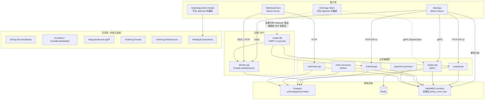
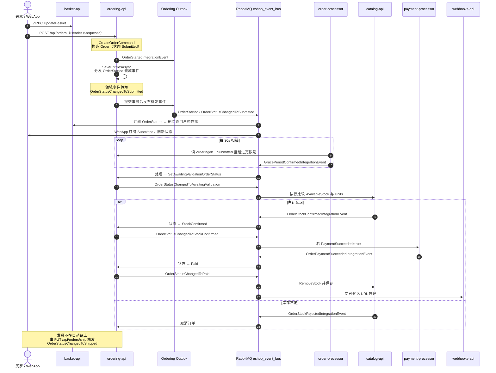

# eShop 架构设计研究

> 文档性质：按真实项目规划口径整理的架构设计说明，定位为**微服务 / 云原生参考架构**。  
> 研究范围：`/workspace/eShop`，提交 `913acea66708a59595351174cee9b29f37179d29`（`main`）。  
> 依据：AppHost、各服务 `Program.cs` / `Extensions`、csproj、集成事件、gRPC proto、`Directory.Packages.props`、`README.md` 及本地 Step 3 实测。未在源码或实测中出现的结论标为「推断」。  
> 撰写日期：2026-11-15（UTC+8）。

---

## 1. 项目背景与架构目标

eShop（对外展示名 “AdventureWorks”）是 .NET 官方的电子商务**参考应用**（`README.md`），用一套可运行的代码示范：

- 按业务能力拆分的**服务化架构**（商品、购物篮、订单、身份、支付、Webhook）；
- 用 **.NET Aspire** 做本地编排与云端部署入口，而不是手写大量 Docker Compose / Kubernetes 清单；
- 面向云原生运行时：容器中间件、服务发现、健康检查、OpenTelemetry、可部署到 **Azure Container Apps**。

本仓库当前基于 **.NET 10**（`global.json` 要求 SDK `10.0.302`，`rollForward: latestFeature`）和 **Aspire 13.6.0**（`aspire.config.json`、`Aspire.AppHost.Sdk/13.6.0`）。

从「真实项目规划」看，它同时承担三项目标：

| 目标 | 在本仓库中的体现 |
|---|---|
| 业务可演示 | WebApp 在线商店可浏览、加购、下单；Identity 预置 `alice` / `bob` |
| 架构可教学 | 订单上下文采用 DDD + CQRS（MediatR）+ Outbox；跨服务用集成事件，而不是共享数据库 |
| 工程可落地 | 统一 ServiceDefaults、集中包版本、Aspire 一键 `aspire run` / `aspire deploy` |

需要事先声明的边界（源码与 README 已写明，不宜当作生产模板原样上线）：

- IdentityServer 使用 `AddDeveloperSigningCredential()`，且 `KeyManagement.Enabled = false`（`Identity.API/Program.cs` 标注不适合生产）；
- 多个服务启动时自动 `AddMigration`（注释写明只为开发便利）；
- 支付是**模拟网关**（`PaymentOptions.PaymentSucceeded`，默认 `true`），没有对接真实 PSP；
- 部署到 ACA 时，PostgreSQL / Redis / RabbitMQ 以**容器**形式运行，README 写明仅用于评估和演示。

---

## 2. 架构总览

系统是典型的 **BFF + 业务微服务 + 消息中间件 + 每服务独立数据库** 结构。编排中心是 `src/eShop.AppHost`（`AppHost.cs`），用 Aspire 资源模型声明容器、数据库、项目和反向代理。



分层说明：

1. **体验层**：WebApp（主商店）、WebhookClient（订阅演示）、ClientApp / HybridApp（MAUI，源码在 `src/`，**未**出现在 `AppHost.cs` 的 `AddDotnetProject` 列表中）。
2. **边缘层**：`identity-api` 作为统一认证授权；`mobile-bff` 为移动端提供 YARP 聚合入口（路由覆盖 catalog、orders、identity，**源码中没有 basket 路由**）。
3. **业务服务层**：按限界上下文拆分的独立进程（见第 3 节）。
4. **基础设施层**：Postgres + pgvector、Redis、RabbitMQ；可选 Microsoft Foundry / Ollama（AI）。

WebApp 对商品图还使用 YARP 转发：`MapForwarder("/product-images/{id}", "https+http://catalog-api", "/api/catalog/items/{id}/pic")`（`WebApp/Program.cs`）。

---

## 3. 微服务拆分与限界上下文

拆分原则可以概括为：**一个业务能力、一套数据、一个可独立部署的进程**。订单上下文在进程内再按 DDD 分层（Domain / Infrastructure / API）。

### 3.1 服务一览

| 限界上下文 / 进程 | 项目 | 职责 | 数据存储 | 对外接口 | 备注 |
|---|---|---|---|---|---|
| 身份 | `Identity.API` | 登录、发令牌、客户端与 Scope 配置 | Postgres `identitydb`（ASP.NET Identity + IdentityServer EF） | HTTP（MVC + IdentityServer 端点）、对外暴露 | 预置用户 `alice` / `bob`，密码 `Pass123$` |
| 商品目录 | `Catalog.API` | 商品/品牌/类型 CRUD、图片、语义检索、库存校验与扣减 | Postgres `catalogdb`（含 `vector(384)` 列 `Embedding`） | HTTP REST，API v1.0 / v2.0 | OpenAPI + Scalar |
| 购物篮 | `Basket.API` | 用户购物篮读写与清空 | Redis（`RedisBasketRepository`） | gRPC：`GetBasket` / `UpdateBasket` / `DeleteBasket` | `basket.proto`；HTTP/2 |
| 订单 | `Ordering.API` + `Ordering.Domain` + `Ordering.Infrastructure` | 下单、状态机、查询、取消/发货 | Postgres `orderingdb` | HTTP REST，API v1.0，需授权 | DDD + CQRS（MediatR）+ Outbox |
| 宽限期处理 | `OrderProcessor` | 轮询已过宽限期的 Submitted 订单 | 只读查询 `orderingdb`（`AddNpgsqlDataSource`，非 EF） | 几乎无业务 HTTP；有 `/health` | Worker / `BackgroundService` |
| 支付（模拟） | `PaymentProcessor` | 收到库存确认后模拟支付成败 | 无自有库 | `/health` | `PaymentSucceeded` 默认 `true` |
| Webhook | `Webhooks.API` | 订阅登记与事件投递 | Postgres `webhooksdb` | HTTP REST `/api/webhooks`，API v1.0，需授权 | |
| 商店前端 | `WebApp` | 浏览、购物车、结账、订单状态通知、可选聊天 | 无自有库；订阅事件总线 | Blazor Server | 引用 `WebAppComponents` |
| Webhook 演示客户端 | `WebhookClient` | 接收并展示 hook | 进程内仓库 | Blazor Server + `/webhook-received` | |
| 移动网关 | `mobile-bff`（无独立 csproj） | YARP 反向代理 | 无 | 对外 HTTP/HTTPS | 镜像 `mcr.microsoft.com/dotnet/nightly/yarp:2.3-preview` |

共享、非进程：

- `eShop.ServiceDefaults`：健康检查、OTel、服务发现、JWT、OpenAPI；
- `EventBus` / `EventBusRabbitMQ`：集成事件抽象与 RabbitMQ 实现；
- `IntegrationEventLogEF`：Outbox 日志；
- `src/Shared`：以 `<Compile Include>` 链入的迁移与 Activity 扩展，不是独立项目；
- `WebAppComponents`：WebApp 与 HybridApp 复用的 Razor 组件。

### 3.2 订单上下文内部结构（DDD / CQRS）

`Ordering.API` 通过 MediatR 注册：

- `RegisterServicesFromAssemblyContaining(typeof(Program))`
- 管道行为：`LoggingBehavior`、`ValidatorBehavior`（FluentValidation）、`TransactionBehavior`（事务提交后再发布 Outbox 事件）

领域模型在 `Ordering.Domain`：聚合 `Order`、`Buyer`；状态枚举（`OrderStatus.cs`）：

`Submitted → AwaitingValidation → StockConfirmed → Paid → Shipped`，以及可转入的 `Cancelled`。

领域事件（`INotification`，进程内由 `OrderingContext.SaveEntitiesAsync` → `DispatchDomainEventsAsync` 分发）再被转成集成事件写入 Outbox。写命令走 Command，读订单列表/详情走 `IOrderQueries`（CQRS）。重复提交用 `IdentifiedCommand` + `IRequestManager` 和请求头 `x-requestid` 做幂等。

### 3.3 REST / gRPC 接口（摘自路由映射）

**Catalog**（`CatalogApi.cs`，组前缀 `api/catalog`）：

- v1/v2 均有：`GET /items`、`GET /items/by`、`GET /items/{id}`、`GET /items/{id}/pic`、`GET /items/facets`、`GET /catalogtypes`、`GET /catalogbrands`、`POST /items`、`DELETE /items/{id}`
- 仅 v1：`GET /items/by/{name}`、`GET /items/type/{typeId}/brand/{brandId?}`、`GET /items/type/all/brand/{brandId?}`、`GET /items/withsemanticrelevance/{text}`、`PUT /items`
- 仅 v2：`GET /items/withsemanticrelevance`、`PUT /items/{id}`

**Ordering**（`OrdersApi.cs`，`api/orders`，v1.0，`RequireAuthorization`）：

`POST /`（创建）、`POST /draft`、`GET /`、`GET /{orderId}`、`GET /cardtypes`、`PUT /cancel`、`PUT /ship`。

**Webhooks**（`WebHooksApi.cs`，`/api/webhooks`，v1.0，需授权）：`GET /`、`GET /{id}`、`POST /`、`DELETE /{id}`。

**Basket gRPC**（`basket.proto`，包名 `BasketApi`）：

```
service Basket {
  rpc GetBasket(GetBasketRequest) returns (CustomerBasketResponse);
  rpc UpdateBasket(UpdateBasketRequest) returns (CustomerBasketResponse);
  rpc DeleteBasket(DeleteBasketRequest) returns (DeleteBasketResponse);
}
```

消息字段目前仅有 `product_id`、`quantity`。Basket 健康检查在实测中只接受 HTTP/2（`curl --http2-prior-knowledge`）。

### 3.4 集成事件：发布与订阅（真实类型名）

RabbitMQ 交换机名为 **`eshop_event_bus`**（direct），routing key 为事件 **CLR 类型名**（`RabbitMQEventBus.PublishAsync`）。各服务队列名来自 `appsettings.json` 的 `EventBus:SubscriptionClientName`。

| 事件类型名 | 主要发布方 | 订阅方（`AddSubscription`） | 作用（据处理器代码） |
|---|---|---|---|
| `OrderStartedIntegrationEvent` | Ordering（创建订单时写入 Outbox） | Basket（`SubscriptionClientName=Basket`） | 按下单用户清空购物篮 |
| `OrderStatusChangedToSubmittedIntegrationEvent` | Ordering（订单开始、Buyer 校验后） | WebApp（`Ordering.webapp`） | UI 订单状态通知 |
| `GracePeriodConfirmedIntegrationEvent` | OrderProcessor（宽限期到期） | Ordering | 转为 `AwaitingValidation` |
| `OrderStatusChangedToAwaitingValidationIntegrationEvent` | Ordering | Catalog、WebApp | Catalog 校验库存 |
| `OrderStockConfirmedIntegrationEvent` | Catalog（库存充足） | Ordering | 转为 `StockConfirmed` |
| `OrderStockRejectedIntegrationEvent` | Catalog（库存不足） | Ordering | 取消订单 |
| `OrderStatusChangedToStockConfirmedIntegrationEvent` | Ordering | PaymentProcessor、WebApp | 触发模拟支付 |
| `OrderPaymentSucceededIntegrationEvent` | PaymentProcessor | Ordering | 转为 `Paid` |
| `OrderPaymentFailedIntegrationEvent` | PaymentProcessor | Ordering | 支付失败路径（取消等） |
| `OrderStatusChangedToPaidIntegrationEvent` | Ordering | Catalog、Webhooks、WebApp | Catalog **扣减库存** `RemoveStock`；Webhook 投递 |
| `OrderStatusChangedToShippedIntegrationEvent` | Ordering（`PUT /ship`） | Webhooks、WebApp | 发货通知 |
| `OrderStatusChangedToCancelledIntegrationEvent` | Ordering | WebApp | 取消通知 |
| `ProductPriceChangedIntegrationEvent` | Catalog（更新商品价格时，走 Outbox） | Webhooks | 价格变更 hook |

说明：同一事件类型在多个项目中**各有一份 record 定义**（没有统一的「Events.Contracts」项目）。这是参考实现的做法；真实项目通常会抽共享契约包，此处标为可改进点，不是源码里已存在的包。

---

## 4. 服务间通信

### 4.1 同步调用

- **HTTP REST + API 版本**：WebApp 用 `AddHttpClient<CatalogService>`（`https+http://catalog-api`，API **2.0**）和 `AddHttpClient<OrderingService>`（`https+http://ordering-api`，API **1.0**），并 `AddAuthToken()` 传递 access_token。`https+http://` 是 Aspire 服务发现的多 scheme 写法。
- **gRPC**：WebApp `AddGrpcClient<Basket.BasketClient>`，地址 `http://basket-api`。ClientApp 同样编译 `basket.proto` 作为客户端。
- **YARP**：
  - AppHost `mobile-bff` 将 `/catalog-api/...`、`/api/catalog/{*any}`、`/api/orders/{*any}`、`/identity/{*any}` 转到对应服务，并用查询参数 `api-version` 做精确匹配（1.0 / 1 / 2.0，视路由而定）；
  - WebApp 进程内转发商品图（见第 2 节）。
- HttpClient 默认带 **Standard Resilience** 与 **Service Discovery**（ServiceDefaults）。

ClientApp 通过设置项保存 `IdentityEndpointBase`、`GatewayCatalogEndpointBase`、`GatewayOrdersEndpointBase`、`GatewayBasketEndpointBase`。**推断**（非 AppHost 硬编码）：Catalog / Orders / Identity 基址可指向 `mobile-bff`；Basket 走独立 gRPC 基址，因为 YARP 配置里没有 basket 路由。ClientApp 与 HybridApp 均未加入 AppHost 编排。

### 4.2 异步：RabbitMQ EventBus 与 Outbox

抽象：`IEventBus.PublishAsync(IntegrationEvent)`。实现：`EventBusRabbitMQ`，用 `Aspire.RabbitMQ.Client` 建立连接，以 HostedService 消费，队列名为各服务 `SubscriptionClientName`，发布带 OpenTelemetry 上下文注入，投递模式 Persistent，发布失败用 Polly 重试（`EventBus:RetryCount`）。

**Outbox（Ordering）**：

1. 命令处理器调用 `AddAndSaveEventAsync`，把事件与当前 EF 事务一并写入 `IntegrationEventLog`；
2. `TransactionBehavior` 在 `CommitTransactionAsync` 之后调用 `PublishEventsThroughEventBusAsync(transactionId)`；
3. 逐条 `MarkEventAsInProgress` → `PublishAsync` → `MarkEventAsPublished`，失败则 `MarkEventAsFailed`。

**Outbox（Catalog）**：价格变更与库存确认/拒绝通过 `SaveEventAndCatalogContextChangesAsync`（与业务库同一局部事务）再 `PublishThroughEventBusAsync`。支付成功后的扣库存只 `SaveChangesAsync`，不再向外发事件。

OrderProcessor、PaymentProcessor 直接 `eventBus.PublishAsync`，**没有** Outbox（进程无业务库或仅只读库）。真实项目中若要求「至少投递一次」，这两个进程也需要落盘或事务发件箱——此为规划建议，不是当前实现。

### 4.3 下单主路径时序（源码路径）

宽限期默认 **1 分钟**，扫描间隔 **30 秒**（`OrderProcessor/appsettings.json`：`GracePeriodTime=1`，`CheckUpdateTime=30`）。支付默认成功。



---

## 5. 数据架构

采用 **Database per Service**（由 AppHost 中「一库一资源、按需引用」落实，而不是一个共享业务库）：

| 资源名（AppHost） | 引擎 | 归属 | 说明 |
|---|---|---|---|
| `postgres`（镜像 `ankane/pgvector:latest`） | PostgreSQL + pgvector | 共享引擎实例 | Persistent 容器；其上建 4 个逻辑库 |
| `catalogdb` | PostgreSQL | Catalog.API | 商品、类型、品牌、图片路径、`Embedding vector(384)`、Outbox 表 |
| `identitydb` | PostgreSQL | Identity.API | 用户与 IdentityServer 存储 |
| `orderingdb` | PostgreSQL | Ordering.API 读写；OrderProcessor 按 SQL 查询宽限期订单 | 订单/买家聚合、幂等、Outbox |
| `webhooksdb` | PostgreSQL | Webhooks.API | 订阅记录 |
| `redis` | Redis 8.x（Aspire 默认镜像，本地实测 `redis:8.6`） | Basket.API | 购物篮；以 TLS/明文双端口暴露 |

没有独立的「报表库」或跨服务 Join。跨上下文一致性靠集成事件，属于**最终一致**。Catalog 在「待校验」时只检查库存、不预扣；真正扣减发生在 **Paid** 之后（处理器注释：`we're not blocking stock/inventory`）。这是有意的简化；真实零售系统通常会引入预留（reservation）或补偿——标为规划差异，不是本仓库已实现的能力。

---

## 6. 身份认证与安全

`Identity.API` 使用 **Duende IdentityServer 7.3.2** + ASP.NET Identity（`AddIdentity` / `AddIdentityServer` / `AddAspNetIdentity` / `AddInMemory*` 资源配置）。Cookie 登录生命周期 2 小时。开发环境关闭密钥自动管理并使用开发签名证书。

资源与 Scope（`Configuration/Config.cs`）：API 资源/Scope 为 `orders`、`basket`、`webhooks`；身份资源为 `openid`、`profile`。

已登记的 OAuth/OIDC 客户端：

| ClientId | 类型 | 用途 |
|---|---|---|
| `webapp` | Authorization Code | WebApp；Redirect `/signin-oidc`；Scope 含 openid/profile/offline_access/orders/basket/webhooks 等 |
| `webhooksclient` | Authorization Code | WebhookClient；Scope 含 webhooks |
| `maui` | Authorization Code + PKCE | MAUI 客户端；回调来自配置 `MauiCallback` |
| `basketswaggerui` / `orderingswaggerui` / `webhooksswaggerui` | Implicit | 各 API 文档的调试登录 |

服务间保护：

- 资源 API 通过 ServiceDefaults 的 `AddDefaultAuthentication()` 使用 **JWT Bearer**，`Authority` 来自配置 `Identity:Url`，`Audience` 来自 `Identity:Audience`；DEBUG 下额外接受 `https://10.0.2.2:5243`（Android 模拟器）；
- WebApp / WebhookClient 使用 **Cookie + OpenIdConnect**（ClientSecret 在源码中为 `"secret"`，仅适合本地演示）；
- Ordering / Webhooks 的业务 API 映射了 `RequireAuthorization()`；
- AppHost 为所有 `DotnetProjectResource` 设置 `ASPNETCORE_FORWARDEDHEADERS_ENABLED=true`，便于反向代理场景。

---

## 7. 横切关注点

### 7.1 eShop.ServiceDefaults

几乎所有服务项目都引用该库（`AddServiceDefaults` 或 Basket/OrderProcessor 的 `AddBasicServiceDefaults`）：

- 健康检查：自检 `"self"`（tag `live`）；开发环境暴露 `/health`（全部检查）与 `/alive`（仅 live）；
- OpenTelemetry：日志、指标、追踪（ASP.NET、HttpClient、Runtime、gRPC 客户端、`Experimental.Microsoft.Extensions.AI`）；开发环境 `AlwaysOnSampler`；配置了 `OTEL_EXPORTER_OTLP_ENDPOINT` 则导出 OTLP（Aspire 仪表板会注入该端点）；
- 服务发现 + HttpClient 标准韧性处理器；
- JWT Bearer、API 版本与 OpenAPI、开发环境 Scalar UI。

### 7.2 API 版本与文档

Catalog、Ordering、Webhooks 使用 `Asp.Versioning`（`ReportApiVersions = true`）。WebApp 调用 Catalog 固定 2.0、Ordering 固定 1.0。

### 7.3 可选 AI

- **Catalog 语义搜索**：`ICatalogAI` / `CatalogAI`，嵌入维度常量 **384**，与库列 `vector(384)` 一致；端点 `withsemanticrelevance` 用余弦距离排序。未启用生成器时（`IsEnabled == false`）回退到普通查询。启用条件：`OllamaEnabled=true` 并引用 Ollama embedding，或连接串 `textEmbeddingModel`（Azure/OpenAI，由 Foundry 注入）。
- **WebApp 聊天**：有 `chatModel` 连接串或 Ollama `chat` 时构建 `IChatClient`，并 `UseFunctionInvocation()`。
- AppHost：`UseFoundry=true` 时部署 `gpt-4.1-mini` 与 `text-embedding-3-small`（`Extensions.AddFoundry`）；`AddOllama` 在 `AppHost.cs` 里写死 `bool useOllama = false`，需改源码才会编排 Ollama（模型名 `all-minilm` / `llama3.1`）。

`Directory.Build.props` 还打开了 `OpenAI.Experimental.EnableOpenTelemetry`。

---

## 8. 部署架构

### 8.1 本地（Aspire）

前置：满足 `global.json` 的 .NET 10 SDK、Aspire CLI、已运行的 OCI 运行时（Docker 或 Podman）。仓库根目录：

```bash
aspire run          # 或 aspire start / aspire ps / aspire stop
```

`aspire.config.json` 指定 AppHost 为 `src/eShop.AppHost/eShop.AppHost.csproj`，避免与测试项目里的 AppHost 混淆。

本机 Step 3 实测（2026-11-15）一次完整启动共 **17 个资源**，全部 Running / Healthy：

webapp、identity-api、catalog-api、basket-api、ordering-api、order-processor、payment-processor、webhooks-api、webhooksclient、mobile-bff、postgres、catalogdb、identitydb、orderingdb、webhooksdb、eventbus、redis。

常用本机端口（来自各项目 `launchSettings.json`，经 Aspire 使用这些 profile 时保持该端口）：WebApp `5045` / `7298`，Identity `5223` / `5243`，Catalog `5222`，Basket `5221`，Ordering `5224`，Payment `5226`，Webhooks `5227`，OrderProcessor `16888`，Dashboard `https://localhost:19888`。

已知本地问题（实测，不是推测）：第一轮因缺少 Docker Buildx，`mobile-bff` 依赖的隧道镜像 `docker build --progress` 失败；安装 buildx 并重启 AppHost 后进程变为 Healthy，但经 BFF 反代 Catalog 的 curl 仍可能超时。WebApp 不经过该 BFF，商店主路径不受影响。详见步骤记录 Step 3。

### 8.2 云端（Azure Container Apps）

`AppHost.cs` 调用 `builder.AddAzureContainerAppEnvironment("aca")`。仓库中**没有** `Dockerfile`、**没有** `azure.yaml` / bicep、**没有** azd 配置。官方路径是 Aspire CLI：

```bash
az login
aspire deploy --list-steps
aspire deploy
aspire publish    # 需要检查产物时；deploy 并不依赖事先 publish
aspire destroy    # 删除整个已配置资源组，需谨慎
```

README 要求 Azure CLI、有效订阅与建资源权限；非交互时通过 `Azure__SubscriptionId`、`Azure__Location`、`Azure__ResourceGroup` 提供参数。Foundry 相关包为 preview。

**推断**：`aspire deploy` 会按 AppHost 模型把各 `AddDotnetProject` 与容器资源发布到名为 `aca` 的 Container Apps 环境；具体镜像构建与 Ingress 规则以当时 Aspire 版本的发布管线为准，本文未实际执行部署，故不描述未见到的资源名。

### 8.3 CI

GitHub Actions：`eShop.Web.slnf` 构建与测试、MAUI（ClientApp 变更时）、Playwright（`ESHOP_USE_HTTP_ENDPOINTS=1`）、markdownlint。Azure DevOps `ci.yml` 在 `main` 上构建同一过滤方案。`build/` 下脚本仍引用旧版 eShopOnContainers 路径，**不能**作为现行发布管线。

---

## 9. 架构设计原则与模式汇总

| 模式 / 原则 | 在哪里用 | 作用 |
|---|---|---|
| 微服务 / 按业务能力拆分 | AppHost 中的独立项目与数据库资源 | 独立部署与扩展，避免共享业务库 |
| 限界上下文 | Identity / Catalog / Basket / Ordering / Payment / Webhooks | 模型与数据边界清晰 |
| DDD 聚合与领域事件 | `Ordering.Domain`、`OrderingContext.SaveEntitiesAsync` | 订单不变量留在聚合内，再映射为集成事件 |
| CQRS | Ordering 的 Command（MediatR）与 `IOrderQueries` | 写模型与读模型分离 |
| 中介者 + 管道行为 | Logging / Validation / TransactionBehavior | 统一事务、校验与 Outbox 发布时机 |
| 幂等命令 | `IdentifiedCommand`、`x-requestid`、`IRequestManager` | 防止重复下单/取消/发货 |
| 数据库每服务一份 | catalogdb / identitydb / orderingdb / webhooksdb / Redis | 服务自治，失败隔离 |
| 最终一致 + 集成事件 | RabbitMQ `eshop_event_bus` | 解耦下单、库存、支付、通知 |
| 事务发件箱（Outbox） | `IntegrationEventLogEF`（Ordering、Catalog） | 业务提交与事件发表尽量原子 |
| 宽限期（Grace Period） | OrderProcessor 定时扫描 Submitted | 给买家短暂的取消窗口后再校验库存（注释语义） |
| 模拟网关 | PaymentProcessor + `PaymentOptions` | 演示支付成败分支，无真实扣款 |
| API 网关 / BFF | `mobile-bff` YARP | 为移动端聚合 Catalog / Ordering / Identity |
| 后端为前端（Web BFF 特征） | WebApp 聚合 gRPC/HTTP 并转发图片 | 浏览器只面对 WebApp |
| 服务发现与韧性 | ServiceDefaults HttpClient | 本地/云上同一套调用方式 |
| 可观测性 | OpenTelemetry + Aspire Dashboard | 日志、追踪、指标集中查看 |
| 健康检查 | `/health`、`/alive`；AppHost 对部分服务 `WithHttpHealthCheck` | 编排就绪与探活 |
| JWT / OIDC | IdentityServer、API Bearer、Web OIDC | 集中认证，服务鉴权 |
| API 版本 | Asp.Versioning | Catalog 多版本并存 |
| 可选智能检索 | pgvector + CatalogAI | 语义搜索作为可插拔能力 |
| 参考实现不等于生产基线 | 开发证书、自动迁移、容器版数据服务 | 规划中需单独加固 |

---

## 10. 项目规划视角

若把本参考应用当作真实产品的起点，建议按限界上下文划分团队与里程碑，而不是按技术分层「前端组 / 后端组」一刀切。

### 10.1 建议的模块 / 团队划分

| 团队（建议） | 负责的进程与库 | 协作契约 |
|---|---|---|
| 体验与 BFF | WebApp、WebAppComponents、WebhookClient、mobile-bff 路由、MAUI 客户端 | 对内依赖稳定的 REST/gRPC 与 OIDC 客户端配置 |
| 身份与安全 | Identity.API、ServiceDefaults 中的认证扩展 | 发布 Scope、密钥与令牌寿命的变更公告 |
| 目录 | Catalog.API（含图片与向量检索） | 库存事件的订阅/发布合同 |
| 交易（购物篮 + 订单） | Basket.API、Ordering.*、OrderProcessor | 下单与宽限期 SLA |
| 支付与履约扩展 | PaymentProcessor（后期替换真实 PSP）、发货命令 | 支付成功/失败事件不变，替换实现 |
| 平台 | AppHost、EventBus*、IntegrationEventLogEF、CI/CD、可观测性 | 中间件版本、环境与部署流水线 |

### 10.2 建议迭代路线（规划，非仓库已排期）

| 里程碑 | 范围 | 完成标准（建议） |
|---|---|---|
| M0 可运行基线 | 已在本地完成：还原、构建、`aspire start`、WebApp 与核心 API 健康 | 17 资源可启动；商店可浏览（本环境已达到） |
| M1 主交易闭环加固 | 理清库存预留、支付失败补偿、Outbox 失败重放；为 Payment/OrderProcessor 补可靠投递 | 给定库存与支付开关，下单路径可重复验收 |
| M2 客户端对齐 | 明确 ClientApp 网关基址与 mobile-bff 路由（补 basket 或改客户端）；修本地 BFF 反代超时 | MAUI 与 Web 走同一套已文档化的入口 |
| M3 安全与配置生产化 | 替换开发签名证书与明文 ClientSecret；关闭自动 Migrate；密钥进 Key Vault / aspire secret | 安全评审清单通过 |
| M4 数据层生产化 | ACA 上把 Postgres/Redis/Rabbit 从「演示容器」换成托管服务；备份与迁移策略 | README 中的演示警告被正式架构取代 |
| M5 可观测与质量 | 契约测试覆盖集成事件；负载下的宽限期与 Outbox；e2e（Playwright）纳入发布门禁 | SLO 与告警落地 |
| M6 可选智能能力 | 按需打开 Foundry 或自建嵌入服务，明确 384 维模型选型 | 语义检索在预发生成后可回归 |

### 10.3 已知问题与风险（来自源码或实测）

| 项 | 性质 | 说明 |
|---|---|---|
| 本地 mobile-bff 反代超时 | 实测 | 进程可 Healthy，经 BFF 访问 Catalog 的 curl 可能超时；WebApp 主路径不依赖它 |
| 无 Docker/azd 清单 | 源码事实 | 部署绑定 Aspire 发布管线，迁移到非 Aspire 平台需要另做包装 |
| `build/` 旧脚本 | 源码事实 | 路径仍是 eShopOnContainers，不可用 |
| 事件契约重复定义 | 源码事实 | 多项目各写一份 record，演进时容易漂移 |
| 库存不预扣 | 源码注释 + 处理器逻辑 | Paid 才 `RemoveStock`，高并发下可能超卖 |
| 支付为开关模拟 | 源码 + `appsettings.json` | 不能直接用于真实收款 |
| 开发用证书与自动迁移 | 源码 TODO/注释 | 生产必须替换 |
| ClientApp / HybridApp 未编排 | AppHost 未引用 | 本地 `aspire run` 不会启动移动客户端 |
| Ollama 默认关闭 | `useOllama = false` | 打开需改 AppHost |
| 公开演示密钥 | Config 中 ClientSecret 为 `secret` | 仅限本地 |

---

## 附录：主要阅读文件

- `src/eShop.AppHost/AppHost.cs`、`Extensions.cs`、`eShop.AppHost.csproj`、`Properties/launchSettings.json`
- `src/eShop.ServiceDefaults/*`（尤其 `Extensions.cs`、`AuthenticationExtensions.cs`、`OpenApi.Extensions.cs`）
- 各服务 `Program.cs`、`Extensions/Extensions.cs`、`appsettings.json`、`*.csproj`
- `src/Basket.API/Proto/basket.proto`
- `src/Catalog.API/Apis/CatalogApi.cs`、`Services/CatalogAI.cs`
- `src/Ordering.API/Apis/OrdersApi.cs`、`Application/Commands/CreateOrderCommandHandler.cs`、`Application/Behaviors/TransactionBehavior.cs`、`Application/IntegrationEvents/*`
- `src/Ordering.Domain/AggregatesModel/OrderAggregate/OrderStatus.cs`、`Ordering.Infrastructure/OrderingContext.cs`
- `src/OrderProcessor/Services/GracePeriodManagerService.cs`、`GracePeriodOrdersRepository.cs`
- `src/PaymentProcessor/IntegrationEvents/EventHandling/OrderStatusChangedToStockConfirmedIntegrationEventHandler.cs`、`PaymentOptions.cs`
- `src/EventBusRabbitMQ/RabbitMQEventBus.cs`、`IntegrationEventLogEF/*`
- `src/Identity.API/Program.cs`、`Configuration/Config.cs`
- `src/WebApp/Program.cs`、`Extensions/Extensions.cs`、`Services/OrderingService.cs`
- `src/ClientApp/Services/Settings/SettingsService.cs`
- `global.json`、`aspire.config.json`、`Directory.Packages.props`、`README.md`、`eShop.slnx`
- 本地步骤记录 Step 3（17 资源实测与 mobile-bff 问题）

**本文结论均对应上述材料；规划里程碑与团队划分属于建议，已在文中标明。**
