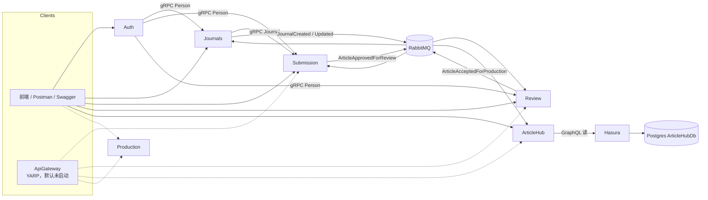
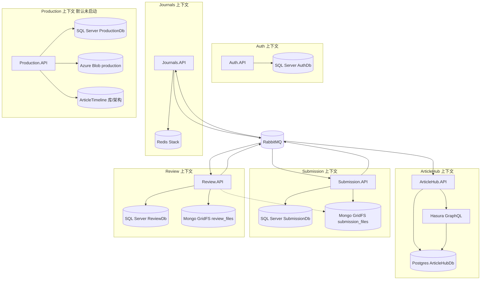
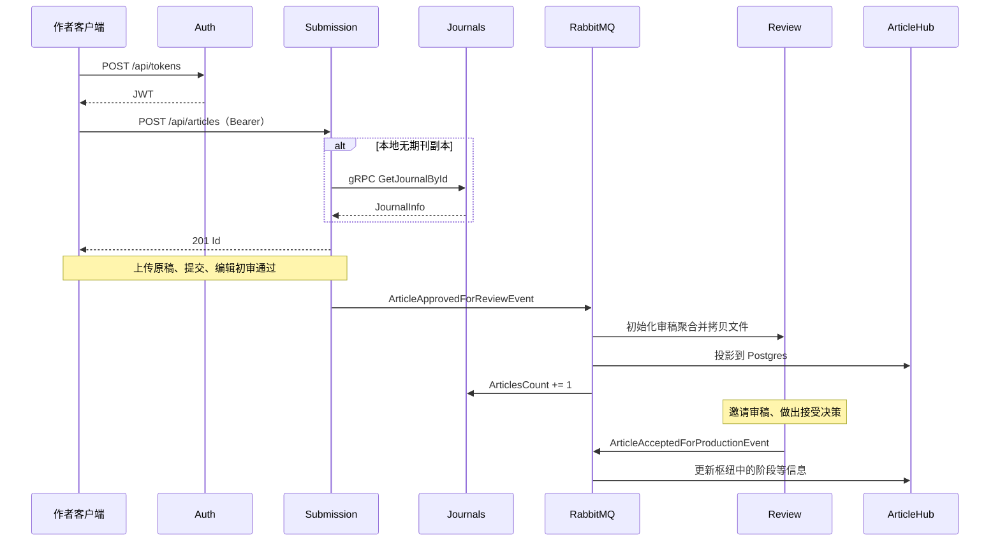

# Articles 微服务架构设计文档

> 文档版本：v1（完整长文，按源码与本地实测撰写，不另出简短版）  
> 对应源码：上游仓库 [ldumit/Articles](https://github.com/ldumit/Articles.git)，本地检出路径 `/workspace/Articles`，分支 `master`，提交 `63ee8c086a69725c9ac5dbc3e7d8f9ce0dc00721`。分析过程中未更新、未修改该源码。  
> 本地编排实测：Step 1 已在同一台 Linux 机器上完成，Docker Compose 拉起中间件，主机 `dotnet run` 启动 5 个业务 API（Auth 4401、Journals 4402、ArticleHub 4403、Submission 4404、Review 4405）。eShop Aspire 与 Articles 服务在分析期间保持运行，本文未重新部署、也未停服务。  
> 正文字数（中文字符 + 英文单词，不计代码块、不计纯路径/命令行）：**17753**。源码摘录 **70** 段。  
> 文档性质：基于源码与 Step 1 实测的架构研究，按真实项目规划的写法组织；不是上游课程讲义的翻译，也不是尚未落地的设计草案。上游 `docs/architecture/README.md` 已说明本仓库带有课程教学意图，本文会引用该说明，但结论一律回到代码与配置。  
> 机密处理：JWT 秘钥、数据库口令、Hasura Admin Secret、种子用户口令、Azure 存储密钥、SMTP 口令等一律替换为占位符（`<REDACTED_DEMO_SECRET>`、`<DEV_DB_PASSWORD>`、`<HASURA_ADMIN_SECRET>`、`<SEED_DEFAULT_PASSWORD>`、`<DEV_DB_USER>`），不把真实密钥写入本文。

## 文档说明

Articles 是一套面向学术期刊投稿、审稿与出版流程的 .NET 9 微服务示例。它要解决的业务问题可以概括为：作者在某个期刊下创建稿件、上传稿件与补充材料、提交给编辑做初审；初审通过后，稿件进入同行评议；评议接受后再进入生产与正式发表。围绕这条生命周期，仓库拆出了身份（Auth）、期刊主数据（Journals）、稿件只读枢纽（ArticleHub）、投稿（Submission）、审稿（Review）和尚未纳入默认启动的生产（Production）等服务，并配套 API 网关、消息契约、文件存储模块和 Hasura GraphQL。

和官方参考应用 eShop 相比，Articles 有几处必须先说清楚的差异，否则后续选型很容易被“都是 .NET 微服务”带偏：

1. **没有 Aspire。** 本地编排真相来源是 `src/docker-compose.yml` 与 `src/docker-compose.override.yml`，而不是 AppHost。业务 API 既可以按 compose 构建镜像，也可以（也是 Step 1 实际采用的方式）只让 compose 托管中间件，再在宿主机上 `dotnet run`。
2. **目标框架是 `net9.0`，不是 .NET 10。** 所有业务项目和 BuildingBlocks 都写死 `net9.0`。Step 1 已验证：用 .NET 10 roll-forward 跑 Auth 迁移会触发 `PendingModelChangesWarning`，必须安装 .NET 9 运行时。
3. **这是带教学痕迹的仓库。** 源码里大量 `talk -`、`todo` 注释，上游 `docs/architecture/README.md` 明确写了“Once a pattern is demonstrated clearly, we don’t re-implement it everywhere”。因此同一套能力在不同服务里的落地并不对称：有的用 FastEndpoints，有的用 Carter，有的用手写 Minimal API；有的有完整领域层，有的把应用逻辑放在 API 项目里。把这种不对称当成“生产级一致性不足”是合理的批评，但首先应理解为教学选择。
4. **默认启动面小于解决方案面。** 解决方案 `Articles.sln` 含 62 个项目，包括 Production、ApiGateway、Email/File/Timeline 模块。compose 里 `production-api` 被整段注释；ApiGateway 不在 compose 服务列表中；Step 1 没有启动这两项。架构分析必须同时写“仓库里有什么”和“默认真正跑起来的是什么”。

本文按真实项目规划展开：技术选型、项目框架、服务拆分、模块通信、认证授权、数据一致性、配置环境、开发部署测试，以及 Step 1 已经证实的限制。所有代码块都是 `/workspace/Articles` 中文件的原文摘录，标注相对路径和行号；可用 `// ...` 省略无关行，但出现的每一行都来自对应文件。

## 目录

- [1. 技术选型](#1-技术选型)
  - [1.1 选型原则](#11-选型原则)
  - [1.2 完整技术栈表](#12-完整技术栈表)
  - [1.3 关键技术的源码落地](#13-关键技术的源码落地)
  - [1.4 替代方案对比](#14-替代方案对比)
- [2. 项目框架](#2-项目框架)
  - [2.1 解决方案与目录结构](#21-解决方案与目录结构)
  - [2.2 中央包管理与构建约定](#22-中央包管理与构建约定)
  - [2.3 BuildingBlocks 与共享契约](#23-buildingblocks-与共享契约)
  - [2.4 Modules：可替换的横切能力](#24-modules可替换的横切能力)
  - [2.5 典型服务内部分层](#25-典型服务内部分层)
- [3. 服务拆分](#3-服务拆分)
  - [3.1 拆分原则与生命周期映射](#31-拆分原则与生命周期映射)
  - [3.2 Auth](#32-auth)
  - [3.3 Journals](#33-journals)
  - [3.4 ArticleHub](#34-articlehub)
  - [3.5 Submission](#35-submission)
  - [3.6 Review](#36-review)
  - [3.7 Production](#37-production)
  - [3.8 ApiGateway](#38-apigateway)
  - [3.9 数据归属总图](#39-数据归属总图)
- [4. 模块通信](#4-模块通信)
  - [4.1 通信总图](#41-通信总图)
  - [4.2 HTTP API 的三种写法](#42-http-api-的三种写法)
  - [4.3 gRPC（protobuf-net 契约优先）](#43-grpcprotobuf-net-契约优先)
  - [4.4 集成事件与 MassTransit / RabbitMQ](#44-集成事件与-masstransit--rabbitmq)
  - [4.5 Hasura / GraphQL 读模型](#45-hasura--graphql-读模型)
  - [4.6 领域事件到集成事件的桥接](#46-领域事件到集成事件的桥接)
- [5. 认证与授权](#5-认证与授权)
- [6. 数据一致性、状态机与文件](#6-数据一致性状态机与文件)
- [7. 配置与环境](#7-配置与环境)
- [8. 开发](#8-开发)
- [9. 部署](#9-部署)
- [10. 测试](#10-测试)
- [11. 已知限制与风险](#11-已知限制与风险)
- [12. 模式总结、优缺点与规划建议](#12-模式总结优缺点与规划建议)
- [附录 A：本文引用的源码文件](#附录-a本文引用的源码文件)

---

## 1. 技术选型

技术选型不是一份流行清单，而是一组互相约束的决定：目标框架决定能引用哪些包，编排方式决定本地进程和容器如何共生，通信方式决定服务契约和故障边界，数据存储决定一致性与扩展方式。Articles 没有 `global.json`，也没有 Aspire 清单，选型的第一条线索是 `src/Directory.Packages.props` 里的中央包版本，以及各 `*.csproj` 中的 `TargetFramework`。

### 1.1 选型原则

从源码组织、compose 文件和上游课程说明，可以归纳出五条原则。原则本身是对结构的解读，不是仓库里单独的架构决策记录。

1. **以 .NET 9 统一语言和运行时。** 业务服务、BuildingBlocks、Modules、网关全部面向 `net9.0`。好处是同一套依赖注入、配置、日志和 Options 模式可以在所有服务复用；代价是与本机若已安装的更新 SDK（例如本环境同时存在 .NET 10）必须小心 roll-forward，不能默认“新 SDK 一定能跑旧目标框架的迁移”。
2. **按投稿生命周期拆限界上下文，而不是按技术层拆。** Auth、Journals、Submission、Review、Production 对应身份、期刊主数据、投稿、审稿、生产五个上下文；ArticleHub 则是一个跨阶段的只读/检索枢纽，用 Postgres 加 Hasura 对外提供 GraphQL。每个上下文拥有自己的数据库（或 Redis、或文件桶），跨上下文同步靠集成事件，必要时用 gRPC 做点查。
3. **同步查询走 RPC 或 HTTP，跨上下文状态变化走消息。** 创建稿件时若本地还没有期刊副本，Submission 会通过 gRPC 向 Journals 拉取期刊信息并落本地副本；期刊新建、稿件初审通过、稿件接受进入生产，则发布 `JournalCreatedEvent`、`ArticleApprovedForReviewEvent`、`ArticleAcceptedForProductionEvent`，由下游各自投影。这样一条 HTTP 请求不会同时改多个服务的数据库。
4. **横切能力下沉到 BuildingBlocks 和 Modules，业务能力留在服务内。** JWT 校验、异常中间件、MassTransit 注册、EF 拦截器、MediatR 管道、Hasura 客户端都在 `Blocks.*` / `Articles.*` 共享库中；邮件和文件存储以可替换模块存在（Empty / Smtp / SendGrid，Mongo GridFS / Azure Blob / MinIO）。服务通过组合这些库来启动，而不是复制样板。
5. **为教学保留多种实现，而不是先追求全仓一致。** 同一“HTTP API”能力同时出现 FastEndpoints、Carter、手写 Minimal API 三种形态；同一“文件存储”预留三种提供程序；邮件在开发环境默认走 `EmptyEmailService`。这降低了“照着一个服务抄出下一个服务”的一致性，但让课程可以在不同章节演示不同库。若要把本仓库当生产起点，第一件事应是收敛 API 风格和启动模板。

这五条原则贯穿后文。只记技术名词、不记原则，就很难理解 Journals 为何把主存储放在 Redis，而 ArticleHub 为何在 EF 写入之外再引入 Hasura。

### 1.2 完整技术栈表

下表版本均摘自 `src/Directory.Packages.props` 或对应 `csproj` / compose 文件，采集基准为提交 `63ee8c086a69725c9ac5dbc3e7d8f9ce0dc00721`。“用在哪里”是源码事实；“为什么选”是结合用法给出的架构解读，不是上游官方声明。

| 类别 | 技术 | 版本（来源） | 用在哪里 | 为什么选（解读） |
| --- | --- | --- | --- | --- |
| 运行时 / SDK | .NET / ASP.NET Core | 目标框架一律 `net9.0`（各 csproj）；配套包如 `Microsoft.AspNetCore.OpenApi`、`Microsoft.AspNetCore.Authentication.JwtBearer`、`Microsoft.EntityFrameworkCore.*` 为 `9.0.8`。本机 Step 1 安装并使用 ASP.NET Core / .NET 运行时 `9.0.23`。 | 全部服务与共享库 | 统一语言、DI、配置和部署单元；必须与 SDK 8 的 Dockerfile 构建阶段区分开（见第 9、11 节） |
| 编排 | Docker Compose | 仓库内 `docker-compose.yml` + `docker-compose.override.yml`；本机补装 Compose 插件 `v5.7.1`。无 Aspire。 | 中间件与（设计上的）API 容器 | 用声明式文件同时描述 SQL Server、Postgres、Redis、Mongo、RabbitMQ、Hasura 及业务镜像依赖 |
| Web 框架 | ASP.NET Core | 随 .NET 9 | 所有 `*.API` 与 ApiGateway | 进程模型简单，适合每服务一个可独立部署的 Web 主机 |
| HTTP API（风格一） | FastEndpoints | `7.0.1`，另有 `FastEndpoints.Swagger`、`FastEndpoints.Messaging.Core` | Auth、Journals；Production 也调用 `UseFastEndpoints` | 以 Endpoint 类组织命令，内置校验与 Swagger，适合按功能文件夹划分的垂直切片 |
| HTTP API（风格二） | Carter | `9.0.0` | ArticleHub、Review 通过 `MapCarter()` | 用模块把 Minimal API 路由按特性分组，教学上与 FastEndpoints 对照 |
| HTTP API（风格三） | 手写 Minimal API | 无额外包 | Submission 的 `MapAllEndpoints()`；部分 Production 控制器 | 直接 `MapPost` / `ISender`，把“端点只是适配器”演示得最浅 |
| 文档 | Swashbuckle + FastEndpoints.Swagger | `Swashbuckle.AspNetCore` `9.0.3`；FastEndpoints.Swagger `7.0.1` | 各 API 的 `/swagger` | Step 1 已在 4401–4405 打开 Swagger UI |
| 身份存储 | ASP.NET Core Identity + EF | `Microsoft.AspNetCore.Identity` `2.3.1`；`Microsoft.AspNetCore.Identity.EntityFrameworkCore` `9.0.8` | Auth 的 User / Role / SignInManager | 复用锁账户、角色、令牌提供程序，不必自写口令哈希 |
| 认证 | JWT Bearer（对称密钥） | `Microsoft.AspNetCore.Authentication.JwtBearer` `9.0.8` | Auth 签发；其余 API 校验 | 服务间无独立授权服务器，靠共享 `JwtOptions:Secret`；实现简单，生产风险见第 5、11 节 |
| 网关 | YARP | `Yarp.ReverseProxy` `2.3.0` | `ApiGateway` | 进程内反向代理，路由来自配置。当前端口表过时，且未纳入 compose |
| RPC | gRPC + protobuf-net.Grpc（契约优先） | `Grpc.AspNetCore` / `Grpc.Net.Client` / `Grpc.Net.ClientFactory` `2.71.0`；`Grpc.Tools` `2.72.0`；`protobuf-net` / `protobuf-net.Core` `3.2.56`；`protobuf-net.Grpc` 与 `protobuf-net.Grpc.AspNetCore` `1.2.2` | Auth 的 `PersonGrpcService`、Journals 的 `JournalGrpcService`；Submission / Review / Journals 作为客户端 | 用 proto 定义人员与期刊查询契约，运行时用 protobuf-net 的 code-first 宿主，适合低延迟点查 |
| CQRS 中介 | MediatR | `13.0.0`，`MediatR.Contracts` `2.0.1` | Submission、Review 的命令与通知处理，以及领域事件发布 | 把用例从端点中拆出，并统一接入校验、日志、赋值用户 |
| 校验 | FluentValidation | `12.0.0`，含 `FluentValidation.DependencyInjectionExtensions` | 命令校验器；FastEndpoints 错误整形；GraphQL 错误包装 | 与 MediatR `ValidationBehavior`、全局异常中间件组成统一 400 响应 |
| 映射 | Mapster（主） / AutoMapper（并存） | `Mapster` `7.4.0`；`AutoMapper` `15.0.1` | 集成事件 DTO、gRPC 映射；部分项目仍引用 AutoMapper | 教学仓库常见的“主路径用 Mapster，个别项目残留 AutoMapper” |
| 数据访问（关系库） | EF Core | `Microsoft.EntityFrameworkCore*` `9.0.8` | Auth、Submission、Review、Production、ArticleHub、ArticleTimeline | 官方 ORM，配合启动时 `Database.Migrate()` |
| SQL Server 提供程序 | `Microsoft.EntityFrameworkCore.SqlServer` | `9.0.8` | Auth、Submission、Review、Production | 这些服务的主库都是 SQL Server，库名按服务隔离 |
| PostgreSQL 提供程序 | `Npgsql.EntityFrameworkCore.PostgreSQL` | `9.0.4` | ArticleHub | 为 Hasura 提供可被 track 的关系模型 |
| 命名约定 | `EFCore.NamingConventions` | `9.0.0` | 被 BuildingBlocks / 部分持久化项目引用 | 便于与 Hasura 的命名约定对齐 |
| 期刊主存储 / 搜索 | Redis Stack + Redis.OM + StackExchange.Redis | 镜像 `redis/redis-stack`；`Redis.OM` `1.0.1`；`StackExchange.Redis` `2.9.11` | Journals 的 Journal / Editor 文档与全文检索 | 期刊是读多写少、需要按名称搜索的主数据，用 Redis JSON + 搜索索引避免再引入 Elasticsearch |
| 消息总线 | MassTransit + RabbitMQ | `MassTransit.RabbitMQ` `8.5.2`；镜像 `rabbitmq:management` | Journals、Submission、Review、ArticleHub 的发布与消费 | 用消费者扫描 + 自定义队列名格式，降低手写交换机绑定的样板 |
| GraphQL 引擎 | Hasura | 镜像 `hasura/graphql-engine`；客户端 `GraphQL.Client` / `GraphQL.Client.Serializer.SystemTextJson` `6.1.0`；元数据调用用 Refit `8.0.0` | ArticleHub 读模型；启动时尝试自动 track 表与关系 | 把“查稿件列表/详情”交给 GraphQL 引擎，API 侧做写和投影 |
| 文件存储 | MongoDB GridFS / Azure Blob / MinIO | `MongoDB.Driver` `3.4.3`，镜像 `mongo:6.0`；`Azure.Storage.Blobs` `12.25.0`；`Minio` `6.0.5` | Submission、Review 默认注册 Mongo GridFS；Production 注册 Azure；合约在 `FileStorage.Contracts` | 文件与关系数据分离；Review 还能同时挂 Submission 桶，以便初审通过后把文件拷到审稿桶 |
| 邮件 | 空实现 / MailKit / SendGrid | `MailKit` `4.13.0`；`SendGrid` `9.29.3` | Auth、Submission、Review 当前调用 `AddEmptyEmailService`；Smtp/SendGrid 模块存在但默认注释 | 开发环境不依赖真实 SMTP，避免课程环境发信失败 |
| 状态机 | Stateless | `5.19.0` | Submission、Review、Production 的 `ArticleStateMachine` | 用库表达阶段-动作许可；转移表来自数据库缓存，而不是写死在代码里 |
| HTTP 韧性 | Polly（经 `Microsoft.Extensions.Http.Polly` `9.0.8`） | 在 `AddConfiguredGrpcClient1` 中按配置重试 | 预留的 gRPC 客户端注册方法之一 | 实际主路径 `AddCodeFirstGrpcClient` 并未挂上该重试策略（见第 4.3 节） |
| 扫描注册 | Scrutor | `6.1.0` | 持久化层按基类注册仓储派生类型 | 减少 `AddScoped<ArticleRepository>()` 一类重复 |
| 其他 | Newtonsoft.Json `13.0.3`、Humanizer.Core `2.14.1`、Flurl.Http `4.0.2`、Carter 已列 | — | Hasura 元数据序列化、若干 HTTP 调用 | 与 System.Text.Json 并存，属于历史与库约束，不是统一策略 |

上表没有出现 OpenTelemetry、健康检查包、测试框架包，也不是遗漏：全仓库 `*.cs` 中搜不到 `OpenTelemetry`、`AddHealthChecks`、`MapHealthChecks`；也搜不到任何 `*Test*.csproj` / `*Tests*.csproj`，没有 `.github` 工作流。观测与自动化测试是缺口，不是“用了但没写进表格”。

### 1.3 关键技术的源码落地

中央包管理在 `src/Directory.Packages.props` 打开，并开启传递依赖钉扎。下面摘录与架构最相关的版本行，不列出全部 80 余条 `PackageVersion`。

```xml
<!-- 文件：src/Directory.Packages.props（第 1–20、38–56、66–72 行，中间省略） -->
<Project>
  <PropertyGroup>
    <ManagePackageVersionsCentrally>true</ManagePackageVersionsCentrally>
    <CentralPackageTransitivePinningEnabled>true</CentralPackageTransitivePinningEnabled>
  </PropertyGroup>
  <ItemGroup>
    <!-- gRPC -->
    <PackageVersion Include="protobuf-net" Version="3.2.56" />
    <PackageVersion Include="protobuf-net.Core" Version="3.2.56" />
    <PackageVersion Include="protobuf-net.Grpc" Version="1.2.2" />
    <PackageVersion Include="Refit" Version="8.0.0" />
    <!-- ... 省略部分 gRPC / AspNetCore 包 ... -->
    <PackageVersion Include="FastEndpoints" Version="7.0.1" />
    <PackageVersion Include="FastEndpoints.Swagger" Version="7.0.1" />
    <PackageVersion Include="FluentValidation.DependencyInjectionExtensions" Version="12.0.0" />
    <PackageVersion Include="MediatR" Version="13.0.0" />
    <PackageVersion Include="MassTransit.RabbitMQ" Version="8.5.2" />
    <PackageVersion Include="Redis.OM" Version="1.0.1" />
    <PackageVersion Include="Yarp.ReverseProxy" Version="2.3.0" />
    <PackageVersion Include="GraphQL.Client" Version="6.1.0" />
    <PackageVersion Include="MongoDB.Driver" Version="3.4.3" />
    <PackageVersion Include="Microsoft.EntityFrameworkCore.SqlServer" Version="9.0.8" />
    <PackageVersion Include="Npgsql.EntityFrameworkCore.PostgreSQL" Version="9.0.4" />
  </ItemGroup>
</Project>
```

MassTransit 的注册被收拢到 BuildingBlocks，服务只要传入“当前程序集”，就会按程序集名推导服务后缀、扫描消费者、并用 Options 里的主机与凭据连接 RabbitMQ：

```csharp
// 文件：src/BuildingBlocks/Blocks.Messaging/MassTransit/DependencyInjection.cs（第 10–43 行）
public static class DependencyInjection
{
    public static IServiceCollection AddMassTransitWithRabbitMQ
            (this IServiceCollection services, IConfiguration configuration, Assembly assembly)
    {
            var rabbitMqOptions = configuration.GetSectionByTypeName<RabbitMqOptions>();

            var serviceName = assembly.GetServiceName();

            services.AddMassTransit(config =>
            {
                    config.SetEndpointNameFormatter(
                            new SnakeCaseWithServiceSuffixNameFormatter(serviceName)
                    );

                    if (assembly != null)
                            config.AddConsumers(assembly);

                    config.UsingRabbitMq((context, rabbitConfig) =>
                    {
                            // Configure RabbitMQ connection
                            rabbitConfig.Host(new Uri(rabbitMqOptions.Host), rabbitMqOptions.VirtualHost, h =>
                            {
                                    h.Username(rabbitMqOptions.UserName);
                                    h.Password(rabbitMqOptions.Password);
                            });

                            rabbitConfig.ConfigureEndpoints(context);
                    });
            });


            return services;
    }
}
```

JWT 校验同样下沉到共享库。这里有几处必须原样指出、并在后文当成限制讨论的设置：`RequireHttpsMetadata = false`、`ValidateAudience = false`、签名密钥来自配置中的对称 `Secret`、使用 `Encoding.Default` 取字节。

```csharp
// 文件：src/BuildingBlocks/Articles.Security/ConfigureAuthentication.cs（第 14–37 行）
public static IServiceCollection AddJwtAuthentication(this IServiceCollection services, IConfiguration configuration)
{
        var jwtOptions = configuration.GetSectionByTypeName<JwtOptions>();

        services
                .AddAuthentication(JwtBearerDefaults.AuthenticationScheme)
                .AddJwtBearer(JwtOptions =>
                {
                        JwtOptions.RequireHttpsMetadata = false;
                        JwtOptions.SaveToken = true;
                        JwtOptions.TokenValidationParameters = new TokenValidationParameters
                        {
                                ValidateIssuer =  true,
                                ValidIssuer = jwtOptions.Issuer,
                                ValidateIssuerSigningKey = true,
                                IssuerSigningKey = new SymmetricSecurityKey(Encoding.Default.GetBytes(jwtOptions.Secret)),
                                ValidateAudience = false,
                                RequireExpirationTime = true,
                                RoleClaimType = ClaimTypes.Role
                        };
                });

        return services;
}
```

Journals 把 Redis 当作主库，而不是缓存。启动时会为 `Editor` 和 `Journal` 创建 Redis.OM 索引：

```csharp
// 文件：src/Services/Journals/Journals.API/AppBuilderExtensions.cs（第 8–18 行）
public static IApplicationBuilder UseRedis(this IApplicationBuilder app)
{
        using (var scope = app.ApplicationServices.CreateScope())
        {
                var provider = scope.ServiceProvider.GetRequiredService<RedisConnectionProvider>();
                provider.Connection.CreateIndex(typeof(Editor));
                provider.Connection.CreateIndex(typeof(Journal));
        }

        return app;
}
```

ArticleHub 则在 EF 之外注册 Hasura GraphQL 客户端和元数据初始化托管服务，这是“BaaS 式读模型”真正接到 DI 上的位置：

```csharp
// 文件：src/Services/ArticleHub/ArticleHub.Persistence/DependencyInjection.cs（第 8–26 行）
public static class DependencyInjection
{
        public static IServiceCollection AddPersistenceServices(this IServiceCollection services, IConfiguration configuration)
        {
                services.AddDbContext<ArticleHubDbContext>(options 
                        => options.UseNpgsql(configuration.GetConnectionString("Database")));

                services.AddHasuraGraphQL(configuration);

                services.AddHasuraMetadata(configuration);
                services.AddHostedService<HasuraMetadataInitService>();


                services.AddScoped<ArticleGraphQLReadStore>();
                services.AddScoped(typeof(Repository<>));
                services.AddScoped<ArticleRepository>();

                return services;
        }
}
```

这些摘录已经足够说明：选型不是停留在 README 里的名词，而是每条都有对应的注册代码。下一节再和常见替代方案对照，避免把“仓库用了 X”直接写成“X 一定最好”。

### 1.4 替代方案对比

| 决策点 | 仓库现状 | 常见替代 | 取舍（解读） |
| --- | --- | --- | --- |
| 本地编排 | Docker Compose + 可选宿主机 `dotnet run` | Aspire、Tye、纯 Kubernetes 清单 | Compose 对课程更直观，也能描述多引擎中间件；代价是没有统一的资源模型，云部署要另写清单，服务发现靠硬编码主机名 |
| 身份 | 自建 Auth + 共享对称 JWT | IdentityServer / Keycloak / Entra ID | 自建签发路径短、依赖少，适合演示登录；缺少标准发现文档、密钥轮换、授权码流、观众校验 |
| 期刊存储 | Redis Stack + Redis.OM | PostgreSQL / Elasticsearch | 搜索和文档模型一体，开发启动快；持久化、备份和复杂事务弱于关系库，源码里还有“Redis.OM 不能正确更新子集合”的变通注释 |
| 稿件检索 | Hasura GraphQL + EF 写入 | 纯 EF 查询、OpenSearch、CQRS 只读库 | Hasura 让前端或 API 用 GraphQL 过滤分页，减少手写查询；引入新的运维面（元数据、Admin Secret、命名约定），Step 1 已遇到网络与自动 track 问题 |
| 消息 | MassTransit over RabbitMQ | 自研 EventBus、NServiceBus、Azure Service Bus | MassTransit 自动配置端点、扫描消费者，开发效率高；本仓库未启用事务性 Outbox / Inbox，可靠性要靠业务幂等补 |
| HTTP 端点库 | FastEndpoints / Carter / Minimal API 并存 | 全仓统一一种 | 教学价值高，工程一致性低；新增服务时没有唯一模板 |
| 文件 | 默认 Mongo GridFS，预留 Azure / MinIO | 只选一种对象存储 | 接口 `IFileService` 设计了按 Options 类型区分多实现，Review 已用“双桶拷贝”；生产应明确默认实现与凭据来源 |
| 观测 | 关联 ID 中间件 + 请求日志 | OpenTelemetry + 健康检查 + 仪表盘 | 课程范围有意收敛（上游架构说明写了 Full dashboards are out of scope）；作为可运行系统则缺少探活与分布式追踪 |

到这里，技术选型可以收束成一句话：Articles 用 .NET 9 和 Compose 搭起一条“按出版生命周期拆分、同步点查加异步投影”的微服务骨架，同时为教学保留了多种库和若干未收口的简化（共享 JWT 秘钥、空邮件实现、无 OpenTelemetry、无测试项目）。下面看这些选择如何落到目录和分层上。

---

## 2. 项目框架

### 2.1 解决方案与目录结构

仓库根目录除源码外还有 `docs/`（课程架构说明、Gherkin、ArticleHub 规格）、`postman/`（演示集合与环境）和 `data/`。可构建的代码集中在 `src/`。`src/Articles.sln` 包含 62 个项目；另有一个 `src/Submission.sln`，应视为某个服务的局部解决方案，而不是整系统入口。`src/docker-compose.dcproj` 供 Visual Studio 以 Docker Compose 配置文件作为启动项。

逻辑目录可以画成下面这棵树（只列架构相关节点，不含 `bin/`、`obj/`）：

```text
Articles/
├── docs/architecture/          # 课程范围的架构说明，不是运行时的一部分
├── postman/
└── src/
    ├── Articles.sln
    ├── Directory.Packages.props
    ├── docker-compose.yml
    ├── docker-compose.override.yml
    ├── launchSettings.json     # 仅配置了 Docker Compose 下启动 production-api
    ├── ApiGateway/
    ├── BuildingBlocks/         # 共享内核与契约
    ├── Modules/                # 可替换模块（邮件、文件、时间线）
    ├── SharedData/Master/      # 跨服务主数据（如 Stage.json）
    └── Services/
        ├── Auth/               # API + Application + Domain + Persistence
        ├── Journals/           # API + Domain + Persistence（无独立 Application 项目）
        ├── ArticleHub/         # API + Domain + Persistence（应用逻辑并入 API）
        ├── Submission/         # 完整四层
        ├── Review/             # 完整四层
        └── Production/         # 完整四层，但默认不启动
```

这种布局表达了两层复用：BuildingBlocks 是与业务无关或弱相关的技术内核（EF 基类、中间件、消息注册），以及跨服务必须共享的契约（gRPC proto、集成事件、角色枚举）；Modules 是可以按服务替换提供程序的能力（发信、存文件、记录时间线）。服务目录才是限界上下文的实现。Journals 和 ArticleHub 少了独立的 Application 项目，并不是结构错误，而是“模式演示一次即可”的教学收敛——查询、命令和消费者被直接放进 API 项目。

### 2.2 中央包管理与构建约定

所有列出的 csproj 都设置 `<TargetFramework>net9.0</TargetFramework>`，典型 API 项目还打开了可空引用和隐式 using。包版本不在 csproj 里写死，只写 `<PackageReference Include="..." />`，版本由 `Directory.Packages.props` 统一钉扎。以 Auth.API 为例，它引用 JWT、Identity、gRPC 宿主，并项目引用 Security、AspNetCore、FastEndpoints、Grpc.Contracts、邮件模块以及本服务的 Application / Persistence / Domain：

```xml
<!-- 文件：src/Services/Auth/Auth.API/Auth.API.csproj（第 1–36 行，包与项目引用） -->
<Project Sdk="Microsoft.NET.Sdk.Web">
  <PropertyGroup>
    <TargetFramework>net9.0</TargetFramework>
    <Nullable>enable</Nullable>
    <ImplicitUsings>enable</ImplicitUsings>
    <UserSecretsId>9506cfc2-05ac-4188-a7a8-def76afb1080</UserSecretsId>
    <DockerDefaultTargetOS>Linux</DockerDefaultTargetOS>
    <DockerfileContext>..\..\..</DockerfileContext>
    <DockerComposeProjectPath>..\..\..\docker-compose.dcproj</DockerComposeProjectPath>
  </PropertyGroup>
  <ItemGroup>
    <PackageReference Include="AutoMapper" />
    <PackageReference Include="Flurl.Http" />
    <PackageReference Include="Grpc.AspNetCore" />
    <PackageReference Include="Microsoft.AspNetCore.Authentication.JwtBearer" />
    <PackageReference Include="Microsoft.AspNetCore.Identity" />
    <PackageReference Include="Microsoft.AspNetCore.Identity.EntityFrameworkCore" />
    <PackageReference Include="Microsoft.AspNetCore.OpenApi" />
    <PackageReference Include="Microsoft.VisualStudio.Azure.Containers.Tools.Targets" />
    <PackageReference Include="protobuf-net.Grpc.AspNetCore" />
  </ItemGroup>
  <ItemGroup>
    <ProjectReference Include="..\..\..\BuildingBlocks\Articles.Security\Articles.Security.csproj" />
    <ProjectReference Include="..\..\..\BuildingBlocks\Blocks.AspNetCore\Blocks.AspNetCore.csproj" />
    <ProjectReference Include="..\..\..\BuildingBlocks\Blocks.FastEndpoints\Blocks.FastEndpoints.csproj" />
    <ProjectReference Include="..\..\..\BuildingBlocks\Articles.Grpc.Contracts\Articles.Grpc.Contracts.csproj" />
    <ProjectReference Include="..\..\..\Modules\EmailService\EmailService.Empty\EmailService.Empty.csproj" />
    <ProjectReference Include="..\..\..\Modules\EmailService\EmailService.Smtp\EmailService.Smtp.csproj" />
    <ProjectReference Include="..\Auth.Application\Auth.Application.csproj" />
    <ProjectReference Include="..\Auth.Persistence\Auth.Persistence.csproj" />
    <ProjectReference Include="..\Auth.Domain\Auth.Domain.csproj" />
  </ItemGroup>
</Project>
```

仓库根下没有 `Directory.Build.props` 来统一警告、分析器或版本前缀，风格与可空性主要靠各项目自己声明。Docker 构建上下文被设到 `src/`（`DockerfileContext` 为 `..\..\..`），这与 compose 里 `build.context: .`（即 `src/`）一致。问题出在 Dockerfile 正文：构建阶段基础镜像是 `sdk:8.0`，且 `COPY` 往往只拷贝单个服务目录，没有把 BuildingBlocks、Directory.Packages.props 一并纳入。这是 Step 1 放弃“直接 compose 构建业务 API”的直接原因，细节放到第 9 节。

### 2.3 BuildingBlocks 与共享契约

`src/BuildingBlocks` 可以分成三类。

第一类是技术内核，命名空间以 `Blocks.` 开头：

- `Blocks.Core`：Options 绑定、JWT 选项、声明与请求上下文等基础类型。
- `Blocks.Domain` / `Blocks.EntityFrameworkCore`：实体、聚合根、领域事件、迁移扩展、SaveChanges 拦截器。
- `Blocks.MediatR`、`Blocks.FastEndpoints`：领域事件发布器、校验/日志/赋值用户管道、FastEndpoints 统一前缀与错误体。
- `Blocks.Messaging`：RabbitMqOptions 与 MassTransit 注册。
- `Blocks.AspNetCore`：全局异常、关联 ID、gRPC 客户端注册、HttpContext 提供程序。
- `Blocks.Hasura`、`Blocks.Redis`、`Blocks.Exceptions`、`Blocks.Http.Abstractions`：面向特定基础设施的封装。

第二类是跨服务业务契约，命名空间以 `Articles.` 开头：

- `Articles.Abstractions`：如 `ArticleStage`、`UserRoleType` 这类必须跨服务保持一致的枚举。
- `Articles.Grpc.Contracts`：`PersonContracts.proto`、`JournalContracts.proto` 及生成的契约。
- `Articles.Integration.Contracts`（程序集名是 `Articles.IntegrationEvents.Contracts`）：集成事件与 DTO。
- `Articles.Security`：JWT 注册、角色常量和基于稿件的授权处理器。

第三类是历史命名残留，阅读时需要容忍：例如实体基类命名空间是 `Blocks.Entitities`（拼写少一个 i），源码里已有 “todo: rename” 注释；ArticleHub 和 Review、Submission 的 API 依赖注入文件有的叫 `DependecyInjection.cs`（少一个 n）。这不影响运行，但说明共享内核仍处于课程迭代中，还不是一个冻结的内部框架。

领域模型的根在共享库里被定义成带审计字段和领域事件集合的聚合，实体相等性以标识为中心：

```csharp
// 文件：src/BuildingBlocks/Blocks.Domain/Entities/AggregateRoot.cs（第 6–35 行）
public interface IAggregateRoot : IAggregateRoot<int>;

public abstract class AggregateRoot : AggregateRoot<int>, IAggregateRoot, IAuditedEntity;


public interface IAggregateRoot<TPrimaryKey> : IAuditedEntity<TPrimaryKey>
        where TPrimaryKey : struct
{
        public IReadOnlyList<IDomainEvent> DomainEvents { get; }
        public void AddDomainEvent(IDomainEvent eventItem);
        public void ClearDomainEvents();
}

public abstract class AggregateRoot<TPrimaryKey> : Entity<TPrimaryKey>, IAggregateRoot<TPrimaryKey>
        where TPrimaryKey : struct
{
        public TPrimaryKey CreatedById { get; init; }
        public DateTime CreatedOn { get; init; } = DateTime.UtcNow;
        public TPrimaryKey? LastModifiedById { get; set; }
        public DateTime? LastModifiedOn { get; set; }

        #region Domain Events
        private List<IDomainEvent> _domainEvents = new();
        public IReadOnlyList<IDomainEvent> DomainEvents => _domainEvents;
        public void AddDomainEvent(IDomainEvent eventItem) => _domainEvents.Add(eventItem);
        public void ClearDomainEvents() => _domainEvents.Clear();
        #endregion
}
```

领域事件接口同时继承 MediatR 的 `INotification` 和 FastEndpoints 的 `IEvent`（见 `src/BuildingBlocks/Blocks.Domain/IDomainEvent.cs`），所以 Journals 的 FastEndpoints 事件处理器和 Submission / Review 的 `INotificationHandler` 可以共用同一抽象。


领域事件同时实现 MediatR 的 `INotification` 和 FastEndpoints 的 `IEvent`，所以 Journals（偏 FastEndpoints 事件处理器）和 Submission / Review（偏 `INotificationHandler`）可以用同一套事件抽象。发布器本身只是对 `IMediator.Publish` 的薄封装：

发布器 `Blocks.MediatR.DomainEventPublisher` 是对 `IMediator.Publish` 的薄封装，实现 `IDomainEventPublisher`，把领域事件送进应用层处理器。


启动时的数据库迁移也被收成一条扩展方法，Auth、ArticleHub、Submission、Review、Production 都在 `Program.cs` 里调用 `app.Migrate<TDbContext>()`：

```csharp
// 文件：src/BuildingBlocks/Blocks.EntityFrameworkCore/Extensions/DbContextExtensions.cs（第 18–27 行）
public static IHost Migrate<TDbContext>(this IHost app)
        where TDbContext : DbContext
{
        using var scope = app.Services.CreateScope();

        var context = scope.ServiceProvider.GetRequiredService<TDbContext>();

        context.Database.Migrate();
        return app;
}
```

源码在 Submission 的 `Program.cs` 里用注释提醒：应讨论何时跑迁移、以及是否把迁移纳入 CI。就现状而言，迁移发生在进程启动、开始侦听之后或前后（各服务顺序略有不同），开发方便，但不适合多副本同时启动的生产环境。

### 2.4 Modules：可替换的横切能力

`src/Modules` 目前有三组。

**EmailService。** `EmailService.Contracts` 定义 `IEmailService`；`EmailService.Empty`、`EmailService.Smtp`、`EmailService.SendGrid` 是三种提供程序。Auth / Submission / Review 的 API 依赖注入里写得很明确：当前注册空实现，并把 SMTP 注册注释掉，等待配置真实服务器。空实现只在控制台打印一行并返回成功，因此审稿邀请等“应该发信”的用例在默认开发环境里不会真正发信。

空实现 `EmptyEmailService`（`src/Modules/EmailService/EmailService.Empty/EmptyEmailService.cs`）只在控制台打印一行 “Skipped sending email” 并返回成功，因此审稿邀请等“应该发信”的用例在默认开发环境里不会真正发信。


**FileService。** 合约项目名为 `FileStorage.Contracts`，核心接口按 Options 类型区分，以便同一个微服务里挂多个存储：

```csharp
// 文件：src/Modules/FileService/FileService.Contracts/IFileService.cs（第 6–30 行）
// we need this version of the interface so we can include multiple file storages into a single microservice. TFileStorageOptions will allow that.
public interface IFileService<TFileStorageOptions> : IFileService
        where TFileStorageOptions : IFileStorageOptions;

public interface IFileService
{
        string GenerateId();
        Task<FileMetadata> UploadAsync(string storagePath, IFormFile file, bool overwrite = false, Dictionary<string, string>? tags = null, CancellationToken ct = default);
        Task<FileMetadata> UploadAsync(FileUploadRequest request, Stream stream, bool overwrite = false, Dictionary<string, string>? tags = null, CancellationToken ct = default);
        Task<IEnumerable<string>> FindFileIdsByTagAsync(string key, string value, CancellationToken ct = default);
        Task<bool> TryDeleteAsync(string fileId, CancellationToken ct = default);
        Task<bool> TryDeleteByTagAsync(string key, string value, CancellationToken ct = default);
        Task<(Stream FileStream, FileMetadata FileMetadata)> DownloadAsync(string fileId, CancellationToken ct = default);
        Task<(Stream FileStream, FileMetadata FileMetadata)> DownloadByTagAsync(string key, string value, CancellationToken ct = default);
}

public record FileUploadRequest(string StoragePath, string FileName, string ContentType, long FileSize = default);
public record FileMetadata(string StoragePath, string FileName, string ContentType, long FileSize, string FileId);
public interface IFileStorageOptions; // marker interface
```

Submission 调用 `AddMongoFileStorageAsSingletone`；Review 在此基础上再 `AddMongoFileStorageAsScoped<SubmissionFileStorageOptions>`，并注册 `FileServiceFactory`，以便消费 `ArticleApprovedForReviewEvent` 时从投稿桶下载、再上传到审稿桶。Production 则注册 Azure Blob。MinIO 模块存在，但默认启动路径没有走到它。

**ArticleTimeline。** 这是一个可嵌入 Production 的时间线模块，Production 的 `Program.cs` 会同时 `AddArticleTimeline` 并对 `ArticleTimelineDbContext` 执行迁移。它演示“共享内核模块可以被某个微服务托管，而不必成为独立进程”。

这种 Modules 划分是清晰的：合约稳定，提供程序可替换，服务只在组成根里选择一种或多种实现。缺憾是配置与密钥仍以明文形式出现在 `appsettings.json` 示例里（本文已全部替换），并且空邮件实现容易让人误以为“发信功能已接通”。

### 2.5 典型服务内部分层

完整四层在 Submission 和 Review 上表现得最清楚：API 负责宿主、中间件、JWT、gRPC 客户端和文件/邮件模块；Application 负责命令、校验器、MassTransit 消费者、状态机工厂和 MediatR 管道；Domain 负责聚合、值对象、领域事件和状态机接口；Persistence 负责 DbContext、仓储、拦截器和启动时缓存加载。Auth 同样是四层，但应用层更薄，核心是 `TokenFactory` 与 Identity 编排。Journals、ArticleHub 把应用层折叠进 API。Production 保持四层，并额外组合 Timeline 与 Azure 文件模块。

各服务的 `Program.cs` 几乎都遵循“先 ConfigureOptions，再 AddApi / AddApplication / AddPersistence，Build 之后迁移或种子，再挂中间件与端点”的顺序，但细节不统一。下面给出五个默认启动服务和一个未默认启动服务的入口，后面拆服务时不再重复贴全文。

```csharp
// 文件：src/Services/Auth/Auth.API/Program.cs（第 10–52 行）
var builder = WebApplication.CreateBuilder(args);

#region Add
builder.Services
        .ConfigureApiOptions(builder.Configuration);                // Configure Options

builder.Services
        .AddApiServices(builder.Configuration)                      // Register API-specific services
        .AddApplicationServices(builder.Configuration)              // Register Applicaiton-specific services
        .AddPersistenceServices(builder.Configuration);     // Register Persistence-specific services
#endregion

var app = builder.Build();

#region InitData
app.Migrate<AuthDbContext>();
if (app.Environment.IsDevelopment())
{
        app.SeedTestData();
}
#endregion

#region Use
app
        .UseSwagger()
        .UseSwaggerUI()
        .UseHttpsRedirection()
        .UseMiddleware<GlobalExceptionMiddleware>()
        .UseRouting()
        .UseAuthentication()
        .UseAuthorization()
        .UseCustomFastEndpoints()
        .UseSwaggerGen();

app.MapGrpcService<PersonGrpcService>();
#endregion

app.Run();
```

```csharp
// 文件：src/Services/Journals/Journals.API/Program.cs（第 10–49 行）
var builder = WebApplication.CreateBuilder(args);

#region Add
builder.Services
        .ConfigureApiOptions(builder.Configuration);

builder.Services
        .AddApiServices(builder.Configuration)
        .AddPersistenceServices(builder.Configuration);
#endregion

var app = builder.Build();

#region Use
app
        .UseSwagger()
        .UseSwaggerUI()
        .UseRedis()
        .UseHttpsRedirection()
        .UseMiddleware<GlobalExceptionMiddleware>()
        .UseRouting()
        .UseAuthentication()
        .UseAuthorization()
        .UseCustomFastEndpoints()
        .UseSwaggerGen();
#endregion

app.MapGrpcService<JournalGrpcService>();

#region InitData
if (app.Environment.IsDevelopment())
{
        await app.SeedTestData();
}
#endregion

app.Run();
```

```csharp
// 文件：src/Services/ArticleHub/ArticleHub.API/Program.cs（第 9–45 行）
var builder = WebApplication.CreateBuilder(args);

#region Add
builder.Services
        .ConfigureOptions(builder.Configuration);

builder.Services
        .AddApiAndApplicationServices(builder.Configuration)
        .AddPersistenceServices(builder.Configuration);
#endregion

var app = builder.Build();

#region Use
app
        .UseSwagger()
        .UseSwaggerUI()
        .UseRouting()
        .UseAuthentication()
        .UseAuthorization()
        .UseMiddleware<GlobalExceptionMiddleware>()
        .UseMiddleware<RequestContextMiddleware>()
        .UseMiddleware<RequestDiagnosticsMiddleware>();

var api = app.MapGroup("/api");
api.MapCarter();
#endregion

#region InitData
app.Migrate<ArticleHubDbContext>();

if (app.Environment.IsDevelopment())
{
        //app.SeedTestData();
}
#endregion

app.Run();
```

```csharp
// 文件：src/Services/Submission/Submission.API/Program.cs（第 11–45 行）
var builder = WebApplication.CreateBuilder(args);

#region Add
builder.Services
        .ConfigureApiOptions(builder.Configuration);

builder.Services
        .AddApiServices(builder.Configuration)
        .AddApplicationServices(builder.Configuration)
        .AddPersistenceServices(builder.Configuration);
#endregion

var app = builder.Build();

#region InitData
//talk - explain when is the best time to run the migration, integrate the migration in the CI pipeline
app.Migrate<SubmissionDbContext>();
if (app.Environment.IsDevelopment())
{
        app.Services.SeedTestData();
}
#endregion

#region Use
app
        .UseSwagger()
        .UseSwaggerUI()
        .UseRouting()
        .UseMiddleware<GlobalExceptionMiddleware>()
        .UseMiddleware<RequestContextMiddleware>()
        .UseMiddleware<RequestDiagnosticsMiddleware>()
        .UseAuthentication()
        .UseAuthorization();

app.MapAllEndpoints();
#endregion

app.Run();
```

```csharp
// 文件：src/Services/Review/Review.API/Program.cs（第 9–44 行）
var builder = WebApplication.CreateBuilder(args);

#region Add
builder.Services
        .ConfigureApiOptions(builder.Configuration);

builder.Services
        .AddApiServices(builder.Configuration)
        .AddApplicationServices(builder.Configuration)
        .AddPersistenceServices(builder.Configuration);
#endregion

var app = builder.Build();

#region InitData
app.Migrate<ReviewDbContext>();
if (app.Environment.IsDevelopment())
{
        app.Services.SeedTestData();
}
#endregion

#region Use
app
        .UseSwagger()
        .UseSwaggerUI()
        .UseRouting()
        .UseAuthentication()
        .UseAuthorization()
        .UseMiddleware<GlobalExceptionMiddleware>();

var api = app.MapGroup("/api");
api.MapCarter();
#endregion

app.Run();
```

```csharp
// 文件：src/Services/Production/Production.API/Program.cs（第 13–63 行，中间有删节）
var builder = WebApplication.CreateBuilder(args);

builder.Services
        .ConfigureApiOptions(builder.Configuration);

builder.Services
        .AddApiServices(builder.Configuration)
        .AddApplicationServices(builder.Configuration)
        .AddPersistenceServices(builder.Configuration);

builder.Services
        .AddArticleTimeline(builder.Configuration)
        .AddAzureFileStorage(builder.Configuration);

var app = builder.Build();

app.UseSwagger();
app.UseSwaggerUI();

app.Migrate<ProductionDbContext>();
app.Migrate<ArticleTimelineDbContext>();
if (app.Environment.IsDevelopment())
{
    app.Services.SeedTestData();
}

app.UseHttpsRedirection();
app.UseMiddleware<GlobalExceptionMiddleware>();
app.UseAuthentication();
app.UseRouting();
app.UseAuthorization();
app.UseEndpoints(endpoints =>
{
    endpoints.MapControllers();
        endpoints.MapDefaultControllerRoute();
});
app
    .UseFastEndpoints(config =>
    {
            config.Serializer.Options.Converters.Add(new JsonStringEnumConverter());
            config.Endpoints.Configurator = ep =>
            {
                    ep.PreProcessor<AssignUserIdPreProcessor>(FastEndpoints.Order.Before);
            };
    })
        .UseSwaggerGen();
```

从这些入口能读出框架层面的几个约定：开发环境会种子数据；FastEndpoints 服务把路由前缀和 gRPC 映射放在同一进程；Carter / Minimal API 服务用 `/api` 分组；关联 ID 中间件只出现在部分服务；Production 同时托管了控制器、FastEndpoints 和模块迁移，是最“杂糅”的宿主，也是默认被 compose 注释掉的那个。接下来按限界上下文把每个服务的职责、数据和依赖写清楚。


## 3. 服务拆分

### 3.1 拆分原则与生命周期映射

拆分的主轴是稿件在出版流程中的阶段，而不是“一个表一个服务”。共享枚举 `ArticleStage` 把阶段分成三段数字区间：100 段属于投稿，200 段属于审稿，300 段属于生产。这种编号本身就是服务边界的代码化表达。

```csharp
// 文件：src/BuildingBlocks/Articles.Abstractions/Enums/ArticleStage.cs（第 5–85 行，略去部分 Description）
public enum ArticleStage : int
{
        None = 0,

        //Submission
        Created = 101,
        ManuscriptUploaded = 102,
        Submitted = 103,
        InitialRejected = 104,
        InitialApproved = 105,

        //Review
        UnderReview = 201,
        ReadyForDecision = 202,
        AwaitingRevision = 203, //talk: not implemented, but real, requires review rounds
        Rejected = 204,
        Accepted = 205,

        // Production
        InProduction = 300,
        DraftProduction = 301,
        FinalProduction = 302,
        PublicationScheduled = 304,
        Published = 305
}

public static class ArticleStages
{
        public static HashSet<ArticleStage> Public =
        [
                ArticleStage.Submitted,
                ArticleStage.UnderReview,
                ArticleStage.InProduction,
                ArticleStage.Accepted,
                ArticleStage.Rejected,
                ArticleStage.Published
        ];

        public static HashSet<ArticleStage> Submission =
        [
                ArticleStage.Created,
                ArticleStage.ManuscriptUploaded,
                ArticleStage.Submitted,
                ArticleStage.InitialRejected,
                ArticleStage.InitialApproved
        ];

        public static HashSet<ArticleStage> Review =
        [
                ArticleStage.UnderReview,
                ArticleStage.ReadyForDecision,
                ArticleStage.AwaitingRevision,
                ArticleStage.Accepted,
                ArticleStage.Rejected
        ];

        public static HashSet<ArticleStage> Production =
        [
                ArticleStage.InProduction,
                ArticleStage.DraftProduction,
                ArticleStage.FinalProduction,
                ArticleStage.PublicationScheduled,
                ArticleStage.Published
        ];
}
```

`AwaitingRevision = 203` 的注释写明“尚未实现，但真实存在，需要审稿轮次”，说明 Review 上下文的目标模型比当前代码更完整。`ArticleStages.Public` 则暗示存在“可对外展示的阶段集合”，用于枢纽或前端过滤。

与阶段并列的是角色枚举。角色同样按区间划分，给未来服务留出空隙：

```csharp
// 文件：src/BuildingBlocks/Articles.Abstractions/Enums/UserRoleType.cs（全文）
public enum UserRoleType : int
{
        // Cross-domain: 1–9
        [Description("Editorial Office Admin")]
        EOF = 1,

        // Submission: 11–19
        [Description("Author")]
        AUT = 11,
        [Description("Corresponding Author")]
        CORAUT = 12,

        // Review: 21–29
        [Description("Review Editor")]
        REVED = 21,
        [Description("Reviewer")]
        REV = 22,

        // Production: 31–39
        [Description("Production Office Admin")]
        POF = 31,
        [Description("Typesetter")]
        TSOF = 32,

        //talk - explain the ranges 11-19 and also the gap betwen the last domain(production) to Auth, allow space for other domains/microservices

        // Auth-only: 91–99
        [Description("User Admin")]
        USERADMIN = 91
}
```

据此可以画出服务边界：



下面按服务说明职责、项目结构、数据和关键代码。端口以 `docker-compose.override.yml` 与各服务 `Properties/launchSettings.json` 为准：HTTP 开发口 4401–4405，HTTPS 在 launchSettings 中为 4451 起，在 compose override 中为 4441–4445。

### 3.2 Auth

**职责。** 人员与账户的权威来源：注册/创建用户、登录签发 JWT 与刷新令牌、基于 ASP.NET Identity 的角色，以及通过 gRPC 对外提供人员查询和“按邮箱获取或创建人员”。它不保存稿件，也不保存期刊。

**项目结构。** `Auth.API`、`Auth.Application`、`Auth.Domain`、`Auth.Persistence`。API 使用 FastEndpoints，路由经 `UseCustomFastEndpoints` 统一加上 `api` 前缀，因此登录路径是 `POST /api/tokens`，而不是端点特性上写的裸 `/tokens`。Step 1 已用该路径验证登录。

**数据。** SQL Server 数据库 `AuthDb`。领域上 `User` 继承 `IdentityUser<int>` 并同时实现 `IAggregateRoot`，与 `Person` 一对一，并持有角色和刷新令牌集合：

```csharp
// 文件：src/Services/Auth/Auth.Domain/Users/User.cs（第 7–32 行）
public partial class User : IdentityUser<int>, IAggregateRoot
{
        public DateTime RegistrationDate { get; init; } = DateTime.UtcNow;
        public DateTime? LastLogin { get; set; }

        public string FullName => Person.FullName;
        public int PersonId { get; set; }
        public Person Person { get; init; } = null!;

        private List<UserRole> _userRoles = new List<UserRole>();
        public virtual IReadOnlyList<UserRole> UserRoles => _userRoles;

        private List<RefreshToken> _refreshTokens = new();
        public virtual IReadOnlyList<RefreshToken> RefreshTokens => _refreshTokens;

        public int CreatedById { get; init; } = default!;
        public DateTime CreatedOn { get; init; } = DateTime.UtcNow;
        public int? LastModifiedById { get; set; } = 0;
        public DateTime? LastModifiedOn { get; set; } = DateTime.UtcNow;

        private List<IDomainEvent> _domainEvents = new();
        public IReadOnlyList<IDomainEvent> DomainEvents => _domainEvents;
        public void AddDomainEvent(IDomainEvent eventItem) => _domainEvents.Add(eventItem);
        public void ClearDomainEvents() => _domainEvents.Clear();
}
```

角色实体 `Auth.Domain.Roles.Role` 继承 `IdentityRole<int>` 并实现 `IEntity`，额外要求 `UserRoleType Type` 与 `Description`，从而把 Identity 角色和共享枚举对齐。


持久化注册非常直接：`AddPersistenceServices` 从 `ConnectionStrings:Database` 取出连接串，`UseSqlServer` 注册 `AuthDbContext`，并加入 `PersonRepository` 与 `UserRepository`（见 `src/Services/Auth/Auth.Persistence/DependencyInjection.cs`）。


API 组成根里同时挂上 FastEndpoints、Swagger、Identity、JWT、gRPC 宿主，以及空邮件服务。Identity 配置了新用户锁账户、默认锁定 5 分钟、失败 5 次；`RequireUniqueEmail` 被注释，并留有“测试培训用户不再需要后改回 true”的 todo。

```csharp
// 文件：src/Services/Auth/Auth.API/DependencyInjection.cs（第 36–66、70–85 行）
public static IServiceCollection AddApiServices(this IServiceCollection services, IConfiguration config)
{
        services
                .AddFastEndpoints()
                .SwaggerDocument()
                .AddEndpointsApiExplorer()
                .AddSwaggerGen()
                .AddJwtIdentity(config)
                .AddJwtAuthentication(config)
                .AddAuthorization();

        services
                .AddScoped<IClaimsProvider, HttpContextProvider>()
                .AddScoped<IRouteProvider, HttpContextProvider>()
                .AddScoped<HttpContextProvider>();

        services.AddScoped<IDomainEventPublisher, DomainEventPublisher>();
        services.AddSingleton<GrpcTypeAdapterConfig>();
        services.AddCodeFirstGrpc(options =>
        {
                options.ResponseCompressionLevel = CompressionLevel.Fastest;
                options.EnableDetailedErrors = true;
        });

        // replace empty email service with the real smtp one after configuring smtp settings in appsettings.json
        services.AddEmptyEmailService(config);
        //services.AddSmtpEmailService(config);

        return services;
}

public static IServiceCollection AddJwtIdentity(this IServiceCollection services, IConfiguration configuration)
{
        services.AddIdentityCore<User>(options =>
        {
                options.Lockout.AllowedForNewUsers = true;
                options.Lockout.DefaultLockoutTimeSpan = TimeSpan.FromMinutes(5);
                options.Lockout.MaxFailedAccessAttempts = 5;
        })
      .AddRoles<Auth.Domain.Roles.Role>()
        .AddEntityFrameworkStores<AuthDbContext>()
        .AddSignInManager<SignInManager<User>>()
        .AddDefaultTokenProviders();
        // ...
}
```

登录端点允许匿名访问，按邮箱查找 Person，再校验口令、取角色、签发 JWT 和 7 天刷新令牌：

```csharp
// 文件：src/Services/Auth/Auth.API/Features/Users/Login/LoginEndpoint.cs（第 10–40 行）
[AllowAnonymous]
[HttpPost("/tokens")]
[Tags("Auth")]
public class LoginEndpoint(UserManager<User> _userManager, SignInManager<User> _signInManager, PersonRepository _personRepository, TokenFactory _tokenFactory) 
        : Endpoint<LoginCommand, LoginResponse>
{
        public override async Task HandleAsync(LoginCommand command, CancellationToken ct)
        {
                var person = Guard.NotFound(
                        await _personRepository.GetByEmailAsync(command.Email, ct)
                );

                var user = Guard.NotFound(person.User);

                var signInResult = await _signInManager.CheckPasswordSignInAsync(user, command.Password, lockoutOnFailure: false);
                if (!signInResult.Succeeded)
                        throw new BadRequestException($"Invalid credentials for {command.Email}");

                var userRoles = await _userManager.GetRolesAsync(user);

                var jwtToken = _tokenFactory.GenerateJWTToken(user.Id.ToString(), user.Person.FullName, command.Email, userRoles, Array.Empty<Claim>());
                var refreshToken = _tokenFactory.GenerateRefreshToken();

                user.AssignRefreshToken(refreshToken);
                await _userManager.UpdateAsync(user);
                var userResult = await _userManager.UpdateAsync(user);
                if (!userResult.Succeeded)
                        throw new BadRequestException("Could not persist refresh token.");

                await Send.OkAsync(new LoginResponse(command.Email, jwtToken, refreshToken.Token));
        }
}
```

这里有两处值得记下的实现细节：`lockoutOnFailure` 此时为 `false`，与 Identity 里配置的锁定策略尚未接通；`UpdateAsync` 被调用了两次，第二次结果才被检查，属于明显的笔误，但不改变“刷新令牌要持久化”的意图。

`TokenFactory` 用 HMAC-SHA256 和共享 Secret 签发令牌，写入 `sub`、邮箱、`jti`、`iat` 以及 `ClaimTypes` 下的 NameIdentifier / Name / Email / Role：

```csharp
// 文件：src/Services/Auth/Auth.Application/TokenFactory.cs（第 23–69 行）
public RefreshToken GenerateRefreshToken()
{
        using (var rng = RandomNumberGenerator.Create())
        {
                var randomBytes = new byte[64];
                rng.GetBytes(randomBytes);
                return new RefreshToken
                {
                        Token = Convert.ToBase64String(randomBytes),
                        ExpiresOn = DateTime.UtcNow.AddDays(7),
                        CreatedOn = DateTime.UtcNow,
                        CreatedByIp = Network.GetLocalIPAddress(),
                };
        }
}

public string GenerateJWTToken(string userId, string fullName, string email, IList<string> userRoles, IEnumerable<Claim> additionalClaims)
{
        var secretKey = new SymmetricSecurityKey(Encoding.Default.GetBytes(_jwtOptions.Secret));
        var signinCredentials = new SigningCredentials(secretKey, SecurityAlgorithms.HmacSha256);

        var claims = new[]
        {
                new Claim(JwtRegisteredClaimNames.Sub, userId),
                new Claim(JwtRegisteredClaimNames.Email, email),
                new Claim(JwtRegisteredClaimNames.Jti, Guid.NewGuid().ToString()),
                new Claim(JwtRegisteredClaimNames.Iat, DateTime.UtcNow.ToUnixEpochDate().ToString(), ClaimValueTypes.Integer64),
                new Claim(ClaimTypes.NameIdentifier, userId),
                new Claim(ClaimTypes.Name, fullName),
                new Claim(ClaimTypes.Email, email),
        }
        .Concat(userRoles.Select(r => new Claim(ClaimTypes.Role, r)))
        .Concat(additionalClaims);

        var jwtToken = new JwtSecurityToken(
                issuer: _jwtOptions.Issuer,
                audience: _jwtOptions.Audience,
                claims: claims,
                notBefore: DateTime.UtcNow,
                expires: DateTime.UtcNow.Add(_jwtOptions.ValidFor),
                signingCredentials: signinCredentials);

        var encodedJwtToken = new JwtSecurityTokenHandler().WriteToken(jwtToken);
        return encodedJwtToken;
}
```

开发配置里 `ValidForInMinutes` 为 `52034400`，注释写的是“Demo: 99 years tokens”。这能减少课程中反复登录的摩擦，但意味着演示密钥一旦泄漏，令牌在实践上长期有效。签发时虽然写了 `audience`，共享校验却把 `ValidateAudience` 设为 `false`，Audience 字段目前几乎不起约束作用。

gRPC 方面，Auth 进程内映射 `PersonGrpcService`，实现按 Id / UserId / Email 查询，以及 GetOrCreate。这是其他服务补齐 Person 副本的同步入口，细节见第 4.3 节。开发环境会从 JSON 种子人员并使用统一默认口令创建 Identity 用户（口令本文写作 `<SEED_DEFAULT_PASSWORD>`）：

```csharp
// 文件：src/Services/Auth/Auth.Persistence/Data/Test/Seed.cs（第 17–38 行，口令已替换）
public static void SeedTestData(this AuthDbContext context, UserManager<User> userManager)
{
    const string DefaultPassword = "<SEED_DEFAULT_PASSWORD>";
    using var transaction = context.Database.BeginTransaction();

        var persons = context.LoadFromJson<Person>();

    context.UseManualGenerateId<User>(true);
        foreach (var person in persons) 
    {
        var user = person.User;
        person.User = null;
                context.Persons.Add(person);
        context.SaveChanges();

                if (user != null) {
            user.UserName = person.Email;
            user.Email = person.Email;
                        user.PersonId = person.Id;
            user.Id = person.Id;

                        var result = userManager.CreateAsync(user, DefaultPassword).GetAwaiter().GetResult();
            // ...
```

Step 1 已用种子管理员账号走通登录。Auth 不订阅 RabbitMQ，也不引用 MassTransit 注册。

### 3.3 Journals

**职责。** 期刊主数据：创建/更新/检索期刊与栏目、维护主编与栏目编辑，并向外提供期刊 gRPC 查询。它还订阅“稿件初审通过”事件，给对应期刊的 `ArticlesCount` 加一；创建和更新期刊时发布集成事件，让 Submission、Review 等地维护期刊副本。

**项目结构。** 只有 API、Domain、Persistence 三层。功能按 FastEndpoints 的 Features 文件夹组织（Journals、Sections、Editors、Search、Consumers）。

**数据。** 主存储是 Redis Stack，连接字符串形态为 `redis://localhost:6379`（compose 中为 `redis://journals-redisdb`）。领域对象用 Redis.OM 的 `[Document]`、`[Indexed]`、`[Searchable]` 标注：

```csharp
// 文件：src/Services/Journals/Journals.Domain/Journals/Journal.cs（第 6–37 行）
[Document(StorageType = StorageType.Json, Prefixes = new[] { nameof(Journal) })]
public partial class Journal : Entity
{
        [Indexed]
        public required string Abbreviation { get; set; }

        private string _name = null!;
        [Searchable]
        public required string Name
        {
                get => _name;
                set
                {
                        _name = value;
                        NormalizedName = _name.ToLowerInvariant();
                }
        }
        [Indexed(Sortable = true)]
        public required string NormalizedName { get; set; }

        [Searchable]
        public required string Description { get; set; }
    public required string ISSN { get; set; } //unique ID in the publishing world
    public int ChiefEditorId { get; set; }

        [Indexed(JsonPath = "$.Name")]
        public List<Section> Sections { get; set; } = new();

        public int ArticlesCount { get; set; }
}
```

持久化层同时注册 `RedisConnectionProvider` 和 `IConnectionMultiplexer`，并把通用 `Repository<>` 交给 Redis 封装：

```csharp
// 文件：src/Services/Journals/Journals.Persistence/DependencyInjection.cs（第 11–23 行）
public static IServiceCollection AddPersistenceServices(this IServiceCollection services, IConfiguration config)
{
        var connectionString = config.GetConnectionString("Database");

        services.AddSingleton(new RedisConnectionProvider(connectionString!));
        var redis = ConnectionMultiplexer.Connect(connectionString!.Replace("redis://", ""));
        services.AddSingleton<IConnectionMultiplexer>(redis);

        services.AddSingleton<JournalDbContext>();
        services.AddScoped(typeof(Repository<>));

        return services;
}
```

API 组成根除 FastEndpoints 与 JWT 外，还注册 MassTransit，并作为 gRPC 服务器和 Person 客户端：

```csharp
// 文件：src/Services/Journals/Journals.API/DependencyInjection.cs（第 33–58 行）
public static IServiceCollection AddApiServices(this IServiceCollection services, IConfiguration config)
{
        services
            .AddFastEndpoints()
            .AddEndpointsApiExplorer()
            .AddSwaggerGen()
            .AddJwtAuthentication(config)
            .AddMapsterConfigsFromCurrentAssembly()
            .AddAuthorization()
            .AddMassTransitWithRabbitMQ(config, Assembly.GetExecutingAssembly())
        ;

        services.AddScoped<IDomainEventPublisher, DomainEventPublisher>();

        services.AddCodeFirstGrpc(options =>
        {
                options.ResponseCompressionLevel = CompressionLevel.Fastest;
                options.EnableDetailedErrors = true;
        });

        var grpcOptions = config.GetSectionByTypeName<GrpcServicesOptions>();
        services.AddCodeFirstGrpcClient<IPersonService>(grpcOptions, "Person");

        return services;
}
```

创建期刊后的集成事件，由 FastEndpoints 风格的 `IEventHandler<JournalCreated>` 发布：

创建期刊后的集成事件，由 FastEndpoints 风格的 `IEventHandler<JournalCreated>`（`PublishIntegrationEventOnJournalCreatedHandler`）把聚合映射为 `JournalDto`，再 `IPublishEndpoint.Publish(new JournalCreatedEvent(...))`。这与 Submission 在 `INotificationHandler` 里发布 `ArticleApprovedForReviewEvent` 是同一意图，只是事件总线的“应用内订阅”机制不同。


稿件计数消费者则体现了“事件只更新本上下文关心的字段”：

```csharp
// 文件：src/Services/Journals/Journals.API/Features/Journals/Consumers/ArticleApprovedForReviewConsumer.cs（第 8–18 行）
public class ArticleApprovedForReviewConsumer(Repository<Journal> _journalRepository)
        : IConsumer<ArticleApprovedForReviewEvent>
{
        public async Task Consume(ConsumeContext<ArticleApprovedForReviewEvent> context)
        {
                var journal = await _journalRepository.GetByIdOrThrowAsync(context.Message.Article.Journal.Id);

                journal.ArticlesCount += 1;

                await _journalRepository.UpdateAsync(journal);
        }
}
```

授权方面，创建/更新期刊要求 `Role.EditorAdmin`（即 `EOF`），普通查询只需 `[Authorize]`。Step 1 在携带管理员令牌时，`GET /api/journals` 返回 7 本种子期刊，说明检索路径与种子是通的。

Journals 选择 Redis 做主库，换来了搜索标注和简单的文档模型，也带上了限制：`JournalGrpcService` 的注释写明 Redis.OM 的异步方法不接受 `CancellationToken`；`Blocks.Redis/Repository.cs` 里有“Redis.OM 不能正确更新子集合（例如 Journal 的 Sections）”的变通。把期刊主数据放到 Redis，适合课程演示，不一定适合需要强备份和复杂事务的生产期刊目录。

### 3.4 ArticleHub

**职责。** 跨阶段的稿件枢纽：把已进入审稿、以及后续接受进入生产的稿件投影到自己的 Postgres 模型中，再通过 Hasura GraphQL 提供查询。它不是投稿或审稿的写权威，而是读模型和检索入口。开发环境的种子被注释掉，数据主要靠消费集成事件进入。

**项目结构。** API + Domain + Persistence。HTTP 用 Carter 挂在 `/api` 下。应用服务与消费者写在 API 项目里（文件名还拼成了 `DependecyInjection.cs`）。

**数据。** PostgreSQL 数据库 `ArticleHubDb`。compose 中 Hasura 的 `HASURA_GRAPHQL_DATABASE_URL` 指向同一库，使 GraphQL 引擎可以直接 track 表。写入仍走 EF：消费者把 `ArticleDto` 适配为本地 `Article` / `Journal` / `Person` / `ArticleActor` 后 `SaveChanges`。读取走 `ArticleGraphQLReadStore`，用 GraphQL fragment 查询列表和按主键取详情。

```csharp
// 文件：src/Services/ArticleHub/ArticleHub.Persistence/ArticleGraphQLReadStore.cs（第 10–51 行，查询字符串保留原文）
public class ArticleGraphQLReadStore(GraphQLHttpClient client)
{
        private readonly GraphQLHttpClient _client = client;

        private const string ArticleFragment = @"
                fragment ArticleDto on Article {
                    id
                    title
                    doi
                    stage
                    submittedOn
                    acceptedOn
                    publishedOn
                    journal { id abbreviation name }
                    submittedBy: person { id email firstName lastName userId }
                    actors:articleActors {
                        role
                        person {id userId email firstName lastName }
                    }
                }";

        public async Task<QueryResult<ArticleDto>> GetArticlesAsync(object filter, int limit = 20, int offset = 0, CancellationToken ct = default)
        {
                var req = new GraphQLRequest
                {
                        OperationName = "GetArticles",
                        Query = ArticleFragment + @"
                        query GetArticles($filter: ArticleBoolExp, $limit: Int = 20, $offset: Int = 0) {
                            items: article(where: $filter, limit: $limit, offset: $offset) {
                                ...ArticleDto
                            }
                        }",
                        Variables = new { filter, limit, offset }
                };

                var res = await _client.SendQueryAsync<QueryResult<ArticleDto>>(req, ct);
                if (res.Errors?.Length > 0)
                        throw new ValidationException("GraphQL error", res.Errors.Select(e => new ValidationFailure("GraphQL", e.Message)));

                return res.Data ?? new QueryResult<ArticleDto>(new());
        }
        // GetArticleById 使用 articleByPk，结构相同，从略
}
```

消费初审通过事件时，若稿件已存在则抛出 `BadRequestException`；期刊和人员则 GetOrCreate。这是一种偏严格的幂等——重复消息会被当成错误，而不是悄悄跳过。与 Submission 侧“已存在则直接 return”的期刊消费者相比，策略并不统一。

```csharp
// 文件：src/Services/ArticleHub/ArticleHub.API/Articles/Consumers/ArticleApprovedForReviewConsumer.cs（第 13–36 行）
public class ArticleApprovedForReviewConsumer(ArticleHubDbContext _dbContext) 
        : IConsumer<ArticleApprovedForReviewEvent>
{
        public async Task Consume(ConsumeContext<ArticleApprovedForReviewEvent> context)
        {
                var articleDto = context.Message.Article;

                if (await _dbContext.Articles.AnyAsync(a => a.Id == articleDto.Id, context.CancellationToken))
                        throw new BadRequestException("Article was already approved for review.");

                var journal = await GetOrCreateJournalAsync(articleDto, context.CancellationToken);

                var article = articleDto.AdaptWith<Article>(article =>
                {
                        article.Journal = journal;
                        article.SubmittedById = articleDto.SubmittedBy.Id;
                });

                await CreateActorsAsync(articleDto, article, context.CancellationToken);

                await _dbContext.Articles.AddAsync(article);

                await _dbContext.SaveChangesAsync(context.CancellationToken);
        }
}
```

Hasura 的接入分成两段：GraphQL 查询客户端在请求头放入 `x-hasura-admin-secret`；元数据 API 用 Refit 调用 track 表与关系。托管服务 `HasuraMetadataInitService` 在启动后最多重试 5 次、每次间隔 5 秒。Step 1 因 Docker 网桥上 Hasura 访问 Postgres 超时，改用 host 网络后健康检查通过，但自动 metadata 初始化仍未完全走通（上游 compose 里的 `hasura-init` 同样是注释状态）。因此“Hasura 作为读模型”在架构上成立，在本机实测上只验证到引擎可访问，表的自动 track 不能当成已经稳定的能力。

ArticleHub 的 JWT 与 MassTransit 都有注册，但针对稿件角色的授权处理器在组成根里被注释掉了，枢纽的访问控制明显弱于 Submission / Review。

### 3.5 Submission

**职责。** 投稿上下文的写权威：创建稿件、分配作者、上传原稿与补充材料、提交初审、初审通过或退回。阶段被限制在 101–105。初审通过后发布 `ArticleApprovedForReviewEvent`，把完整 `ArticleDto`（含作者、资产、期刊）交给下游。本地若没有期刊副本，会通过 gRPC 向 Journals 拉取。

**项目结构。** 标准四层。API 不使用 FastEndpoints 或 Carter，而是手写 `MapAllEndpoints()`：

```csharp
// 文件：src/Services/Submission/Submission.API/Endpoints/XEndpointRegistration.cs（第 5–21 行）
public static class EndpointRegistration
{
        public static IEndpointRouteBuilder MapAllEndpoints(this IEndpointRouteBuilder app)
        {
                var api = app.MapGroup("/api");

                GetArticleEndpoint.Map(api);
                CreateArticleEndpoint.Map(api);
                AssignAuthorEndpoint.Map(api);
                CreateAndAssignAuthorEndpoint.Map(api);
                UploadManuscriptFileEndpoint.Map(api);
                UploadSupplementaryMaterialFileEndpoint.Map(api);
                SubmitArticleEndpoint.Map(api);
                ApproveArticleEndpoint.Map(api);
                RejectArticleEndpoint.Map(api);
                DownloadFileEndpoint.Map(api);
                
                return app;
        }
}
```

创建稿件端点直接把命令交给 MediatR，并用 `RequireRoleAuthorization(Role.Author)` 限制为作者角色：

```csharp
// 文件：src/Services/Submission/Submission.API/Endpoints/CreateArticleEndpoint.cs（第 5–21 行）
public static class CreateArticleEndpoint
{
        public static void Map(this IEndpointRouteBuilder app)
        {
                app.MapPost("/articles", async (CreateArticleCommand command, ISender sender) =>
                {
                        var response = await sender.Send(command);
                        return Results.Created($"/api/articles/{response.Id}", response);
                })
                .RequireRoleAuthorization(Role.Author)
                .WithName("CreateArticle")
                .WithTags("Articles")
                .Produces<IdResponse>(StatusCodes.Status201Created)
                .ProducesValidationProblem(StatusCodes.Status400BadRequest)
                .ProducesProblem(StatusCodes.Status404NotFound)
                .ProducesProblem(StatusCodes.Status401Unauthorized);
        }
}
```

命令与校验器、处理程序分文件存放，是本仓库 CQRS 写得最完整的一条路径：

```csharp
// 文件：src/Services/Submission/Submission.Application/Features/CreateArticle/CreateArticleCommand.cs（第 3–22 行）
public record CreateArticleCommand(int JournalId, string Title, ArticleType Type, string Scope)
        : ArticleCommand
{
        public override ArticleActionType ActionType => ArticleActionType.CreateArticle;
}

public class CreateArticleCommandValidator : AbstractValidator<CreateArticleCommand>
{
        public CreateArticleCommandValidator()
        {
                RuleFor(x => x.Title)
                        .NotEmptyWithMessage(nameof(CreateArticleCommand.Title))
                        .MaximumLengthWithMessage(MaxLength.C256, nameof(CreateArticleCommand.Title));

                RuleFor(x => x.Scope)
                        .NotEmptyWithMessage(nameof(CreateArticleCommand.Scope))
                        .MaximumLengthWithMessage(MaxLength.C2048, nameof(CreateArticleCommand.Scope));

                RuleFor(c => c.JournalId).GreaterThan(0).WithMessageForInvalidId(nameof(CreateArticleCommand.JournalId));
        }
}
```

```csharp
// 文件：src/Services/Submission/Submission.Application/Features/CreateArticle/CreateArticleCommandHandler.cs（第 6–40 行）
public class CreateArticleCommandHandler(SubmissionDbContext _dbContext, Repository<Journal> _journalRepository, IJournalService _journalClient)
        : IRequestHandler<CreateArticleCommand, IdResponse>
{
        public async Task<IdResponse> Handle(CreateArticleCommand command, CancellationToken ct)
        {
                var journal = await _journalRepository.FindByIdAsync(command.JournalId);
                if (journal is null)
                        journal = await CreateJournal(command);

                var article = journal.CreateArticle(command.Title, command.Type, command.Scope, command);

                await AssignCurrentUserAsAuthor(article, command);

                await _journalRepository.SaveChangesAsync(ct);

                return new IdResponse(article.Id);
        }
        // AssignCurrentUserAsAuthor：若本地已有对应 Author，则指定为通讯作者
        // CreateJournal：gRPC 调用 Journals 后 Journal.Create(...) 并 AddAsync
}
```

**数据。** SQL Server 数据库 `SubmissionDb`。稿件是典型的聚合根：标题、类型、范围、阶段、所属期刊，以及资产、参与者、阶段历史和动作的私有集合。

```csharp
// 文件：src/Services/Submission/Submission.Domain/Entities/Article.cs（全文）
public partial class Article : AggregateRoot
{
    internal Article() {}

    public required string Title { get; init; }
        public ArticleType Type { get; init; }
        public string Scope { get; init; } = default!;

        public DateTime? SubmittedOn { get; set; }
    public int? SubmittedById { get; set; }
    public Person? SubmittedBy { get; set; }

    public ArticleStage Stage { get; set; }

        public int JournalId { get; init; }
        public required Journal Journal { get; init; } = null!;

        private readonly List<Asset> _assets = new();
    public IReadOnlyList<Asset> Assets => _assets.AsReadOnly();

        private readonly List<ArticleActor> _actors = new();
        public IReadOnlyList<ArticleActor> Actors => _actors.AsReadOnly();

        private readonly List<StageHistory> _stageHistories = new();
    public IReadOnlyList<StageHistory> StageHistories => _stageHistories.AsReadOnly();

        private readonly List<ArticleAction> _actions = new();
    public IReadOnlyList<ArticleAction> Actions => _actions.AsReadOnly();
}
```

行为部分把状态转移、作者分配、通过与退回收进聚合，先走状态机校验，再改阶段、追加历史并挂领域事件：

```csharp
// 文件：src/Services/Submission/Submission.Domain/Behaviours/Article.cs（第 9–67 行）
public void SetStage(ArticleStage newStage, IArticleAction<ArticleActionType> action, ArticleStateMachineFactory stateMachineFactory)
{
        stateMachineFactory.ValidateStageTransition(Stage, action.ActionType);

        if (newStage == Stage)
                return;

        var currentStage = Stage;
        Stage = newStage;
        LastModifiedOn = action.CreatedOn;
        LastModifiedById = action.CreatedById;

        _stageHistories.Add(
                new StageHistory { ArticleId = Id, StageId = newStage, StartDate = DateTime.UtcNow });
        
        AddDomainEvent(
                new ArticleStageChanged(currentStage, newStage, action));
}

public void Approve(Person editor, IArticleAction<ArticleActionType> action, ArticleStateMachineFactory _stateMachineFactory)
{
        _actors.Add(new ArticleActor
        {
                Person = editor,
                Role = UserRoleType.REVED
        });

        SetStage(ArticleStage.InitialApproved, action, _stateMachineFactory);
        
        AddDomainEvent(new ArticleApproved(this, action));
}

public void Reject(IArticleAction<ArticleActionType> action, ArticleStateMachineFactory _stateMachineFactory)
{
        SetStage(ArticleStage.InitialRejected, action, _stateMachineFactory);

        AddDomainEvent(new ArticleRejected(this, action));
}
```

应用层把 MediatR 管道、FluentValidation、MassTransit 和状态机工厂一次注册齐：

```csharp
// 文件：src/Services/Submission/Submission.Application/DependencyInjection.cs（第 17–41 行）
public static IServiceCollection AddApplicationServices (this IServiceCollection services, IConfiguration configuration)
{
        services
                .AddMapsterConfigsFromAssemblyContaining<GrpcMappings>()
                .AddValidatorsFromAssemblyContaining<CreateArticleCommandValidator>()
                .AddMediatR(config =>
                {
                        config.RegisterServicesFromAssembly(Assembly.GetExecutingAssembly());

                        config.AddOpenBehavior(typeof(AssignUserIdBehavior<,>));
                        config.AddOpenBehavior(typeof(ValidationBehavior<,>));
                        config.AddOpenBehavior(typeof(LoggingBehavior<,>));
                })
                .AddMassTransitWithRabbitMQ(configuration, Assembly.GetExecutingAssembly());

        services.AddScoped<IDomainEventPublisher, DomainEventPublisher>();
        services.AddScoped<IArticleAccessChecker, ArticleAccessChecker>();

        services.AddScoped<ArticleStateMachineFactory>(provider => articleStage =>
        {
                var cache = provider.GetRequiredService<IMemoryCache>();
                return new ArticleStateMachine(articleStage, cache);
        });

        return services;
}
```

持久化层启用 `DispatchDomainEventsInterceptor`，用显式 `SqlConnection` 创建 DbContext，并在启动时用 `DatabaseCacheLoader` 把 `ArticleStageTransition` 载入内存缓存，供状态机读取。文件默认落到 Mongo GridFS（库名 `submission_files`，桶名 `files`）。API 还注册了 Person、Journal 两个 gRPC 客户端，以及基于稿件的 `ArticleAccessAuthorizationHandler`。

对 `JournalCreatedEvent` 的消费采用“已存在则跳过”的幂等，这是比 ArticleHub 更温和的策略：

```csharp
// 文件：src/Services/Submission/Submission.Application/Features/JournalCreated/JournalCreatedConsumer.cs（第 6–26 行）
public class JournalCreatedConsumer(Repository<Journal> _journalRepository) : IConsumer<JournalCreatedEvent>
{
        public async Task Consume(ConsumeContext<JournalCreatedEvent> context)
        {
                var journalDto = context.Message.Journal;

                // Idempotency: skip if already exists
                var existing = await _journalRepository.GetByIdAsync(journalDto.Id);
                if (existing is not null)
                        return;

                var journal = new Journal
                {
                        Id = journalDto.Id,
                        Name = journalDto.Name,
                        Abbreviation = journalDto.Abbreviation                        
                };

                await _journalRepository.AddAsync(journal);
                await _journalRepository.SaveChangesAsync();
        }
}
```

Submission 是理解本系统“一个上下文如何同时使用 DDD 聚合、CQRS、状态机、gRPC 和集成事件”的主样本。它也把文件存储和邮件模块接了进来，其中邮件仍是空实现。

### 3.6 Review

**职责。** 审稿上下文的写权威：从 `ArticleApprovedForReviewEvent` 初始化本地稿件（含把文件从投稿桶拷到审稿桶）、邀请审稿人、编辑决策、接受或拒绝。接受后发布 `ArticleAcceptedForProductionEvent`。阶段使用 200 段。`AwaitingRevision` 在枚举中预留但未实现。

**项目结构。** 四层齐全。HTTP 用 Carter。应用层的 MediatR / 校验 / 状态机注册几乎是 Submission 的同构副本，只是校验器入口换成了 `InviteReviewerCommandValidator`，映射配置换成 `IntegrationEventMappings`。

**数据。** SQL Server 数据库 `ReviewDb`。持久化注册与 Submission 非常接近：同一套拦截器、`SqlConnection`、通用仓储加派生类型扫描、`DatabaseCacheLoader`。

Review 的持久化注册与 Submission 几乎同构：同样注册 `DispatchDomainEventsInterceptor`、显式 `SqlConnection`、通用仓储与派生类型扫描，以及 `DatabaseCacheLoader`（见 `src/Services/Review/Review.Persistence/DependencyInjection.cs`）。差别主要在文件存储和领域模型，而不是 DbContext 的装配方式。


与 Submission 的关键差别在文件：Review 同时注册默认审稿桶和 `SubmissionFileStorageOptions` 指向的投稿桶，消费事件时下载再上传。消费者注释还提到“inbox pattern vs simple business rules”，实际采用的是 `EnsureNotExistsOrThrowAsync`——重复消息会抛错，而不是写入收件箱表。

接受稿件后，领域事件 `ArticleAccepted` 由通知处理器映射为集成事件并发布：

```csharp
// 文件：src/Services/Review/Review.Application/Features/Articles/AcceptArticle/PublishIntegrationEventOnArticleAcceptedHandler.cs（第 8–18 行）
public class PublishIntegrationEventOnArticleAcceptedHandler(ArticleRepository _articleRepository, IPublishEndpoint _publishEndpoint)
    : INotificationHandler<ArticleAccepted>
{
    public async Task Handle(ArticleAccepted notification, CancellationToken ct)
    {
        var article = await _articleRepository.GetFullArticleByIdAsync(notification.Article.Id);

        var articleDto = article.Adapt<ArticleDto>();

        await _publishEndpoint.Publish(new ArticleAcceptedForProductionEvent(articleDto), ct);
    }
}
```

API 组成根里，Journal 的 gRPC 客户端被注释为 “todo - add this service if needed”，目前只接了 `IPersonService`。邀请类端点使用 `RequireRoleAuthorization(Role.Editor, Role.EditorAdmin)`。邮件同样是空实现。`AppUrlsOptions:ReviewUIBaseUrl` 指向 `https://localhost:4455/api/`，这是给邀请链接之类用途预留的前端基址，仓库里没有对应的前端项目作为默认启动部分。

### 3.7 Production

**职责。** 生产与发表上下文：排版、草稿 PDF、作者确认、排期与发表，对应 300 段阶段。解决方案和代码都完整，但 `docker-compose.yml` 与 override 里整个 `production-api` 服务被注释，Step 1 未启动。`src/launchSettings.json` 的 Docker Compose 配置反而只写了启动 `production-api`，和默认 compose 状态不一致，说明这份根 launch 配置已经过时。

**项目结构。** 四层加上 ArticleTimeline 模块与 Azure 文件存储。宿主同时映射控制器和 FastEndpoints，是风格最不纯的服务。持久化使用 `TransactionalDispatchDomainEventsInterceptor`，可在同一事务中于保存后分发领域事件再提交，比 Submission/Review 默认的“先提交再分发”更强：

```csharp
// 文件：src/Services/Production/Production.Persistence/DependencyInjection.cs（第 11–27 行）
public static IServiceCollection AddPersistenceServices(this IServiceCollection services, IConfiguration configuration)
{
        var connectionString = configuration.GetConnectionString("Database");

        services.AddScoped<ISaveChangesInterceptor, TransactionalDispatchDomainEventsInterceptor>();

        services.AddScoped<DbConnection>(provider =>
        {
                return new SqlConnection(connectionString);
        });
        services.AddDbContext<ProductionDbContext>((provider, options) =>
        {
                var dbConnection = provider.GetRequiredService<DbConnection>();
                options.AddInterceptors(provider.GetServices<ISaveChangesInterceptor>());
                options.UseSqlServer(dbConnection);
        });
        // 另注册 TransactionProvider、若干仓储；ArticleTimeline DbContext 的共用连接被注释
}
```

配置中的数据库名为 `ProductionDb`，文件容器名为 `production`。设计上它应订阅 `ArticleAcceptedForProductionEvent`（ArticleHub 已有对应消费者）。因为默认不启动，本文不把 Production 写成“已在运行的生产链路”，只把它作为仓库中已实现、但编排层尚未纳入默认路径的上下文。

### 3.8 ApiGateway

网关是独立的 ASP.NET 项目，用 YARP 从配置加载路由，并在进入管道时补 `X-Correlation-ID`。`Program.cs` 开头有 `//todo add authentication`，说明网关本身还没有接入 JWT。

```csharp
// 文件：src/ApiGateway/Program.cs（全文）
var builder = WebApplication.CreateBuilder(args);

//todo add authentication

builder.Services.AddReverseProxy()
        .LoadFromConfig(builder.Configuration.GetSection("ReverseProxy"));

var app = builder.Build();

app.Use(async (context, next) =>
{
        const string header = "X-Correlation-ID";

        if (!context.Request.Headers.ContainsKey(header))
                context.Request.Headers[header] = Guid.NewGuid().ToString();

        await next();
});

app.UseHttpsRedirection();

app.MapReverseProxy();

app.Run();
```

当前路由表只覆盖 submission / review / production / articlehub 四个路径前缀，没有 Auth，也没有 Journals。集群地址与 Step 1 实测端口也不一致：submission 指向 `http://localhost:4403`（实测是 ArticleHub），articlehub 指向 `4409`（不存在），production 指向 `4407`（compose 注释中的 Production HTTP 口是 4406）。review 的 `4405` 是对上的。

```json
// 文件：src/ApiGateway/appsettings.json（ReverseProxy 段）
{
  "ReverseProxy": {
    "Routes": {
      "submission-service": {
        "ClusterId": "submission-cluster",
        "Match": { "Path": "/submission/{**catch-all}" }
      },
      "review-service": {
        "ClusterId": "review-cluster",
        "Match": { "Path": "/review/{**catch-all}" }
      },
      "production-service": {
        "ClusterId": "production-cluster",
        "Match": { "Path": "/production/{**catch-all}" }
      },
      "articlehub-service": {
        "ClusterId": "articlehub-cluster",
        "Match": { "Path": "/articlehub/{**catch-all}" }
      }
    },
    "Clusters": {
      "submission-cluster": { "Destinations": { "submission": { "Address": "http://localhost:4403" } } },
      "review-cluster": { "Destinations": { "review": { "Address": "http://localhost:4405" } } },
      "production-cluster": { "Destinations": { "production": { "Address": "http://localhost:4407" } } },
      "articlehub-cluster": { "Destinations": { "articlehub": { "Address": "http://localhost:4409" } } }
    }
  }
}
```

因此，网关是架构上存在、但既未编入默认启动、路由又已过时的组件。客户端在 Step 1 中是直连各服务端口，而不是经网关。

### 3.9 数据归属总图



每个上下文只写自己的库，跨上下文的期刊、人员、稿件概要通过事件或 gRPC 复制。文件按服务分桶，审稿在初始化时拷贝投稿文件，避免两个上下文共享同一可变 blob。这是标准的“数据库每服务一份”拆分，混合使用了四种存储引擎，运维复杂度明显高于单一 Postgres 方案，换来的是各上下文可以独立选择存储模型。


## 4. 模块通信

### 4.1 通信总图

Articles 同时使用四条通信通道，用途不同，不能互相替代：

| 通道 | 技术 | 典型用途 | 可靠性与耦合 |
| --- | --- | --- | --- |
| 客户端 HTTP | FastEndpoints / Carter / Minimal API | 登录、期刊 CRUD、投稿与审稿命令、枢纽查询 | 请求-响应；认证靠 JWT |
| 服务间同步 RPC | protobuf-net.Grpc | 按 Id 取期刊、按邮箱取或创建人员 | 调用时对方必须在线；地址写在 `GrpcServicesOptions` |
| 服务间异步消息 | MassTransit + RabbitMQ | 期刊变更、稿件进入审稿、稿件进入生产 | 时间解耦；本仓库靠业务幂等，无开箱 Outbox |
| GraphQL 读 | Hasura + GraphQL.Client | ArticleHub 列表与详情 | API 把 Admin Secret 放在请求头，引擎直连 Postgres |



### 4.2 HTTP API 的三种写法

**FastEndpoints** 把路由前缀固定为 `api`，并用统一结构返回校验错误。Auth 与 Journals 的对外路径因此都是 `/api/...`。这也能解释为何特性上写 `[HttpPost("/tokens")]`，实际却是 `/api/tokens`。

```csharp
// 文件：src/BuildingBlocks/Blocks.FastEndpoints/Extensions.cs（第 9–38 行）
public static IApplicationBuilder UseCustomFastEndpoints(this IApplicationBuilder app)
{
        app.UseFastEndpoints(c =>
        {
                c.Endpoints.RoutePrefix = "api";
                c.Serializer.Options.Converters.Add(new JsonStringEnumConverter());
                c.Errors.ResponseBuilder = (failures, ctx, statusCode) =>
                {
                        var errorDict = failures
                                .GroupBy(f => f.PropertyName)
                                .ToDictionary(
                                        g => g.Key,
                                        g => g.Select(f => f.ErrorMessage).ToArray()
                                );

                        var message = failures.Count == 1
                                ? failures.First().ErrorMessage
                                : "Validation failed for multiple fields.";

                        return new
                        {
                                statusCode,
                                message,
                                errors = errorDict
                        };
                };
        });

        return app;
}
```

**Carter** 在 ArticleHub 和 Review 中通过 `app.MapGroup("/api"); api.MapCarter();` 获得同样的前缀，但端点发现方式是程序集内的 Carter 模块，而不是 FastEndpoints 的 Endpoint 类。

**手写 Minimal API** 在 Submission 里把每个用例写成静态 `Map` 方法，端点内部只调用 `ISender`。这是三种写法里与 CQRS 适配器角色最贴合的一种，也是样板最多的一种。

全局异常中间件把校验、领域、未找到、未授权等异常映射成稳定的 HTTP 状态码，并在开发环境附加堆栈。部分服务还使用 `RequestContextMiddleware` 解析或生成 `X-Correlation-ID`，写入响应头和日志作用域；ApiGateway 用内联中间件做了类似的事。并不是所有服务都挂了关联 ID 中间件，Auth 和 Journals 的 `Program.cs` 里就没有，全链路追踪因此并不完整。

```csharp
// 文件：src/BuildingBlocks/Blocks.AspNetCore/Middlewares/GlobalExceptionMiddleware.cs（第 15–24、66–84 行）
private static HttpStatusCode MapStatusCode(Exception ex) => ex switch
{
        ValidationException => HttpStatusCode.BadRequest,
        ArgumentException => HttpStatusCode.BadRequest,
        BadRequestException => HttpStatusCode.BadRequest,
        NotFoundException => HttpStatusCode.NotFound,
        DomainException => HttpStatusCode.BadRequest,
        UnauthorizedException => HttpStatusCode.Unauthorized,
        _ => HttpStatusCode.InternalServerError
};
```

```csharp
// 文件：src/BuildingBlocks/Blocks.AspNetCore/Middlewares/RequestContextMiddleware.cs（第 10–36 行）
private const string CorrelationIDHeader = "X-Correlation-ID";

public async Task InvokeAsync(HttpContext httpContext, RequestContext requestContext)
{
        var correlationId = ResolveCorrelationId(httpContext);	

        httpContext.Items[CorrelationIDHeader] = correlationId;
        requestContext.CorrelationId = correlationId;
        requestContext.IsUpload = (httpContext.Request.ContentType?.StartsWith("multipart/form-data", StringComparison.OrdinalIgnoreCase) ?? false);
        requestContext.IsDownload = httpContext.Request.Path.Value?.IndexOf("download", StringComparison.OrdinalIgnoreCase) >= 0;
        requestContext.RemoteIp = httpContext.Connection.RemoteIpAddress?.ToString();

        httpContext.Response.OnStarting(() =>
        {
                if (!httpContext.Response.Headers.ContainsKey(CorrelationIDHeader))
                        httpContext.Response.Headers[CorrelationIDHeader] = requestContext.CorrelationId ?? string.Empty;
                return Task.CompletedTask;
        });

        using (_log.BeginScope(new Dictionary<string, object> { ["CorrelationId"] = requestContext.CorrelationId ?? "" }))
        {
                await _next(httpContext);
        }
}
```

### 4.3 gRPC（protobuf-net 契约优先）

契约放在 `Articles.Grpc.Contracts`，同时提供 `.proto` 和 C# 接口。人员服务覆盖按 Id、UserId、Email 查询以及 GetOrCreate：

```protobuf
// 文件：src/BuildingBlocks/Articles.Grpc.Contracts/Auth/PersonContracts.proto（第 1–13、51–81 行，消息体有删节）
syntax = "proto3";

option csharp_namespace = "Auth.Grpc";

package auth;

service PersonService {
    rpc GetPersonById(GetPersonRequest) returns (GetPersonResponse);
    rpc GetPersonByUserId(GetPersonByUserIdRequest) returns (GetPersonResponse);
    rpc GetPersonByEmail(GetPersonByEmailRequest) returns (GetPersonResponse);
    rpc GetOrCreatePersonAsync(CreatePersonRequest) returns (CreatePersonResponse);
}
```

```protobuf
// 文件：src/BuildingBlocks/Articles.Grpc.Contracts/Journals/JournalContracts.proto（全文）
syntax = "proto3";
option csharp_namespace = "Journals.Grpc";

package journals;

service JournalService
{
        rpc GetJournalById (GetJournalByIdRequest) returns (GetJournalResponse);
        rpc IsEditorAssignedToJournal (IsEditorAssignedToJournalRequest) returns (IsEditorAssignedToJournalResponse);
}

message GetJournalByIdRequest { int32 journal_id = 1; }
message GetJournalResponse { JournalInfo journal = 1; }
message JournalInfo
{
  int32 id = 1;
  string name = 2;
  string abbreviation = 3;
  string chief_editor_user_id = 4;
}
message IsEditorAssignedToJournalRequest { int32 journal_id = 1; int32 user_id = 2; }
message IsEditorAssignedToJournalResponse { bool is_assigned = 1; }
```

服务端用 `AddCodeFirstGrpc` 和 `MapGrpcService<T>()` 托管。人员实现把仓储查询和 Mapster 适配放在一起，GetOrCreate 在邮箱不存在时直接 `Person.Create(request)`：

```csharp
// 文件：src/Services/Auth/Auth.API/Features/Persons/PersonGrpcService.cs（第 9–27 行）
public class PersonGrpcService(PersonRepository _personRepository, GrpcTypeAdapterConfig _typeAdapterConfig) : IPersonService
{
        public async ValueTask<CreatePersonResponse> GetOrCreatePersonAsync(CreatePersonRequest request, CallContext context = default)
        {
                var person = await _personRepository.GetByEmailAsync(request.Email);
                if(person is null)
                {
                        person = Person.Create(request);

                        await _personRepository.AddAsync(person, context.CancellationToken);
                        await _personRepository.SaveChangesAsync(context.CancellationToken);
                }

                return new CreatePersonResponse
                {
                        PersonInfo = person.Adapt<PersonInfo>(_typeAdapterConfig)
                };
        }
        // GetPersonByEmail / ById / ByUserId 走同一私有 GetPersonResponseAsync
}
```

```csharp
// 文件：src/Services/Journals/Journals.API/Features/Journals/JournalGrpcService.cs（第 7–26 行）
public class JournalGrpcService(Repository<Journal> _journalRepository) : IJournalService
{
        public async ValueTask<GetJournalResponse> GetJournalByIdAsync(GetJournalByIdRequest request, CallContext context = default)
        {
                var journal = await _journalRepository.GetByIdOrThrowAsync(request.JournalId);
                return new GetJournalResponse
                {
                        Journal = journal.Adapt<JournalInfo>()
                };
        }

        public async ValueTask<IsEditorAssignedToJournalResponse> IsEditorAssignedToJournalAsync(IsEditorAssignedToJournalRequest request, CallContext context = default)
        {
                var journal = await _journalRepository.GetByIdOrThrowAsync(request.JournalId);
                return new IsEditorAssignedToJournalResponse
                {
                        IsAssigned = journal.ChiefEditorId == request.UserId
                };
        }
}
```

客户端注册有多个方法并存。真正被 Journals、Submission、Review 调用的是 `AddCodeFirstGrpcClient`：按配置里的服务键取出 URL，创建 `GrpcChannel` 并 `CreateGrpcService<TClient>()`。这里无条件安装了“接受任意服务器证书”的回调，且没有挂上 Polly 重试。带重试的 `AddConfiguredGrpcClient1` 和未完成的 `AddGrpcServiceSingleton2` 留在同一文件中，属于未收口的教学草稿。

```csharp
// 文件：src/BuildingBlocks/Blocks.AspNetCore/Grpc/GrpcClientRegistrationExtensions.cs（第 63–88 行）
public static IServiceCollection AddCodeFirstGrpcClient<TClient>(this IServiceCollection services, GrpcServicesOptions grpcOptions, string? serviceKey = null)
        where TClient : class
{
        serviceKey ??= typeof(TClient).Name.Replace("Client", "").Replace("Service", "");

        if (string.IsNullOrWhiteSpace(serviceKey)
                || !grpcOptions.Services.TryGetValue(serviceKey, out var serviceSettings))
        {
                throw new InvalidOperationException($"Missing GrpcService config for: {typeof(TClient).Name}");
        }

        services.AddScoped(sp =>
        {
                var channel = GrpcChannel.ForAddress(serviceSettings.Url,
                        new GrpcChannelOptions
                        {
                                HttpHandler = new HttpClientHandler
                                {
                                        ServerCertificateCustomValidationCallback = HttpClientHandler.DangerousAcceptAnyServerCertificateValidator
                                }
                        });
                return channel.CreateGrpcService<TClient>();
        });

        return services;
}
```

配置里的 URL 面向 Docker 内网，例如 `https://auth-api:8081`、`https://journals-api:8081`，注释写明“因为两个服务在同一 Docker 环境中，所以使用内部端口”。Step 1 把 API 跑在宿主机上时，这些主机名不可解析，需要改成本机地址才能做 gRPC 探活。本文依据源码描述设计意图，Step 1 记录中这条链路标记为未单独验证。

### 4.4 集成事件与 MassTransit / RabbitMQ

集成事件是跨上下文的契约，放在独立程序集中，形态为只包含 DTO 的 record：

集成事件都是只包含 DTO 的 record，例如 `JournalCreatedEvent(JournalDto Journal)`、`ArticleApprovedForReviewEvent(ArticleDto Article)`、`ArticleAcceptedForProductionEvent(ArticleDto Article)`，分别定义在 `Articles.Integration.Contracts` 对应目录下。载荷选择“把稿件或期刊图谱整体带上”，下游不必再回调上游即可完成投影，代价是契约变宽、版本演进更敏感。完整的稿件载荷形状如下：

```csharp
// 文件：src/BuildingBlocks/Articles.Integration.Contracts/Articles/Dtos/ArticleDto.cs（全文）
public record ArticleDto(
        int Id, 
        string Title,
        string Scope,
        string? Doi,
        ArticleType Type,
        ArticleStage Stage, 
        JournalDto Journal,
        PersonDto SubmittedBy, 
        DateTime SubmittedOn, 
        DateTime? AcceptedOn, 
        DateTime? PublishedOn,
        List<ActorDto> Actors,
        List<AssetDto> Assets
        );
```

同一程序集里还有 `JournalUpdatedEvent`、`ArticlePublishedEvent`、`ArticlerReviewedEvent`（类型名少一个 e，属于拼写残留）和 `PersonUpdatedEvent`。

队列命名通过自定义格式器，在 MassTransit 默认的 snake_case 之外加上服务后缀，并去掉 `EventHandler` / `Handler` 字样，避免多个服务的同名消费者争抢同一端点：

```csharp
// 文件：src/BuildingBlocks/Blocks.Messaging/MassTransit/SnakeCaseWithServiceSuffixNameFormatter.cs（全文）
public class SnakeCaseWithServiceSuffixNameFormatter : SnakeCaseEndpointNameFormatter
{
        readonly string _serviceName;

        public SnakeCaseWithServiceSuffixNameFormatter(string serviceName)
        {
                if (string.IsNullOrWhiteSpace(serviceName))
                        throw new ArgumentException("Service name must be provided", nameof(serviceName));

                _serviceName = serviceName.Trim().ToLowerInvariant();
        }

        public override string SanitizeName(string name)
        {
                name = name
                        .Replace("EventHandler", "")
                        .Replace("Handler", "");

                name = base.SanitizeName(name);
                return $"{name}.{_serviceName}";
        }
}
```

根据源码中的发布与消费关系，可以把主要事件矩阵写成下表（只列代码里能直接看到的连接，不臆造未实现的订阅）：

| 事件 | 发布方 | 已见到的消费者 | 下游动作 |
| --- | --- | --- | --- |
| `JournalCreatedEvent` / `JournalUpdatedEvent` | Journals（领域事件处理器里 `IPublishEndpoint.Publish`） | Submission、Review 中的同名 Consumer | 维护期刊副本 |
| `ArticleApprovedForReviewEvent` | Submission（`INotificationHandler<ArticleApproved>`） | Review 初始化聚合并拷贝文件；ArticleHub 投影；Journals 增加 `ArticlesCount` | 稿件跨出投稿上下文 |
| `ArticleAcceptedForProductionEvent` | Review（`INotificationHandler<ArticleAccepted>`） | ArticleHub 的 `ArticleAcceptedForProductionConsumer` | 枢纽更新；Production 若启动应是自然下游，但默认未编入 |

发布侧典型代码是：先按聚合 Id 重新加载完整对象，Mapster 成 DTO，再 Publish：

```csharp
// 文件：src/Services/Submission/Submission.Application/Features/ApproveArticle/PublishIntegrationEventOnArticleApprovedHandler.cs（全文）
public class PublishIntegrationEventOnArticleApprovedHandler(ArticleRepository _articleRepository, IPublishEndpoint _publishEndpoint) 
        : INotificationHandler<ArticleApproved>
{
        public async Task Handle(ArticleApproved notification, CancellationToken ct)
        {
                var article = await _articleRepository.GetFullArticleByIdAsync(notification.Article.Id);

                var articleDto = article.Adapt<ArticleDto>(); 

                await _publishEndpoint.Publish(new ArticleApprovedForReviewEvent(articleDto), ct);
        }
}
```

`AddMassTransitWithRabbitMQ` 没有调用 `UseEntityFrameworkOutbox` 或 Inbox 相关 API。可靠性策略是消费者自己做存在性检查。消息在 SaveChanges 成功之后才发布（见下一节拦截器），若发布失败，数据库已经提交，事件可能丢失。这是与 eShop Outbox 方案最关键的差别之一。

RabbitMQ 连接选项默认主机 `localhost`、用户 `guest`、虚拟主机 `/`；各服务 `appsettings.json` 在 Docker 想定下把 Host 写成 `amqp://articles-mq:5672`，与 compose 中 `hostname: articles-mq` 对应。宿主机 `dotnet run` 时必须改成 `localhost`，否则连不上。Step 1 已能打开管理页 `http://127.0.0.1:15672`。

`RabbitMqOptions`（`src/BuildingBlocks/Blocks.Messaging/RabbitMqOptions.cs`）的类内默认值是主机 `localhost`、用户 `guest`、虚拟主机 `/`；`guest` 是 RabbitMQ 的开发默认账户，不是另外生成的秘钥。各服务 `appsettings.json` 在 Docker 想定下把 Host 写成 `amqp://articles-mq:5672`，与 compose 中 `hostname: articles-mq` 对应，其中的口令在文档摘录里一律写作占位符。


### 4.5 Hasura / GraphQL 读模型

Hasura 的 Options（`src/BuildingBlocks/Blocks.Hasura/HasuraOptions.cs`）只有 `BaseUrl` 与 `AdminSecret` 两个字段。


注册 GraphQL 客户端时，把端点拼到 `v1/graphql`，并用 `x-hasura-admin-secret` 而不是 Bearer：

```csharp
// 文件：src/BuildingBlocks/Blocks.Hasura/HasuraRegistration.cs（第 19–46 行）
public static IServiceCollection AddHasuraGraphQL(this IServiceCollection services, IConfiguration configuration)
{
        var hasuraOptions = configuration.GetSectionByTypeName<HasuraOptions>();

        services.AddSingleton(_ =>
        {
                var jsonSerializerOptions = new JsonSerializerOptions
                {
                        PropertyNamingPolicy = JsonNamingPolicy.CamelCase,
                        DefaultIgnoreCondition = JsonIgnoreCondition.WhenWritingNull,
                };

                var graphQLClientOptions = new GraphQLHttpClientOptions
                {
                        EndPoint = new Uri(new Uri(hasuraOptions.BaseUrl), "v1/graphql")
                };

                var graphQLHttpClient = new GraphQLHttpClient(graphQLClientOptions, new SystemTextJsonSerializer(jsonSerializerOptions));

                graphQLHttpClient.HttpClient.DefaultRequestHeaders.Add("x-hasura-admin-secret", hasuraOptions.AdminSecret);

                return graphQLHttpClient;
        });

        return services;
}
```

启动初始化服务在 Secret 或 BaseUrl 为空时直接跳过；否则发现表、track 表、再 track 关系，失败则重试：

```csharp
// 文件：src/BuildingBlocks/Blocks.Hasura/HasuraMetadataInitService.cs（第 25–65 行，有删节）
protected override async Task ExecuteAsync(CancellationToken ct)
{
        if (string.IsNullOrWhiteSpace(_hasuraOptions.BaseUrl) || string.IsNullOrWhiteSpace(_hasuraOptions.AdminSecret))
        {
                _logger.LogWarning("Hasura BaseUrl/AdminSecret missing. Skipping Hasura metadata init.");
                return;
        }

        const int maxAttempts = 5;
        for (int attempt = 1; attempt <= maxAttempts && !ct.IsCancellationRequested; attempt++)
        {
                try
                {
                        if (_state == InitState.Started)
                        {
                                var tables = await _hasuraMetadataService.DiscoverTablesAsync(ct);
                                await _hasuraMetadataService.TrackAllTablesAsync(tables, ct);
                                _state = InitState.TablesTracked;
                        }
                        if (_state == InitState.TablesTracked)
                        {
                                var relationships = await _hasuraMetadataService.GetAllRelationshipsAsync(ct);
                                await _hasuraMetadataService.TrackAllRelationshipsAsync(relationships, ct);
                                _state = InitState.RelationsTracked;
                        }
                        _state = InitState.Succeeded;
                        return;
                }
                catch (Exception ex)
                {
                        // 最后一次记录错误并返回；否则等待 5 秒重试
                }
        }
}
```

compose 中 Hasura 开启控制台、实验性命名约定，并把默认命名设为 `graphql-default`，这与读存储里使用 `articleByPk`、`ArticleBoolExp` 的命名相匹配。配置里 `HasuraOptions:BaseUrl` 默认为 `http://articlehub-hasura:8080/`，同样是容器 DNS。Step 1 将其改到本机 `127.0.0.1:4493` 后，`/healthz` 与控制台可访问。

用 Hasura 做读模型的架构含义是：写路径仍由 ArticleHub 的 EF 消费者保证不变式，读路径把过滤、分页、关系展开交给引擎。优点是查询面扩展快；风险是 API 目前用 admin secret 访问，等于拥有整库权限，尚未看到按用户角色裁剪的 Hasura 权限规则落在代码里。

### 4.6 领域事件到集成事件的桥接

领域事件在聚合方法里 `AddDomainEvent(...)`，并不直接碰 MassTransit。EF 的 `SaveChanges` 拦截器在保存完成后调用 `DispatchDomainEventsAsync`，由 `IDomainEventPublisher`（即 MediatR）分发给应用层处理器，处理器再 `Publish` 集成事件。

```csharp
// 文件：src/BuildingBlocks/Blocks.EntityFrameworkCore/Interceptors/DispatchDomainEventsInterceptor.cs（全文）
public class DispatchDomainEventsInterceptor(IDomainEventPublisher _publisher) : SaveChangesInterceptor
{
        public override async ValueTask<int> SavedChangesAsync(SaveChangesCompletedEventData eventData, int result, CancellationToken ct = default)
        {
                result = await base.SavedChangesAsync(eventData, result, ct);
                
                if (eventData.Context is not null)
                        await eventData.Context.DispatchDomainEventsAsync(_publisher, ct);

                return result;
        }
}
```

Production 使用的事务型拦截器可以在 Saving 时开启事务，Saved 后先分发再提交，失败则回滚。注释写明：选择同一事务时，事件处理器里的写库可以加入这笔事务。

```csharp
// 文件：src/BuildingBlocks/Blocks.EntityFrameworkCore/Interceptors/TransactionalDispatchDomainEventsInterceptor.cs（第 21–50 行）
public override async ValueTask<InterceptionResult<int>> SavingChangesAsync(DbContextEventData eventData, InterceptionResult<int> result, CancellationToken ct = default)
{
        if (_transactionOptions.UseSingleTransaction
                && eventData.Context is not null 
                && eventData.Context.Database.CurrentTransaction is null
                && _transaction is null)
        {
                _transaction =  await _transactionProvider.BeginTransactionAsync(ct);
                await eventData.Context.Database.UseTransactionAsync(_transaction, ct);
        }

        return await base.SavingChangesAsync(eventData, result, ct);
}

public override async ValueTask<int> SavedChangesAsync(SaveChangesCompletedEventData eventData, int result, CancellationToken ct = default)
{
        result = await base.SavedChangesAsync(eventData, result, ct);

        if(eventData.Context is not null)
                await eventData.Context.DispatchDomainEventsAsync(_eventPublisher, ct);

        if (_transaction != null)
                await _transaction.CommitAsync(ct);

        return result;
}
```

Submission 与 Review 的 `TransactionOptions:UseSingleTransaction` 在配置里为 `true`，但它们注册的是非事务型 `DispatchDomainEventsInterceptor`，这个开关对那两个服务并不自动生效。跨库的集成事件也就没有被同一条本地事务覆盖。Journals 走 Redis，连这种拦截器都没有，发布发生在 FastEndpoints 事件处理器中，同样是“先写再发”。

把这条链说完整很重要：本系统有清晰的领域事件与集成事件分层，但没有把“发布”做成与业务提交同事务的 Outbox。规划后续可靠性时，应在 MassTransit 的 EF Outbox 或自建发件箱两者中显式选择，而不是继续只靠消费者幂等。

---

## 5. 认证与授权

认证模型是“Auth 签发、各 API 用同一套 `JwtOptions` 校验”。没有发现端点、没有密钥轮换，也没有按服务区分的 Audience 校验。角色声明使用 `ClaimTypes.Role`，与 Identity 的 `RoleClaimType` 配置一致。安全共享库把枚举映射成策略里使用的字符串常量：

```csharp
// 文件：src/BuildingBlocks/Articles.Security/Role.cs（全文）
public static class Role
{
        public const string UserAdmin = nameof(UserRoleType.USERADMIN);
        public const string EditorAdmin = nameof(UserRoleType.EOF);
        public const string Author = nameof(UserRoleType.AUT);
        public const string Editor = nameof(UserRoleType.REVED);
        public const string Reviewer = nameof(UserRoleType.REV);
        public const string ProdAdmin = nameof(UserRoleType.POF);
        public const string Typesetter = nameof(UserRoleType.TSOF);
}
```

端点扩展在 `RequireRole` 之外，还会附加 `ArticleRoleRequirement`，从而把“有这个角色”升级为“对这篇稿件也有这个角色”：

```csharp
// 文件：src/BuildingBlocks/Articles.Security/Extensions.cs（全文）
public static class Extensions
{
        public static TBuilder RequireRoleAuthorization<TBuilder>(this TBuilder builder, params string[] roles) 
                where TBuilder : IEndpointConventionBuilder
                => builder.RequireAuthorization(policy =>
                {
                        policy.RequireRole(roles);
                        policy.Requirements.Add(new ArticleRoleRequirement(roles));
                });

        public static TBuilder RequireRoleAuthorization<TBuilder>(this TBuilder builder, params UserRoleType[] roles)
                where TBuilder : IEndpointConventionBuilder
                => builder.RequireAuthorization(policy =>
                {
                        policy.RequireRole(roles.Select(r => r.ToString()));
                        policy.Requirements.Add(new ArticleRoleRequirement(roles));
                });
}
```

```csharp
// 文件：src/BuildingBlocks/Articles.Security/ArticleAccessAuthorizationHandler.cs（全文）
public class ArticleAccessAuthorizationHandler(HttpContextProvider _httpProvider, IArticleAccessChecker _articleRoleChecker)
        : AuthorizationHandler<ArticleRoleRequirement>
{
        protected override async Task HandleRequirementAsync(AuthorizationHandlerContext context, ArticleRoleRequirement requirement)
        {
                var userRoles = _httpProvider.GetUserRoles<UserRoleType>()
                                                                .Where(requirement.AllowedRoles.Contains)
                                                                .ToHashSet();

                if (userRoles.Count > 0 
                        && await HasUserRoleForArticle(userRoles))
                {
                        context.Succeed(requirement);
                }
        }

        private async Task<bool> HasUserRoleForArticle(IReadOnlySet<UserRoleType> userRoles)
        {
                return await _articleRoleChecker
                        .HasAccessAsync(_httpProvider.GetArticleId(), _httpProvider.GetUserId(), userRoles, _httpProvider.HttpContext.RequestAborted);
        }
}
```

`IArticleAccessChecker` 由各服务自己实现。Submission 的规则是：与具体稿件无关的端点直接放行；编辑办公管理员和审稿编辑放行全部稿件；其他人必须出现在该稿件的 `ArticleActors` 中且 `Person.UserId` 匹配。

```csharp
// 文件：src/Services/Submission/Submission.Application/ArticleAccessChecker.cs（全文）
public class ArticleAccessChecker(SubmissionDbContext _dbContext) : IArticleAccessChecker
{
        public async Task<bool> HasAccessAsync(int? articleId, int? userId, IReadOnlySet<UserRoleType> roles, CancellationToken ct = default)
        {				
                if (articleId is null)
                        return true; 

                if (userId is null || roles.IsNullOrEmpty()) 
                        return false;
                
                if(roles.Overlaps([UserRoleType.EOF, UserRoleType.REVED]))
                        return true;

                return await _dbContext.ArticleActors
                        .AsNoTracking()
                        .AnyAsync(e => e.ArticleId == articleId && e.Person.UserId == userId, ct);
        }
}
```

Review 里对“放行全部稿件”的角色是 `EOF`；Production 里是 `POF`。这与阶段、角色的区间划分一致：每个上下文承认自己的管理员角色。Journals 没有这套稿件级检查，只用 `[Authorize]` 或 `[Authorize(Roles = ...)]`。Auth 的 `Me` 需要登录，创建用户需要 `USERADMIN`。ArticleHub 的稿件角色处理器被注释，枢纽目前主要依赖“是否带 JWT”，而不是“是否与稿件有关”。

还需要指出几处认证上的薄弱点，以免把教学简化写成生产实践：对称 Secret 出现在每个服务的 `appsettings.json` 中；`RequireHttpsMetadata = false`；`ValidateAudience = false`；演示令牌有效期约 99 年；登录接口关闭了失败锁定；gRPC 客户端接受任意证书；网关尚未加认证。这些在课程里便于联调，在真实部署里都必须逐项关掉或替换。

---

## 6. 数据一致性、状态机与文件

### 6.1 每个服务一份数据，加副本与事件

一致性策略可以概括为三点。第一，权威数据只在所属上下文修改：账户只在 Auth 写，期刊主数据只在 Journals 写，投稿阶段只在 Submission 写。第二，其他上下文需要的期刊、人员、稿件概要，以本地副本形式存在，靠 gRPC 拉取或事件投影更新。第三，文件不共享可变存储，跨阶段时拷贝。

这种模型接受的是最终一致，而不是分布式事务。期刊刚创建时，若事件尚未到达 Submission，创建稿件仍可通过 gRPC 补上副本，这条同步回退减少了“事件还在路上就无法投稿”的窗口。反之，初审通过后 Review 与 ArticleHub 必须等到消息，它们没有再回调 Submission 拉全量的同步路径（Review 只会在初始化时去投稿文件桶拷文件）。

幂等策略不统一：Submission 的期刊消费者选择跳过已存在记录；ArticleHub 与 Review 对重复的“初审通过”选择抛错。在至少一次投递下，抛错会导致消息重试失败，需要运维干预或依赖 MassTransit 的失败队列（仓库未自定义可见的错误队列配置）。规划上应统一为“检测重复则成功返回”。

### 6.2 状态机：转移表在库中，许可判断在内存里

状态机接口留在领域层，实现却在应用层，源码 todo 也写了“搬回领域层、去掉 Stateless 库、直接用缓存的数据库数据”。当前实现用 Stateless 把缓存里的 `ArticleStageTransition` 列表配置成许可或重入：

```csharp
// 文件：src/Services/Submission/Submission.Domain/IArticleStateMachine.cs（全文）
public interface IArticleStateMachine
{
        bool CanFire(ArticleActionType actionType);
}

public delegate IArticleStateMachine ArticleStateMachineFactory(ArticleStage articleStage);

public static class Extensions
{
        public static void ValidateStageTransition(this ArticleStateMachineFactory factory, ArticleStage articleStage, ArticleActionType actionType)
        {
                var stateMachine = factory(articleStage);

                if (!stateMachine.CanFire(actionType))
                        throw new DomainException($"Action {actionType} not allowed in the {articleStage} article stage");
        }
}
```

```csharp
// 文件：src/Services/Submission/Submission.Application/StateMachines/ArticleStateMachine.cs（全文）
public class ArticleStateMachine : IArticleStateMachine
{
        private StateMachine<ArticleStage, ArticleActionType> _stateMachine;
        public ArticleStateMachine(ArticleStage articleStage, IMemoryCache cache)
        {
                _stateMachine = new(articleStage);
                
                var transitions = cache.Get<List<ArticleStageTransition>>();
                foreach (var transition in transitions)
                {
                        if (transition.CurrentStage != transition.DestinationStage)
                                _stateMachine.Configure(transition.CurrentStage)
                                        .Permit(transition.ActionType, transition.DestinationStage);
                        else
                                _stateMachine.Configure(transition.CurrentStage)
                                        .PermitReentry(transition.ActionType);
                }
        }

        public bool CanFire(ArticleActionType actionType)
        {
                return _stateMachine.CanFire(actionType);
        }
}
```

转移表在进程启动时由托管服务载入：

转移表在进程启动时由托管服务 `DatabaseCacheLoader`（`src/Services/Submission/Submission.Persistence/DatabaseCacheLoader.cs`）载入：它实现 `IHostedService`，在 `StartAsync` 里创建作用域、取出 `SubmissionDbContext`，调用 `GetAllCached<ArticleStageTransition>()`。当前没有看到缓存失效或刷新机制，改表后需要重启进程。


`src/SharedData/Master/Stage.json` 为阶段提供了跨服务共享的标识、名称和面向作者的说明文本，与枚举中的 id、描述一致。把转移做成数据而不是硬编码，有利于按期刊或租户调整流程，但当前缓存加载没有看到失效或刷新机制，改表后需要重启进程。Review 的状态机没有 Submission 那种“同阶段则 PermitReentry”分支，细微差别再次体现出教学仓库未完全对齐。

### 6.3 文件拷贝作为上下文边界的一部分

Mongo 注册展示了 GridFS 的桶、块大小和写关注：

```csharp
// 文件：src/Modules/FileService/FileService.MongoGridFS/FileStorageRegistration.cs（第 16–50 行）
public static IServiceCollection AddMongoFileStorageAsSingletone<TService, TOptions>(this IServiceCollection services, IConfiguration config)
        where TService : FileService
        where TOptions : MongoGridFsFileStorageOptions
{
        services.AddAndValidateOptions<TOptions>(config);
        var options = config.GetSectionByTypeName<TOptions>();

        services.AddSingleton<IMongoClient>(sp =>
        {
                return new MongoClient(config.GetConnectionStringOrThrow(options.ConnectionStringName));
        });
        // 注册 IMongoDatabase、GridFSBucket（WMajority / Primary）
        services.AddScoped<IFileService, TService>();
        services.AddScoped<TService>(); 
        return services;
}
```

Review 消费初审通过事件时，对每个资产：按类型定义创建资产、从投稿文件服务下载、再上传到审稿文件服务，然后 `CreateFile`。这是跨上下文传递二进制的正规做法，避免两个服务同时写同一个对象。Step 1 没有把这条上传-拷贝链路作为验证项，因此本文只确认代码路径存在，不声称本机已经跑通 GridFS 文件往返。

### 6.4 MediatR 管道中的赋值、校验与日志

命令在到达处理程序之前，会依次经过赋值当前用户、FluentValidation 和耗时日志。赋值行为只处理实现了 `IAuditableAction` 的请求，从 `IClaimsProvider` 取用户 Id 写入 `CreatedById`，这样领域层不必直接读 HttpContext。

```csharp
// 文件：src/BuildingBlocks/Blocks.MediatR/Behaviours/AssignUserIdBehavior.cs（全文）
public class AssignUserIdBehavior<TRequest, TResponse>
        (IClaimsProvider _claimsProvider) 
        : IPipelineBehavior<TRequest, TResponse>
        where TRequest : IAuditableAction
{
        public async Task<TResponse> Handle(TRequest request, RequestHandlerDelegate<TResponse> next, CancellationToken cancellationToken)
        {
                if (request is IAuditableAction action)
                {
                        var userId = _claimsProvider.TryGetUserId();
                        if (userId is not null)
                                action.CreatedById = userId.Value;
                }

                return await next();
        }
}
```

```csharp
// 文件：src/BuildingBlocks/Blocks.MediatR/Behaviours/ValidationBehavior.cs（全文）
public class ValidationBehavior<TRequest, TResponse>
    (IEnumerable<IValidator<TRequest>> validators)
    : IPipelineBehavior<TRequest, TResponse>
    where TRequest : IRequest<TResponse>
{
    public async Task<TResponse> Handle(TRequest request, RequestHandlerDelegate<TResponse> next, CancellationToken cancellationToken)
    {
        var context = new ValidationContext<TRequest>(request);

        var validationResults =
            await Task.WhenAll(validators.Select(v => v.ValidateAsync(context, cancellationToken)));

        var failures =
            validationResults
            .Where(r => r.Errors.Any())
            .SelectMany(r => r.Errors)
            .ToList();

        if (failures.Any())
            throw new ValidationException(failures);

        return await next();
    }
}
```

```csharp
// 文件：src/BuildingBlocks/Blocks.MediatR/Behaviours/LoggingBehavior.cs（第 13–32 行）
public async Task<TResponse> Handle(TRequest request, RequestHandlerDelegate<TResponse> next, CancellationToken ct)
{
        var correlationId = _requestContext.CorrelationId;
        _logger.LogDebug("[Begin] Handling {Request} | CorrelationId: {CorrelationId}", typeof(TRequest).Name, correlationId);

        var stopwatch = Stopwatch.StartNew();
        var response = await next();
        stopwatch.Stop();
        var requestDuration = stopwatch.Elapsed;

        var thresholdMs = _requestContext.IsFileTransfer ? 3000 : 1000;
        if (requestDuration.TotalMilliseconds > thresholdMs)
        {
                _logger.LogWarning("[PerfWarn] {Request} took {Elapsed} ms. (FileTransfer: {IsFileTransfer})",
                        typeof(TRequest).Name, (int)requestDuration.TotalMilliseconds, _requestContext.IsFileTransfer);
        }
        // ...
}
```

普通请求超过 1 秒、文件传输超过 3 秒会打性能警告。这是仓库里少有的“观测”实现，仍然只落在日志里，没有指标导出。


## 7. 配置与环境

配置遵循 ASP.NET Core 的层次：`appsettings.json`、`appsettings.Development.json`、环境变量、User Secrets。compose override 用双下划线环境变量覆盖连接字符串，例如 `ConnectionStrings__Database=...`。Options 类通过 `AddAndValidateOptions<T>` 按类型名绑定配置节，`JwtOptions`、`RabbitMqOptions`、`HasuraOptions`、`GrpcServicesOptions`、`TransactionOptions`、各类 `*FileStorageOptions` 都走这条路。

各服务的 `appsettings.json` 结构高度相似，但连接目标不同。下面用已脱敏的关键段说明“环境想定”是什么——这些文件默认写的是 Docker 主机名，本机 `dotnet run` 必须改成 localhost，否则消息、gRPC、Hasura 都会指错地方。

```json
// 文件：src/Services/Auth/Auth.API/appsettings.json（连接串与 JWT 段，已脱敏）
{
  "ConnectionStrings": {
    "Database": "Server=localhost;Database=AuthDb;User Id=sa;Password=<DEV_DB_PASSWORD>;Encrypt=False;TrustServerCertificate=True"
  },
  "JwtOptions": {
    "Issuer": "Articles",
    "Audience": "Articles",
    "Secret": "<REDACTED_DEMO_SECRET>",
    "ValidForInMinutes": 52034400
  }
}
```

```json
// 文件：src/Services/ArticleHub/ArticleHub.API/appsettings.json（Hasura 与消息段，已脱敏）
{
  "ConnectionStrings": {
    "Database": "Server=localhost;Port=5432;Database=ArticleHubDb;User Id=postgres;Password=<DEV_DB_PASSWORD>;Include Error Detail=true"
  },
  "HasuraOptions": {
    "BaseUrl": "http://articlehub-hasura:8080/",
    "AdminSecret": "<HASURA_ADMIN_SECRET>"
  },
  "JwtOptions": {
    "Issuer": "Articles",
    "Audience": "Articles",
    "Secret": "<REDACTED_DEMO_SECRET>"
  },
  "RabbitMqOptions": {
    "Host": "amqp://articles-mq:5672",
    "UserName": "guest",
    "Password": "<REDACTED_DEMO_SECRET>",
    "VirtualHost": "/"
  }
}
```

Journals 的默认连接串是 `redis://localhost:6379`；其 `GrpcServicesOptions` 里 Person 的 URL 同样指向 `https://auth-api:8081`。该文件中重试次数的键名写成了 `Count1`，与 Submission 使用的 `Count` 不一致——即便将来把 Polly 接到主路径上，Journals 也读不到正确的重试次数。


有几处配置本身就暴露了“未收口”：Journals 与 Review 的重试节键名是 `Count1` 而不是 Submission 里的 `Count`，即便将来把 Polly 接到主路径上，这几个服务也读不到正确的重试次数。Submission 和 Review 的 `appsettings.json` 里还出现了 Azure Blob 连接串占位；本文全部替换为占位符，不转写任何 AccountKey。邮件配置指向 SMTP 主机和用户名，但组成根默认并不启用 Smtp 模块。

compose 把“镜像与依赖”和“开发端口、环境变量、凭据”拆到两个文件，源码里也有 “talk: separation between main and override files” 的注释。主文件声明服务依赖与构建上下文，并把 `production-api`、`hasura-init` 以及数据卷挂载注释掉；override 则公布端口并注入连接串。

```yaml
# 文件：src/docker-compose.yml（业务服务、被注释的 Production，以及中间件与 Postgres 健康检查）
services:
  auth-api:
    image: ${DOCKER_REGISTRY-}auth-api
    depends_on:
      - sqlserver
    build:
      context: .
      dockerfile: Services/Auth/Auth.API/Dockerfile

  journals-api:
    depends_on:
      - journals-redisdb
    build:
      context: .
      dockerfile: Services/Journals/Journals.API/Dockerfile

  articleHub-api:
    depends_on:
        postgres:
            condition: service_healthy
        articlehub-hasura:
            condition: service_started
        rabbitmq:
            condition: service_started
    build:
      context: .
      dockerfile: Services/ArticleHub/ArticleHub.API/Dockerfile

  submission-api:
    depends_on:
      - sqlserver
      - rabbitmq
      - mongo-gridfs

  review-api:
    depends_on:
      - sqlserver
      - rabbitmq

  # production-api:
  #   image: ${DOCKER_REGISTRY-}production-api
  #   depends_on:
  #     - sqlserver

  sqlserver:
    image: mcr.microsoft.com/mssql/server
  journals-redisdb:
    image: redis/redis-stack
  articlehub-hasura:
    image: hasura/graphql-engine
    depends_on:
      - postgres
  postgres:
    image: postgres
    healthcheck:
      test: ["CMD-SHELL", "pg_isready -U app -d articles"]
      interval: 5s
      timeout: 3s
      retries: 30
  mongo-gridfs:
    image: mongo:6.0
  rabbitmq:
    image: "rabbitmq:management"
```

这里有一个已经被 Step 1 证实的配置错误：主文件健康检查使用用户 `app`、数据库 `articles`，override 里实际创建的是用户 `postgres`、数据库 `ArticleHubDb`。健康检查会一直失败，进而挡住 `articleHub-api` 的 `service_healthy` 依赖。本机用 `github-Articles/docker-compose.local.yml` 覆盖了检查命令，没有改上游源码。

override 中的端口映射是 Step 1 地址表的来源（凭据已替换）：

```yaml
# 文件：src/docker-compose.override.yml（端口与中间件发布，凭据已替换）
  auth-api:
    ports: [ "4401:8080", "4441:8081" ]
  journals-api:
    ports: [ "4402:8080", "4442:8081" ]
  articleHub-api:
    ports: [ "4403:8080", "4443:8081" ]
  submission-api:
    ports: [ "4404:8080", "4444:8081" ]
  review-api:
    ports: [ "4405:8080", "4445:8081" ]
  # production-api:
  #   ports: [ "4406:8080", "4446:8081" ]
  sqlserver:
    environment:
      - ACCEPT_EULA=Y
      - SA_PASSWORD=<DEV_DB_PASSWORD>
    ports: [ "1433:1433" ]
  journals-redisdb:
    ports: [ "6379:6379", "8801:8801" ]
  articlehub-hasura:
    environment:
      - HASURA_GRAPHQL_DATABASE_URL=postgres://<DEV_DB_USER>:<DEV_DB_PASSWORD>@postgres:5432/ArticleHubDb
      - HASURA_GRAPHQL_ADMIN_SECRET=<HASURA_ADMIN_SECRET>
      - HASURA_GRAPHQL_ENABLE_CONSOLE=true
    ports: [ "4493:8080" ]
  postgres:
    environment:
      - POSTGRES_USER=postgres
      - POSTGRES_PASSWORD=<DEV_DB_PASSWORD>
      - POSTGRES_DB=ArticleHubDb
    ports: [ "5432:5432" ]
  mongo-gridfs:
    ports: [ "27018:27017" ]
  rabbitmq:
    hostname: articles-mq
    ports: [ "5672:5672", "15672:15672" ]
```

另外，override 把 `${APPDATA}/Microsoft/UserSecrets` 与 HTTPS 证书目录挂进容器。Linux 上 `APPDATA` 为空，Step 1 在启动前把它指到临时目录，否则卷规格不合法。这不是业务架构问题，但属于“Windows 开发者设定进入跨平台 compose”的典型摩擦。

环境上还要区分三种运行模式，不能混用同一份主机名：

1. **Visual Studio / Docker Compose 启动业务容器。** 服务名即 DNS（`auth-api`、`articles-mq`），gRPC 走 `https://auth-api:8081`。前提是镜像能构建成功，目前上游 Dockerfile 做不到这一点。
2. **只 compose 中间件，宿主机 `dotnet run`。** 这是 Step 1 的实际模式。连接串和 RabbitMQ、Hasura、gRPC 都必须指向 `127.0.0.1` 或 `localhost`，以及已发布端口（Mongo 是 27018 而不是 27017）。
3. **未来的生产环境。** 仓库没有提供 Kubernetes 清单、Aspire 发布配置或云参数模板。生产所需的密钥存储、HTTPS 终止、多副本迁移策略都尚未落地。

`JwtOptions`（`src/BuildingBlocks/Blocks.Core/Security/JwtOptions.cs`）把 Issuer、Audience、Secret 标为 `required`，并用 `ValidForInMinutes` 计算 `ValidFor` 与 `Expiration`。源码 todo 还提到应引入 `SigningCredentials`，并注释“没有它令牌是无效的”——这与当前直接用对称密钥构造 `SigningCredentials` 的实现并存，说明认证配置仍在讲解过程中。


---

## 8. 开发

推荐的本地开发顺序，结合源码约定和 Step 1 的成功路径，是这样的：

1. 安装 .NET 9 SDK / ASP.NET Core 运行时（本机实测为 9.0.23），以及 Docker Engine 与 Compose 插件。不要指望只用更新的 .NET 10 SDK 去跑 Auth 迁移。
2. 在 `src/` 目录启动中间件。若沿用上游文件，需要处理 Postgres 健康检查不一致、Linux 下 `APPDATA` 为空、以及本环境中出现过的 Hasura 访问 Postgres 超时。不要在同一套 compose 项目里误停其他应用的容器。
3. 为每个 API 准备一份指向 localhost 的开发配置（连接串、`RabbitMqOptions.Host`、`HasuraOptions.BaseUrl`、gRPC URL）。然后在各 API 项目目录 `dotnet run`，或使用对应 `launchSettings.json` 的 `Auth.API` 等配置文件。Auth 的 HTTP 地址是 `http://localhost:4401`，Swagger 路径为 `/swagger`。
4. 用 Postman 目录中的集合，或直接调用 `POST /api/tokens` 获取令牌，再访问需要授权的接口。种子用户口令不要写进共享文档。
5. 修改代码时保持垂直切片：新命令放在 `Features/` 或 `Application/Features/`，新集成事件放进 `Articles.Integration.Contracts`，新 gRPC 方法先改 proto 再改两端实现。

新增一个与 Submission 同构的服务时，仓库事实上已经给出模板：复制四层目录，在 Persistence 注册独立数据库，在 Application 调用 `AddMassTransitWithRabbitMQ` 和 MediatR 管道，在 API 注册 JWT 与（如需要的）gRPC 客户端，把服务加入 compose 并分配新端口、新库名。不要把新表加进已有服务的库，也不要在 HTTP 请求里同步写两个上下文的数据库。

开发体验上的摩擦也来自框架不统一。一个人如果先看懂了 Journals 的 FastEndpoints，转去改 Submission 就要换成 `ISender` 和手写 `Map`；再去改 Review 又要熟悉 Carter 模块。对课程这是有意设计，对长期开发则应尽快选定一种宿主模板。类似地，拼写不统一的文件名、未完成的 gRPC 注册方法、被注释的授权处理器，都会让“从哪抄”变得不确定。

日志方面，默认级别是 Information，框架是 Warning。关联 ID 只在部分服务进入日志作用域。没有集中式日志后端配置。调试 gRPC 时，服务端 `EnableDetailedErrors = true`，这在开发有帮助，生产必须关闭。

上游 `docs/architecture/README.md` 对开发范围有明确声明，与源码观察相符，值得对照阅读：分层采用 Domain / Application / Persistence / API；仓储同时承担工作单元并暴露 `SaveChangesAsync()`，以减少样板；一旦某个模式演示清楚，就不会在每个服务里重复实现；观测以关联 ID 和请求日志为限，完整仪表盘不在课程范围内。把这些话放到工程规划里，意思就是：若要以本仓库为产品起点，需要单独列出一份“从课程收敛到生产”的工作项，而不是假设缺掉的部分会在某个分支里自动出现。

---

## 9. 部署

### 9.1 设计上的部署单元

每个 `*.API` 加 ApiGateway 都是独立的 ASP.NET 进程，对应一份 Docker 镜像。中间件使用官方镜像：`mcr.microsoft.com/mssql/server`、`postgres`、`redis/redis-stack`、`mongo:6.0`、`rabbitmq:management`、`hasura/graphql-engine`。业务镜像的构建上下文是 `src/`。容器内侦听 8080/8081，由 override 映射到主机 440x/444x。

启动时各服务自行 `Database.Migrate()`，开发环境再种子数据。这适合单实例演示，不适合多副本同时启动——多个实例会并发抢迁移历史表。源码已经用注释提出应把迁移放进 CI，但仓库里既没有 CI，也没有独立的迁移 Job 项目。

### 9.2 上游 Dockerfile 为什么不适合直接构建

这是 Step 1 的核心结论之一，这里用 Auth 的 Dockerfile 说明三点结构性问题。其他业务 Dockerfile 是同一模式。

```dockerfile
# 文件：src/Services/Auth/Auth.API/Dockerfile（全文）
# Base image for runtime
FROM mcr.microsoft.com/dotnet/aspnet:9.0 AS base
USER app
WORKDIR /app
EXPOSE 8080 8081

# Build stage
FROM mcr.microsoft.com/dotnet/sdk:8.0 AS build

ARG BUILD_CONFIGURATION=Release
ARG APP_NAME=Auth.API
ARG PROJECT_PATH=Services/Auth/${APP_NAME}

WORKDIR /src/${PROJECT_PATH}

COPY ${PROJECT_PATH}/${APP_NAME}.csproj ./
RUN dotnet restore

# Copy ONLY the full project folder to prevent cross-service contamination
COPY ${PROJECT_PATH}/ ./

RUN dotnet publish ${APP_NAME}.csproj -c $BUILD_CONFIGURATION -o /app/publish /p:UseAppHost=false

FROM base AS final
WORKDIR /app
COPY --from=build /app/publish .

ARG APP_NAME
ENV APP_NAME=${APP_NAME}

ENTRYPOINT ["dotnet", "/app/${APP_NAME}.dll"]
```

第一，运行时基础镜像是 `aspnet:9.0`，构建 SDK 却是 `sdk:8.0`。项目目标框架是 `net9.0`，在 8.0 SDK 上还原和发布会失败或行为不确定。第二，`COPY` 只纳入单个 API 项目目录，但 csproj 引用了 `BuildingBlocks`、`Modules` 以及同服务的 Domain / Application / Persistence，并且版本来自 `src/Directory.Packages.props`。这些文件都不在 `COPY` 范围内，`dotnet restore` 无法在干净上下文中成功。注释写“只拷贝本项目以防跨服务污染”，意图可以理解，做法与解决方案结构矛盾。第三，`ENTRYPOINT` 使用 JSON 数组形式，其中的 `${APP_NAME}` 不会经过 shell 展开，容器启动时会去执行字面路径 `/app/${APP_NAME}.dll`。

因此，当前可信的运行路径是：compose 只负责中间件，业务进程在能看到完整源码树的环境里用 `dotnet run` 或先在主机上 `dotnet publish` 再自建镜像。要把 Dockerfile 修到可构建，至少需要：构建阶段改为 `sdk:9.0`（或与锁定的 SDK 一致）、在 `src/` 上下文中复制解决方案与共享项目后再 publish、ENTRYPOINT 改为 shell 形式或写死 DLL 名。本文只分析，不修改 `/workspace/Articles` 源码。

### 9.3 本机 Step 1 的实际部署

Step 1 在同一台 Linux 机器上，与仍在运行的 eShop Aspire 并存，完成了如下部署：

- 安装 Docker Compose v5.7.1 和 .NET 9 运行时 9.0.23。
- 用本地覆盖文件修正 Postgres 健康检查，设置 `APPDATA` 后启动 Articles 的 compose 项目。
- Hasura 在默认网桥上无法连接 Postgres，改为 `--network host` 并把数据库 URL 指到 `127.0.0.1:5432`，端口 4493。`/healthz` 返回 OK。
- 五个 API 用 `dotnet run` 启动，地址为 `http://127.0.0.1:4401` 至 `4405`。
- 验证：Swagger 可打开；`POST /api/tokens` 登录成功；带令牌的 `GET /api/journals` 返回 7 本期刊。
- 未启动 Production 与 ApiGateway。未把完整 GridFS 文件链路和 gRPC 探活记为已验证。

这些地址只在该机器的回环接口上有效，不是对外发布的生产地址。停止时必须只停 Articles 的进程和 compose 项目，不能误用 `aspire stop` 或删除 eShop 的容器。详细命令、版本和截图见同目录 `Articles-steps.md`。

### 9.4 生产部署还缺什么

从源码和实测可以列出一份明确的缺口清单，而不是模糊的“还要加强”：没有健康检查端点，编排系统无法判断进程是否可服务；没有 OpenTelemetry，无法把一次投稿请求串到消息消费；没有 CI/CD；Dockerfile 不能直接用于制品构建；密钥明文写在示例配置里；网关路由过时且无认证；启动时自动迁移不适合多实例；Hasura 使用 admin secret 做业务查询；邮件和 Azure Blob 未在默认路径启用。若要部署到测试环境，应先补“可构建的镜像、外置密钥、探活、单次迁移 Job、订正后的网关或干脆暂时直连、以及把 RabbitMQ / 数据库主机从容器 DNS 改为环境注入”。

---

## 10. 测试

这一节必须写得比希望的更短，因为事实就是：在提交 `63ee8c086a69725c9ac5dbc3e7d8f9ce0dc00721` 的树中，没有找到任何 `*Test*.csproj` 或 `*Tests*.csproj`，也没有 `.github/workflows` 或其他 CI 描述文件。全仓库的自动化测试资产，目前是 `docs/gherkin` 下的行为说明、`docs/ArticleHub_Specification.md`，以及 `postman/ArticlesAPI.postman_collection.json` 与 `Demo.postman_environment.json`。这些是手工或课程演示用的规格与请求集合，不是可在流水线里执行的测试项目。

源码里并非没有“可测试的接缝”。聚合行为、FluentValidation 校验器、状态机许可、事件消费者的幂等分支、`ArticleAccessChecker` 的角色规则，都是典型的单元测试对象；Submission 的 `MapAllEndpoints` 和 Auth 的登录端点适合做 WebApplicationFactory 级的集成测试；跨服务则需要带 Testcontainers 的组件测试来覆盖“初审通过 → Review 初始化 + 文件拷贝 + ArticleHub 投影 + Journals 计数”。现在这些接缝都空着。

上游架构说明把重点放在演示模式而不是测试金字塔上，这可以解释现状，但不能替代测试。结合 Step 1 只验证了登录和期刊列表，可以认为：当前对系统正确性的信心，主要来自手工调用和种子数据，而不是回归套件。若继续在本仓库上做产品化，测试应从状态机与聚合不变量开始，再补一条跨服务的事件契约测试，其优先级高于再引入一种新的 HTTP 端点库。

MediatR 的 `ValidationBehavior` 和全局异常中间件已经为集成测试提供了稳定的 400 响应形状；FastEndpoints 的 `ResponseBuilder` 是另一套形状。测试时必须按服务选择断言结构，这又是风格不统一带来的成本。

---

## 11. 已知限制与风险

下面把源码事实、配置事实和 Step 1 实测放到同一张清单里，避免把“环境偶发”和“仓库固有”混为一谈。

**编排与构建。** 上游 Dockerfile 的 SDK 版本、COPY 范围和 ENTRYPOINT 展开问题，使“compose up 业务 API”在当前源码下不可信。Postgres 健康检查用户/库与 override 不一致。`production-api` 在 compose 中被注释。ApiGateway 不在 compose 中，且路由端口过时、缺少 Auth/Journals、自身无认证。`src/launchSettings.json` 只配置启动 `production-api`，与默认 compose 相反。Linux 上 `${APPDATA}` 为空会影响容器卷。本机 Docker 网桥上曾出现 Hasura 到 Postgres 的连接超时，这是环境问题，但说明 Hasura 依赖对网络更敏感。

**安全。** 共享对称 JWT、不校验 Audience、不强制 HTTPS 元数据、演示令牌超长有效期、登录失败不锁定、种子口令统一、gRPC 接受任意证书、Hasura 业务查询使用 admin secret、示例配置中的数据库与云存储凭据。这些在课程里能跑通，在任何共享环境里都不可接受。

**可靠性。** 没有 Outbox / Inbox 基础设施；默认拦截器在提交之后才发布消息；幂等策略不一致；没有可见的健康检查；MassTransit 主注册路径没有重试与死信的显式配置。Review / ArticleHub 对重复事件抛错，在重复投递下会放大失败。

**功能完整度。** Production 默认不启动，发表链路不完整。`AwaitingRevision` 未实现。邮件默认空实现，邀请邮件不会真正发出。ArticleHub 的稿件级授权被注释。Hasura 自动 track 在 Step 1 未完全成功。gRPC 与 GridFS 完整链路在 Step 1 未单独验证。Journal gRPC 客户端在 Review 中仍是 todo。

**工程完整度。** 无测试项目，无 CI，无 OpenTelemetry，关联 ID 未覆盖全部服务，HTTP 风格三种并存，部分文件名与事件类型名存在拼写错误，配置键 `Count` / `Count1` 不一致，AutoMapper 与 Mapster 并存。共享库仍带有大量 talk/todo，不宜当成冻结的内部框架。

**多引擎运维。** 一个完整环境需要同时理解 SQL Server、Postgres、Redis Stack、Mongo、RabbitMQ、Hasura。这增加了备份、监控和本地资源占用。与 eShop 主要用 Postgres + Redis + RabbitMQ 相比，Articles 的运维面明显更宽。

以上限制并不否定仓库作为“出版领域微服务教学样本”的价值。它们界定的是：可以把本系统当作拆分、通信和分层的研究对象，但不能把当前默认配置当成可上线基线。

---

## 12. 模式总结、优缺点与规划建议

### 12.1 已经落地的模式

从源码可以确认下列模式不是口号，而是有实现的：

- **按限界上下文拆分微服务**，阶段与角色用共享枚举的数字区间固定边界。
- **数据库每服务一份**，跨上下文用副本，不用共享库表。
- **CQRS + MediatR** 在 Submission / Review：端点适配，处理程序编排，管道统一做校验、审计用户和日志。
- **DDD 聚合**：稿件作为聚合根，不变式和领域事件留在领域层，仓储保存后分发事件。
- **状态机**：许可来自数据库转移表，校验发生在聚合方法入口。
- **领域事件与集成事件分层**：前者对内，后者对外，契约独立程序集。
- **同步 RPC 与异步消息并用**：点查走 gRPC，状态跃迁走 MassTransit。
- **可替换模块**：邮件、文件存储以合约加提供程序接入。
- **读模型旁路**：ArticleHub 写 EF、读 Hasura GraphQL。
- **横切下沉**：JWT、异常处理、MassTransit 注册、EF 迁移与拦截器进入 BuildingBlocks。

这些模式组合在一起，已经能够讲述一条完整的业务故事：作者创建稿件 → 初审通过 → 审稿初始化并拷贝文件 → 枢纽可检索 → 接受后准备进入生产。即便 Production 默认没有启动，事件与阶段模型也为它留好了位置。

### 12.2 优点

相对于把全部流程放进一个单体，当前拆分让投稿和审稿可以独立演化存储与规则，文件按阶段隔离，查询枢纽也不会拖住写模型。相对于完全同步的编排，事件让 Journals 计数、枢纽投影和审稿初始化可以并行发生。BuildingBlocks 和 Modules 的方向是对的，服务组成根大多可读。Redis 做期刊搜索、Hasura 做稿件检索，展示了“为上下文选择存储”而不是“全仓一种数据库”的思路。对教学而言，三种 HTTP 风格和多种文件提供程序确实能让不同章节有东西可讲。

### 12.3 缺点

同一套优点翻过来就是成本。多存储引擎和 Hasura 让本地启动脆弱，Step 1 的大部分时间花在编排而不是业务上。契约优先的 gRPC 与宽载荷集成事件都需要严格的版本纪律，但仓库还没有契约测试。没有 Outbox，事件分层只完成了“概念正确”的一半。认证模型过简。风格不统一提高了修改成本。最关键的工程缺口是测试与部署制品：不能自动回归，也不能用仓库自己的 Dockerfile 稳定地产出镜像。

和 eShop 对照（这是比较，不是要求 Articles 复制官方样本）：eShop 用 Aspire 统一本地与云的资源模型，用 Outbox 把发布纳入事务，用 ServiceDefaults 统一健康检查和 OpenTelemetry，并带有可执行的单元、功能与 Playwright 测试。Articles 在领域建模和出版生命周期上更“像一个真实业务系统”，在平台工程和可靠性上则明显更薄。两者的目标本来不同——一个是官方参考应用，一个是带 talk 注释的课程仓库——评价时不应混用同一套“是否生产就绪”的满分表，但若要继续把 Articles 当作可运行的系统来维护，eShop 在探活、观测、Outbox 和测试上的做法是可以直接借鉴的。

### 12.4 若作为真实项目规划的建议

建议按依赖顺序推进，而不是并行再引入新框架：

1. **先让制品可构建。** 修正 Dockerfile 的 SDK、COPY、ENTRYPOINT；把 Postgres 健康检查改到与真实用户/库一致；把宿主机开发所需的 localhost 配置放到明确的 `appsettings.Development.json` 或环境文件，而不是继续让 Docker DNS 出现在默认 json 里。
2. **收敛安全基线。** 秘钥外置；缩短令牌寿命并校验 Audience；打开登录锁定；去掉开发用的任意证书回调；Hasura 使用受限角色而不是 admin secret；网关若启用则先改端口表并加认证，或在更正前继续直连。
3. **补可靠性。** 为发布集成事件引入 Outbox；消费者统一幂等并成功返回；增加 `/health` 与就绪检查；为 RabbitMQ 声明重试和死信策略。
4. **补测试。** 先写状态机与聚合单元测试，再写登录和投稿的 API 集成测试，再写一条“初审通过”的跨服务契约测试。在此之前不要把 Production 强行纳入默认启动，以免扩大未测面。
5. **再谈收敛与功能。** 选定一种 HTTP 端点风格作为新代码标准；启用真实邮件或明确演示环境下的邮件捕捉器；实现或明确放弃 `AwaitingRevision`；在测试具备后再把 Production 加回 compose。
6. **最后才是观测平台。** 在关联 ID 已覆盖全部服务的前提下引入 OpenTelemetry，而不是先上仪表盘。

这条顺序与上游“课程范围”并不冲突：课程可以继续用当前多样性做演示；产品化分支则按上面收口。本文记录的是 2026-11-15（Asia/Shanghai，UTC+8）这一刻的源码与实测，而不是对上游未来提交的预测。

---

## 附录 A：本文引用的源码文件

下列路径均相对于 `/workspace/Articles`。摘录时可能只取部分行，但未改写保留下来的代码。配置摘录中的机密已替换为占位符。

- `src/Directory.Packages.props`
- `src/Services/Auth/Auth.API/Auth.API.csproj`
- `src/Services/Auth/Auth.API/Program.cs`
- `src/Services/Auth/Auth.API/DependencyInjection.cs`
- `src/Services/Auth/Auth.API/Features/Users/Login/LoginEndpoint.cs`
- `src/Services/Auth/Auth.API/Features/Persons/PersonGrpcService.cs`
- `src/Services/Auth/Auth.API/appsettings.json`
- `src/Services/Auth/Auth.Application/TokenFactory.cs`
- `src/Services/Auth/Auth.Domain/Users/User.cs`
- `src/Services/Auth/Auth.Domain/Roles/Role.cs`
- `src/Services/Auth/Auth.Persistence/DependencyInjection.cs`
- `src/Services/Auth/Auth.Persistence/Data/Test/Seed.cs`
- `src/Services/Auth/Auth.API/Dockerfile`
- `src/Services/Journals/Journals.API/Program.cs`
- `src/Services/Journals/Journals.API/DependencyInjection.cs`
- `src/Services/Journals/Journals.API/AppBuilderExtensions.cs`
- `src/Services/Journals/Journals.API/Features/Journals/Create/PublishIntegrationEventOnJournalCreatedHandler.cs`
- `src/Services/Journals/Journals.API/Features/Journals/Consumers/ArticleApprovedForReviewConsumer.cs`
- `src/Services/Journals/Journals.API/Features/Journals/JournalGrpcService.cs`
- `src/Services/Journals/Journals.API/appsettings.json`
- `src/Services/Journals/Journals.Domain/Journals/Journal.cs`
- `src/Services/Journals/Journals.Persistence/DependencyInjection.cs`
- `src/Services/ArticleHub/ArticleHub.API/Program.cs`
- `src/Services/ArticleHub/ArticleHub.API/Articles/Consumers/ArticleApprovedForReviewConsumer.cs`
- `src/Services/ArticleHub/ArticleHub.Persistence/DependencyInjection.cs`
- `src/Services/ArticleHub/ArticleHub.Persistence/ArticleGraphQLReadStore.cs`
- `src/Services/ArticleHub/ArticleHub.API/appsettings.json`
- `src/Services/Submission/Submission.API/Program.cs`
- `src/Services/Submission/Submission.API/Endpoints/XEndpointRegistration.cs`
- `src/Services/Submission/Submission.API/Endpoints/CreateArticleEndpoint.cs`
- `src/Services/Submission/Submission.Application/DependencyInjection.cs`
- `src/Services/Submission/Submission.Application/Features/CreateArticle/CreateArticleCommand.cs`
- `src/Services/Submission/Submission.Application/Features/CreateArticle/CreateArticleCommandHandler.cs`
- `src/Services/Submission/Submission.Application/Features/ApproveArticle/PublishIntegrationEventOnArticleApprovedHandler.cs`
- `src/Services/Submission/Submission.Application/Features/JournalCreated/JournalCreatedConsumer.cs`
- `src/Services/Submission/Submission.Application/StateMachines/ArticleStateMachine.cs`
- `src/Services/Submission/Submission.Application/ArticleAccessChecker.cs`
- `src/Services/Submission/Submission.Domain/Entities/Article.cs`
- `src/Services/Submission/Submission.Domain/Behaviours/Article.cs`
- `src/Services/Submission/Submission.Domain/IArticleStateMachine.cs`
- `src/Services/Submission/Submission.Persistence/DependencyInjection.cs`
- `src/Services/Submission/Submission.Persistence/DatabaseCacheLoader.cs`
- `src/Services/Review/Review.API/Program.cs`
- `src/Services/Review/Review.Persistence/DependencyInjection.cs`
- `src/Services/Review/Review.Application/Features/Articles/AcceptArticle/PublishIntegrationEventOnArticleAcceptedHandler.cs`
- `src/Services/Review/Review.Application/Features/Articles/InitializeFromSubmission/ArticleApprovedForReviewConsumer.cs`（文中综述，完整拷贝路径见第 3.6 节分析）
- `src/Services/Production/Production.API/Program.cs`
- `src/Services/Production/Production.Persistence/DependencyInjection.cs`
- `src/ApiGateway/Program.cs`
- `src/ApiGateway/appsettings.json`
- `src/docker-compose.yml`
- `src/docker-compose.override.yml`
- `src/BuildingBlocks/Blocks.Messaging/MassTransit/DependencyInjection.cs`
- `src/BuildingBlocks/Blocks.Messaging/MassTransit/SnakeCaseWithServiceSuffixNameFormatter.cs`
- `src/BuildingBlocks/Blocks.Messaging/RabbitMqOptions.cs`
- `src/BuildingBlocks/Articles.Security/ConfigureAuthentication.cs`
- `src/BuildingBlocks/Articles.Security/Role.cs`
- `src/BuildingBlocks/Articles.Security/Extensions.cs`
- `src/BuildingBlocks/Articles.Security/ArticleAccessAuthorizationHandler.cs`
- `src/BuildingBlocks/Blocks.Core/Security/JwtOptions.cs`
- `src/BuildingBlocks/Blocks.FastEndpoints/Extensions.cs`
- `src/BuildingBlocks/Blocks.EntityFrameworkCore/Extensions/DbContextExtensions.cs`
- `src/BuildingBlocks/Blocks.EntityFrameworkCore/Interceptors/DispatchDomainEventsInterceptor.cs`
- `src/BuildingBlocks/Blocks.EntityFrameworkCore/Interceptors/TransactionalDispatchDomainEventsInterceptor.cs`
- `src/BuildingBlocks/Blocks.MediatR/DomainEventPublisher.cs`
- `src/BuildingBlocks/Blocks.MediatR/Behaviours/AssignUserIdBehavior.cs`
- `src/BuildingBlocks/Blocks.MediatR/Behaviours/ValidationBehavior.cs`
- `src/BuildingBlocks/Blocks.MediatR/Behaviours/LoggingBehavior.cs`
- `src/BuildingBlocks/Blocks.Domain/IDomainEvent.cs`
- `src/BuildingBlocks/Blocks.Domain/Entities/AggregateRoot.cs`
- `src/BuildingBlocks/Blocks.AspNetCore/Middlewares/GlobalExceptionMiddleware.cs`
- `src/BuildingBlocks/Blocks.AspNetCore/Middlewares/RequestContextMiddleware.cs`
- `src/BuildingBlocks/Blocks.AspNetCore/Grpc/GrpcClientRegistrationExtensions.cs`
- `src/BuildingBlocks/Blocks.Hasura/HasuraOptions.cs`
- `src/BuildingBlocks/Blocks.Hasura/HasuraRegistration.cs`
- `src/BuildingBlocks/Blocks.Hasura/HasuraMetadataInitService.cs`
- `src/BuildingBlocks/Articles.Abstractions/Enums/ArticleStage.cs`
- `src/BuildingBlocks/Articles.Abstractions/Enums/UserRoleType.cs`
- `src/BuildingBlocks/Articles.Grpc.Contracts/Auth/PersonContracts.proto`
- `src/BuildingBlocks/Articles.Grpc.Contracts/Journals/JournalContracts.proto`
- `src/BuildingBlocks/Articles.Integration.Contracts/Journals/JournalCreatedEvent.cs`
- `src/BuildingBlocks/Articles.Integration.Contracts/Articles/ArticleApprovedForReviewEvent.cs`
- `src/BuildingBlocks/Articles.Integration.Contracts/Articles/ArticleAcceptedForProductionEvent.cs`
- `src/BuildingBlocks/Articles.Integration.Contracts/Articles/Dtos/ArticleDto.cs`
- `src/Modules/EmailService/EmailService.Empty/EmptyEmailService.cs`
- `src/Modules/FileService/FileService.Contracts/IFileService.cs`
- `src/Modules/FileService/FileService.MongoGridFS/FileStorageRegistration.cs`
- `docs/architecture/README.md`（课程范围说明，非运行时代码）

本文完。源码提交 `63ee8c086a69725c9ac5dbc3e7d8f9ce0dc00721`，分析日期 2026-11-15，时区 Asia/Shanghai（UTC+8）。

