# Articles 从零创建与跑通手册（from-scratch-v2）

本文是一份自包含手册。读者不需要打开任何其他文档、仓库说明或外部分析。按正文中的命令、配置、数据结构和验收标准执行，可以从一个空目录创建解决方案，落实微服务架构，启动中间件与各 API，并跑通最小垂直切片：注册或登录、查看期刊、提交稿件、进入审稿。具体业务模块的代码实现可以从简，但设计必须写全——职责、接口、数据结构、流程图和状态机都不能省略。数据库口令、图引擎管理员密钥、种子用户口令一律使用占位符，不要把真实密钥写入仓库或手册副本。

建议的实施姿态是：先把第 2、5、6 章读完，弄清投稿生命周期被切成哪些上下文、状态在哪里推进、文件如何跨上下文拷贝，再执行第 1、3、4、8、9、10 章的命令。不要先生成一堆空项目，却不知道令牌从哪个接口签发、期刊数据为什么放在 Redis、稿件中枢为什么不承担审稿决策。

## 目录

- 第 0 章 怎么用这份手册
  - 0.1 目标与完成定义（什么叫「跑通」）
  - 0.2 建议阅读与实施顺序
  - 0.3 范围：必做的设计，以及可以省略的业务实现
- 第 1 章 准备开发环境
  - 1.1 工具与运行时清单（名称、用途、建议版本）
  - 1.2 安装与核对命令
  - 1.3 开发环境与 IDE（解决方案加载、容器工具、多服务调试配置）
  - 1.4 中间件的 docker-compose 全文（SQL Server、Postgres、Redis Stack、Mongo、RabbitMQ、Hasura）
  - 1.5 启动中间件与连通性检查（含图引擎健康检查）
- 第 2 章 系统架构设计（核心，先于写代码）
  - 2.1 系统要解决的问题与业务边界（投稿生命周期与上下文划分）
  - 2.2 架构原则（服务自治、每服务一份数据、同步命令加异步事实、读模型可分离）
  - 2.3 逻辑架构图
  - 2.4 进程与部署视图（本机多 API 加 compose 中间件，以及容器化时要注意的点）
  - 2.5 服务目录：认证、期刊、稿件中枢、投稿、审稿、生产、网关——各自的职责、对外接口形态、依赖的中间件、不做什么
  - 2.6 数据归属图（关系库、文档库、缓存、图查询引擎各归谁写、谁只读）
  - 2.7 通信总图（HTTP、gRPC、消息总线、图查询）
  - 2.8 技术选型表与选型理由（运行时、两种 HTTP 风格、契约优先的 gRPC、总线、文件存储、鉴权、测试）
- 第 3 章 创建解决方案与项目骨架
  - 3.1 目标目录结构（完整树）
  - 3.2 用官方模板创建各项目（解决方案、Web API、类库、测试，命令按项目列出）
  - 3.3 可选的第三方模板：适用场景、限制，以及用或不用的判断
  - 3.4 共享构建块、可替换模块、各限界上下文项目的划分
  - 3.5 本地启动方式与端口规划
- 第 4 章 用测试项目验证技术选型
  - 4.1 目的：本系统从零就必须有测试项目，先证明关键依赖可用
  - 4.2 创建测试项目并安装依赖（版本写在正文）
  - 4.3 验证项与测试设计：关系库（SQL Server 与 Postgres）、缓存与对象映射、文档库与文件存储、真实消息总线、gRPC 通道、令牌签发与校验、两种 HTTP 框架的最小端点、图引擎健康检查
  - 4.4 运行命令与通过标准
- 第 5 章 数据结构设计（核心）
  - 5.1 限界上下文与多存储引擎的数据规则
  - 5.2 身份上下文：用户、角色、令牌与持久化表
  - 5.3 期刊上下文：期刊、栏目、人员角色
  - 5.4 稿件中枢：稿件主档与跨上下文引用
  - 5.5 投稿上下文：投稿记录、作者、文件元数据，以及与对象存储的关系
  - 5.6 审稿上下文：审稿人、评审轮次、意见
  - 5.7 生产与排版上下文的数据
  - 5.8 状态转移表的持久化结构
  - 5.9 文件存储桶划分，以及跨上下文拷贝的元数据
  - 5.10 全系统数据模型总图
- 第 6 章 流程与状态设计（核心）
  - 6.1 注册、登录、取令牌、查询当前用户（流程图和时序图）
  - 6.2 期刊管理与权限校验
  - 6.3 创建稿件并投递到期刊
  - 6.4 文件上传、存储与跨上下文拷贝
  - 6.5 投稿主状态机：状态定义、转移表、谁能触发、非法转移
  - 6.6 审稿流程与审稿状态机
  - 6.7 录用后进入生产的流程
  - 6.8 领域事件到集成事件的桥接
  - 6.9 只读图模型的查询流程
  - 6.10 失败、权限拒绝、补偿与一致性
- 第 7 章 通信、安全与一致性设计
  - 7.1 不同 HTTP API 写法的使用边界
  - 7.2 gRPC 服务契约（消息与方法，不写完整业务逻辑）
  - 7.3 集成事件目录与总线拓扑
  - 7.4 图查询读模型的设计
  - 7.5 认证与授权（端点策略、角色、跨服务身份）
  - 7.6 配置、密钥，以及邮件等外设的设计（可以暂不实现，但设计要有）
- 第 8 章 按架构落地可运行的整体 MVP
  - 8.1 最小可运行切片：先启动哪些 API 与中间件，验收什么
  - 8.2 共享库与各服务空壳
  - 8.3 端口、启动命令、健康检查
  - 8.4 DevOps：本地构建与测试，以及从零补上的最小 CI 流水线（完整工作流写在正文）
  - 8.5 这一阶段的跑通标准
- 第 9 章 按功能模块补齐（实现从简，设计与接口写全）
  - 9.1 认证模块
  - 9.2 期刊模块
  - 9.3 稿件中枢模块
  - 9.4 投稿模块
  - 9.5 审稿模块
  - 9.6 生产与网关（设计写全；若最小切片暂不启动，写明依赖与接口）
  - 9.7 垂直切片：把「登录 → 期刊 → 投稿 → 审稿」串起来跑通
- 第 10 章 从零启动与验收
  - 10.1 启动命令、进程清单与端口
  - 10.2 验收清单
  - 10.3 常见故障与排查
  - 10.4 完成定义与后续可扩展点（只列设计，不展开实现）
- 附录 A 完整中间件 compose
- 附录 B 推荐包与工具版本表
- 附录 C 事件清单，以及投稿、审稿两张状态转移表（集中检索）

## 第 0 章 怎么用这份手册

### 0.1 目标与完成定义（什么叫「跑通」）

所谓「跑通」，不是解决方案能够编译，也不是把期刊出版涉及的所有角色流程都做完。对这份手册而言，跑通是一条可以被独立验证的闭环：中间件全部健康，包括关系库、缓存、文档库、消息代理和图查询引擎；认证服务能签发访问令牌，并拒绝错误凭据；期刊服务在持有令牌时能列出至少一种期刊；投稿服务能创建一篇稿件、上传一个小文件，并把稿件推进到已提交；审稿服务能接收「进入审稿」的事实，并完成一次编辑决策路径中的最小步骤（例如进入审稿中，或直接给出接受、拒绝中的一种演示决策）。稿件中枢应当能够投影出这篇稿件的只读主档，图引擎在完成元数据跟踪后可以读到它。生产和网关可以在最小切片中暂不启动，但它们的接口、依赖和在状态机中的位置必须已经写清，并且不能挡住上述主路径。

如果只是五个 API 都能打开文档页，却不能登录，不能算跑通。如果能够登录并列出期刊，但投稿没有落入持久化存储、也没有向总线发出集成事件，同样不能算跑通，因为审稿和中枢将没有触发点。最小切片允许用演示种子用户代替完整的自助注册，允许审稿轮次只有一轮，允许生产阶段只停留在设计中。不允许的是：用一个共享数据库把所有表放在一起冒充「先跑起来」；或让投稿服务直接去写审稿库、以省掉消息。

### 0.2 建议阅读与实施顺序

先读第 2 章，理解为什么按投稿生命周期切分上下文，以及同步的 gRPC 查询与异步的集成事件各自解决什么问题。然后读第 5 章和第 6 章，把多存储引擎的归属、两台状态机、文件跨上下文拷贝和领域事件桥接记清楚。读完这些再执行第 1 章安装环境并启动中间件。第 3 章用模板生成解决方案，第 4 章用测试项目证明 SQL Server、Postgres、Redis Stack、Mongo、RabbitMQ、JWT、两种 HTTP 框架和 Hasura 在本机可用。不要跳过第 4 章，尤其不要跳过图引擎的健康检查——它经常在容器网络上出现「进程在跑但连不上库」的假象。

第 4 章全部变绿后，进入第 8 章，把各 API 做成能在规划端口上启动的空壳，并建立最小持续集成。再按第 9 章的顺序补功能：先认证，再期刊，再投稿与文件，再审稿，同时让稿件中枢投影事件；生产和网关按设计就位后可选择稍后启动。第 10 章给出启动命令和验收清单。附录集中放置可复制的 Compose、版本表和状态转移表。

### 0.3 范围：必做的设计，以及可以省略的业务实现

必做的设计包括：七个服务（含网关与生产）的职责和「故意不做」的清单；每一种存储的写所有者；表、文档、缓存键、文件桶和状态转移表的字段说明；登录、期刊权限、创建稿件、文件拷贝、投稿状态机、审稿状态机、进入生产、事件桥接、图查询的流程；认证授权模型；两种 HTTP 风格的使用边界；gRPC 契约的方法列表；邮件等外设的接入点。即使某段代码只写了骨架，这些设计也必须先存在，并在代码中留下对应的接口和类型。

可以省略或从简的实现包括：完整的自助注册与邮箱验证、多轮审稿的全部催稿策略、排版厂商的真实对接、DOI 与定期出版计划、复杂的权限管理界面、邮件发送的模板市场、对象存储从 GridFS 迁移到云厂商的全部运维细节、网关的生产级限流与动态配置中心。最小切片里，邮件可以是空实现，生产服务可以不启动，网关可以不启用，审稿可以只有编辑决策而暂缓多名审稿人并行。省略实现不等于省略设计：空的邮件模块也要说明在哪些状态节点应当发信，以及替换 SMTP 或投递服务时遵循的接口。

## 第 1 章 准备开发环境

### 1.1 工具与运行时清单（名称、用途、建议版本）

本系统的目标框架一律是 `net9.0`。开发机应安装 .NET 9 SDK（9.0.x）。如果本机同时还装有更新一代的 SDK，必须保证 9.0 的运行时存在；仅有更新一代运行时而缺少 9.0 运行时，认证服务的数据库迁移可能因回滚策略走到不兼容的运行时而失败。本设计按运行时 `9.0.23` 核对过这一约束。容器运行时使用 Docker Engine，并需要 Compose 插件；本设计按 Docker `29.9.3`、Compose 插件 `v5.7.1` 说明。本系统不使用 Aspire，因此不需要 Aspire CLI，也不要把编排主机引入解决方案。

Git 用于初始化你自己的版本库。IDE 不是强制条件，推荐 Visual Studio 或 VS Code 加 C# Dev Kit，以便同时调试多个 API。操作系统只要能运行 Docker 即可。在 Linux 上，部分配置和用户机密路径会参考 `APPDATA`；若该变量为空，应在启动前把它设为可写目录，例如用户配置目录，否则依赖该路径的组件会在看似无关的地方失败。

### 1.2 安装与核对命令

在创建项目之前先核对工具链：

```bash
dotnet --list-sdks
dotnet --list-runtimes
docker compose version
dotnet new list
export APPDATA="${APPDATA:-$HOME/.config}"
```

期望看到 9.0 的 SDK 或至少 9.0 的运行时，Compose 插件可用。`dotnet new list` 应包含 `sln`、`web`、`webapi`、`classlib`、`xunit`、`editorconfig`、`gitignore`、`packagesprops` 等官方模板。默认列表里通常没有 FastEndpoints 或 Carter 的短名称，这是正常的；它们属于可选的第三方模板，只有在第 3.3 节决定使用时才安装，并且安装后必须再执行 `dotnet new list` 确认短名称。不要使用未经本机列表确认的模板短名称。

### 1.3 开发环境与 IDE（解决方案加载、容器工具、多服务调试配置）

用 IDE 打开解决方案后，不要只设一个启动项目。最小切片需要同时启动认证、期刊、稿件中枢、投稿、审稿五个 API，中间件则由 Compose 先行拉起。VS Code 可用复合启动配置，Visual Studio 可用多启动项目。每个 API 的启动配置里应包含规划端口、环境（Development）以及指向本机中间件的连接串或环境变量。调试时把五个终端或五个调试会话一起打开，再另开一个终端观察容器健康。不要把五个服务先打成镜像再在开发期用 Compose 启动业务进程——本系统的开发路径是「Compose 只管中间件，业务在宿主机以 `dotnet run` 启动」，以便直接下断点。容器化是发布阶段的选项，而且镜像基础必须与 `net9.0` 一致，不能沿用过期的旧版 SDK 基础镜像。

### 1.4 中间件的 docker-compose 全文（SQL Server、Postgres、Redis Stack、Mongo、RabbitMQ、Hasura）

下面这份文件只包含中间件，不包含五个业务 API，不包含生产 API，也不包含网关。请把 `<DEV_DB_PASSWORD>` 和 `<HASURA_ADMIN_SECRET>` 换成本地开发值后再启动，不要提交真实密钥。SQL Server 使用官方镜像，接受许可协议，并把 `sa` 口令设为开发口令。Postgres 的用户为 `postgres`，库名为 `ArticleHubDb`，健康检查必须与这个用户和库一致，否则容器会一直显示不健康，图引擎也会跟着启动失败。Redis 使用 Redis Stack，因为期刊上下文需要检索与对象映射能力，普通 Redis 镜像缺少这些模块。Mongo 使用 `mongo:6.0`，把主机端口 `27018` 映射到容器的 `27017`，以免与本机可能存在的本地 Mongo 冲突，并设置根用户。RabbitMQ 使用带管理插件的镜像，主机名设为 `articles-mq`，端口 `5672` 与 `15672` 对宿主开放；开发默认账户是 `guest` / `guest`，仅限本机开发。Hasura 连接同一 Postgres 库，开启控制台，并把默认命名约定设为 `graphql-default`。

```yaml
services:
  sqlserver:
    image: mcr.microsoft.com/mssql/server
    environment:
      ACCEPT_EULA: "Y"
      SA_PASSWORD: "<DEV_DB_PASSWORD>"
    ports:
      - "1433:1433"

  postgres:
    image: postgres
    environment:
      POSTGRES_USER: postgres
      POSTGRES_PASSWORD: "<DEV_DB_PASSWORD>"
      POSTGRES_DB: ArticleHubDb
    ports:
      - "5432:5432"
    healthcheck:
      test: ["CMD-SHELL", "pg_isready -U postgres -d ArticleHubDb"]
      interval: 5s
      timeout: 5s
      retries: 20

  journals-redisdb:
    image: redis/redis-stack
    ports:
      - "6379:6379"
      - "8801:8001"

  mongo-gridfs:
    image: mongo:6.0
    environment:
      MONGO_INITDB_ROOT_USERNAME: root
      MONGO_INITDB_ROOT_PASSWORD: "<DEV_DB_PASSWORD>"
    ports:
      - "27018:27017"

  rabbitmq:
    image: "rabbitmq:management"
    hostname: articles-mq
    ports:
      - "5672:5672"
      - "15672:15672"

  articlehub-hasura:
    image: hasura/graphql-engine
    depends_on:
      postgres:
        condition: service_healthy
    environment:
      HASURA_GRAPHQL_DATABASE_URL: postgres://postgres:<DEV_DB_PASSWORD>@postgres:5432/ArticleHubDb
      HASURA_GRAPHQL_ADMIN_SECRET: "<HASURA_ADMIN_SECRET>"
      HASURA_GRAPHQL_ENABLE_CONSOLE: "true"
      HASURA_GRAPHQL_EXPERIMENTAL_FEATURES: naming_convention
      HASURA_GRAPHQL_DEFAULT_NAMING_CONVENTION: graphql-default
    ports:
      - "4493:8080"
```

### 1.5 启动中间件与连通性检查（含图引擎健康检查）

在存放该文件的目录执行：

```bash
docker compose -f docker-compose.yml up -d
docker compose ps
```

检查 1433、5432、6379、27018、5672、15672、4493 是否在监听，Postgres 是否为 healthy。SQL Server 初次启动较慢，可用客户端尝试连接 `sa` 后再继续。Redis 用 `PING` 探测。Mongo 使用带认证的连接串 `mongodb://root:<DEV_DB_PASSWORD>@127.0.0.1:27018/?authSource=admin`。RabbitMQ 管理页在 `http://127.0.0.1:15672`，开发账户为 `guest`。图引擎健康检查为：

```bash
curl -sS http://127.0.0.1:4493/healthz
```

期望得到 `OK`。若容器在跑而健康检查超时，常见原因是图引擎在容器网络里访问不到 `postgres:5432`（表现为连接一直处于等待）。此时不要反复重启全部中间件。可以把图引擎从 Compose 中停掉，改用宿主网络启动，让它通过 `127.0.0.1:5432` 访问已经发布的 Postgres 端口，并继续在宿主的 `4493` 提供服务。环境变量与上面保持一致，只是把数据库 URL 中的主机名改成 `127.0.0.1`。即便健康检查已经成功，也不要假定业务表已经被跟踪：元数据初始化可以留到稿件中枢完成迁移之后，在控制台中手工跟踪，或编写一次性的元数据脚本。本设计不把自动跟踪当作启动的前置条件，但把健康检查当作前置条件。

## 第 2 章 系统架构设计（核心，先于写代码）

### 2.1 系统要解决的问题与业务边界（投稿生命周期与上下文划分）

本系统要支撑学术期刊的投稿与审稿过程。一位作者在选定期刊后创建稿件、上传文稿与附件、填写作者信息，然后提交给期刊做初审。期刊编辑对稿件做是否进入外审的判断；外审过程中审稿人提交意见，编辑综合后做出修改、接受或拒绝的决策。被接受的稿件进入生产，经过排版、作者核对清样、安排上线，最终发表。系统还需要一个跨阶段可查询的稿件主档，供不同角色查看「这篇稿件现在在哪里」，而不必进入每一个写模型的内部表。

这个问题如果做成单库单体，初看更简单，但投稿、审稿、生产在变更频率、权限模型和文件归属上差异很大：投稿阶段的文件属于作者可替换的工作副本，审稿阶段的文件必须是送审时的冻结副本，生产阶段又会产生排版产物。把它们放在同一组表和同一个状态字段里，很快会出现「谁能改这一行」无法说清的情况。因此本系统按生命周期阶段划分限界上下文：认证、期刊、投稿、审稿、生产，再加上一个只负责只读投影的稿件中枢，以及可选的 API 网关。邮件和文件存储作为可替换模块被这些上下文使用，而不是再变成新的业务中枢。

本期明确不覆盖：完整的约稿与特刊策划、会议论文集流程、开放获取计费与APC对账、长期数字保存、复杂的学术不端检测产品化。这些可以在扩展点中出现，但不能倒逼当前的切分。

### 2.2 架构原则（服务自治、每服务一份数据、同步命令加异步事实、读模型可分离）

服务自治意味着每个上下文拥有自己的发布节奏和失败域。期刊改栏目结构，不应要求投稿服务同时迁移；审稿改轮次模型，不应修改投稿的初审表。共享构建块可以提供认证中间件、分页、总线装配和异常格式，但不得容纳「如何决定一篇稿件是否接收」这样的业务规则。

每服务一份数据在本系统里不仅是「每服务一个 SQL 库」。认证、投稿、审稿、生产使用 SQL Server 中各自的数据库；期刊的写模型放在 Redis Stack，因为它的读多写少、结构以聚合文档为主，并需要检索；稿件中枢使用 Postgres，以便图引擎直接连接并暴露 GraphQL；大文件放在 Mongo 的 GridFS 中，按桶划分，元数据则写在所属上下文的关系库或文档中。没有任何服务被允许直接写别人的库、别人的 Redis 键或别人的文件桶。

同步命令加异步事实：用户正在等待的动作用同步 HTTP 或 gRPC，例如登录、列出期刊、创建稿件、上传文件、提交初稿、编辑点击「送审」或「接收」。已经发生、需要其他上下文知晓的事实用集成事件，例如稿件已提交、初审已通过、审稿已接受、文件需要被拷贝。同步查询若只是为了补全当前用户或期刊是否存在，使用 gRPC 的点查，而不是跨库连接。

读模型可分离：稿件中枢不是又一个可以修改状态机的写模型。它订阅集成事件，把跨阶段需要展示的字段投影到 Postgres，再由 Hasura 提供查询。页面上的「稿件现在处于哪一阶段」可以读中枢；真正改变阶段的命令仍然打到拥有该阶段的服务。这一分离避免了让图引擎成为命令入口，也避免了让投稿库承担所有查询。

### 2.3 逻辑架构图

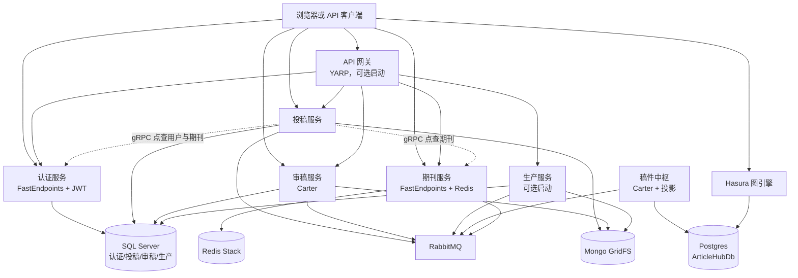

网关不是最小切片的必经之路。开发期客户端可以直接访问各 API 的规划端口；网关的价值是为外部提供稳定前缀和跨域策略。图引擎面向只读查询，命令仍然走各 API。

### 2.4 进程与部署视图（本机多 API 加 compose 中间件，以及容器化时要注意的点）

开发机上，中间件全部是容器，业务 API 全部是本机进程。规划端口为：认证 `4401`，期刊 `4402`，稿件中枢 `4403`，投稿 `4404`，审稿 `4405`。生产若启动，应另选未被占用的端口，例如 `4406`，不要沿用过时或互相冲突的端口表。图引擎 `4493`，RabbitMQ 管理页 `15672`，Redis Stack 的图形界面映射在 `8801`。五个默认 API 各有一份启动配置，连接串指向本机已发布的容器端口。Linux 上启动前设置 `APPDATA`。

容器化发布时，每个 API 一个镜像，基础镜像必须支持 `net9.0`。不要使用仍停留在更旧 SDK 版本、且复制指令不完整的 Dockerfile 直接构建，那会在发布阶段才暴露开发期并未出现的失败。中间件在部署环境中可以继续用 Compose，或改用托管的 SQL Server、Postgres、Redis、Mongo 和消息服务。Hasura 必须与稿件中枢使用的同一 Postgres 实例通信，网络策略上只允许它访问该库，管理员密钥不得出现在前端。业务进程之间的 gRPC 与总线应走内部网络，不直接暴露到公网；若启用网关，由网关作为唯一的外部 HTTP 入口，图引擎是否对外暴露要单独做权限设计，默认只允许带角色的只读查询。

### 2.5 服务目录：认证、期刊、稿件中枢、投稿、审稿、生产、网关——各自的职责、对外接口形态、依赖的中间件、不做什么

认证服务负责用户、角色、登录和令牌。对外使用 HTTP，登录路径设计为 `POST /api/tokens`，请求体包含邮箱与口令，成功时返回访问令牌；另提供当前用户查询。它使用 FastEndpoints 组织端点，数据在 SQL Server 的认证库，身份机制采用 ASP.NET Identity。它通过 gRPC 向其他服务提供人员点查。它不保存期刊、稿件或审稿意见，不保存文件。

期刊服务负责期刊、栏目和编辑角色的主数据。对外使用 HTTP，可列出期刊、按标识获取、在授权下创建或更新栏目与编辑。数据在 Redis Stack 中以聚合文档存放。它通过 gRPC 提供期刊点查，并通过总线发出「期刊已创建」等主数据事实，供中枢或其他只读方使用。它不做投稿，不保存稿件文件，不推进稿件状态。

稿件中枢负责跨阶段的只读主档。对外可用 HTTP 做简单查询，更主要的查询走 Hasura 的 GraphQL。它订阅各阶段发出的集成事件，把标识、标题、所属期刊、当前阶段、作者摘要等写入 Postgres。它不接受「把稿件改为接收」这类命令，不保存大文件，不成为状态机的执行者。

投稿服务负责稿件在投稿阶段的写模型：创建、作者、文件元数据、提交、初审通过或拒绝。对外使用 HTTP，并在需要时作为 gRPC 客户端查询认证与期刊。文件本体写入投稿桶。它依赖 SQL Server、Mongo、RabbitMQ。初审通过后，它发出进入审稿的集成事件，并把文件拷贝所需要的信息带给审稿上下文，自己不再继续修改进入审稿之后的阶段。

审稿服务负责外审：审稿人、轮次、意见、编辑决策。对外使用 Carter 模块组织 HTTP。它依赖 SQL Server、总线，以及必要时的审稿文件桶。它不回头修改投稿阶段的初审表，不排版，不直接发布文章。决策为接受后，发出进入生产的事件。

生产服务负责排版指派、清样、定稿、安排发表与发表。最小切片可以不启动它，但状态机中从「已接受」到「发表」的阶段仍然属于本系统的设计范围。它依赖 SQL Server 和总线，文件使用生产桶。

网关用 YARP 把外部路径转到上述服务。它不包含业务规则，不拥有数据。最小切片可以不启动。

### 2.6 数据归属图（关系库、文档库、缓存、图查询引擎各归谁写、谁只读）

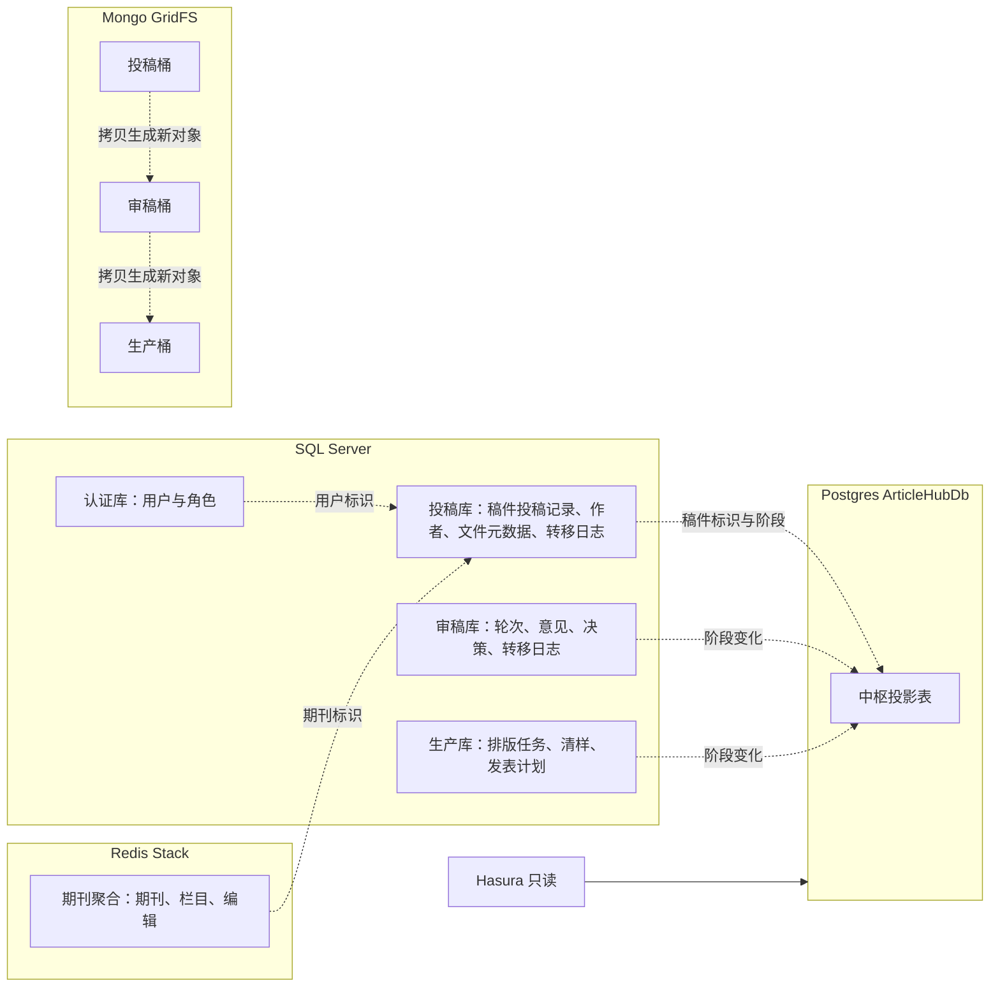

Hasura 对 Postgres 只有查询与订阅，不作为命令源去改投影表。投影表只由稿件中枢的消费者写入。Redis 中的期刊文档只有期刊服务可写。GridFS 的跨上下文「共享文件」必须通过拷贝实现，而不是把同一个对象标识借给下一个上下文修改。

### 2.7 通信总图（HTTP、gRPC、消息总线、图查询）

外部客户端以 HTTP 访问各 API，开发期可以直连规划端口，启用网关后走统一前缀。同步点查用 gRPC：投稿在创建或提交时确认用户存在、期刊存在、栏目接受投稿，这些是必须立即得到对错的问题。跨上下文的阶段变化用 RabbitMQ 上的 MassTransit 发布订阅。图查询是只读的另一条边：查询方携带令牌或图引擎允许的角色头，按中枢的模型读取，不经过投稿库的表。禁止用图引擎的 mutation 去改阶段。禁止投稿服务为了「省事」用 HTTP 调用审稿的内部表更新接口来推进外审——那会把两个写模型重新耦合在一起。

### 2.8 技术选型表与选型理由（运行时、两种 HTTP 风格、契约优先的 gRPC、总线、文件存储、鉴权、测试）

运行时选择 `net9.0`，是为了在一整条服务线上使用同一代 ASP.NET、EF Core 和 JWT 中间件，避免混用目标框架。不选择 Aspire，是因为本系统的开发模型刻意保持「中间件容器 + 多进程本机 API」，端口稳定、启动命令简单，也更容易把图引擎这类非 .NET 进程放进同一份 Compose。关系库选择 SQL Server 承载带有事务、转移日志和身份的写模型；选择 Postgres 承载中枢，是因为图引擎对它的支持直接而成熟。期刊选择 Redis Stack 加对象映射客户端，是因为期刊聚合以文档方式读写更自然，且检索模块可以覆盖按名称查找，而不必一开始就引入独立搜索集群。

HTTP 同时允许 FastEndpoints 与 Carter，是有意的边界划分而不是随意混用：认证、期刊、生产以及倾向于垂直切片（一个功能一组端点文件）的命令型 API 使用 FastEndpoints；稿件中枢和审稿使用 Carter 的模块式路由，便于把只读查询或相对稳定的资源面组织在一起。两者都建立在 ASP.NET 端点之上，共享同一套认证中间件。不允许在同一个 API 项目里再随意加入第三种风格，除非是极少量的健康检查或钩子。

gRPC 选择 protobuf-net 的代码优先方式：先在契约项目中定义接口和数据类，再由服务端注册代码优先宿主，客户端按接口生成调用。这与「先写 `.proto` 再生成代码」的官方 gRPC 项目模板不同。因此不要用官方 `grpc` 模板作为业务服务骨架，它会把你带进另一套工具链。官方 `grpc` 模板只适合用来确认本机 HTTP/2 是否工作，随后应改回代码优先契约。

总线选择 MassTransit 加 RabbitMQ，用于集成事件、重试和消费者隔离。文件选择 Mongo GridFS 作为最小切片的对象存储，接口上抽象为文件服务，以便日后替换为对象存储网关。鉴权选择 JWT 承载，令牌由认证服务签发，其他 API 用同一套校验参数。测试框架从零就采用 xUnit，并且把选型测试作为强制门禁；本系统不接受「先把业务写完再补测试项目」的顺序。

## 第 3 章 创建解决方案与项目骨架

### 3.1 目标目录结构（完整树）

在空目录中创建系统，建议根目录名为 `Articles`。完成后应具有下面这棵树。名称可以按产品更换，但「构建块 + 按上下文分层 + 可替换模块 + 独立测试」的结构应保持稳定。

```text
Articles/
  .editorconfig
  .gitignore
  tests/
    TechSelection.Tests/
  .github/workflows/
    ci.yml
  src/
    Directory.Packages.props
    Articles.sln
    docker-compose.yml
    BuildingBlocks/
      Articles.Abstractions/
      Articles.Grpc.Contracts/
      Articles.Integration.Contracts/
      Articles.Security/
      Blocks.AspNetCore/
      Blocks.Core/
      Blocks.Domain/
      Blocks.EntityFrameworkCore/
      Blocks.Exceptions/
      Blocks.FastEndpoints/
      Blocks.Hasura/
      Blocks.Http.Abstractions/
      Blocks.MediatR/
      Blocks.Messaging/
      Blocks.Redis/
    Services/
      Auth/Auth.API Auth.Application Auth.Domain Auth.Persistence
      Journals/Journals.API Journals.Domain Journals.Persistence
      ArticleHub/ArticleHub.API ArticleHub.Domain ArticleHub.Persistence
      Submission/Submission.API Submission.Application Submission.Domain Submission.Persistence
      Review/Review.API Review.Application Review.Domain Review.Persistence
      Production/Production.API Production.Application Production.Domain Production.Persistence
    ApiGateway/
    Modules/
      FileService/FileService.Contracts FileService.MongoGridFS
      EmailService/EmailService.Contracts EmailService.Empty
```

解决方案文件放在 `src/Articles.sln`。测试项目放在仓库根下的 `tests`，以便与业务代码分开，同时仍由同一解决方案包含。期刊和稿件中枢可以没有独立的 Application 项目，因为它们的应用层较薄；认证、投稿、审稿、生产保留 Application，用于状态机、命令处理和与持久化的编排。

### 3.2 用官方模板创建各项目（解决方案、Web API、类库、测试，命令按项目列出）

```bash
mkdir Articles && cd Articles
dotnet new sln -n Articles
dotnet new packagesprops -o src
dotnet new editorconfig
dotnet new gitignore

for n in Articles.Abstractions Articles.Grpc.Contracts Articles.Integration.Contracts Articles.Security \
         Blocks.AspNetCore Blocks.Core Blocks.Domain Blocks.EntityFrameworkCore Blocks.Exceptions \
         Blocks.FastEndpoints Blocks.Hasura Blocks.Http.Abstractions Blocks.MediatR Blocks.Messaging Blocks.Redis
do
  dotnet new classlib -n "$n" -o "src/BuildingBlocks/$n" -f net9.0
  dotnet sln add "src/BuildingBlocks/$n/$n.csproj"
done

create_service() {
  local svc="$1"
  dotnet new webapi -n "${svc}.API" -o "src/Services/${svc}/${svc}.API" -f net9.0
  dotnet new classlib -n "${svc}.Domain" -o "src/Services/${svc}/${svc}.Domain" -f net9.0
  dotnet new classlib -n "${svc}.Persistence" -o "src/Services/${svc}/${svc}.Persistence" -f net9.0
  if [ "$svc" != "Journals" ] && [ "$svc" != "ArticleHub" ]; then
    dotnet new classlib -n "${svc}.Application" -o "src/Services/${svc}/${svc}.Application" -f net9.0
  fi
  dotnet sln add src/Services/${svc}/*/*.csproj
}
create_service Auth
create_service Journals
create_service ArticleHub
create_service Submission
create_service Review
create_service Production

dotnet new web -n ApiGateway -o src/ApiGateway -f net9.0
dotnet sln add src/ApiGateway/ApiGateway.csproj
dotnet new classlib -n FileStorage.Contracts -o src/Modules/FileService/FileService.Contracts -f net9.0
dotnet new classlib -n FileStorage.MongoGridFS -o src/Modules/FileService/FileService.MongoGridFS -f net9.0
dotnet new classlib -n EmailService.Contracts -o src/Modules/EmailService/EmailService.Contracts -f net9.0
dotnet new classlib -n EmailService.Empty -o src/Modules/EmailService/EmailService.Empty -f net9.0
dotnet sln add src/Modules/FileService/*/*.csproj
dotnet sln add src/Modules/EmailService/*/*.csproj
dotnet new xunit -n TechSelection.Tests -o tests/TechSelection.Tests -f net9.0
dotnet sln add tests/TechSelection.Tests/TechSelection.Tests.csproj
```

创建后立即把 `src/Directory.Packages.props` 改成附录 B 的锁定版本，并在构建属性中启用中央包管理。所有项目的目标框架必须是 `net9.0`。把第 1.4 节的 Compose 保存为 `src/docker-compose.yml`，或放在仓库根并在文档中固定路径；本手册按 `src/docker-compose.yml` 描述。

### 3.3 可选的第三方模板：适用场景、限制，以及用或不用的判断

默认路径是官方模板打底，再按锁定版本加包。这是推荐路径，因为本系统的目录结构、构建块和多存储依赖，没有任何第三方解决方案模板能够一次性正确生成。

FastEndpoints 官方组织提供模板包，安装命令是 `dotnet new install FastEndpoints.TemplatePack`。其文档中的短名称包括：`feproj` 用于最小起步项目，`feintproj` 把集成测试与功能代码放在一起，`fetest` 用于 xUnit 测试项目，`feat` 用于生成一组功能文件（端点、模型、校验、映射），`feaot` 面向原生 AOT。适用场景是：在单个 API 内快速得到垂直切片的文件布局。限制是：生成项目的目标框架和包版本不一定等于本系统的 `net9.0` 与 FastEndpoints `7.0.1`；它也不会生成 BuildingBlocks 和状态机。判断：可以用 `feat` 在已经由官方模板创建的项目里生成一组端点文件，然后立刻对齐包版本；不要用 `feproj` 取代整个解决方案。

Carter 提供模板包 `CarterTemplate`。若要尝试与本系统 Carter `9.0.0` 对齐，应安装锁定主版本的包，例如 `dotnet new install CarterTemplate::9.0.0`，然后以本机 `dotnet new list carter` 确认短名称（文档中的用法是 `dotnet new carter`）。限制同样是目录和包可能需要手工调整，且不要安装面向更新一代框架的未钉版本。判断：稿件中枢或审稿可以用它做单个 API 的起步，但更稳妥的是官方 `webapi` 加 `Carter` 9.0.0。

MassTransit、YARP、Hasura、Redis.OM、Mongo 没有与本设计匹配的、值得引入的解决方案模板。gRPC 不要用官方 `grpc` 模板当服务骨架，理由见第 2.8 节。

### 3.4 共享构建块、可替换模块、各限界上下文项目的划分

构建块按技术能力切分，而不是按「所有公共代码进一个 Util」。`Articles.Abstractions` 放置跨服务稳定枚举，例如稿件阶段。`Articles.Grpc.Contracts` 放置代码优先的 gRPC 接口。`Articles.Integration.Contracts` 放置集成事件类型。`Articles.Security` 放置授权策略名与角色。`Blocks.AspNetCore` 放置 JWT 装配、Swagger、gRPC 客户端工厂。`Blocks.FastEndpoints` 放置与 FastEndpoints 相关的管道扩展。`Blocks.Messaging` 装配 MassTransit 与命名约定。`Blocks.Redis` 封装 Redis.OM 的连接与仓储。`Blocks.Hasura` 封装对图引擎管理或查询的客户端，仅供中枢或需要校验的服务使用，不把管理员密钥传到浏览器。`Blocks.EntityFrameworkCore` 放置上下文扩展，例如在保存时收集领域事件。构建块不得引用某个具体服务项目。

可替换模块通过契约项目定义接口：文件服务负责上传、下载、按标识拷贝到另一桶；邮件服务负责按事件发送通知。最小切片中，文件模块的实现是 Mongo GridFS，邮件模块的实现是空操作。替换实现时只改组合根的注册，不改领域项目。

各限界上下文内部按领域、应用、持久化、API 分层。领域包含实体、值对象、阶段枚举的使用规则和领域事件。应用包含状态机的装配、命令处理、权限判断的编排。持久化包含 EF 映射或 Redis 映射、迁移、种子。API 只负责把 HTTP 请求转成命令，不做业务决策。

### 3.5 本地启动方式与端口规划

先启动中间件，再分别启动五个默认 API。端口规划固定如下，以便客户端和 gRPC 地址可写进开发配置：认证 `http://127.0.0.1:4401`，期刊 `http://127.0.0.1:4402`，稿件中枢 `http://127.0.0.1:4403`，投稿 `http://127.0.0.1:4404`，审稿 `http://127.0.0.1:4405`。图引擎 `http://127.0.0.1:4493`，管理页与健康检查都在这一端口下。RabbitMQ 管理页 `http://127.0.0.1:15672`。生产与网关不进入默认启动，若启动，网关应选择一个对外端口，例如 `4500`，并在路由表中指向上述地址。每个 API 的 `applicationUrl` 或命令行参数必须与规划一致，否则投稿在调用期刊 gRPC 时会连错端口。

## 第 4 章 用测试项目验证技术选型

### 4.1 目的：本系统从零就必须有测试项目，先证明关键依赖可用

本系统设计要求：在编写业务状态机之前，仓库里就已经存在测试项目，并且关键依赖的选型测试必须能红能绿。没有测试项目的解决方案不算完成第 4 章。测试的目标不是覆盖投稿流程，而是证明：SQL Server 与 Postgres 都能被锁定版本的 EF 提供者连接；Redis Stack 可读写，并且对象映射客户端能够工作；Mongo 能完成一次 GridFS 上传下载；MassTransit 能在真实的 RabbitMQ 上发布并消费；JWT 能在本机签发和校验；FastEndpoints 与 Carter 都能在最小宿主里注册一个探活端点；Hasura 的 `/healthz` 返回成功。云账号和外部邮件供应商不在本步范围内。

### 4.2 创建测试项目并安装依赖（版本写在正文）

第 3 章已创建 `tests/TechSelection.Tests`。添加以下锁定版本（它们应同时写入 `src/Directory.Packages.props`）。EF Core 与 SQL Server 提供者为 `9.0.8`，Npgsql 的 EF 提供者为 `9.0.4`，StackExchange.Redis 为 `2.9.11`，Redis.OM 为 `1.0.1`，MongoDB.Driver 为 `3.4.3`，MassTransit.RabbitMQ 为 `8.5.2`，Grpc.Net.Client 为 `2.71.0`，protobuf-net.Grpc 为 `1.2.2`，JWT 承载为 `9.0.8`，FastEndpoints 为 `7.0.1`，Carter 为 `9.0.0`。`Microsoft.AspNetCore.Mvc.Testing` 用于启动最小宿主，版本与 9.0.8 对齐；若中央包文件里还没有这一行，在测试项目中显式指定，不要随手安装未锁定的最新版。

```bash
cd tests/TechSelection.Tests
dotnet add package Microsoft.EntityFrameworkCore.SqlServer --version 9.0.8
dotnet add package Npgsql.EntityFrameworkCore.PostgreSQL --version 9.0.4
dotnet add package StackExchange.Redis --version 2.9.11
dotnet add package Redis.OM --version 1.0.1
dotnet add package MongoDB.Driver --version 3.4.3
dotnet add package MassTransit.RabbitMQ --version 8.5.2
dotnet add package Grpc.Net.Client --version 2.71.0
dotnet add package protobuf-net.Grpc --version 1.2.2
dotnet add package Microsoft.AspNetCore.Authentication.JwtBearer --version 9.0.8
dotnet add package FastEndpoints --version 7.0.1
dotnet add package Carter --version 9.0.0
dotnet add package Microsoft.AspNetCore.Mvc.Testing --version 9.0.8
```

连接串全部来自环境变量，口令与密钥使用占位符对应的本地值。

### 4.3 验证项与测试设计：关系库（SQL Server 与 Postgres）、缓存与对象映射、文档库与文件存储、真实消息总线、gRPC 通道、令牌签发与校验、两种 HTTP 框架的最小端点、图引擎健康检查

SQL Server 测试创建极小上下文，`EnsureCreated` 后插入一行再查询，连接串指向 `127.0.0.1,1433`，数据库可以使用专门的探测库名。Postgres 测试对 `ArticleHubDb` 调用 `CanConnectAsync`，证明图引擎将要使用的库可从宿主访问。Redis 测试先用 `StringSet` 和 `StringGet` 证明连通，再定义一个带文档标记的极小类型，用 Redis.OM 插入并按标识读回，以证明 Stack 上的对象映射可用，而不仅仅是 TCP 端口开放。Mongo 测试向 `gridfs_db` 上传一小段字节再下载，断言内容一致，连接串使用 `mongodb://root:<DEV_DB_PASSWORD>@127.0.0.1:27018/gridfs_db?authSource=admin`。

总线测试必须对着真实的 RabbitMQ，而不是只跑内存测试座。注册一个极小消息类型和处理器，启动总线，发布一条消息，在超时前收到相同文本。gRPC 测试先创建到 `http://127.0.0.1:4402` 的通道对象；更有价值的第二条是用代码优先接口在测试宿主中注册 `AddCodeFirstGrpc`，客户端按接口调用。令牌测试用随机字节生成签名密钥，签发后校验主体。FastEndpoints 测试注册一个返回固定字符串的 `GET` 端点并请求它。Carter 测试注册一个模块并请求其路由。Hasura 测试请求 `/healthz`，期望成功且正文为 `OK`；可选地用管理员密钥做一次 `__typename` 查询，但不要在本步断言业务表已经存在。

### 4.4 运行命令与通过标准

```bash
export ARTICLES_TEST_SQL='Server=127.0.0.1,1433;User Id=sa;Password=<DEV_DB_PASSWORD>;TrustServerCertificate=True;Initial Catalog=TechSel'
export ARTICLES_TEST_PG='Host=127.0.0.1;Port=5432;Database=ArticleHubDb;Username=postgres;Password=<DEV_DB_PASSWORD>'
export ARTICLES_TEST_MONGO='mongodb://root:<DEV_DB_PASSWORD>@127.0.0.1:27018/gridfs_db?authSource=admin'
dotnet test tests/TechSelection.Tests
```

通过标准是全部绿色。图引擎失败时先按 1.5 节检查网络，不要关闭该测试以求继续。全部绿色后，才允许开始建立业务表、Redis 文档和状态转移表。

## 第 5 章 数据结构设计（核心）

### 5.1 限界上下文与多存储引擎的数据规则

除了「每上下文一个写所有者」之外，多存储带来三条额外规则。第一，存储引擎的选择一旦写入设计，不得为了某次查询方便而把同一份写模型再复制到另一种引擎里充当第二写源。期刊只写 Redis，不在 SQL Server 再保留一套可编辑的期刊表；若中枢需要展示期刊名称，应投影只读字段。第二，文件本体与文件元数据必须同时有归属：元数据在上下文的关系库或文档中，本体在该上下文的桶中，禁止只存文件标识却让所有服务共用一个可写桶。第三，状态的权威在拥有当前阶段的服务；中枢的阶段字段是投影，可能短暂滞后，查询若用于做决策，应回到写模型确认，而不能只信图查询的结果去推进另一台状态机。

跨上下文引用一律使用稳定标识：用户标识、期刊标识、稿件标识、文件标识。禁止跨库外键。迁移或键空间初始化由所有者负责。

### 5.2 身份上下文：用户、角色、令牌与持久化表

认证库采用 ASP.NET Identity 的典型结构：用户表包含主键、规范化邮箱、规范化用户名、口令哈希、安全戳、锁定状态、邮箱确认标记；角色表包含角色名，例如作者、编辑、审稿人、排版、管理员；用户角色关联表表达多对多。可以扩展一张人员资料表，保存显示名、所属机构等，与用户主键一对一。令牌本身不作为长期行保存在业务表中，访问令牌是 JWT，短期有效；若需要刷新令牌或登录会话撤销，再增加刷新令牌表或会话表。开发环境种子一位管理员和至少一位作者，口令为 `<SEED_DEFAULT_PASSWORD>`，演示邮箱可使用明显的测试域名。登录接口只返回令牌与过期时间，不返回口令哈希。其他服务只信任令牌中的用户标识与角色声明。

### 5.3 期刊上下文：期刊、栏目、人员角色

期刊在 Redis 中以聚合文档存储。建议键或文档标识使用期刊的业务标识（或整数标识加前缀），文档内容包括：名称、ISSN 或内部代号、简介、是否接收投稿、栏目列表、编辑列表。栏目包含栏目标识、名称、是否开放、可选的栏目编辑。编辑条目包含用户标识、在该期刊或栏目上的角色（主编、栏目编辑）。人员的显示名不是期刊上下文的权威数据，需要时可从认证的 gRPC 点查补全后写入只读缓存字段。期刊列表查询利用 Redis Stack 的检索能力按名称查找；最小切片也可以先扫描已知键再过滤。种子数据应至少提供两本可投稿的期刊，以便列表验收。期刊文档不包含稿件集合，否则会把投稿写模型拖进 Redis。

### 5.4 稿件中枢：稿件主档与跨上下文引用

中枢的 Postgres 模型以稿件主档为一张表，字段包括：稿件标识（与投稿上下文相同的业务标识）、标题、投稿作者标识、期刊标识、期刊名称快照、当前阶段、最近阶段变更时间、是否对某类角色可见的摘要信息。可以另建作者列表投影、时间线条目投影，以便图查询一次取出。中枢不保存口令、不保存审稿意见全文（意见是否投影要谨慎，默认不投影，避免只读模型泄露未公开的评审）。稿件标识在系统中一旦创建就不再改变，是所有事件的关联键。Hasura 跟踪这些表后，按角色限制哪些字段可查询。

### 5.5 投稿上下文：投稿记录、作者、文件元数据，以及与对象存储的关系

投稿库的核心是稿件表：稿件标识、标题、摘要、期刊标识、栏目标识、当前阶段（仅限投稿阶段集合）、创建人、创建与更新时间。作者表或稿件作者关系表保存每位作者的姓名、邮箱、顺序、是否通讯作者，以及可选的用户标识。文件元数据表保存文件标识、稿件标识、文件类型（正文、封面、附件）、原始文件名、内容类型、大小、桶名、对象标识、校验和、当前版本是否有效。文件本体在 Mongo 投稿桶中，元数据不得缺少桶名，否则跨上下文拷贝时会丢失来源。投稿库还包含初审意见的简短字段（通过或拒绝的理由），不包含外审轮次。

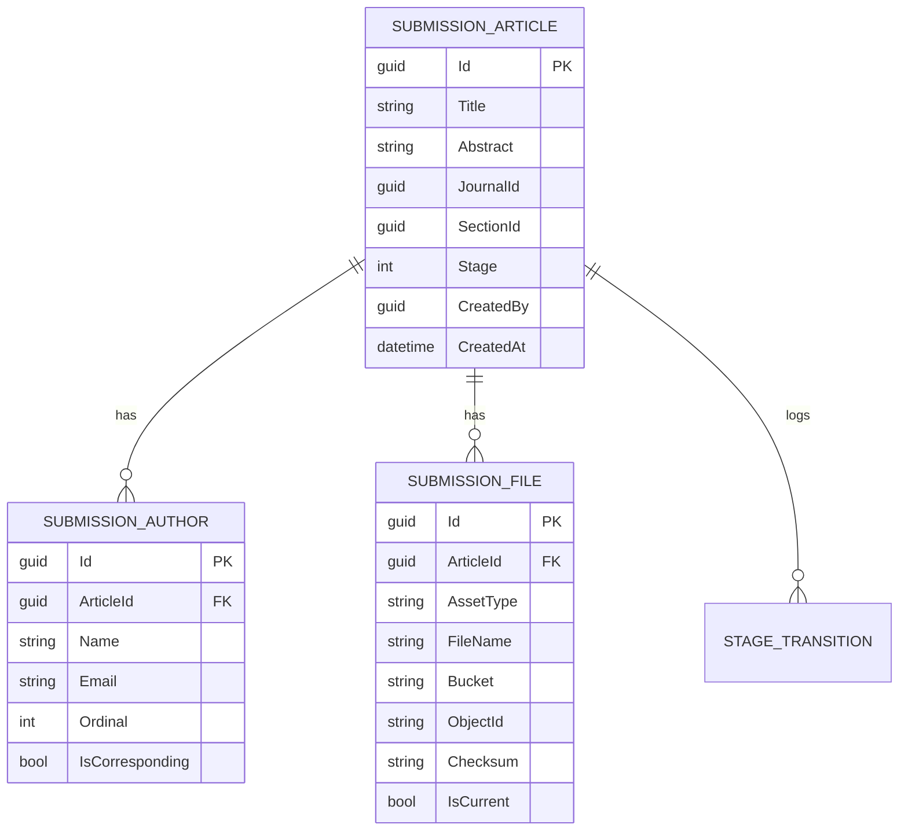

### 5.6 审稿上下文：审稿人、评审轮次、意见

审稿库以稿件在审稿阶段的记录为根，稿件标识与投稿相同，但不复用投稿表。轮次表包含轮次号、开始时间、截止时间、状态。审稿人指派表包含轮次、用户标识、是否已接受邀请、是否已提交意见。意见表包含建议（接收、小修、大修、拒绝）、评语、提交时间。编辑决策表包含决策类型、理由、时间、操作者。文件元数据指向审稿桶中的冻结副本。阶段字段只使用审稿阶段集合。意见在决策公开前不得被作者从投稿 API 读到。

### 5.7 生产与排版上下文的数据

生产库包含生产任务（稿件标识、排版责任人、当前生产阶段）、清样文件元数据（指向生产桶）、作者是否核准、计划发表日期、发表 DOI 或站内路径。最小切片可以只建任务表和阶段字段，其余列为可空。生产服务未启动时，这些表不需要被创建，但字段设计应预先写在文档中，以免接受事件到达后无处投影。

### 5.8 状态转移表的持久化结构

状态机的允许转移是领域规则，运行时应先从持久化的转移表加载或在启动时写入种子，再在内存中构造状态机并做权限校验。建议的表结构（各写模型库各有一份，或使用相同结构的表名）：当前阶段、动作类型、目标阶段、允许的角色列表、是否启用。一次真实发生的转移还要写入转移日志：稿件标识、从阶段、到阶段、动作、操作者、时间、备注。权限判断在内存中进行，避免每次请求都拼动态 SQL 去解释规则；但规则的数据来源是这张表，以便在不改代码的情况下关闭某条尚未开放的转移（例如「等待修改」相关动作可以先禁用）。非法转移不得写日志冒充成功，应在校验失败时直接拒绝。

| 列 | 类型 | 说明 |
| --- | --- | --- |
| FromStage | 整数，对应阶段枚举 | 当前阶段 |
| ActionType | 字符串或整数 | 动作，如提交初稿、初审通过 |
| ToStage | 整数 | 目标阶段 |
| AllowedRoles | 字符串列表或关联表 | 例如作者、编辑 |
| IsEnabled | 布尔 | 是否开放 |
| Comment | 字符串 | 设计说明 |

### 5.9 文件存储桶划分，以及跨上下文拷贝的元数据

三个桶分别是投稿桶、审稿桶、生产桶，可以是同一 Mongo 实例中的不同数据库或不同桶名。拷贝不是改对象的 ACL，而是读取源对象、写入目标桶、产生新的对象标识，并在目标上下文的文件元数据表中插入一行，记录来源上下文、来源对象标识、校验和、拷贝时间。这样审稿中的文件不会被作者在投稿桶里的一次覆盖而悄悄改变。拷贝发生在阶段跨越时：初审通过进入审稿之前或之时，把当前有效的正文与必要附件拷到审稿桶；接受进入生产之时，再拷到生产桶。失败时的补偿见第 6.10 节。

### 5.10 全系统数据模型总图

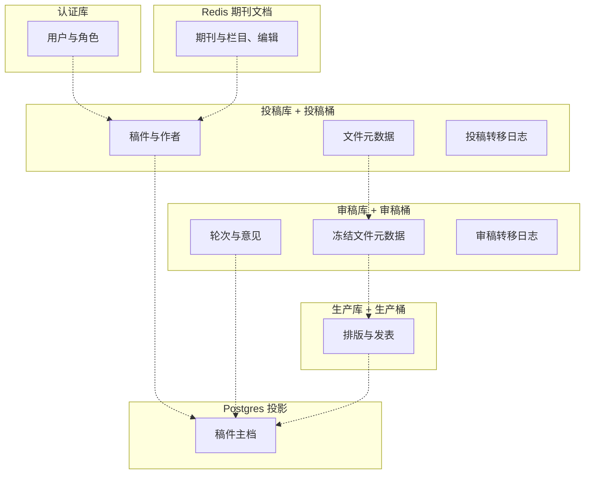

实线是同一所有权内的组成，虚线是标识引用、投影或文件拷贝。实施时每增加一个字段，先在这张图上找到归属。

## 第 6 章 流程与状态设计（核心）

### 6.1 注册、登录、取令牌、查询当前用户（流程图和时序图）

最小切片可以使用种子用户，不必先做完整的邮箱验证注册。设计上仍保留注册：认证服务提供创建用户的接口，写入用户表并赋予作者角色，口令以哈希存储。登录是同步 HTTP：客户端向 `POST /api/tokens` 提交邮箱和口令，认证服务校验成功后签发 JWT，载荷包含用户标识、邮箱、角色和过期时间，签名密钥仅保存在认证服务与各 API 共享的校验配置中，文档里写 `<REDACTED_DEMO_SECRET>`。失败时返回统一的未授权错误，不提示「用户不存在」或「口令错误」中的哪一种，以减少探测。客户端随后在 `Authorization: Bearer` 头中携带令牌，访问 `GET` 当前用户接口，确认标识与角色。其他服务不签发令牌，只校验。

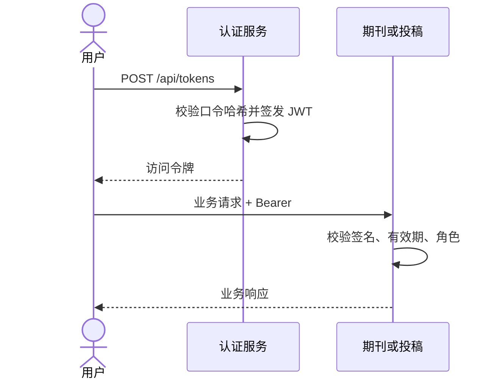

令牌过期后需要重新登录或使用日后扩展的刷新接口。最小切片可以把过期时间设得稍长以便演示，但不能把令牌当作可在查询字符串里传递的永久密钥。

### 6.2 期刊管理与权限校验

列出公开期刊可以要求已登录，以避免未授权爬取编辑邮箱；若产品希望首页匿名可浏览，也可以把列表对匿名开放，但编辑联系方式不得出现在匿名视图。创建期刊、修改栏目、指派编辑要求管理员或已有主编角色。权限校验分两层：第一层是端点策略，例如「必须是已认证用户」；第二层是领域规则，例如「只有该期刊的主编可以添加栏目编辑」。第二层的数据来自期刊聚合文档中的编辑列表，结合令牌中的用户标识，在内存中判断。不要把第二层下沉到「前端隐藏按钮」了事。投稿服务在创建稿件时通过 gRPC 询问期刊是否存在、是否开放、栏目是否可投，得到否定则拒绝创建，而不是先写一条无效稿件再异步删除。

### 6.3 创建稿件并投递到期刊

作者登录后选择期刊与栏目，提交标题和摘要，投稿服务创建稿件，阶段为「已创建」。随后作者可以添加作者信息、上传正文。当正文已上传，阶段进入「文稿已上传」。作者确认提交后，阶段进入「已提交」，投稿服务在同一事务中写下转移日志，并在成功后发出「稿件已提交」集成事件，供中枢投影和编辑侧通知。编辑对已提交的稿件做初审：通过则进入「初审通过」，并触发进入审稿的后续流程；拒绝则进入「初审拒绝」，该路径在投稿阶段是终态之一，除非产品允许作者基于同一稿件重新提交——本设计把「重新提交」视为新的动作，只在设置中启用时才从初审拒绝回到已创建或文稿已上传，默认关闭。

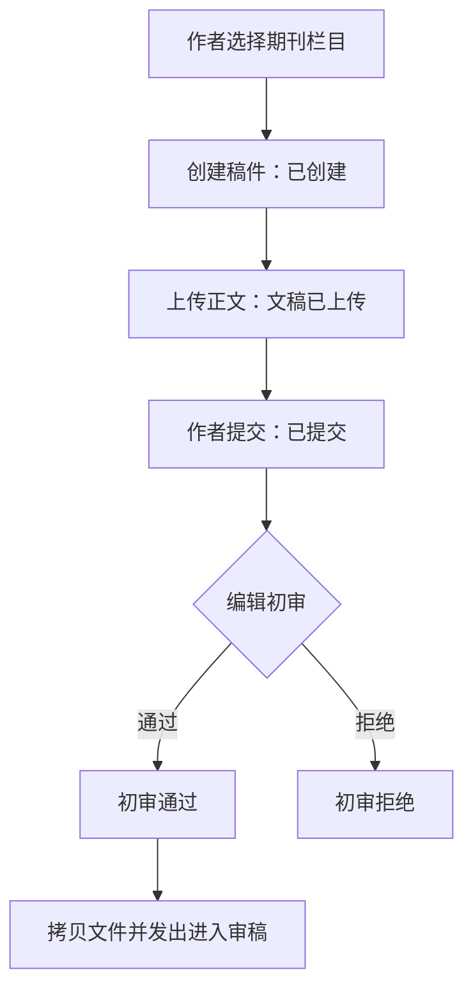

创建时必须记录创建人，后续只有作者本人、被邀请的共同作者或该期刊编辑能看到写模型中的草稿。中枢是否投影「已创建」状态是产品选择：本设计选择从「已提交」开始对更广泛角色可见，草稿阶段只存在于投稿写模型。

### 6.4 文件上传、存储与跨上下文拷贝

上传是同步命令：客户端把文件送到投稿 API，API 写入投稿桶，再写入元数据行，必要时把阶段从已创建推进到文稿已上传。文件大小和类型要在 API 层限制，以防止把对象存储当成无限网盘。跨上下文拷贝发生在阶段跨越时，由发出跨越事件的一方或专门的文件消费者执行。推荐由目标上下文在接收到「请接收文件」或「初审通过」事件后，调用文件模块的拷贝接口，从源桶读出并写入自己的桶，再记录自己的元数据。这样目标上下文拥有自己的对象生命周期。

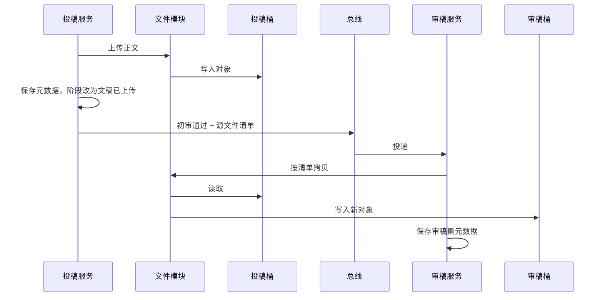

拷贝必须校验校验和，失败则重试，不得把「没有文件的审稿记录」当成已准备好送审。源文件在拷贝后默认保留，以便作者回顾自己提交过的版本；删除源文件是单独的保留策略，不属于最小切片。

### 6.5 投稿主状态机：状态定义、转移表、谁能触发、非法转移

投稿阶段使用如下状态：已创建（Created）、文稿已上传（ManuscriptUploaded）、已提交（Submitted）、初审拒绝（InitialRejected）、初审通过（InitialApproved）。它们构成投稿上下文的全部合法阶段值。已创建表示记录存在但还没有可送审的正文。文稿已上传表示有当前有效的正文，但作者尚未确认送出。已提交表示进入编辑初审队列。初审拒绝与初审通过是投稿阶段的两个出口；通过之后，写模型不再接受投稿阶段的推进动作，后续阶段由审稿上下文拥有。

合法转移：创建动作把空记录变为已创建，触发者是作者。上传正文在已创建或文稿已上传上执行，后者表示替换当前正文，阶段保持文稿已上传；触发者是作者。提交初稿仅当当前为文稿已上传，进入已提交，触发者是作者。初审通过与初审拒绝仅当当前为已提交，触发者是该期刊的编辑。默认不允许从初审拒绝回到上传，也不允许作者把自己的已提交稿件直接改为初审通过。

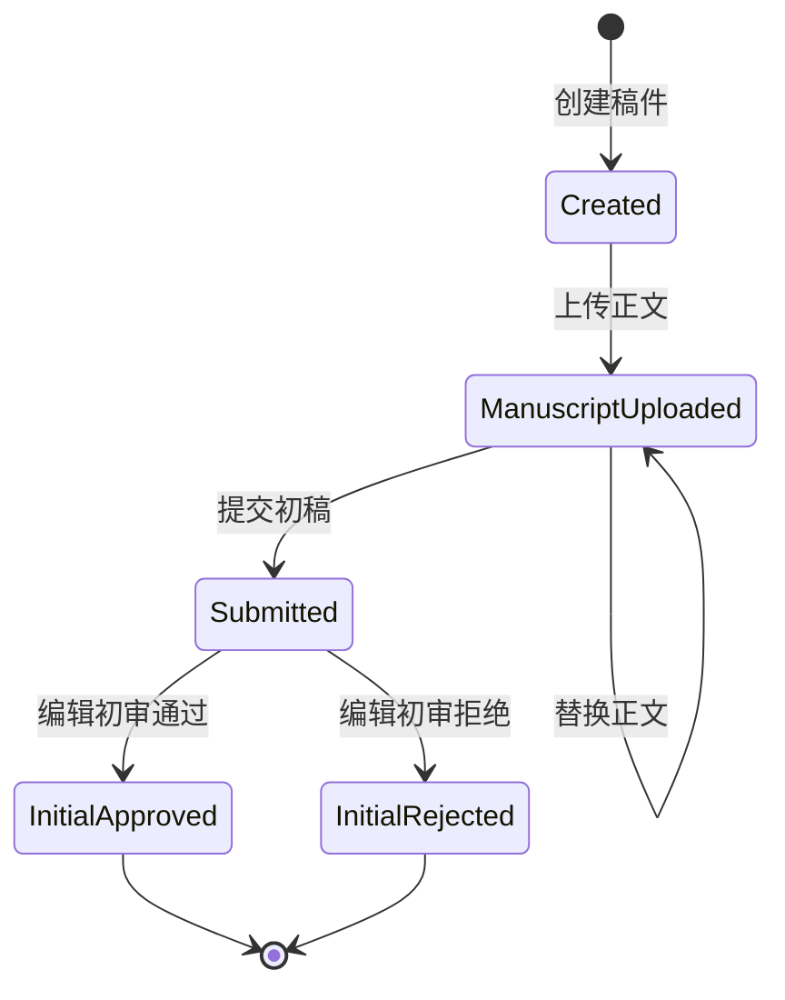

非法转移必须被拒绝并返回明确错误。例如：在已创建且无正文时提交；在已提交后作者再替换正文却不走撤回设计（本期不提供已提交后的随意替换）；编辑对别人期刊的稿件做初审；把阶段直接写成审稿中——投稿库根本不应接受审稿阶段枚举值。状态机在内存中根据转移表和角色校验，通过后才改写阶段列并追加日志。

### 6.6 审稿流程与审稿状态机

当投稿发出初审通过并完成文件拷贝后，审稿服务创建自己的稿件记录，阶段为审稿中（UnderReview），并开启第一轮。编辑可以邀请审稿人；审稿人提交意见。当本轮所需意见已齐（最小切片可定义为「至少一份意见」，正式规则可以是「不少于两份」），阶段进入待决策（ReadyForDecision）。编辑在待决策上做出三种决策之一：接受，进入已接受（Accepted）；拒绝，进入已拒绝（Rejected）；退回修改，进入等待修改（AwaitingRevision）。等待修改后，作者提交修订（修订文件进入审稿桶的新版本），阶段回到审稿中并开启新一轮。等待修改在转移表中可以先标记为未启用，最小切片不必实现完整修订回路，但状态和动作必须在设计中存在，以免日后把「修改后再审」塞进已接受。

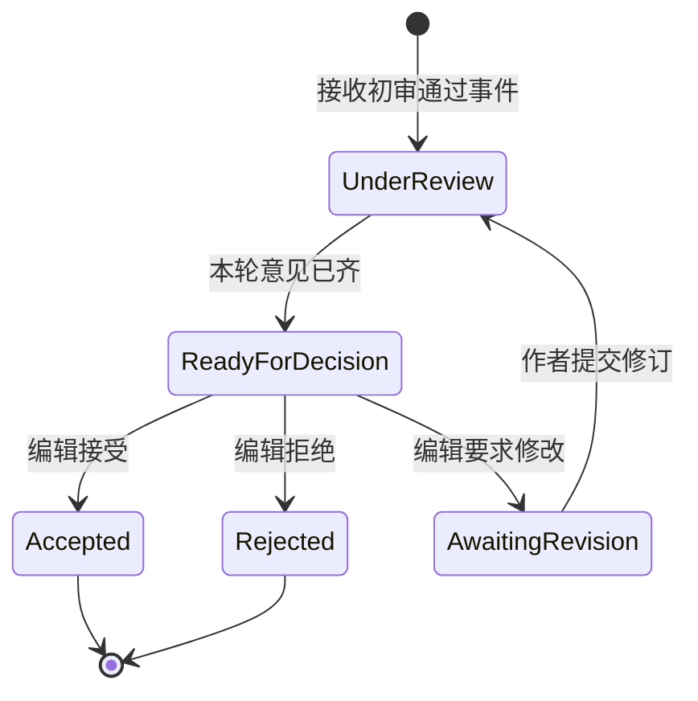

非法转移包括：审稿人给不是自己负责的稿件做接受决策；在意见未齐时直接接受（若规则要求齐套）；对已拒绝的稿件再打开一轮却不走正式的重启动作；投稿作者修改审稿阶段字段。已接受是审稿上下文的出口，之后由生产上下文拥有阶段。已拒绝是终态。权限同样在内存中按角色和指派记录检查。

审稿流程的协作顺序是：中枢投影「审稿中」；编辑在审稿 API 上邀请审稿人（可先用种子审稿人）；审稿人提交意见；编辑决策。最小切片若把「意见已齐」简化为编辑可以随时决策，必须在规则表里写明，避免以后无法收紧。

### 6.7 录用后进入生产的流程

编辑接受之后，审稿服务发出「稿件已接受」事件。生产服务（一旦启动）创建生产任务，阶段为生产中（InProduction），并完成文件拷贝到生产桶。随后可以指派排版人员，上传清样后进入清样待核（DraftProduction），作者核准后进入定稿生产（FinalProduction），安排日期后进入已排期（PublicationScheduled），正式上线后进入已发表（Published）。最小切片可以在验收中止于已接受，不启动生产进程；但中枢应能投影已接受，且不得把已接受误标为已发表。生产阶段的非法转移同样要定义：作者不能把自己的稿件直接标记为已发表；未上传清样不能进入待核之后的阶段。

生产状态机与投稿、审稿一样，必须写成可执行的规则，而不能只在口头上约定「接受之后就去排版」。生产中表示任务已建立、责任尚未必指定；清样待核表示作者或编辑需要核对排版稿；定稿生产表示核准意见已收回，进入最后技术处理；已排期表示对外公开日期已经确定但仍未上线；已发表是终态。触发者分别是：系统消费者在接收已接受事件后创建任务；编辑或排版管理员指派责任人（阶段可保持生产中）；排版上传清样后进入清样待核；作者或被授权的通讯作者核准后进入定稿生产；编辑安排日期后进入已排期；发布动作完成后进入已发表。若作者在清样待核上拒绝核准，设计上应回到生产中并要求新的清样，而不是直接取消已接受——已接受是审稿事实，不能因为排版迭代而被撤回，除非走单独的「撤销接收」流程，该流程本期只保留名称，不进入最小切片。

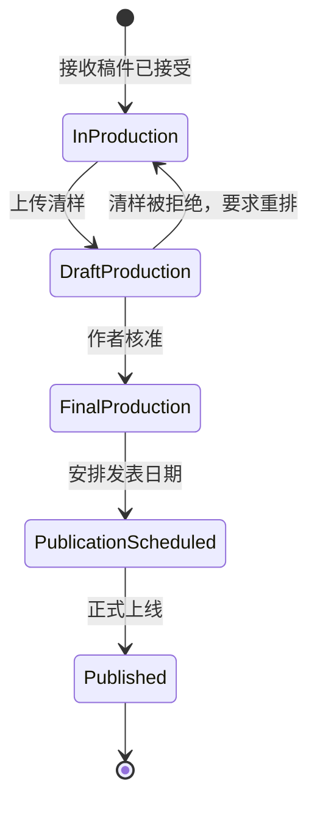

把生产画清楚，是为了防止最小切片「暂不启动生产」被理解成「接受之后没有后续设计」。接口和事件在生产未启动时仍然有效：事件会被总线保留或在消费者上线后补投，中枢可以先投影已接受，待生产消费者上线再投影生产中。这要求生产消费者同样按稿件标识幂等创建任务。

### 6.8 领域事件到集成事件的桥接

领域事件发生在单一上下文的内存中，例如「本聚合已从已提交变为初审通过」。它不应直接被其他服务引用，因为那会泄漏领域模型。桥接发生在持久化成功之后：应用层把领域事件翻译为集成事件，写入可靠投递机制（本系统采用 MassTransit 对 RabbitMQ 的发布，推荐在同一数据库事务中先写下消息或使用总线提供的事务型发件箱，避免「库已改、消息没有」）。集成事件只包含约定字段：稿件标识、阶段、时间、必要的文件清单和标题等，不包含整个聚合。

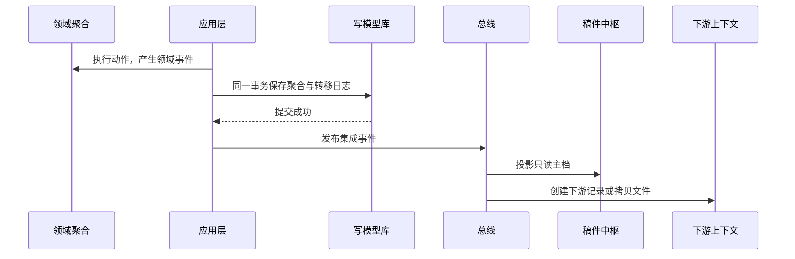

命名使用过去时：稿件已创建、文稿已上传、稿件已提交、初审已通过、初审已拒绝、审稿已开始、意见已提交、稿件已接受、稿件已拒绝、进入生产、稿件已发表。订阅方按类型处理，并按稿件标识加事件标识去重。

### 6.9 只读图模型的查询流程

查询方（浏览器或服务）在稿件中枢的表被跟踪之后，向 Hasura 发送 GraphQL。认证可以先采用管理员密钥仅限开发机查询，但设计上必须过渡到 JWT 传递，并在图引擎中按角色限制字段。典型查询：按稿件标识取当前阶段、标题、期刊名称；按作者标识列出自己可见的稿件。这个查询不能替代命令。若页面上的编辑要点击「初审通过」，按钮调用的是投稿 API，成功后再通过查询或订阅刷新中枢数据。中枢投影延迟应在一秒到数秒内，界面用「处理中」表达，而不是让用户反复提交同一命令。

### 6.10 失败、权限拒绝、补偿与一致性

权限拒绝发生在状态机校验之前或之中，必须是同步失败，不产生部分转移，不发集成事件。文件拷贝失败时，下游上下文不应进入「已准备好审稿」的工作状态：可以把本地记录标为「待接收文件」并重试拷贝，或通知源上下文跨越尚未完成。消息重复时，创建下游记录必须幂等，拷贝必须能识别「已经为该源对象生成过目标对象」。投稿已提交但事件未发出时，应靠事务型发件箱或补偿扫描把事件补发。不要用手工改库把阶段拨到下一状态来「修数据」，那会让日志与文件桶失去对应。最终一致性的可见后果是：编辑刚通过初审时，图查询可能仍显示已提交，刷新后变为初审通过或审稿中。这是可接受的，只要写模型上的命令结果是立即正确的。

## 第 7 章 通信、安全与一致性设计

### 7.1 不同 HTTP API 写法的使用边界

FastEndpoints 用于命令型、按功能切文件的 API：一个动作一组请求模型、校验器和端点类，适合认证、期刊维护、投稿命令、生产命令。Carter 用于按模块注册一组相关路由，适合审稿资源和中枢的只读 HTTP。健康检查或极少量钩子可以使用最小端点。同一个服务选定一种主风格后应保持稳定，共享的认证、错误处理和 OpenAPI 注册放在构建块里，不因风格差异而分裂成两套用户模型。文档页在开发环境启用，便于手工验收，但不作为外部集成的契约来源；对外稳定的是路径、状态码和 JSON 形状。

### 7.2 gRPC 服务契约（消息与方法，不写完整业务逻辑）

认证契约至少提供 `GetPerson`：输入用户标识，输出是否存在、显示名、邮箱、角色摘要。期刊契约至少提供 `GetJournal` 与 `GetSection`：输入标识，输出名称、是否开放、栏目是否可投。这些方法供投稿在同步命令中使用。契约定义在 `Articles.Grpc.Contracts`，使用代码优先接口，服务端用 `AddCodeFirstGrpc` 托管，客户端用工厂创建。不要把稿件的整个写模型通过 gRPC 暴露给中枢。超时要短，失败时投稿命令应失败并提示「暂时无法校验期刊」，而不是写入一个没有期刊的稿件。

### 7.3 集成事件目录与总线拓扑

总线使用主题或按消息类型的消费端点，服务名作为队列前缀，避免多个服务竞争同一队列却无法隔离失败。重试使用有限次数加死信。最小事件集合如下。

| 事件 | 发布方 | 订阅方 | 目的 | 关键载荷 |
| --- | --- | --- | --- | --- |
| 期刊已创建或更新 | 期刊 | 中枢 | 只读名称 | 期刊标识、名称 |
| 稿件已提交 | 投稿 | 中枢、通知 | 投影，提醒编辑 | 稿件标识、标题、期刊标识 |
| 初审已通过 | 投稿 | 审稿、中枢、文件拷贝 | 创建审稿记录 | 稿件标识、文件清单 |
| 初审已拒绝 | 投稿 | 中枢、通知 | 投影 | 稿件标识、理由 |
| 审稿已开始 | 审稿 | 中枢 | 投影阶段 | 稿件标识 |
| 稿件已接受 | 审稿 | 生产、中枢、文件拷贝 | 进入生产 | 稿件标识、文件清单 |
| 稿件已拒绝 | 审稿 | 中枢、通知 | 投影 | 稿件标识 |
| 进入生产 | 生产 | 中枢 | 投影 | 稿件标识 |
| 稿件已发表 | 生产 | 中枢、通知 | 投影 | 稿件标识、发表信息 |

### 7.4 图查询读模型的设计

读模型只包含展示和检索需要的字段，见 5.4。Hasura 连接 `ArticleHubDb`，跟踪中枢表，使用 `graphql-default` 命名。权限：开发机可用管理员密钥做验收；正式设计应按 JWT 中的角色限制行，例如作者只能看到自己作为作者的稿件，编辑可以看到所属期刊的已提交及之后的稿件，草稿默认不可见。禁止把转移日志中的内部备注或未公开评审意见放到默认跟踪集合。中枢消费者必须以稿件标识为幂等键做插入或更新，避免事件乱序把较新阶段覆盖回较旧阶段——应比较阶段变更时间或使用阶段的单调编号，投稿阶段编号在 100 段，审稿在 200 段，生产在 300 段，便于比较先后。

### 7.5 认证与授权（端点策略、角色、跨服务身份）

角色至少包括：作者、编辑、审稿人、排版、管理员。端点策略声明「要登录」或「要某角色」，领域规则再限制到「这篇稿件上的关系」。跨服务调用有两类：用户驱动的，转发用户的 JWT 或在服务内使用用户标识继续授权；系统驱动的，例如事件消费者，使用服务身份，不再假装是某个作者。gRPC 点查属于系统协助用户命令，但仍应限制为内部网络。不要在集成事件里携带可长期使用的用户令牌。种子管理员不得用于日常投稿验收，以免把权限漏洞掩盖掉。

令牌中建议包含的声明有：主体标识（`sub`）、邮箱、角色集合、签发者、听众、过期时间。听众应面向本系统的 API 资源，而不是某一台机器的主机名。端点策略示例：列出期刊要求已认证；创建稿件要求作者角色；初审通过要求编辑角色，并且应用层还要确认该编辑属于稿件所在期刊；提交审稿意见要求审稿人角色，并且该用户已被指派到这一轮；上传清样要求排版角色或管理员；发表动作要求编辑或管理员。这些策略写在代码的授权属性或过滤器中，关系型限制写在状态机守卫里。两者缺一不可：只有角色没有关系，编辑就可以操作他人期刊；只有关系没有角色，普通作者一旦被错误写入编辑列表就会获得命令入口。开发期可以用种子数据把作者和编辑分成两个账户，专门用于第 10 章的验收，而不要用同一个管理员账户走完整路径。

### 7.6 配置、密钥，以及邮件等外设的设计（可以暂不实现，但设计要有）

配置包括各库连接串、Redis、Mongo、总线地址、图引擎地址、令牌签发参数、文件大小限制。秘密包括 `<DEV_DB_PASSWORD>`、`<HASURA_ADMIN_SECRET>`、`<SEED_DEFAULT_PASSWORD>`、`<REDACTED_DEMO_SECRET>`，以及日后的 SMTP 口令或投递服务密钥。它们只来自环境或用户机密。邮件模块的接口是「在事件发生时发送指定模板」，触发点至少包括：稿件已提交通知编辑、初审结果通知作者、审稿邀请、接受或拒绝通知、清样待核通知。最小切片注册空实现，测试中可以断言接口被调用。不要把邮件发送失败回滚已经成功的状态转移；应记录失败并重试发送，因为转移已经是事实。

## 第 8 章 按架构落地可运行的整体 MVP

### 8.1 最小可运行切片：先启动哪些 API 与中间件，验收什么

这一阶段先追求进程可运行，而不是完整投稿闭环。要启动的中间件包括：SQL Server、Postgres、Redis Stack、Mongo、RabbitMQ、Hasura。要启动的 API 包括认证、期刊、稿件中枢、投稿、审稿。生产与网关可以保持未启动，但项目必须能够编译。验收：五个 API 在规划端口上监听；每个 API 至少有一个可访问的文档页或探活路径；认证库迁移成功；图引擎 `/healthz` 为 OK；总线管理页可打开。业务端点可以仍返回空集合。

### 8.2 共享库与各服务空壳

空壳要引用构建块中的配置、日志和认证扩展，即使还没有业务端点。认证空壳应能执行迁移并启动。期刊空壳应能连接 Redis。投稿与审稿空壳应能连接 SQL Server 并配置 MassTransit，即使消费者是空的。中枢空壳应能连接 Postgres 并等待事件。把阶段枚举、转移表实体、文件契约先建起来，后续只填行为。不要在空壳里留下无法还原的项目引用。

### 8.3 端口、启动命令、健康检查

本系统的业务进程不由 Aspire 分配随机端口，因此健康检查和客户端都使用规划地址。建议每个 API 提供 `GET /health` 或在文档页之外的简单探活；若框架最小实现暂时只有文档页，也应在第 9 章补上健康检查，以便日后接入编排或网关。启动顺序是：Compose 先于 API；认证先于需要登录才能验收的调用。启动命令示例：

```bash
docker compose -f src/docker-compose.yml up -d
export APPDATA="${APPDATA:-$HOME/.config}"
dotnet run --project src/Services/Auth/Auth.API --urls http://127.0.0.1:4401
dotnet run --project src/Services/Journals/Journals.API --urls http://127.0.0.1:4402
dotnet run --project src/Services/ArticleHub/ArticleHub.API --urls http://127.0.0.1:4403
dotnet run --project src/Services/Submission/Submission.API --urls http://127.0.0.1:4404
dotnet run --project src/Services/Review/Review.API --urls http://127.0.0.1:4405
```

五个 `dotnet run` 需要五个终端或后台会话。连接串通过用户机密或环境变量提供，指向本机端口，口令使用本地开发值。

### 8.4 DevOps：本地构建与测试，以及从零补上的最小 CI 流水线（完整工作流写在正文）

本系统从零就必须建立持续集成，不能把「先没有测试和流水线」当作默认状态。本地在提交前执行还原、构建和测试。将下面的工作流保存为 `.github/workflows/ci.yml`。它安装 .NET 9，对解决方案执行还原、构建和测试。需要中间件的选型测试应使用服务容器，或标记为仅在具备依赖时运行，以免云端运行器因没有本机 1433 端口而变红。镜像发布不是本阶段的必做项，且必须先有与 `net9.0` 匹配的 Dockerfile 再谈发布作业。

```yaml
name: build-and-test
on:
  pull_request:
  push:
    branches: [ main ]
jobs:
  test:
    runs-on: ubuntu-latest
    steps:
      - uses: actions/checkout@v4
      - name: Setup .NET 9
        uses: actions/setup-dotnet@v4
        with:
          dotnet-version: "9.0.x"
      - name: Restore
        run: dotnet restore src/Articles.sln
      - name: Build
        run: dotnet build src/Articles.sln --no-restore
      - name: Test
        run: dotnet test src/Articles.sln --no-build --no-restore
```

### 8.5 这一阶段的跑通标准

解决方案能够构建；测试项目存在且不依赖中间件的测试在 CI 中通过；五个 API 能同时在规划端口启动；中间件健康，图引擎返回 OK。尚未要求完成投稿。达成后再进入第 9 章，避免在进程都起不来时调试状态机。

## 第 9 章 按功能模块补齐（实现从简，设计与接口写全）

### 9.1 认证模块

职责是用户、角色与令牌。接口：`POST /api/tokens`、当前用户查询、可选的注册、面向内部的人员 gRPC。数据结构见 5.2。流程见 6.1。最小可运行要点：种子用户使用 `<SEED_DEFAULT_PASSWORD>` 能取得令牌；错误口令失败；令牌可被期刊和投稿校验；无令牌访问受保护接口被拒绝。不需要完整的用户管理界面。

### 9.2 期刊模块

职责是期刊主数据与编辑角色。接口：列表、按标识获取、授权下的创建与更新，以及期刊 gRPC 点查。数据结构见 5.3。流程见 6.2。最小可运行要点：持有令牌时列表至少返回两本种子期刊；点查对开放期刊返回可投。不要在这一步做稿件统计。

### 9.3 稿件中枢模块

职责是投影与只读查询。接口：内部消费者；可选的 HTTP 查询；主要查询走图引擎。数据结构见 5.4。流程见 6.8 与 6.9。最小可运行要点：在一篇稿件已提交后，Postgres 中出现对应主档行；跟踪表之后可以用 GraphQL 读到标识和阶段。即使图元数据尚未自动跟踪，也应能在数据库中看到行。

### 9.4 投稿模块

职责是投稿写模型、文件元数据、初审出口。接口：创建稿件、添加作者、上传文件、提交、编辑初审通过或拒绝。数据结构见 5.5、5.8、5.9。状态机见 6.5。最小可运行要点：作者能创建稿件并上传一个小文件，提交后阶段为已提交，总线发出事件；编辑能通过或拒绝；非法转移被拒绝。文件进入投稿桶，元数据可查。

### 9.5 审稿模块

职责是外审写模型与决策。接口：查看待审、邀请或使用种子审稿人、提交意见、编辑决策。数据结构见 5.6。状态机见 6.6。最小可运行要点：初审通过后自动或手工出现审稿记录，阶段为审稿中；编辑可以做出接受或拒绝；接受后发出已接受事件。等待修改回路可以暂不开放，但尝试非法动作时应失败。

### 9.6 生产与网关（设计写全；若最小切片暂不启动，写明依赖与接口）

生产的职责、数据、阶段见 5.7 与 6.7。它依赖「稿件已接受」事件和文件拷贝接口。未启动时，主路径验收止于已接受，中枢投影该阶段。一旦启动，最小接口包括：查看任务、上传清样、作者核准、标记发表。网关的职责是路由而不是业务。建议路由：`/auth/*` 到 `4401`，`/journals/*` 到 `4402`，`/hub/*` 到 `4403`，`/submissions/*` 到 `4404`，`/reviews/*` 到 `4405`，生产路径仅在服务启动后启用。网关必须转发授权头，不得把图引擎管理员密钥暴露为匿名路由。最小切片可以直连 API，但路由表应写在配置文件中待命。

### 9.7 垂直切片：把「登录 → 期刊 → 投稿 → 审稿」串起来跑通

执行一次人工路径：确认中间件健康；启动五个 API；用种子作者调用 `POST /api/tokens` 取得令牌；用该令牌列出期刊并记下标识；创建稿件、上传一小段文本文件、提交；用编辑账户（或同一演示环境中的编辑种子）对这篇稿件做初审通过；确认审稿记录出现且阶段为审稿中；编辑做出接受或拒绝中的一种；在中枢库或图查询中看到阶段随之变化。全程不要手工改库。若某一步失败，按 10.3 排查。走通这条路径，即达到本手册对最小切片的完成定义。

## 第 10 章 从零启动与验收

### 10.1 启动命令、进程清单与端口

先启动中间件并执行连通性检查，再按 8.3 节启动五个 API。进程清单：`sqlserver`、`postgres`、`journals-redisdb`、`mongo-gridfs`、`rabbitmq`、`articlehub-hasura`，以及五个 API 进程。端口：1433、5432、6379、8801、27018、5672、15672、4493、4401 至 4405。若端口冲突，先解决冲突再改规划，不要让 gRPC 客户端继续指向旧地址。生产与网关默认不在清单中。

### 10.2 验收清单

1. .NET 9 运行时可用，Docker 与 Compose 可用，`APPDATA` 在 Linux 上已设置。
2. 选型测试在中间件健康时全部绿色，包括 `/healthz`。
3. 解决方案构建通过，CI 工作流文件已加入版本库。
4. 五个 API 在规划端口监听。
5. `POST /api/tokens` 对种子用户成功，错误口令失败。
6. 持令牌可列出期刊，且至少有两本。
7. 无令牌访问受保护的投稿接口被拒绝。
8. 作者可创建稿件、上传文件、提交，阶段为已提交，文件可在投稿桶中下载。
9. 编辑初审通过后，审稿记录存在，文件在审稿桶中有拷贝，校验和一致。
10. 投稿状态机拒绝无正文提交等非法转移。
11. 编辑可在审稿中做出接受或拒绝，非法角色不能决策。
12. 中枢投影包含该稿件的当前阶段。
13. 重复投递同一「初审已通过」事件不会创建两条互相冲突的审稿主记录。
14. 日志能按稿件标识检索创建、提交、初审、决策。

可选：GraphQL 查询成功；网关转发登录；生产服务把已接受推进到生产中。全部必选项勾选即跑通。

### 10.3 常见故障与排查

SQL Server 尚未就绪时迁移失败，应等待端口可连接后再启动认证。Postgres 健康检查一直失败，检查是否误用了与库名或用户不一致的探测命令。图引擎健康检查失败，优先怀疑容器网络，改用宿主网络指向 `127.0.0.1:5432`。Redis 连接成功但对象映射失败，确认镜像是 Redis Stack 而不是普通 Redis。Mongo 认证失败，检查端口是否为 27018 以及 `authSource=admin`。登录成功但期刊列表 401，检查各 API 的签发者、密钥和时钟是否一致。创建稿件失败在校验期刊，检查期刊服务是否在 4402、gRPC 是否启用。初审通过后审稿没有记录，检查总线是否连通、消费者是否启动、事件类型是否与契约一致。文件在审稿侧缺失，检查拷贝消费者和校验和。Linux 上出现与用户机密路径相关的异常，检查 `APPDATA`。不要同时改状态机种子和连接串。

### 10.4 完成定义与后续可扩展点（只列设计，不展开实现）

完成定义即 0.1 与 10.2 描述的闭环。后续可扩展但本期不实现的包括：完整注册与邮箱验证；等待修改的多轮审稿与催稿；生产全流程与 DOI；真实邮件投递；对象存储替换为云厂商；网关限流、动态路由与统一观测；图引擎按 JWT 的行级权限落地；学术不端检测的外部集成；收费与开放获取对账。增加这些能力时，仍遵守写模型归属、文件按桶拷贝、阶段由拥有该阶段的服务推进、中枢只做投影的原则。

## 附录 A 完整中间件 compose

下面与第 1.4 节相同，集中于此便于复制。将 `<DEV_DB_PASSWORD>` 与 `<HASURA_ADMIN_SECRET>` 换成本地开发值。

```yaml
services:
  sqlserver:
    image: mcr.microsoft.com/mssql/server
    environment:
      ACCEPT_EULA: "Y"
      SA_PASSWORD: "<DEV_DB_PASSWORD>"
    ports:
      - "1433:1433"

  postgres:
    image: postgres
    environment:
      POSTGRES_USER: postgres
      POSTGRES_PASSWORD: "<DEV_DB_PASSWORD>"
      POSTGRES_DB: ArticleHubDb
    ports:
      - "5432:5432"
    healthcheck:
      test: ["CMD-SHELL", "pg_isready -U postgres -d ArticleHubDb"]
      interval: 5s
      timeout: 5s
      retries: 20

  journals-redisdb:
    image: redis/redis-stack
    ports:
      - "6379:6379"
      - "8801:8001"

  mongo-gridfs:
    image: mongo:6.0
    environment:
      MONGO_INITDB_ROOT_USERNAME: root
      MONGO_INITDB_ROOT_PASSWORD: "<DEV_DB_PASSWORD>"
    ports:
      - "27018:27017"

  rabbitmq:
    image: "rabbitmq:management"
    hostname: articles-mq
    ports:
      - "5672:5672"
      - "15672:15672"

  articlehub-hasura:
    image: hasura/graphql-engine
    depends_on:
      postgres:
        condition: service_healthy
    environment:
      HASURA_GRAPHQL_DATABASE_URL: postgres://postgres:<DEV_DB_PASSWORD>@postgres:5432/ArticleHubDb
      HASURA_GRAPHQL_ADMIN_SECRET: "<HASURA_ADMIN_SECRET>"
      HASURA_GRAPHQL_ENABLE_CONSOLE: "true"
      HASURA_GRAPHQL_EXPERIMENTAL_FEATURES: naming_convention
      HASURA_GRAPHQL_DEFAULT_NAMING_CONVENTION: graphql-default
    ports:
      - "4493:8080"
```

## 附录 B 推荐包与工具版本表

| 名称 | 版本 | 用途 |
| --- | --- | --- |
| .NET SDK / 运行时 | 9.0.x，运行时建议 9.0.23 | 目标框架 net9.0 |
| Docker Engine / Compose 插件 | 29.9.3 / v5.7.1 | 中间件 |
| Microsoft.EntityFrameworkCore 与 SQL Server 提供者 | 9.0.8 | 认证、投稿、审稿、生产 |
| Npgsql.EntityFrameworkCore.PostgreSQL | 9.0.4 | 稿件中枢 |
| Microsoft.AspNetCore.Authentication.JwtBearer | 9.0.8 | 验票 |
| Microsoft.AspNetCore.Identity.EntityFrameworkCore | 9.0.8 | 用户存储 |
| FastEndpoints / FastEndpoints.Swagger / Messaging.Core | 7.0.1 | 命令型 HTTP |
| Carter | 9.0.0 | 模块式 HTTP |
| MassTransit.RabbitMQ | 8.5.2 | 集成事件 |
| StackExchange.Redis | 2.9.11 | Redis 客户端 |
| Redis.OM | 1.0.1 | 期刊文档映射 |
| MongoDB.Driver | 3.4.3 | GridFS |
| protobuf-net / protobuf-net.Grpc / protobuf-net.Grpc.AspNetCore | 3.2.56 / 1.2.2 / 1.2.2 | 代码优先 gRPC |
| Grpc.Net.Client / Grpc.AspNetCore | 2.71.0 | 通道与宿主 |
| Yarp.ReverseProxy | 2.3.0 | 网关 |
| GraphQL.Client | 6.1.0 | 中枢或服务侧查询 |
| MediatR | 13.0.0 | 应用内命令 |
| FluentValidation | 12.0.0 | 校验 |
| Stateless | 5.19.0 | 内存状态机 |
| Microsoft.AspNetCore.Mvc.Testing | 9.0.8 | 选型测试宿主 |
| SQL Server 镜像 | mcr.microsoft.com/mssql/server | 关系写模型 |
| Postgres 镜像 | postgres | 中枢与图引擎 |
| Redis 镜像 | redis/redis-stack | 期刊 |
| Mongo 镜像 | mongo:6.0 | 文件 |
| RabbitMQ 镜像 | rabbitmq:management | 总线与管理页 |
| Hasura 镜像 | hasura/graphql-engine | 只读图查询 |

## 附录 C 事件清单，以及投稿、审稿两张状态转移表（集中检索）

事件清单：期刊已创建或更新；稿件已提交；初审已通过；初审已拒绝；审稿已开始；意见已提交；稿件已接受；稿件已拒绝；进入生产；稿件已发表。

投稿状态转移表：

| 当前状态 | 动作 | 触发角色 | 下一状态 | 非法或注意事项 |
| --- | --- | --- | --- | --- |
| （无） | 创建稿件 | 作者 | 已创建 | 期刊与栏目必须可投 |
| 已创建 | 上传正文 | 作者 | 文稿已上传 | 无有效正文不得提交 |
| 文稿已上传 | 替换正文 | 作者 | 文稿已上传 | 已提交后默认不得随意替换 |
| 文稿已上传 | 提交初稿 | 作者 | 已提交 | 已创建且无文件时提交非法 |
| 已提交 | 初审通过 | 该刊编辑 | 初审通过 | 作者不得自己通过；随后拷贝文件并出事件 |
| 已提交 | 初审拒绝 | 该刊编辑 | 初审拒绝 | 默认不自动回到上传 |
| 初审通过 / 初审拒绝 | （投稿上下文内无继续推进） | — | 出口 | 不得把审稿阶段写入投稿库 |

审稿状态转移表：

| 当前状态 | 动作 | 触发角色 | 下一状态 | 非法或注意事项 |
| --- | --- | --- | --- | --- |
| （无） | 接收初审通过 | 系统消费者 | 审稿中 | 必须幂等；文件拷贝失败则不得视为可送审 |
| 审稿中 | 本轮意见已齐 | 系统或编辑确认 | 待决策 | 齐套规则可配置；最小切片可放宽 |
| 待决策 | 接受 | 编辑 | 已接受 | 审稿人不能做最终接受 |
| 待决策 | 拒绝 | 编辑 | 已拒绝 | 终态 |
| 待决策 | 要求修改 | 编辑 | 等待修改 | 最小切片可先禁用该动作 |
| 等待修改 | 提交修订 | 作者 | 审稿中 | 开启新一轮，文件进审稿桶 |
| 已接受 / 已拒绝 | （审稿上下文内无继续推进） | — | 出口 | 已接受后由生产拥有后续阶段 |

到此，读者应能从空目录开始，按命令创建解决方案，按设计落实多存储归属与两台状态机，并把「登录、期刊、投稿、审稿」跑通。若改变阶段集合或文件桶策略，应先改本附录中的表和第 6 章的图，再改代码。
