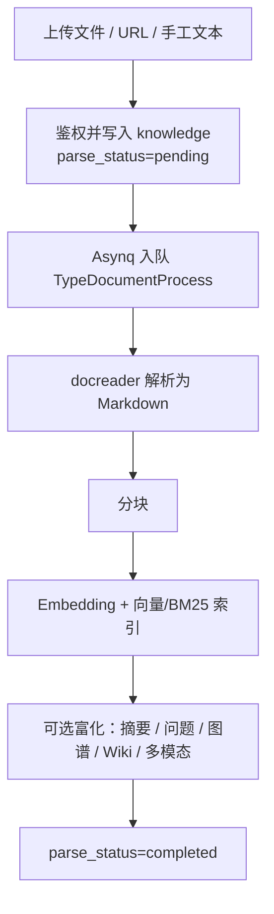
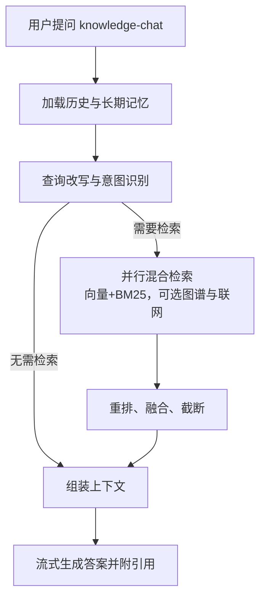

# WeKnora 知识库链路

本文根据上游文档整理 WeKnora 的知识处理路径，对照提交与 [analysis.md](./analysis.md) 相同（`81a0304`，仓库版本 0.9.0）。主要依据是仓库内的 [文档入库流程](https://weknora.weixin.qq.com/docs/02-architecture/03-document-pipeline)、[检索问答流程](https://weknora.weixin.qq.com/docs/02-architecture/04-rag-pipeline)、[知识图谱](https://weknora.weixin.qq.com/docs/03-features/09-knowledge-graph) 和 [模型管理](https://weknora.weixin.qq.com/docs/03-features/06-models)。尚未在本机用真实文档跑通端到端效果。

知识库链路分成两段：先把文档入库，再在会话里做检索增强问答。默认都走核心五个 Compose 服务，向量检索和关键词检索都在 ParadeDB 里完成，不必先开 Qdrant 或 Neo4j。

## 文档入库

入库是异步的。浏览器、小程序或 API 可以把文件、URL 或手工文本送进某个知识库，对应接口大致是：

- `POST /api/v1/knowledge-bases/:id/knowledge/file`
- `POST /api/v1/knowledge-bases/:id/knowledge/url`
- `POST /api/v1/knowledge-bases/:id/knowledge/manual`

请求先经过前端 Nginx，再进入 `app` 的 Gin 处理层。中间件会做鉴权和知识库权限检查。服务层计算文件哈希做去重，经 `FileService` 把原文件写到本地卷或对象存储，并插入一条 `knowledge` 记录，`parse_status=pending`，然后向 Redis 中的 Asynq 队列投递 `TypeDocumentProcess`。接口返回 202 和知识 ID，前端再轮询或订阅进度。

Worker 领取任务后，主路径在 `knowledge_process.go`：

1. **解析。** 通过 gRPC 把文件字节或 URL 交给 `docreader`，得到 Markdown 文本和图片。音频会先走语音转写（ASR）。
2. **图片落存。** 抽出的图片再上传到存储后端。
3. **分块。** 按知识库配置做普通切分或父子块、按标题等策略。
4. **写库与索引。** 块写入 PostgreSQL，再批量 Embedding，建立向量索引和 BM25 关键词索引。默认检索引擎是 ParadeDB；若启用了相应 profile，也可以改用 Qdrant、Milvus、Weaviate、Doris 等。
5. **富化。** 核心索引完成后，再向其他队列投递可选后处理：图片多模态（OCR / 视觉描述）、摘要、问题生成、图谱抽取、Wiki 页面生成。

主状态机是 `pending → processing → finalizing → completed`。没有富化任务时，可以从 `processing` 直接到 `completed`。解析、分块或索引失败且重试用尽会变成 `failed`；用户可以取消解析，也可以 `reparse` 重新入队。还有 housekeeping 任务处理卡住的作业，以及单独的删除清理链路。FAQ 导入、知识克隆和移动是另外的入口，不经过完整的文件解析时仍会维护块和索引。

## 检索问答

问答走另一条事件插件管线，入口主要是：

- `POST /knowledge-chat/:session_id`：知识库问答，SSE 流式输出
- `POST /agent-chat/:session_id`：智能体对话，可再编排工具
- `GET /sessions/continue-stream/:session_id`：断线续传
- `POST /sessions/:session_id/stop`：停止生成

一次知识问答大致按下面的插件顺序推进：加载会话历史、召回长期记忆、查询改写与意图识别（需要时还做图谱实体抽取）。若意图判定不需要检索（例如闲聊），就跳过检索，直接组装上下文并生成。需要检索时，会并行做分块混合检索（默认向量 + BM25，可按配置走其他引擎）、可选的 Neo4j 实体检索，以及可选的联网搜索；结果去重后进入重排（可选重排模型、FAQ 加权、MMR、Wiki 加权等），再抓取部分网页全文、做融合合并、截断 Top-K，必要时用 DuckDB 做表格分析，最后把上下文写入提示词，流式调用对话模型。引用（references）会先于答案推给客户端。

输出经过每请求的 EventBus 和 StreamManager，以 SSE 事件推送思考过程、答案增量和完成标记。

## 知识图谱（可选，默认关闭）

WeKnora 有知识图谱能力，但不是默认核心服务。它在入库时抽取实体和关系，在问答时沿关系补充相关片段，和向量、关键词检索一起用。官方说明更适合人物、组织、产品或条款之间关系较多的资料。启用后会增加入库阶段的模型调用，并需要部署 Neo4j（预装 APOC 插件）。

要同时满足两级开关：

1. **全局：** Compose 使用 `--profile neo4j`，并把 `NEO4J_ENABLE` 设为 `true`。自 v0.1.6 起，旧变量 `ENABLE_GRAPH_RAG` 已不再被主应用读取。未启用时，内部图谱检索降级为空操作，独立查询接口返回 503，系统信息接口报告 `Not Enabled`。
2. **知识库级：** 知识库的 `IndexingStrategy.GraphEnabled` 与有效的 `ExtractConfig` 都要打开。

抽取任务按每个分块入队，用**对话模型**做抽取（不是单独一类图谱模型），再写入 Neo4j。问答阶段的 `CHUNK_SEARCH_PARALLEL` 会并行调用 `SearchNode`。不启用图谱时，混合检索和问答仍然可用。

## 模型类型

起步配置只需要对话模型和嵌入模型，就可以走通常的入库和问答。这不是系统只支持两种模型。`internal/types/model.go` 里定义了五类：

| 类型（后端） | 前端标识 | 用途 |
| --- | --- | --- |
| `KnowledgeQA` | 对话模型 / `chat` | 知识问答、Agent 推理，以及摘要、问题生成、图谱抽取等所有大模型调用 |
| `Embedding` | 向量模型 / `embedding` | 文档和问题的向量化，供索引与查询 |
| `Rerank` | 重排模型 / `rerank` | 对召回片段重新排序 |
| `VLLM` | 视觉模型 / `vllm` | 文档或对话中的图片理解 |
| `ASR` | 语音模型 / `asr` | 音频转写 |

模型来源可以是远程 API，或本地 Ollama（重排模型不支持 Ollama）。官方文档写明内置二十多家厂商，包括 OpenAI、Azure OpenAI、Anthropic、DeepSeek、通义、智谱、混元、豆包、Gemini、硅基流动、OpenRouter、Ollama 等，也支持自定义 OpenAI 兼容接口。

## 尚未实测的部分

- 未在本机启动 Compose，也未用真实文档验证解析耗时、索引结果和问答质量。
- 未打开 Neo4j 对照抽取与检索前后的差异。
- 未配置重排、视觉或语音模型，也未验证 Ollama 与远程 API 的连通。
- 智能体、Wiki、数据源同步、IM 渠道等不在本文展开。
