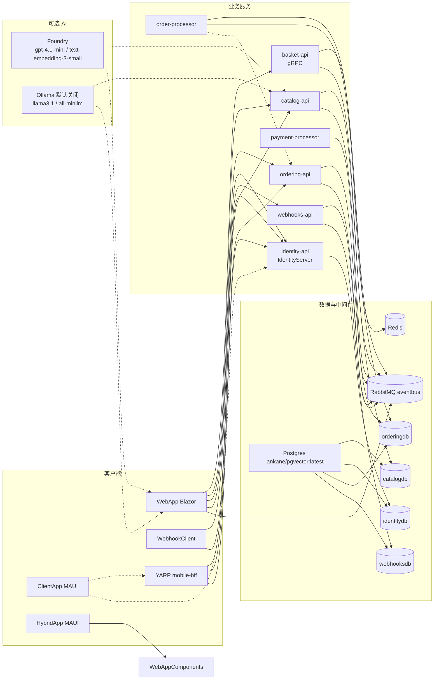

# eShop 项目步骤记录

仓库：https://github.com/dotnet/eShop
工作环境：Grok Bot 电脑（Debian 13 / x86_64），代码路径 `/workspace/eShop`

---

## Step 1：下载代码，创建运行环境（2026-11-15，UTC+8）

### 1. 下载代码
```bash
git clone https://github.com/dotnet/eShop.git /workspace/eShop
```
- 分支：main
- 提交：`913acea66708a59595351174cee9b29f37179d29`（Confine catalog picture reads to Pics (#1061)）

### 2. 安装 .NET 10 SDK
- `global.json` 要求 10.0.302（rollForward: latestFeature）
- 用 dotnet-install.sh 安装到 `~/.dotnet`，版本 SDK 10.0.303 / 运行时 10.0.11
- `~/.bashrc` 中加入 `DOTNET_ROOT`、`~/.dotnet`、`~/.dotnet/tools` 到 PATH

### 3. 安装 Aspire CLI
- 按 https://aspire.dev/get-started/install-cli/ 安装到 `~/.aspire/bin`
- `aspire --version` → 13.6.5

### 4. 安装容器运行时 Docker
- apt 源返回 500，改用 Docker 静态二进制安装到 `/usr/local/bin`，版本 29.9.3
- 补装 iptables 1.8.11（桥接网络需要）
- 手动启动 dockerd（无 systemd，重启后需重新执行）：
```bash
sudo dockerd --host=unix:///var/run/docker.sock --data-root=/var/lib/docker --pidfile=/var/run/docker.pid > /var/log/dockerd.log 2>&1 &
sudo chmod 666 /var/run/docker.sock
```
- 验证：`docker run --rm hello-world` 成功

### 5. 还原与构建
```bash
cd /workspace/eShop
dotnet restore eShop.Web.slnf   # 成功（中途一次 NuGet 超时后恢复）
dotnet build eShop.Web.slnf     # 成功，0 错误，12 条 NuGet 漏洞警告（测试项目）
npm ci                          # 成功，0 vulnerabilities
```

### 6. 运行验证
```bash
aspire start
aspire stop
```
- 拉起 Postgres（ankane/pgvector）、RabbitMQ 4.3、Redis 8.6
- 日志出现 `Distributed application started`，webapp / identity-api / order-processor 进入 Running
- 仪表板地址形如 `https://localhost:19888/login?t=<token>`
- 验证后已停止并清理容器

### 备注
- HTTPS 开发证书已生成，未执行 `dotnet dev-certs https --trust`
- 其他已有工具：git 2.47.3、Node v24.22.1、npm 11.21.1

**结果：完成 ✅**

---

## Step 2：项目结构、依赖、中间件、启动命令、部署环境分析（2026-11-15，UTC+8）

分析对象：`/workspace/eShop`，提交 `913acea66708a59595351174cee9b29f37179d29`（main）。以下均来自仓库文件，未猜测未在代码中出现的配置。

### 分析时读取 / 执行的内容
- 阅读：`eShop.slnx`、`eShop.Web.slnf`、`global.json`、`Directory.Build.props`、`Directory.Packages.props`、`nuget.config`、`package.json`、`aspire.config.json`、`.aspire/settings.json`
- 提取全部 `*.csproj` 的 TargetFramework、ProjectReference、PackageReference
- 阅读：`src/eShop.AppHost/AppHost.cs`、`Extensions.cs`、`Properties/launchSettings.json`、`appsettings.json`
- 阅读：`src/eShop.ServiceDefaults/*`，各服务 `Program.cs` 与 `Extensions/Extensions.cs`，`Identity.API/Configuration/Config.cs`、`UsersSeed.cs`
- 阅读全部 `Properties/launchSettings.json`、`playwright.config.ts`、`e2e/*`、`README.md`
- 阅读：`.github/workflows/*`、`ci.yml`、`.devcenter/catalog/definitions/imagedefinition.yaml`、`build/`、`es-metadata.yml`
- 检索：Dockerfile、azure.yaml / bicep、Dapper / HealthChecks.Uris 的实际引用

### 1. 项目结构

解决方案 `eShop.slnx` 共 **28** 个项目（src 19 + tests 9）。过滤方案 `eShop.Web.slnf` 含 **25** 个（排除两个 MAUI 客户端及 `ClientApp.UnitTests`，便于在无 MAUI workload 的环境构建 Web/服务端）。

另有 `src/Shared/`（不是独立 csproj，通过 `<Compile Include>` 链入若干项目）和 `e2e/`（Playwright TypeScript，不在解决方案里）。

#### 1.1 编排与共享

| 路径 | 角色 | 说明 |
|---|---|---|
| `src/eShop.AppHost` | 编排宿主（Aspire AppHost） | SDK `Aspire.AppHost.Sdk/13.6.0`；定义全部容器、数据库、服务、YARP、可选 AI |
| `src/eShop.ServiceDefaults` | 共享库 | 健康检查、OpenTelemetry、服务发现、HTTP 弹性、JWT Bearer、OpenAPI/Scalar、API 版本 |
| `src/Shared/` | 共享源文件（非项目） | `MigrateDbContextExtensions.cs`、`ActivityExtensions.cs`，被 Catalog / Identity / Ordering / Webhooks / EventBusRabbitMQ 以 Link 方式编译 |

#### 1.2 业务服务

| 路径 | 角色 | 关键目录 |
|---|---|---|
| `src/Identity.API` | 身份服务（Duende IdentityServer + ASP.NET Identity） | `Configuration/`（客户端/Scope）、`Data/`、`Quickstart/`、`Views/`、`UsersSeed.cs` |
| `src/Basket.API` | 购物篮 gRPC 服务 | `Grpc/`、`Proto/basket.proto`、`Repositories/`（Redis）、`IntegrationEvents/` |
| `src/Catalog.API` | 商品目录 HTTP API（含 v1/v2、向量检索） | `Apis/`、`Infrastructure/`（EF + Migrations）、`Pics/`、`Services/`、`Setup/catalog.json` |
| `src/Ordering.API` | 订单 HTTP API（CQRS + DDD） | `Apis/`、`Application/`（Commands/Queries/Behaviors/Validations/IntegrationEvents）、`Infrastructure/` |
| `src/Ordering.Domain` | 订单领域库 | `AggregatesModel/`（Order、Buyer）、`Events/`、`SeedWork/` |
| `src/Ordering.Infrastructure` | 订单基础设施库 | `EntityConfigurations/`、`Migrations/`、`Repositories/`、`Idempotency/` |
| `src/OrderProcessor` | 后台 Worker | 宽限期（Grace Period）扫描，向订单库写确认事件 |
| `src/PaymentProcessor` | 支付处理（仿真） | 订阅库存确认事件并发布支付成功/失败 |
| `src/Webhooks.API` | Webhook 注册与投递 API | `Apis/`、`Infrastructure/`、`Migrations/`、`IntegrationEvents/` |

#### 1.3 Web 前端与 BFF

| 路径 | 角色 | 关键目录 |
|---|---|---|
| `src/WebApp` | 在线商店（Blazor Server） | `Components/`（Pages、Layout、Chatbot）、`Services/`、`wwwroot/`；YARP 转发商品图 |
| `src/WebAppComponents` | 共享 Razor 组件库 | `Catalog/`、`Item/`、`Services/`；供 WebApp 与 HybridApp 复用 |
| `src/WebhookClient` | Webhook 演示客户端（Blazor Server） | `Components/`、`Endpoints/`、`Services/` |
| AppHost 中的 `mobile-bff` | YARP 反向代理（非独立 csproj） | 为移动端聚合 catalog / orders / identity 路由 |

#### 1.4 消息与集成库

| 路径 | 角色 |
|---|---|
| `src/EventBus` | 集成事件抽象（`IEventBus`、事件基类） |
| `src/EventBusRabbitMQ` | RabbitMQ 实现（`Aspire.RabbitMQ.Client` + 自研总线/遥测） |
| `src/IntegrationEventLogEF` | 集成事件日志（EF/outbox，依赖 EventBus） |

#### 1.5 客户端应用（仅在 slnx，不在 Web.slnf）

| 路径 | 角色 | 关键目录 |
|---|---|---|
| `src/ClientApp` | .NET MAUI 原生客户端 | `Views/`、`ViewModels/`、`Services/`（含 Basket gRPC 客户端 proto）、`Models/`、`Platforms/` |
| `src/HybridApp` | .NET MAUI Hybrid（WebView + 共享组件） | `Components/`、`Services/`、引用 `WebAppComponents` |

#### 1.6 测试与 e2e

| 路径 | 角色 | 测试框架 |
|---|---|---|
| `tests/Basket.UnitTests` | Basket.API 单元测试 | MSTest.Sdk |
| `tests/Basket.FunctionalTests` | Basket 功能测试（自带 Aspire + Redis） | Aspire.AppHost.Sdk + xunit.v3 |
| `tests/Catalog.FunctionalTests` | Catalog 功能测试（Aspire + PostgreSQL） | 同上 |
| `tests/Ordering.UnitTests` | 订单领域/应用层单元测试 | MSTest.Sdk |
| `tests/Ordering.FunctionalTests` | 订单功能测试（Aspire + PostgreSQL + Identity） | Aspire.AppHost.Sdk + xunit.v3 |
| `tests/Webhooks.FunctionalTests` | Webhooks 功能测试（Aspire + PostgreSQL + RabbitMQ） | 同上 |
| `tests/Application.UnitTests` | 跨多个服务的应用层单元测试 | MSTest.Sdk |
| `tests/eShop.AppHost.UnitTests` | AppHost 配置测试（转发头、Foundry 开关等） | MSTest.Sdk |
| `tests/ClientApp.UnitTests` | MAUI 客户端单元测试（不在 Web.slnf） | MSTest.Sdk |
| `e2e/` | Playwright 浏览器旅程 | `login.setup.ts`、`BrowseItemTest.spec.ts`、`CartTest.spec.ts`、`CheckoutTest.spec.ts`、`cart-helpers.ts` |

根目录其它要点：`README.md`、`CONTRIBUTING.md`、`ci.yml`（Azure DevOps）、`.github/workflows/`、`.devcenter/`（占位）、`build/`（旧版 eShopOnContainers 脚本，路径已不匹配当前仓库）、`img/`、`.config/`（VS / VS Code winget 配置）。当前仓库 **没有 Dockerfile**，也 **没有 azure.yaml / bicep**。

### 2. 所有依赖

#### 2.1 运行时与 SDK
- `global.json`：SDK `10.0.302`，`rollForward: latestFeature`，`allowPrerelease: false`；测试 runner 为 `Microsoft.Testing.Platform`；MSBuild SDK `MSTest.Sdk` 4.0.2
- `aspire.config.json`：Aspire SDK `13.6.0`，AppHost 路径 `src/eShop.AppHost/eShop.AppHost.csproj`
- 服务端 / 测试项目目标框架均为 **net10.0**
- ClientApp：`net10.0-android; net10.0-ios; net10.0-maccatalyst; net10.0`，Windows 另加 `net10.0-windows10.0.19041.0`
- HybridApp：`net10.0-android; net10.0-ios; net10.0-maccatalyst`，Windows 同上
- NuGet 源仅 `https://api.nuget.org/v3/index.json`（`nuget.config` 已 `<clear />`）
- `Directory.Build.props`：集中包版本、`TreatWarningsAsErrors`、产出到 `artifacts/`，并临时抑制 NU1901–NU1904；启用 `OpenAI.Experimental.EnableOpenTelemetry`

#### 2.2 NuGet 包（`Directory.Packages.props` 集中版本，按用途分组）

**Aspire 宿主与客户端（多为 13.6.0，部分 preview）**
- 宿主：`Aspire.Hosting.Dotnet` 13.6.0-preview.1.26479.8、`Aspire.Hosting.Azure.AppContainers` 13.6.0、`Aspire.Hosting.Foundry` 13.6.0-preview.1.26479.8、`Aspire.Hosting.PostgreSQL` / `RabbitMQ` / `Redis` / `Yarp` 13.6.0、`CommunityToolkit.Aspire.Hosting.Ollama` 13.1.1
- 服务客户端：`Aspire.Npgsql`、`Aspire.Npgsql.EntityFrameworkCore.PostgreSQL`、`Aspire.RabbitMQ.Client`、`Aspire.StackExchange.Redis` 均为 13.6.0；`Aspire.Azure.AI.OpenAI` 13.6.0-preview.1.26479.8；`CommunityToolkit.Aspire.OllamaSharp` 13.1.1

**ASP.NET / 身份 / API**
- ASP.NET 10.0.12 一组：JwtBearer、OpenIdConnect、Identity.EntityFrameworkCore / UI、OpenApi、Components.Web / QuickGrid、Mvc.Testing、TestHost 等
- `Asp.Versioning.Http` 10.2.3、`Asp.Versioning.Http.Client` 10.2.0、`Asp.Versioning.Mvc.ApiExplorer` 10.2.1、`Asp.Versioning.OpenApi` 10.2.3
- `Microsoft.OpenApi` 2.12.2、`Scalar.AspNetCore` 2.17.10
- Duende IdentityServer 7.3.2（含 AspNetIdentity、EntityFramework、Storage）

**数据**
- `Npgsql.EntityFrameworkCore.PostgreSQL` 10.0.3、`Microsoft.EntityFrameworkCore.Tools` / `Relational` 10.0.12
- `Pgvector` 0.3.2、`Pgvector.EntityFrameworkCore` 0.3.0

**可观测性 / 弹性 / 服务发现**
- OpenTelemetry 1.19.x（OTLP Exporter、Hosting、AspNetCore / Http / Runtime Instrumentation）；`OpenTelemetry.Instrumentation.GrpcNetClient` 1.15.0-beta.1
- `Microsoft.Extensions.Http.Resilience`、`ServiceDiscovery`、`ServiceDiscovery.Yarp` 均为 10.10.0

**消息、校验、gRPC 及其它**
- `MediatR` 13.1.0、`FluentValidation` / DI 扩展 12.1.1
- `Grpc.AspNetCore` / `Grpc.Net.ClientFactory` / `Grpc.Tools` 2.84.0、`Google.Protobuf` 3.36.2
- 测试：`MSTest` 4.0.2、`xunit.v3.mtp-v2` 3.2.2、`NSubstitute` 5.3.0
- `Directory.Packages.props` 中还声明了 `Dapper` 2.1.89、`AspNetCore.HealthChecks.Uris` 9.0.0，但各 csproj **没有**对应 PackageReference（当前代码未直接引用）

**MAUI 客户端（版本写在各自 csproj，未走上面的集中版本表）**
- ClientApp：`Microsoft.Maui.Controls` 及 Compatibility / Maps **9.0.30**，`CommunityToolkit.Maui` 9.1.1、`CommunityToolkit.Mvvm` 8.3.2、`IdentityModel` 7.0.0、`IdentityModel.OidcClient` 6.0.0，以及内联版本的 Grpc/Protobuf 工具
- HybridApp：`Microsoft.AspNetCore.Components.WebView.Maui` 9.0.30、Maui Controls 9.0.30
- ClientApp.UnitTests：Maui 包为 **9.0.40**

#### 2.3 npm（根目录 `package.json`，仅 e2e）
- 脚本：`test:e2e` / `test:e2e:headed` / `test:e2e:report`
- devDependencies：`@playwright/test` ^1.62.1、`@types/node` ^26.1.2、`dotenv` ^17.4.2

#### 2.4 关键项目引用关系

```
eShop.AppHost
  （无 ProjectReference；用 AddDotnetProject 指向各服务路径）

Identity.API          → ServiceDefaults
Basket.API            → ServiceDefaults, EventBusRabbitMQ
Catalog.API           → ServiceDefaults, EventBusRabbitMQ, IntegrationEventLogEF
Ordering.API          → ServiceDefaults, EventBusRabbitMQ, IntegrationEventLogEF, Ordering.Domain, Ordering.Infrastructure
Ordering.Infrastructure → Ordering.Domain, IntegrationEventLogEF
OrderProcessor        → ServiceDefaults, EventBusRabbitMQ
PaymentProcessor      → ServiceDefaults, EventBusRabbitMQ
Webhooks.API          → ServiceDefaults, EventBusRabbitMQ, IntegrationEventLogEF
WebApp                → ServiceDefaults, EventBusRabbitMQ, WebAppComponents
WebhookClient         → ServiceDefaults
HybridApp             → WebAppComponents
EventBusRabbitMQ      → EventBus
IntegrationEventLogEF → EventBus
```

测试项目分别引用被测服务；功能测试项目自身也是 Aspire AppHost（13.6.0）。

### 3. 所有中间件

#### 3.1 AppHost 编排的资源（`src/eShop.AppHost/AppHost.cs`）

另外：`builder.AddForwardedHeaders()` 为所有 `DotnetProjectResource` 设置 `ASPNETCORE_FORWARDEDHEADERS_ENABLED=true`；`builder.AddAzureContainerAppEnvironment("aca")` 声明 Azure Container Apps 部署环境。

| 资源名 | 类型 | 镜像 / 版本（代码或实测） | 生命周期 / 说明 |
|---|---|---|---|
| `redis` | Redis | 代码未钉镜像；Step 1 实测拉到 `redis:8.6`（Aspire.Hosting.Redis 默认） | 与 `basket-api` 建立 ParentRelationship |
| `eventbus` | RabbitMQ | 代码未钉镜像；Step 1 实测拉到 `rabbitmq:4.3` | `ContainerLifetime.Persistent` |
| `postgres` | PostgreSQL + pgvector | **代码明确**：镜像 `ankane/pgvector`，标签 `latest` | Persistent |
| `catalogdb` | 数据库 | 位于 postgres | Catalog.API |
| `identitydb` | 数据库 | 位于 postgres | Identity.API |
| `orderingdb` | 数据库 | 位于 postgres | Ordering.API、OrderProcessor |
| `webhooksdb` | 数据库 | 位于 postgres | Webhooks.API |
| `mobile-bff` | YARP | Aspire.Hosting.Yarp | 对外 HTTP；转发 catalog / orders / identity（带 api-version 查询参数） |
| `foundry`（可选） | Microsoft Foundry | 当配置/环境 `UseFoundry=true` | 部署 `chatModel` = `gpt-4.1-mini`（`2025-04-14`，OpenAI）、`textEmbeddingModel` = `text-embedding-3-small`（`1`，OpenAI） |
| `ollama`（可选，默认关） | Ollama | 代码里 `bool useOllama = false`，需改源码才启用 | `all-minilm`（embedding）、`llama3.1`（chat），带 DataVolume、GPU、OpenWebUI |

**服务依赖（WithReference / WaitFor / 环境变量）**

| 服务（AppHost 名） | 引用 / 等待 | 其它 |
|---|---|---|
| `identity-api` | `identitydb` | 对外 HTTP；健康检查 `/health`；再注入各客户端回调 URL（与 WebApp 等形成环） |
| `basket-api` | `redis`；`eventbus`（WaitFor）；`Identity__Url` | |
| `catalog-api` | `eventbus`（WaitFor）；`catalogdb` | 启用 Foundry 时 WaitFor `textEmbeddingModel`；启用 Ollama 时 WaitFor embedding 并设 `OllamaEnabled=true` |
| `ordering-api` | `eventbus`（WaitFor）；`orderingdb`（WaitFor）；`Identity__Url` | 健康检查 `/health` |
| `order-processor` | `eventbus`（WaitFor）；`orderingdb`；**WaitFor `ordering-api`**（等 EF 迁移） | |
| `payment-processor` | `eventbus`（WaitFor） | |
| `webhooks-api` | `eventbus`（WaitFor）；`webhooksdb`；`Identity__Url` | |
| `webhooksclient` | `webhooks-api`；`IdentityUrl`；`CallBackUrl`（自身端点） | 使用 http/https launch profile |
| `webapp` | `basket-api`、`catalog-api`、`ordering-api`；`eventbus`（WaitFor）；**WaitFor `identity-api`**；`IdentityUrl`；`CallBackUrl` | 对外 HTTP；启用 Foundry 时 WaitFor `chatModel` |
| `mobile-bff` | 路由指向 catalog / ordering / identity | 对外 HTTP |

环境变量 `ESHOP_USE_HTTP_ENDPOINTS=1` 时，Identity / WebApp / WebhookClient 改用 `http` launch profile（供 CI 中 Playwright 使用）。

#### 3.2 应用内中间件与集成

**eShop.ServiceDefaults（被几乎所有服务引用）**
- 健康检查：`AddCheck("self")`（tag `live`）；开发环境映射 `/health`（全部检查）与 `/alive`（仅 live）
- OpenTelemetry：日志 / 指标 / 追踪（ASP.NET、HttpClient、Runtime、gRPC 客户端、`Experimental.Microsoft.Extensions.AI`）；开发环境 `AlwaysOnSampler`；若配置 `OTEL_EXPORTER_OTLP_ENDPOINT` 则导出 OTLP
- 服务发现 + `AddStandardResilienceHandler()`（默认 HttpClient）
- JWT Bearer（`AddDefaultAuthentication`）：读取配置节 `Identity:Url` / `Audience`；DEBUG 下额外接受 `https://10.0.2.2:5243`（Android 模拟器）
- OpenAPI + API 版本 + Scalar（开发环境 `/scalar/{version}`，根路径重定向）

**Duende IdentityServer（Identity.API）**
- `AddIdentity` + `AddIdentityServer`（内存 Resources / ApiScopes / ApiResources / Clients）+ `AddAspNetIdentity` + `AddDeveloperSigningCredential`（代码注明不适合生产；`KeyManagement.Enabled = false`）
- 管道：`UseStaticFiles` → `UseCookiePolicy`（SameSite=Lax）→ `UseRouting` → **`UseIdentityServer`** → `UseAuthorization` → MVC
- 预置用户：`alice` / `bob`，密码均为 `Pass123$`（`UsersSeed.cs`）
- 客户端：`maui`、`webapp`、`webhooksclient`，以及 basket/ordering/webhooks 的 swaggerui（Implicit）
- API Scope：`orders`、`basket`、`webhooks`

**EventBus / RabbitMQ**
- 抽象在 EventBus，实现 `AddRabbitMqEventBus`（`AddRabbitMQClient` + HostedService 消费 + OpenTelemetry ActivitySource）
- 订阅关系（代码）：
  - Basket：`OrderStartedIntegrationEvent`（清空购物篮）
  - Catalog：订单待校验 / 已支付（库存相关）
  - Ordering：宽限期确认、库存确认/拒绝、支付成功/失败
  - OrderProcessor：扫描宽限期订单并发布确认
  - PaymentProcessor：`OrderStatusChangedToStockConfirmed` → 支付成功/失败
  - Webhooks.API：价格变更、已发货、已支付
  - WebApp：多种订单状态变更（通知 UI）

**gRPC**
- Basket.API：`AddGrpc()` + `MapGrpcService<BasketService>`（`basket.proto`）
- WebApp：`AddGrpcClient<Basket.BasketClient>`，地址 `http://basket-api`，带 access_token
- ClientApp：作为 gRPC 客户端编译同一 proto

**YARP / BFF**
- AppHost `mobile-bff`：`/catalog-api/...`、`/api/catalog/{*any}`、`/api/orders/{*any}`、`/identity/{*any}`，并按 `api-version` 匹配 1.0 / 1 / 2.0
- WebApp：`AddHttpForwarderWithServiceDiscovery()`，`MapForwarder("/product-images/{id}", "https+http://catalog-api", "/api/catalog/items/{id}/pic")`

**数据访问**
- Catalog / Identity / Webhooks：`AddNpgsqlDbContext` + 启动时 `AddMigration`（开发便利，代码注明不宜用于生产）
- Ordering.API：手动 `UseNpgsql` + `EnrichNpgsqlDbContext`（因上下文构造函数无法 pooling）
- OrderProcessor：`AddNpgsqlDataSource("orderingdb")`（非 EF）
- Basket：`AddRedisClient("redis")` + `RedisBasketRepository`
- Catalog 启用 `UseVector()`（pgvector）

**API 版本**
- Catalog.API、Ordering.API、Webhooks.API：`AddApiVersioning(ReportApiVersions=true)` + OpenAPI
- WebApp 调用 Catalog 使用 API v2.0，Ordering 使用 v1.0

**Web 认证**
- WebApp / WebhookClient：Cookie + OpenIdConnect（ClientId 分别为 `webapp`、`webhooksclient`，Secret 为 `secret`；开发关闭 `RequireHttpsMetadata`）
- 非开发环境：`UseExceptionHandler`、`UseHsts`；两者均 `UseAntiforgery`、`UseStaticFiles`；WebApp 另有 `UseHttpsRedirection`
- Blazor：Interactive Server + `ServerAuthenticationStateProvider`

**可选 AI**
- Catalog：有 `textEmbeddingModel` 连接串则用 Azure/OpenAI Embedding；或 `OllamaEnabled` 时用 Ollama `embedding`
- WebApp：有 `chatModel` 连接串则聊天客户端；或 Ollama `chat`；并 `UseFunctionInvocation()`
- AppHost 中 Ollama 默认关闭；Foundry 需显式 `UseFoundry=true`



### 4. 启动命令

仓库根目录（`aspire.config.json` 已指定 AppHost，避免与测试 AppHost 混淆）：

```bash
# 前台运行（推荐），启动完成后打印仪表板 URL
aspire run

# 后台
aspire start
aspire ps
aspire stop
```

Visual Studio：打开 `eShop.Web.slnf`，将 `src/eShop.AppHost/eShop.AppHost.csproj` 设为启动项目，Ctrl+F5。

测试：

```bash
dotnet test --solution eShop.Web.slnf

# Playwright（会自动启动 AppHost，需先有容器运行时）
npm ci
npx playwright install chromium
npm run test:e2e
```

`playwright.config.ts` 的 `webServer.command` 为 `dotnet run --project src/eShop.AppHost/eShop.AppHost.csproj`，`baseURL` 为 `http://localhost:5045`（WebApp http 端口）。CI 设置 `ESHOP_USE_HTTP_ENDPOINTS=1`。

可选 Foundry（需先 `az login`）：

```bash
aspire secret set "Azure:SubscriptionId" "<subscription-id>"
aspire secret set "Azure:Location" "eastus"
# PowerShell: $env:UseFoundry = "true"
# bash:
export UseFoundry=true
aspire run
```

**launchSettings 中的端口（单独启动某项目时使用；经 Aspire 编排时多数端口由运行时分配，仪表板端口来自 AppHost profile）**

| 项目 | http | https | 其它 |
|---|---|---|---|
| eShop.AppHost（仪表板） | 18848 | **19888** | OTLP `https://localhost:18076`；Resource Service `https://localhost:19076` |
| Basket.API | 5221 | — | `Identity__Url=http://localhost:5223` |
| Catalog.API | 5222 | — | |
| Identity.API | 5223 | 5243 | |
| Ordering.API | 5224 | — | |
| PaymentProcessor | 5226 | — | |
| Webhooks.API | 5227 | — | |
| OrderProcessor | 16888 | — | |
| WebApp | **5045** | 7298 | Playwright 使用 5045 |
| WebhookClient | 5062 | 7260 | IIS Express 64178 / ssl 44365 |

### 5. 部署环境

**本地开发前置（README + 本仓库）**
- 满足 `global.json` 的 .NET 10 SDK
- Aspire CLI（`aspire --version`）
- OCI 容器运行时（推荐 Docker Desktop，也支持 Podman）
- 无需单独安装 Aspire workload
- 可选：Visual Studio（ASP.NET workload）、VS Code + C# Dev Kit + Aspire 扩展、MAUI workload（仅客户端）
- Windows 另有 `.config/configuration.vs.winget` 与 `configuration.vsCode.winget`（开发者模式、WSL 等）
- `.devcenter/catalog/definitions/imagedefinition.yaml` 当前内容仅为 `Initial Commit`，不是可用的 Dev Box 镜像定义

**Azure Container Apps（当前推荐部署路径）**
- AppHost 已调用 `AddAzureContainerAppEnvironment("aca")`，可用 Aspire CLI 直接部署
- 仓库中 **没有** `azure.yaml` 或 bicep 清单；发布产物由 `aspire publish` / `aspire deploy` 生成
- 前置：本地同一套工具 + 正在运行的容器运行时 + Azure CLI、有效订阅、建资源权限
- README 命令：

```bash
az login
aspire deploy --list-steps
aspire deploy
# 非交互示例：
# Azure__SubscriptionId / Azure__Location / Azure__ResourceGroup
# aspire deploy --non-interactive
aspire publish    # 需要检查产物时；deploy 并不依赖事先 publish
aspire destroy    # 删除整个已配置资源组（含非 Aspire 创建的资源，需谨慎）
```

- README 警告：此示例把 **PostgreSQL、Redis、RabbitMQ 以容器形式** 部署到 ACA，仅用于评估/演示，不是生产数据方案
- Foundry 宿主集成包为 preview

**CI**
- GitHub Actions
  - `pr-validation.yml`：ubuntu，`dotnet build eShop.Web.slnf` + `dotnet test --solution eShop.Web.slnf`（忽略 md / ClientApp）
  - `pr-validation-maui.yml`：windows，仅 ClientApp 变更时安装 maui/android/ios/maccatalyst workload 并测试
  - `playwright.yml`：ubuntu，.NET 10.x + Node LTS，`npm ci`，安装 Chromium，`ESHOP_USE_HTTP_ENDPOINTS=1`，账号 `bob` / `Pass123$`，上传 playwright-report
  - `markdownlint.yml`：Node 20，全库 markdownlint
- Azure DevOps `ci.yml`：触发 `main`，1ES 模板，Windows VS2019 池，`UseDotNet`（global.json）后 `dotnet build eShop.Web.slnf`
- `build/acr-build/queue-all.ps1` 与 `build/multiarch-manifests/` 仍引用旧版 eShopOnContainers 路径（如 `src/Services/...`、`WebSPA`、`ocelotapigw`），与当前解决方案结构不一致，不能当作现行部署脚本

**结果：分析完成，已写入本文件 ✅**

---

## Step 3：本地部署运行（2026-11-15，UTC+8）

目标：在本机（Grok Bot 电脑 / Debian 13）用 Aspire 后台启动 eShop，保持运行，不部署到 Azure。代码路径 `/workspace/eShop`，提交仍为 `913acea66708a59595351174cee9b29f37179d29`。

### 执行的命令与过程

#### 1. 确认 / 启动 dockerd
此前 Step 1 已手动启动的 dockerd 仍在运行（pid 166181），`docker info` 成功。为保险执行：
```bash
sudo chmod 666 /var/run/docker.sock
```
（box 用户已加入 docker 组，socket 权限为 `srw-rw-rw- root:docker`。）

#### 2. 第一次 `aspire start`
```bash
cd /workspace/eShop
export PATH="$HOME/.aspire/bin:$HOME/.dotnet:$HOME/.dotnet/tools:/usr/local/bin:$PATH"
export DOTNET_ROOT="$HOME/.dotnet"
aspire start --non-interactive --nologo
```
- AppHost 启动成功；当时仪表板为 `https://localhost:19888/login?t=<TOKEN_FROM_aspire_ps>`（随后因重启已失效）
- 日志：`/home/box/.aspire/logs/cli_20261114T230014532_detach-child_80787f50c177465fb0481c9a5dcc88c2.log`

第一次启动后：除 `mobile-bff` 外，其余资源均 `Running / Healthy`。`mobile-bff` 为 `FailedToStart`。原因是 Aspire DCP 在创建容器网络隧道代理（`aspire-container-network-tunnelproxy`）时执行 `docker build --progress`，而本机安装的是 Docker 静态二进制，没有 Buildx，走 legacy builder，报错：
```
Failed to build image: docker command 'BuildImage' returned with non-zero exit code 125
DEPRECATED: The legacy builder is deprecated and will be removed in a future release.
Install the buildx component to build images with BuildKit:
https://docs.docker.com/go/buildx/
unknown flag: --progress
```

#### 3. 修复 Docker Buildx（供 YARP / 隧道镜像构建）
```bash
# 安装 docker-buildx v0.39.0
mkdir -p ~/.docker/cli-plugins
curl -fL -o ~/.docker/cli-plugins/docker-buildx \
  https://github.com/docker/buildx/releases/download/v0.39.0/buildx-v0.39.0.linux-amd64
chmod +x ~/.docker/cli-plugins/docker-buildx
sudo cp ~/.docker/cli-plugins/docker-buildx /usr/local/lib/docker/cli-plugins/
sudo cp ~/.docker/cli-plugins/docker-buildx /usr/libexec/docker/cli-plugins/
```
验证：`docker buildx version` → `github.com/docker/buildx v0.39.0`。但 DCP 调用时仍等价于 `DOCKER_BUILDKIT=0 docker build --progress`（legacy builder 不认识该参数）。因此增加包装脚本（真实客户端移到 `docker.bin`）：
```bash
sudo mv /usr/local/bin/docker /usr/local/bin/docker.bin
# /usr/local/bin/docker 为包装脚本：export DOCKER_BUILDKIT=1; exec /usr/local/bin/docker.bin "$@"
```
之后仅 `aspire resource mobile-bff start` 仍会立刻失败——AppHost/DCP 会话缓存了首次构建失败，并未重新执行 build。需要重启 AppHost。

#### 4. 重启 AppHost（成功拉起 mobile-bff）
```bash
aspire stop --non-interactive --nologo
aspire start --non-interactive --nologo
aspire wait webapp --status healthy --timeout 180 --non-interactive --nologo
```
重启后 **17 个资源全部 Running / Healthy**（含 mobile-bff）。当前进程与地址如下（以此次为准，服务保持运行）。

当前 `aspire ps`：
- Path：`eShop.AppHost.csproj`，Status：running，SDK：13.6.0
- AppHost PID：183739，CLI PID：183656
- Dashboard：`https://localhost:19888/login?t=<TOKEN_FROM_aspire_ps>`
- 日志：`/home/box/.aspire/logs/cli_20261114T230255592_detach-child_26d4f970018446669799105c3b44e217.log`

#### 5. 接口验证（curl）与截图
见下方「验证结果」。截图命令：
```bash
npx playwright install chromium   # Chromium 151.0.7922.34 / Playwright 1.62.1
npx playwright screenshot --ignore-https-errors --full-page --timeout 60000 \
  --wait-for-selector 'text=101 products' --wait-for-timeout 6000 \
  https://localhost:7298/ /workspace/eshop-home.png
npx playwright screenshot --ignore-https-errors --full-page --timeout 60000 \
  --wait-for-timeout 3000 \
  https://localhost:7298/item/99 /workspace/eshop-catalog-item.png
npx playwright screenshot --ignore-https-errors --full-page --timeout 60000 \
  --wait-for-selector 'text=webapp' --wait-for-timeout 5000 \
  'https://localhost:19888/login?t=<TOKEN_FROM_aspire_ps>' \
  /workspace/eshop-dashboard.png
```

### 资源表（重启后当前状态，`aspire describe` + `docker ps`）

| 名称 | 类型 | URL / 端口 | 状态 |
|---|---|---|---|
| webapp | Project | http://localhost:5045（会 307 到 HTTPS）、https://localhost:7298 | Running / Healthy |
| identity-api | Project | http://localhost:5223、https://localhost:5243 | Running / Healthy |
| catalog-api | Project | http://localhost:5222 | Running / Healthy |
| basket-api | Project | http://localhost:5221（仅 HTTP/2） | Running / Healthy |
| ordering-api | Project | http://localhost:5224 | Running / Healthy |
| webhooks-api | Project | http://localhost:5227 | Running / Healthy |
| order-processor | Project | http://localhost:16888 | Running / Healthy |
| payment-processor | Project | http://localhost:5226 | Running / Healthy |
| webhooksclient | Project | http://localhost:5062、https://localhost:7260 | Running / Healthy |
| mobile-bff | Container（YARP `mcr.microsoft.com/dotnet/nightly/yarp:2.3-preview`） | Aspire：http://localhost:41469、https://localhost:45357；Docker：127.0.0.1:32776→5000、127.0.0.1:32777→5001 | Running / Healthy |
| postgres | Container（`ankane/pgvector:latest`） | tcp://localhost:28956 | Running / Healthy（Persistent） |
| catalogdb | PostgresDatabase | （挂在 postgres） | Running / Healthy |
| identitydb | PostgresDatabase | （挂在 postgres） | Running / Healthy |
| orderingdb | PostgresDatabase | （挂在 postgres） | Running / Healthy |
| webhooksdb | PostgresDatabase | （挂在 postgres） | Running / Healthy |
| eventbus | Container（`rabbitmq:4.3`） | tcp://localhost:28955（5672） | Running / Healthy（Persistent） |
| redis | Container（`redis:8.6`） | Docker：127.0.0.1:32772→6379（TLS）、32773→6380；Aspire 另列 tunnel：tcp://localhost:37819、rediss://localhost:36893 | Running / Healthy |
| Aspire Dashboard | — | https://localhost:19888（登录含 token，见上） | 运行中 |

另有 DCP 隧道代理容器 `tunnel-proxy-...`（127.0.0.1:32774→15049、32775→15050），供 YARP 访问主机上的项目。

### 验证结果

| 检查 | 结果 |
|---|---|
| WebApp `http://localhost:5045/` | HTTP 200（先 307 到 `https://localhost:7298/`），标题 AdventureWorks，目录页（`@page "/"`） |
| WebApp `https://localhost:7298/` | HTTP 200，同样首页 |
| Catalog `GET /api/catalog/items?api-version=1.0` 及 `2.0` | HTTP 200，JSON `count=101`，首条为 Adventurer GPS Watch（id 99） |
| Catalog `/health` | HTTP 200，`Healthy` |
| Identity `https://localhost:5243/.well-known/openid-configuration` | HTTP 200，issuer 为 `https://localhost:5243`（http://5223 的发现文档同样 200） |
| Identity `/health`（http/https） | HTTP 200，`Healthy` |
| Ordering / Webhooks / Payment / OrderProcessor `/health` | HTTP 200，`Healthy` |
| Basket `/health` | 普通 HTTP/1.1 curl 返回 400：`An HTTP/1.x request was sent to an HTTP/2 only endpoint.`；`curl --http2-prior-knowledge` 返回 HTTP 200，`Healthy` |
| WebhookClient `http://localhost:5062/` | HTTP 200，HTML |
| Dashboard 登录 URL | Playwright 可进入资源列表；curl 跟随重定向时因 cookie 处理可能落到登录页，属预期 |
| mobile-bff | 资源为 Running/Healthy；`http://127.0.0.1:32776/` 返回 404（根路径无页面）；对 `/api/catalog/catalogBrands?api-version=1.0` 以及 Aspire 公布的 41469/45357 上带 `/catalog-api` 前缀的请求，curl 在 8–15s 内超时（未伪造成功）。网站本身走 catalog-api，不依赖这条 BFF 路径 |

截图（已保存，未编造）：
- `/workspace/eshop-home.png`：商店首页（hero「Ready for a new adventure?」、品牌/类型筛选、显示 101 products、分页）
- `/workspace/eshop-catalog-item.png`：商品详情 `/item/99` Adventurer GPS Watch / Solstix / $199.99
- `/workspace/eshop-dashboard.png`：Aspire 仪表板资源列表，17 个资源，mobile-bff 为 Running，右上角 Live run

### 遇到的问题与处理

1. **Docker 无 Buildx**：静态安装的 Docker 29.9.3 不能执行 `docker build --progress`，导致 YARP（mobile-bff）所需的容器网络隧道镜像构建失败。已安装 buildx v0.39.0，并用 `/usr/local/bin/docker` 包装脚本强制 `DOCKER_BUILDKIT=1`。
2. **首次失败被 DCP 缓存**：只执行 `aspire resource mobile-bff start` 不会重新 build，必须 `aspire stop` 后再 `aspire start`。重启后 mobile-bff 变为 Running/Healthy。
3. **Basket 仅 HTTP/2**：健康检查需 `--http2-prior-knowledge`，不是服务挂了。
4. **mobile-bff 业务路由 curl 超时**：容器已起来，但经 BFF 反代 catalog 的探测未在超时内返回。WebApp、Catalog API、Identity 均正常。仪表板上 catalog-api 曾出现日志标记（第一次启动时有 EF `Failed executing DbCommand` 记录，迁移后服务仍 Healthy）。
5. 未做 Azure 部署，也未使用 Azure 凭据。

### 如何停止 / 再次启动

停止整套服务（当前按用户要求保持运行，不要执行 stop，除非需要主动关掉）：
```bash
cd /workspace/eShop
export PATH="$HOME/.aspire/bin:$HOME/.dotnet:$HOME/.dotnet/tools:/usr/local/bin:$PATH"
export DOTNET_ROOT="$HOME/.dotnet"
aspire stop
# Persistent 容器（postgres / eventbus）可能仍在，可用 docker stop / docker rm 清理
```

再次启动：
```bash
# 若机器重启导致 dockerd 不在：
sudo dockerd --host=unix:///var/run/docker.sock --data-root=/var/lib/docker --pidfile=/var/run/docker.pid > /var/log/dockerd.log 2>&1 &
sudo chmod 666 /var/run/docker.sock
cd /workspace/eShop
aspire start
aspire ps
# 仪表板 URL 与 login token 每次启动都会变
```

确认 Docker 包装脚本仍在（`/usr/local/bin/docker` 应为强制 BuildKit 的脚本，`docker.bin` 为真实客户端），否则 mobile-bff 可能再次失败。

**结果：本地已部署并保持运行 ✅**（17/17 资源 Running/Healthy；WebApp / Catalog / Identity 验证通过。mobile-bff 进程健康，经 BFF 的 catalog 反代 curl 探测超时，已如实记录。）

---

## 附：在桌面浏览器中打开商店（2026-11-15 09:2x JST）

- 目的：在我电脑（box，Linux）的桌面 Chrome 窗口中打开 `https://localhost:7298`。
- 结果：两次尝试均为 `ERR_CONNECTION_REFUSED`（`http://localhost:5045` 同样失败），未出现证书提示。
- 排查：`ss -ltnp` 显示 WebApp 只监听 `127.0.0.1:7298 / 127.0.0.1:5045`（及 `[::1]`）；box shell 中 `curl -k https://localhost:7298` 返回 200、`http://localhost:5045` 返回 307，服务正常。桌面浏览器流量经出口代理转发，访问不到 box 本机的 localhost。未修改任何代理/网络设置。
- 替代：继续用无界面 Playwright Chromium 截图（与 Step 3 相同方式）：
  ```bash
  cd /workspace/eShop
  npx playwright screenshot --ignore-https-errors --timeout 60000 https://localhost:7298/ /workspace/eshop-home-now.png
  ```
  成功，截图 `/workspace/eshop-home-now.png`（首页，显示 101 products）。

## 附：在桌面打开带窗口的 Playwright 浏览器并保持运行（2026-11-15 09:27 JST）

- 脚本 `/workspace/pw-open.js`：用 Playwright 启动有界面的 Chromium（`headless: false`、`ignoreHTTPSErrors: true`），打开 `https://localhost:7298/` 后一直挂起不退出。
- 启动命令：
  ```bash
  cd /workspace/eShop
  DISPLAY=:11 NODE_PATH=$(pwd)/node_modules nohup node /workspace/pw-open.js > /workspace/pw-open.log 2>&1 &
  ```
- 结果：日志 `opened AdventureWorks`。桌面截图确认商店首页已显示（101 products）。进程 PID 为 208626，需要关闭时运行 `kill 208626`。
- 说明：Playwright 自带的 Chromium 不走桌面浏览器的出口代理，所以能访问本机 localhost。

## 附：AppHost 管理页面（Aspire 仪表板）（2026-11-15 09:29 JST）

- 查询登录地址：`aspire ps`（在 /workspace/eShop 下），Dashboard 列显示 `https://localhost:19888/login?t=<token>`。token 每次启动 AppHost 都会变。
- 打开方式：`/workspace/pw-dashboard.js`（与 pw-open.js 相同，只是把地址换成仪表板登录链接），命令为 `DISPLAY=:11 NODE_PATH=$(pwd)/node_modules nohup node /workspace/pw-dashboard.js > /workspace/pw-dashboard.log 2>&1 &`。PID 为 210637，关闭用 `kill 210637`。
- 结果：桌面上出现第二个 Chromium 窗口，已登录 eShop 仪表板，能看到 Resources、Parameters、Graph 三个视图。

## 附：文档提交到 GitHub 仓库（2026-11-15 09:37 JST）

- 从现在起，所有文档和报告都统一保存在 https://github.com/slackman-cn/dotnet-eShop 。
- 提交内容：
  - `docs/eShop-steps.md`
  - `docs/screenshots/`，共 6 张截图
  - `docs/scripts/pw-open.js` 和 `docs/scripts/pw-dashboard.js`
  - 根目录的中文 `README.md`
- 因为仓库是公开的，提交前已把仪表板登录令牌替换成 `<TOKEN_FROM_aspire_ps>`。
- 结果：已直接推送到 `main`，提交为 `632d328521bb0c5a0e3d4370b0a21e288486ecd5`（`560d425..632d328`），没有创建 PR。仓库里没有放 eShop 源代码。

---

## Step 4：架构设计研究（2026-11-15，UTC+8）

按用户要求，在不编造的前提下，基于 `/workspace/eShop` 源码（提交 `913acea66708a59595351174cee9b29f37179d29`）撰写微服务架构设计文档，按真实项目规划的口径组织。未执行 `aspire deploy`，也未向 GitHub 推送。

### 做了什么
- 阅读 AppHost、各微服务 Program/Extensions/csproj、集成事件发布与订阅、gRPC proto、Identity 客户端配置、EventBus/Outbox、订单状态机与下单命令、Catalog AI、README 与部署相关文件（确认仓库中没有 Dockerfile / azure.yaml / azd）。
- 结合 Step 3 本地实测的 17 个资源与 mobile-bff 问题。
- 产出中文文档，含架构总览与下单时序两张 mermaid 图、服务/事件清单、模式对照表，以及建议的团队划分与里程碑（规划部分已标明）。

### 主要阅读的文件
- `src/eShop.AppHost/AppHost.cs`、`Extensions.cs`、`eShop.AppHost.csproj`
- `src/eShop.ServiceDefaults/Extensions.cs`、`AuthenticationExtensions.cs`、`OpenApi.Extensions.cs`
- `src/Identity.API/Program.cs`、`Configuration/Config.cs`
- `src/Catalog.API/Program.cs`、`Extensions/Extensions.cs`、`Apis/CatalogApi.cs`、`Services/CatalogAI.cs`、相关 IntegrationEvents
- `src/Basket.API/Program.cs`、`Extensions/Extensions.cs`、`Proto/basket.proto`
- `src/Ordering.API/Program.cs`、`Extensions/Extensions.cs`、`Apis/OrdersApi.cs`、`Application/Commands/CreateOrderCommandHandler.cs`、`Application/Behaviors/TransactionBehavior.cs`、`Application/IntegrationEvents/*`
- `src/Ordering.Domain/AggregatesModel/OrderAggregate/OrderStatus.cs`、`src/Ordering.Infrastructure/OrderingContext.cs`
- `src/OrderProcessor/Services/GracePeriodManagerService.cs`、`GracePeriodOrdersRepository.cs`、`appsettings.json`
- `src/PaymentProcessor/Program.cs`、`PaymentOptions.cs`、支付事件处理器
- `src/Webhooks.API/Extensions/Extensions.cs`、`Apis/WebHooksApi.cs`
- `src/WebApp/Program.cs`、`Extensions/Extensions.cs`、`Services/OrderingService.cs`
- `src/EventBusRabbitMQ/RabbitMQEventBus.cs`、`src/IntegrationEventLogEF/*`、`src/EventBus/Abstractions/IEventBus.cs`
- `src/ClientApp/Services/Settings/SettingsService.cs`
- `global.json`、`aspire.config.json`、`Directory.Packages.props`、`README.md`、`eShop.slnx`

### 产出路径
- `/workspace/eshop-docs/docs/architecture.md`（主文档）
- `/workspace/architecture.md`（同内容副本，便于发送）
- 本步骤已追加到 `/workspace/eShop-steps.md`，并同步覆盖 `/workspace/eshop-docs/docs/eShop-steps.md`（同步副本中的仪表板登录令牌保持为占位符 `<TOKEN_FROM_aspire_ps>`）
- 打包：`/workspace/eshop-docs-step4.tar.gz`（内含 `docs/architecture.md`、`docs/eShop-steps.md`）

**结果：架构设计文档已完成，未推送仓库 ✅**

---

## Step 5：架构设计 v2（2026-11-15，Asia/Tokyo）

按用户反馈，v1（`docs/architecture.md`）过于简洁、缺少关键内容与源码，因此另写 v2，保留 v1 不动。未向 GitHub 推送。撰写期间未执行 `aspire stop`，eShop 编排保持运行。

### 做了什么
- 从 `/workspace/eShop` 源码（`main`，提交 `913acea66708a59595351174cee9b29f37179d29`）按真实行号摘录代码，版本号取自 `Directory.Packages.props`、`global.json`、`csproj`、`package.json`。
- 撰写中文文档 `architecture-v2.md`，覆盖技术选型、项目框架、服务拆分、模块通信、认证授权、开发、部署、测试、模式与规划。
- 在不停止 Aspire 的前提下运行单元测试：`dotnet test tests/Ordering.UnitTests/Ordering.UnitTests.csproj`。
- 复制文档到 `/workspace/architecture-v2.md`；将本步骤追加到步骤记录；同步到 `eshop-docs` 时替换仪表板令牌；打包 `eshop-docs-step5.tar.gz`。

### 运行的命令与结果

1. 确认编排仍在运行（摘要，令牌不写入公开副本）：

```bash
export PATH="$HOME/.aspire/bin:$HOME/.dotnet:$HOME/.dotnet/tools:/usr/local/bin:$PATH"
export DOTNET_ROOT="$HOME/.dotnet"
aspire ps --non-interactive --nologo
```

结果：AppHost `eShop.AppHost.csproj` 状态 `running`，SDK 13.6.0，Dashboard 位于 `https://localhost:19888/login?t=<TOKEN_FROM_aspire_ps>`（令牌每次启动都会变化，公开文档使用占位符）。

2. 单元测试（未停止 eShop）：

```bash
cd /workspace/eShop
dotnet test tests/Ordering.UnitTests/Ordering.UnitTests.csproj --no-progress --verbosity minimal
```

结果：通过，退出码 0。

```text
Test run summary: Passed!
  total: 43
  failed: 0
  succeeded: 43
  skipped: 0
  duration: 1s 116ms
```

未运行 FunctionalTests 与 Playwright，以免与正在演示的编排争用 Docker 资源或浏览器会话。

### 字数统计

统计规则：中文字符（CJK 统一汉字）+ 英文单词（拉丁字母词）。代码块指 Markdown 围栏 ` ``` ` 内的内容。

| 范围 | 中文字符 | 英文单词 | 合计 |
| --- | ---: | ---: | ---: |
| 正文（不含代码块） | 16665 | 3082 | 19747 |
| 代码块内 | 278 | 7815 | 8093 |
| 全文（含代码块） | 16943 | 10972 | 27915 |

正文合计 19747，落在 1 万到 2 万字要求内，且不含代码块已超过 1 万。代码围栏共 75 个，其中源码摘录（“摘自 `路径`”）70 处，另有目录树、mermaid 图、以及明确标注为“示例，非仓库代码”的新增服务示例、测试运行输出等。

### 产出路径
- `/workspace/eshop-docs/docs/architecture-v2.md`（主文档，v1 保留不动）
- `/workspace/architecture-v2.md`（同内容副本）
- 本步骤已追加到 `/workspace/eShop-steps.md`，并同步到 `/workspace/eshop-docs/docs/eShop-steps.md`（同步副本中的仪表板登录令牌替换为 `<TOKEN_FROM_aspire_ps>`）
- 打包：`/workspace/eshop-docs-step5.tar.gz`（内含 `docs/architecture-v2.md`、`docs/eShop-steps.md`）

**结果：架构设计 v2 已完成，未推送仓库 ✅**

---

## Step 6：Serverless / FaaS / BaaS 可行性对比（2026-11-15，Asia/Tokyo）

用户提问：这个项目是否可以改成 Serverless 架构（FaaS、BaaS），对比现在的技术方案有什么优势。本文基于已有源码分析与架构文档（v1 / v2，源码提交 `913acea66708a59595351174cee9b29f37179d29`）作评估，未编造新的源码细节，未停止正在运行的 eShop，未向 GitHub 推送，也未执行云部署。

### 做了什么
- 核对 AppHost 仍在运行（`aspire ps`，未执行 `aspire stop`）。
- 依据 `docs/architecture-v2.md`、`docs/architecture.md` 及既有源码结论，撰写中文对比文档，覆盖概念界定、逐服务可迁移性、优劣势对比和三条改造路径。
- 文档中的演示密钥、仪表板令牌均未写入；结论明确推荐混合路径 B。

### 运行的命令与结果

```bash
export PATH="$HOME/.aspire/bin:$HOME/.dotnet:$HOME/.dotnet/tools:/usr/local/bin:$PATH"
aspire ps --non-interactive --nologo
```

结果：AppHost `eShop.AppHost.csproj` 仍为 `running`，SDK 13.6.0，Dashboard 位于 `https://localhost:19888/login?t=<TOKEN_FROM_aspire_ps>`。未重启、未停止任何资源。

### 字数统计

统计规则与 Step 5 相同：中文字符 + 英文单词。本文无代码围栏。

| 范围 | 中文字符 | 英文单词 | 合计 |
| --- | ---: | ---: | ---: |
| 正文 / 全文 | 6449 | 707 | 7156 |

落在 4000–8000 字目标范围内。

### 产出路径
- `/workspace/eshop-docs/docs/serverless-faas-baas.md`（主文档）
- `/workspace/serverless-faas-baas.md`（同内容副本）
- 本步骤已追加到 `/workspace/eShop-steps.md`，并同步到 `/workspace/eshop-docs/docs/eShop-steps.md`（仪表板令牌替换为 `<TOKEN_FROM_aspire_ps>`）
- 打包：`/workspace/eshop-docs-step6.tar.gz`（内含 `docs/serverless-faas-baas.md`、`docs/eShop-steps.md`）

**结果：Serverless 对比文档已完成，未推送仓库 ✅**

---

## Step 7：决定放弃 Serverless 改造（2026-11-15，Asia/Shanghai）

用户明确决定：**放弃 Serverless 架构，没有明显优势。**

### 做了什么
- 将该决定记录为项目规划决策：后续不再按 FaaS / BaaS 改造本项目，继续采用现有的 .NET 10 + Aspire 进程型微服务方案。
- 在 `docs/serverless-faas-baas.md` 文首增加决策说明；原文作为评估记录保留，不再作为改造实施依据。
- 同步更新步骤记录，并提交到 `https://github.com/slackman-cn/dotnet-eShop` 的 `main` 分支。

### 决策原因（与 Step 6 评估一致）
- Serverless 在闲置成本、少运维中间件、工人弹性上有收益，但不是全面更优。
- 代价包括冷启动（首页 / 浏览）、连接池、Basket 的 gRPC、订单 Saga / Outbox 改造成本，以及本地 Aspire 一键编排体验变弱。
- 用户判断这些收益没有明显优势，因此不走混合路径或全量重构，维持现状架构。

### 产出路径
- 更新后的 `/workspace/eshop-docs/docs/serverless-faas-baas.md` 与 `/workspace/serverless-faas-baas.md`
- 本步骤已追加到 `/workspace/eShop-steps.md`，并同步到 `/workspace/eshop-docs/docs/eShop-steps.md`

**结果：决策已记录，准备提交仓库。**

---

## Step 8：将文档目录 `docs` 改为 `github-eShop`（2026-11-15，Asia/Shanghai）

用户要求：把仓库中的 `docs` 目录改名为 `github-eShop`，因为后续还会分析其他 .NET 项目；并在根目录 `README.md` 中记录本项目信息。

### 做了什么
- 将 GitHub 仓库 `slackman-cn/dotnet-eShop` 中的 `docs/` 重命名为 `github-eShop/`（`git mv docs github-eShop`，以保留历史）。
- 重写根目录 `README.md`：说明本仓库将收录多个 .NET 项目的分析文档；用表格索引当前项目；详细记录 eShop 的上游地址、对照提交、技术栈、架构决策和文档清单。
- 此前步骤记录中出现的 `docs/` 路径视为更名之前的历史写法，不回溯改写；自本步骤起，仓库内文档路径以 `github-eShop/` 为准。

### 产出路径
- 仓库根目录 `README.md`
- `github-eShop/`（原 `docs/` 下全部文件）
- 本步骤已追加到 `/workspace/eShop-steps.md`

**结果：目录调整与 README 项目信息已准备提交。**
