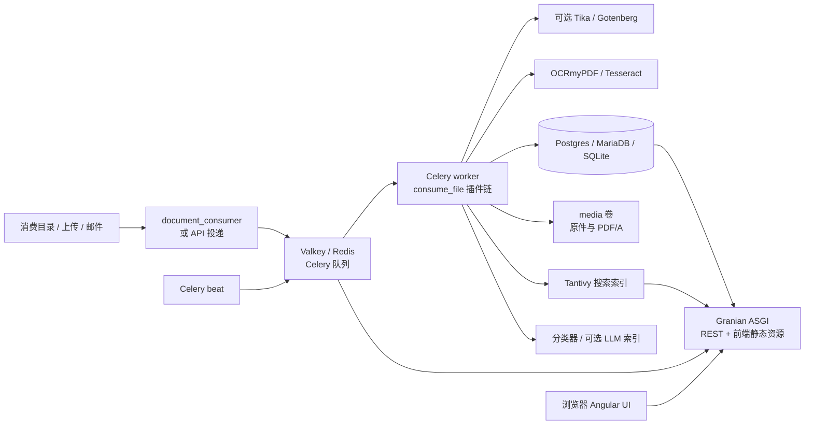
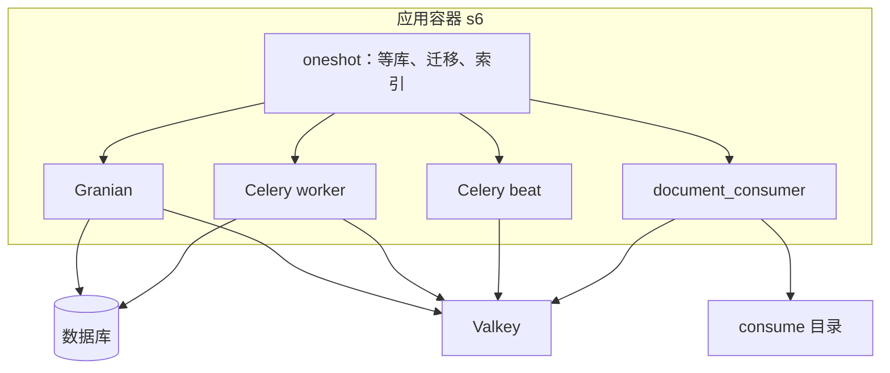

# paperless-ngx 仓库分析

本文依据本机浅克隆的源码与仓库内文档写成，对照提交为 [`4610171a94e5932e85a80e480032e397cdb6f309`](https://github.com/paperless-ngx/paperless-ngx/commit/4610171a94e5932e85a80e480032e397cdb6f309)（分支 `dev`，提交说明：`Chore (dev): add tsconfig missing types (#14771)`，提交时间 2026-11-14 09:33:39 -0800，即 **2026-11-15 01:33 Asia/Shanghai**）。软件版本在 `pyproject.toml`、`src/paperless/version.py` 与前端 `src-ui/package.json` 中均为 **3.4.2**。本文不是从零复现手册，也没有在本机实际拉起容器；启动命令与中间件均来自源码和仓库内文档。配置示例中的口令与密钥一律改成占位符。

## 1. 项目概述与目的

README 把 Paperless-ngx 定义为文档管理系统：把纸质或扫描件变成可检索的在线档案，从而「少留纸」。它是原 Paperless 以及 Paperless-ng 的官方后继项目。README 同时强调：扫描件常含敏感信息，数据以明文存放，**不应运行在不受信任的主机上**；更稳妥的做法是在自有本地服务器上运行并做好备份。

```20:22:README.md
Paperless-ngx is a document management system that transforms your physical documents into a searchable online archive so you can keep, well, _less paper_.

Paperless-ngx is the official successor to the original [Paperless](https://github.com/the-paperless-project/paperless) & [Paperless-ng](https://github.com/jonaswinkler/paperless-ng) projects and is designed to distribute the responsibility of advancing and supporting the project among a team of people.
```

```96:99:README.md
> Document scanners are typically used to scan sensitive documents like your social insurance number, tax records, invoices, etc. **Paperless-ngx should never be run on an untrusted host** because information is stored in clear text without encryption. No guarantees are made regarding security (but we do try!) and you use the app at your own risk.
> **The safest way to run Paperless-ngx is on a local server in your own home with backups in place**.
```

`docs/index.md` 的功能列表与代码结构相符，主要包括：按标签、往来方、类型等组织文档；在服务器本地存储；对扫描件做 OCR 并生成可检索文本和 PDF/A 归档；用机器学习自动建议标签、往来方和类型；可选接入大语言模型（默认关闭）做建议、对话与相似检索；支持 PDF、图像、纯文本，以及在启用 Tika/Gotenberg 时支持 Office 文档；全文检索；邮件导入；多用户权限与工作流；并行消费。前端是独立的 Angular 应用，构建后嵌入 Django 静态资源。许可在镜像标签中写为 `GPL-3.0-only`。

## 2. 目录结构

仓库根目录的主要条目如下（省略隐藏的工具配置文件中与运行关系不大的项）。

| 路径 | 作用 |
| --- | --- |
| `README.md`、`docs/` | 项目说明与完整文档（安装、配置、API、开发、排障等），站点配置见 `zensical.toml` |
| `src/` | Django 后端，`manage.py` 入口 |
| `src-ui/` | Angular 前端，pnpm 工作区 |
| `docker/` | 镜像 rootfs（s6-overlay 进程监督）、官方 Compose 模板、管理命令包装脚本 |
| `Dockerfile` | 多阶段构建：Node 编译前端，uv + Python 安装依赖，收集静态文件 |
| `pyproject.toml`、`uv.lock` | Python 项目元数据、依赖与锁文件 |
| `paperless.conf.example` | 裸机/开发用配置样例 |
| `install-paperless-ngx.sh` | 交互式 Docker Compose 安装脚本 |
| `scripts/` | 裸机 systemd 单元、开发用 `start_services.sh`、消费后脚本示例 |
| `.devcontainer/` | VS Code Dev Container（SQLite + Tika 组合） |
| `.github/workflows/` | CI、发布、文档部署与仓库机器人 |
| `LICENSE`、`CONTRIBUTING.md`、`SECURITY.md`、`AGENTS.md` | 许可与贡献说明 |

### 2.1 `src/`：Django 应用

`src/manage.py` 是管理命令入口。设置模块为 `paperless.settings`（见 `pyproject.toml` 中 `DJANGO_SETTINGS_MODULE`）。应用划分如下。

- **`paperless/`**：项目配置、ASGI/WSGI、URL、Celery 应用、认证适配、中间件、部分解析器注册（Tesseract、Tika、邮件、远程 OCR 等）。这是「站点」应用，不是文档领域模型的所在。
- **`documents/`**：核心领域。包含 `models.py`（文档、标签、往来方、类型、存储路径、自定义字段、分享链接、工作流等）、消费器 `consumer.py`、Celery 任务 `tasks.py`、分类器、检索（`search/`，Tantivy）、REST 视图与序列化、管理命令、权限、工作流、静态前端输出目录 `static/frontend/`。
- **`paperless_mail/`**：从邮箱拉取附件或正文并投入消费队列，含 OAuth、任务与管理界面。
- **`paperless_ai/`**：可选 AI 能力（嵌入、向量库、对话、分类建议、LLM 索引）。默认不作为必须启动的功能；由 `PAPERLESS_AI_ENABLED` 等设置控制，默认关闭。
- **`paperless_testing/`**：测试基础设施（工厂、示例文件、断言）。Ruff 配置明确禁止业务测试从 `documents.tests` 引用共享夹具，应使用该包。
- **`locale/`**：后端翻译（本检出下约 53 个语言目录）。
- **`conftest.py`**：pytest 共享配置。

`INSTALLED_APPS` 在设置中固定包含 `paperless`、`documents`、`paperless_mail`，以及 Django 管理后台、DRF、过滤器、guardian、allauth（含 MFA 与社交账号）、drf-spectacular 等；还可通过 `PAPERLESS_APPS` 追加。调试时才会加入 `channels`。

```136:161:src/paperless/settings/__init__.py
INSTALLED_APPS = [
    "whitenoise.runserver_nostatic",
    "django.contrib.auth",
    "django.contrib.contenttypes",
    "django.contrib.sessions",
    "django.contrib.messages",
    "django.contrib.staticfiles",
    "corsheaders",
    "django_extensions",
    "paperless",
    "documents.apps.DocumentsConfig",
    "paperless_mail.apps.PaperlessMailConfig",
    "django.contrib.admin",
    "rest_framework",
    "rest_framework.authtoken",
    "django_filters",
    "guardian",
    "allauth",
    "allauth.account",
    "allauth.socialaccount",
    "allauth.mfa",
    "allauth.headless",
    "drf_spectacular",
    "drf_spectacular_sidecar",
    *env_apps,
]
```

文档模型的核心是 `Document`：往来方、存储路径、标题、类型、用于检索的纯文本 `content`、MIME 类型、标签、原件与归档件校验和、页数等，并带所有者与软删除。

```216:283:src/documents/models.py
class Document(SoftDeleteModel, ModelWithOwner):  # type: ignore[django-manager-missing]
    ...
    title = models.CharField(_("title"), max_length=128, blank=True, db_index=True)
    ...
    content = models.TextField(
        _("content"),
        blank=True,
        help_text=_(
            "The raw, text-only data of the document. This field is "
            "primarily used for searching.",
        ),
    )
    ...
    checksum = models.CharField(
        _("checksum"),
        max_length=64,
        editable=False,
        db_index=True,
        help_text=_("The checksum of the original document."),
    )
```

### 2.2 `src-ui/`：前端

Angular 应用，包名 `paperless-ngx-ui`，版本同样是 3.4.2。生产构建输出到 `../src/documents/static/frontend/`，由 Dockerfile 复制进镜像。开发用 `pnpm start`（`ng serve`），测试用 Jest，e2e 用 Playwright。包管理器锁定为 `pnpm@11.15.1`，`preinstall` 通过 `only-allow pnpm` 阻止误用 npm/yarn。

### 2.3 `docker/` 与镜像

`docker/compose/` 存放面向用户的 Compose 模板（见第 4、6 节）。`docker/rootfs/` 是 s6-overlay 的文件系统：启动 oneshot（等 Redis/数据库、迁移、建超级用户、编译字节码、安装额外 Tesseract 语言、搜索索引、LLM 索引迁移等）以及长期服务 `svc-webserver`、`svc-worker`、`svc-scheduler`、`svc-consumer`、`svc-flower`。`docker/init-flow.md` 用图说明 oneshot 的并行与依赖。`docker/rootfs/usr/local/bin/` 把常用 `manage.py` 命令包成容器内可直接调用的脚本（导出、导入、重建索引、邮件抓取等）。

`Dockerfile` 分三阶段：`compile-frontend` 基于 `docker.io/node:24-trixie-slim`，用 pnpm 安装并 `ng build --configuration production`；`s6-overlay-base` 基于钉死摘要的 `ghcr.io/astral-sh/uv:0.13.7-python3.14-trixie-slim`，安装 s6-overlay **3.2.2.0**；`main-app` 安装运行时系统包与 Python 依赖，复制后端与前端，执行 `collectstatic` 与 `compilemessages`。数据卷为 `/usr/src/paperless/data`、`media`、`consume`、`export`。入口是 `/init`（s6），暴露 **8000**，健康检查请求 `http://localhost:8000`。

## 3. 依赖

### 3.1 Python（`pyproject.toml`）

`requires-python = ">=3.11"`，分类器列出 3.11 至 3.15。文档的裸机安装章节写的是支持 3.11、3.12、3.13、3.14，并说明政策是至少覆盖三个最近的版本。Docker 构建使用 Python 3.14。`[tool.uv] required-version = ">=0.9.0"`，`package = false`（不以可安装发行包的方式打包自身）。`uv.lock` 约 6208 行，钉死完整依赖图，分析时以 `pyproject.toml` 的范围为准，不以锁文件逐条展开。

主依赖可按用途分组（版本范围为文件中的声明，不是锁文件精确针）：

| 分组 | 主要包与范围 |
| --- | --- |
| Web / API | `django~=5.2.18`（注释强调 Django 不用 semver，只有补丁号保证不破坏兼容）、`djangorestframework~=3.16`、`drf-spectacular~=0.30`、`django-filter`、`django-cors-headers`、`django-compression-middleware`、`whitenoise~=6.11`、`channels~=4.2`、`channels-redis~=4.2` |
| 鉴权与审计 | `django-allauth[mfa,socialaccount]~=65.21.1`、`django-guardian`、`django-auditlog`、`python-ipware`、`python-gnupg` |
| 任务队列 | `celery[redis]~=5.6.2`、`redis[hiredis]~=6.4.0`、`flower>=2.0.1,<2.3` |
| ORM / 缓存 / 工具 | `django-cachalot`、`django-soft-delete`、`django-extensions`、`python-dotenv`、`jinja2`、`setproctitle`、`watchfiles`、`filelock` |
| OCR / PDF / 文件 | `ocrmypdf[heic]>=17.12,<17.13`、`pdf2image~=1.17.0`、`python-magic`、`pathvalidate`、`gotenberg-client`、`tika-client`、`zxing-cpp`（条码） |
| 检索 | `tantivy~=0.26.0`、`whoosh-compat[tantivy]==0.3`、`sqlite-vec==0.1.9` |
| 传统分类 | `scikit-learn~=1.9.0`、`rapidfuzz`、`langdetect`、`dateparser` |
| AI / 嵌入 | `torch>=2.13,<2.15`（uv 源指向 PyTorch CPU 索引）、`sentence-transformers`、`llama-index-core` 及 HuggingFace / Ollama / OpenAI-like 的嵌入与 LLM 插件、`openai`、`azure-ai-documentintelligence` |
| 邮件 | `imap-tools`、`httpx-oauth` |
| 其它 | `babel`、`turbohtml`、`ijson`、`regex` 等 |

可选 extra：

- `mariadb`：`mysqlclient>=2.2.7,<2.4`
- `postgres`：`psycopg[c,pool]==3.3.4` 及拆开的 `psycopg-c`、`psycopg-pool`；Linux 镜像构建时 `psycopg-c` 走 paperless-ngx/builder 预编译轮子
- `webserver`：`granian[uvloop]>=2.7,<2.9`

开发依赖组：`docs`（zensical）、`lint`（prek、ruff）、`testing`（pytest 及相关插件、factory-boy、daphne 等），`dev` 包含上述三组；另有 `typing` 组。

测试环境变量在 `pyproject.toml` 的 `[tool.pytest_env]` 中设置，包括非生产用途的密钥占位，并关掉真实 DB handler、改用内存缓存与内存 Channel layer。不要把测试密钥用于部署。

### 3.2 前端（`src-ui/package.json` 与锁文件）

框架是 **Angular ~22.2.3**（core/common/forms/router/localize 等），CDK 与 CLI 为 22.2.x。UI 主要还有 Bootstrap 5.3、ng-bootstrap、ng-select、ngx-color、pdfjs-dist、rxjs 7、file-saver、marked、uuid 等。开发依赖包括 Jest 30、Playwright、ESLint、Prettier、TypeScript 6。`packageManager` 为 `pnpm@11.15.1`。`package.json` **没有**单独的 `engines` 字段；开发文档写明需要 **Node.js 24+**，Dockerfile 前端阶段使用 `node:24-trixie-slim`。`pnpm-lock.yaml` 约 8475 行，钉死前端依赖图。

### 3.3 镜像与系统工具（Dockerfile / 裸机文档）

Dockerfile 的 `RUNTIME_PACKAGES` 安装（摘录）：

```119:156:Dockerfile
ARG RUNTIME_PACKAGES="\
  # General utils
  curl \
  # Docker specific
  gosu \
  # Timezones support
  tzdata \
  # fonts for text file thumbnail generation
  fonts-liberation \
  gettext \
  ghostscript \
  gnupg \
  icc-profiles-free \
  # PostgreSQL
  postgresql-client \
  # MySQL / MariaDB
  mariadb-client \
  # OCRmyPDF dependencies
  tesseract-ocr \
  tesseract-ocr-eng \
  tesseract-ocr-deu \
  tesseract-ocr-fra \
  tesseract-ocr-ita \
  tesseract-ocr-spa \
  unpaper \
  pngquant \
  jbig2dec \
  # lxml
  libxml2 \
  libxslt1.1 \
  # itself
  qpdf \
  # Mime type detection
  file \
  libmagic1 \
  media-types \
  zlib1g \
  poppler-utils"
```

另外从 paperless-ngx/builder 安装预编译的 **jbig2enc 0.30**。默认 OCR 语言包是英、德、法、意、西；更多语言可通过 `PAPERLESS_OCR_LANGUAGES` 在容器启动时安装（文档说明：以 rootless 方式运行时不能用该变量加语言）。本 Dockerfile 的运行时包列表中 **没有 ImageMagick**，分析不以它为镜像必备组件。

裸机安装在 `docs/setup.md` 中另行列出 Python 头文件、`libpq-dev`、`libmagic-dev`、`poppler-utils` 以及 OCRmyPDF 所需的 `unpaper`、`ghostscript`、`qpdf`、`pngquant` 等，与镜像意图一致。

## 4. 中间件与基础设施

官方推荐路径是 Docker Compose。`docs/setup.md` 写明新安装建议使用 **PostgreSQL**；若需要 Office 文档，选用带 `-tika` 的模板。所有面向用户的 compose 都声明：开机按先前状态重启、数据卷由 Docker 管理、导入/导出目录挂在 compose 文件同级目录、Web 默认监听 **8000**（Portainer 模板把宿主端口映射为 **8010**）。

代理镜像不是 `redis`，而是 **Valkey 9**（Redis 协议兼容）。应用侧连接串仍使用 `PAPERLESS_REDIS=redis://broker:6379`。

### 4.1 模板一览

| 文件 | 用途 |
| --- | --- |
| `docker/compose/docker-compose.postgres.yml` | Postgres + Valkey + 应用 |
| `docker/compose/docker-compose.postgres-tika.yml` | 同上，并启动 Tika 与 Gotenberg（Office 等） |
| `docker/compose/docker-compose.mariadb.yml` | MariaDB 12 + Valkey + 应用 |
| `docker/compose/docker-compose.mariadb-tika.yml` | MariaDB + Tika + Gotenberg |
| `docker/compose/docker-compose.sqlite.yml` | 无独立数据库容器，`PAPERLESS_DBENGINE=sqlite` |
| `docker/compose/docker-compose.sqlite-tika.yml` | SQLite + Tika + Gotenberg |
| `docker/compose/docker-compose.portainer.yml` | 基于 Postgres，宿主端口 **8010:8000**，便于 Portainer 使用 |
| `docker/compose/docker-compose.ci-test.yml` | **CI 集成测试**，不是最终用户栈：Gotenberg、Tika、Greenmail（IMAP 3143）、Nginx 8080 |
| `docker/compose/docker-compose.env` | 应用环境文件样例（密钥、OCR 语言、UID/GID 等） |
| `docker/compose/.env` | 仅 `COMPOSE_PROJECT_NAME=paperless` |

`.devcontainer/docker-compose.devcontainer.sqlite-tika.yml` 服务于开发容器，不属于 `docker/compose` 的生产模板。

### 4.2 各组件角色、镜像与端口

官方模板中的镜像标签是写死的（应用本身用 `latest`，随拉取更新）。下面把示例库口令改成占位符；上游模板原文使用开发默认值 `paperless`，部署时必须更换。

| 服务 | 角色 | 镜像（模板中的标签） | 端口 | 卷 / 说明 |
| --- | --- | --- | --- | --- |
| `webserver` | 应用容器：s6 同时拉起 Web、Celery worker、beat、消费器，可选 Flower | `ghcr.io/paperless-ngx/paperless-ngx:latest`（也可改为 Docker Hub 的 `paperlessngx/paperless-ngx:latest`） | 宿主 `8000:8000`（Portainer 模板为 `8010:8000`）；容器内 Granian 默认 8000。Flower 默认 **5555**，仅在设置 `PAPERLESS_ENABLE_FLOWER` 时启动，官方默认 compose **不**映射该端口 | `data`、`media`、`./export`、`./consume` |
| `broker` | Celery 经纪、Channels、缓存所用的 Redis 兼容服务 | `docker.io/valkey/valkey:9-alpine` | 容器内 6379，默认不对宿主发布 | `redisdata` |
| `db`（Postgres 模板） | 主数据库 | `docker.io/library/postgres:18` | 容器内 5432，默认不对宿主发布 | `pgdata` → `/var/lib/postgresql`；库名/用户 `paperless`，口令应设为 `<DEV_DB_PASSWORD>` |
| `db`（MariaDB 模板） | 主数据库 | `docker.io/library/mariadb:12` | 容器内 3306 | `dbdata`；另有 root 口令，同样应替换 |
| （SQLite） | 库文件放在应用 `data` 卷 | 无独立镜像 | — | `PAPERLESS_DBENGINE=sqlite` |
| `gotenberg` | Office / 部分格式转 PDF（含限制 JavaScript 的 Chromium 路由，用于 `.eml`） | `docker.io/gotenberg/gotenberg:8.38` | 容器内 3000 | 启动参数关闭 JS，并限制 `file:///tmp/` |
| `tika` | 提取 Office 等格式的文本与元数据 | `docker.io/apache/tika:3.3.1.0` | 容器内 9998 | 与 `PAPERLESS_TIKA_ENABLED=1` 一起使用 |

### 4.3 脱敏后的 Postgres + Tika 模板（官方路径）

使用前将 `<DEV_DB_PASSWORD>`、`<PAPERLESS_SECRET_KEY>` 换成自己的值。`docker-compose.env` 中的密钥不要使用样例里的 `change-me`。

```yaml
services:
  broker:
    image: docker.io/valkey/valkey:9-alpine
    restart: unless-stopped
    volumes:
      - redisdata:/data
  db:
    image: docker.io/library/postgres:18
    restart: unless-stopped
    volumes:
      - pgdata:/var/lib/postgresql
    environment:
      POSTGRES_DB: paperless
      POSTGRES_USER: paperless
      POSTGRES_PASSWORD: "<DEV_DB_PASSWORD>"
  webserver:
    image: ghcr.io/paperless-ngx/paperless-ngx:latest
    restart: unless-stopped
    depends_on:
      - db
      - broker
      - gotenberg
      - tika
    ports:
      - "8000:8000"
    volumes:
      - data:/usr/src/paperless/data
      - media:/usr/src/paperless/media
      - ./export:/usr/src/paperless/export
      - ./consume:/usr/src/paperless/consume
    env_file: docker-compose.env
    environment:
      PAPERLESS_REDIS: redis://broker:6379
      PAPERLESS_DBHOST: db
      PAPERLESS_DBENGINE: postgresql
      PAPERLESS_TIKA_ENABLED: 1
      PAPERLESS_TIKA_GOTENBERG_ENDPOINT: http://gotenberg:3000
      PAPERLESS_TIKA_ENDPOINT: http://tika:9998
  gotenberg:
    image: docker.io/gotenberg/gotenberg:8.38
    restart: unless-stopped
    command:
      - "gotenberg"
      - "--chromium-disable-javascript=true"
      - "--chromium-allow-list=^file:///tmp/.*"
  tika:
    image: docker.io/apache/tika:3.3.1.0
    restart: unless-stopped
volumes:
  data:
  media:
  pgdata:
  redisdata:
```

与官方 `docker-compose.postgres-tika.yml` 的差异仅是把数据库口令换成占位符。应用还通过 `env_file: docker-compose.env` 读取 `PAPERLESS_SECRET_KEY` 等。若要启用 Flower，需自行增加环境变量并映射 5555，这不是默认模板的一部分。

## 5. 进程与运行时模型

一个「webserver」容器里由 s6-overlay 监督多个进程，而不是 Compose 里再拆四个业务服务。入口 `/init` 先跑一组 oneshot（见 `docker/init-flow.md`）：读取环境、调整用户、等待数据库与 Redis、准备目录、编译字节码、执行 `manage.py migrate`（带文件锁）、可选创建超级用户、搜索索引初始化、LLM 索引迁移、系统检查、自定义 init。完成后再拉起长期服务。

长期服务及其命令（均在 `docker/rootfs/etc/s6-overlay/s6-rc.d/`）：

| 服务 | 命令 | 说明 |
| --- | --- | --- |
| `svc-webserver` | `granian --interface asginl --ws --loop uvloop "paperless.asgi:application"` | 默认绑定 `::`、端口 8000、1 个 worker，可用 `GRANIAN_*` 或 `PAPERLESS_BIND_ADDR` / `PAPERLESS_PORT` / `PAPERLESS_WEBSERVER_WORKERS` 覆盖 |
| `svc-worker` | `celery --skip-checks --app paperless worker --loglevel INFO --without-mingle --without-gossip` | 消费文档、训练分类器、索引、工作流等异步任务 |
| `svc-scheduler` | `celery --skip-checks --app paperless beat --loglevel INFO` | 周期任务；调度文件在 data 目录的 `celerybeat-schedule.db` |
| `svc-consumer` | `python3 manage.py document_consumer --skip-checks` | 监视消费目录；若设置 `PAPERLESS_CONSUMER_DISABLE` 则退出 |
| `svc-flower` | `celery --app paperless flower` | 仅当 `PAPERLESS_ENABLE_FLOWER` 非空时启动 |

进程之间的协作：消费器发现稳定文件后，把 `documents.tasks.consume_file` 投进 Celery（经纪为 Valkey/Redis）；worker 做解析、OCR、缩略图、入库、索引；Web 通过数据库与 Redis（Channels）向界面推送任务进度；邮件抓取由 beat 定时触发 `paperless_mail.tasks.process_mail_accounts`。工作流可以发出 Webhook（模型中有 `WorkflowActionWebhook`）。Celery 任务序列化使用带 HMAC 的 signed-pickle，设置注释写明是为了降低经纪被暴露时的风险。

```707:747:src/paperless/settings/__init__.py
CELERY_BROKER_URL = _CELERY_REDIS_URL
CELERY_RESULT_BACKEND = _CELERY_REDIS_URL
...
CELERY_WORKER_CONCURRENCY: Final[int] = get_int_from_env("PAPERLESS_TASK_WORKERS", 1)
...
CELERY_TASK_SERIALIZER = "signed-pickle"
CELERY_ACCEPT_CONTENT = ["application/json", "application/x-signed-pickle"]
```

默认周期任务（可用环境变量改 cron，或设为 `disable` 关闭）包括：检查邮箱（默认约每 10 分钟，并按密钥做偏移分散）、每小时训练分类器、每日优化搜索索引、每周日健全性检查、每日清空回收站、每小时检查定时工作流、每日重建 LLM 索引、清理过期分享包、清理过期会话。

裸机则拆成四个 systemd 单元（`scripts/paperless-*.service`），同样要求 Redis，Web 仍用 Granian。开发文档还要求单独启动 `celery beat` 才能跑周期任务；`docs/development.md` 示例的三个并行命令是 `runserver`、`document_consumer` 与 `celery worker`，**未**在同一行里启动 beat，本地若要定时邮件/训练需再开 beat 进程。

## 6. 启动命令

### 6.1 Docker Compose（主要路径）

从 `docker/compose` 复制一份 `docker-compose.*.yml` 为 `docker-compose.yml`，同时复制 `docker-compose.env` 与 `.env`，修改卷路径、端口与密钥后：

```bash
docker compose pull
docker compose up -d
```

首次打开 `http://127.0.0.1:8000`（或你映射的端口）会提示创建超级用户。也可以预先设置 `PAPERLESS_ADMIN_USER`（及相应口令环境变量），由容器 oneshot `init-superuser` 调用 `manage.py manage_superuser` 创建。文档建议新安装用 Postgres；需要 Word/Excel 等时用 `-tika` 文件。镜像默认从 GHCR 拉取。

### 6.2 官方安装脚本

```bash
bash -c "$(curl --location --silent --show-error https://raw.githubusercontent.com/paperless-ngx/paperless-ngx/main/install-paperless-ngx.sh)"
```

`install-paperless-ngx.sh` 要求非 root、已安装 wget、Docker 与 Compose 插件。脚本会询问 URL、端口（默认 8000）、时区、数据库后端（`postgres` / `sqlite` / `mariadb`，默认 postgres）、是否启用 Tika、OCR 语言、UID/GID、目标目录、管理员用户与邮箱等，然后下载对应 compose、写入环境、`docker compose up` 并创建超级用户。这是对上一小节的自动化，不是另一套架构。

### 6.3 裸机与开发

裸机：按 `docs/setup.md` 安装系统包与 Python 依赖，使用 `paperless.conf`，配置 systemd 单元。Web 命令与容器一致，使用 Granian；另需 `document_consumer`、`celery worker`、`celery beat`，以及自备的 Redis 兼容经纪和可选数据库、Tika、Gotenberg。仅支持 Linux。

开发（`docs/development.md`，在 `dev` 分支上工作）：

```bash
# 仓库根
uv sync --group dev
uv run prek install
mkdir -p consume media
# 复制 paperless.conf.example 为 paperless.conf，并设 PAPERLESS_DEBUG=true
cd src
uv run manage.py migrate
uv run manage.py createsuperuser
uv run manage.py runserver &
uv run manage.py document_consumer &
uv run celery --app paperless worker -l DEBUG
```

经纪可用 `docker run -d -p 6379:6379 --restart unless-stopped docker.io/valkey/valkey:9-alpine`，或运行 `scripts/start_services.sh`。需要注意：`start_services.sh` 里的镜像标签（`postgres:15`、`redis:latest`、`gotenberg/gotenberg:7.8`、`apache/tika:latest`）**与官方 compose 模板不一致**，且其中 Postgres 口令为脚本内字面值，只适合临时开发，不要当作当前推荐部署组合。

前端开发：Node 24+，在 `src-ui/` 执行 `pnpm install` 与 `pnpm start`。一次性生产构建：`pnpm ng build --configuration production`。也可用 Dev Container：重建容器后跑初始化任务（迁移、编译前端、创建超级用户等）。

### 6.4 与运行相关的管理命令

容器启动时会自动 `migrate`。常用命令（容器内也有同名包装脚本）包括：`createsuperuser` / `manage_superuser`、`document_consumer`、`document_exporter`、`document_importer`、`document_index`、`document_llmindex`、`document_create_classifier`、`document_retagger`、`document_renamer`、`document_archiver`、`document_thumbnails`、`document_sanity_checker`、`document_fuzzy_match`、`mail_fetcher`、`prune_audit_logs` 等。

## 7. 部署环境

Docker 是文档标明的首选路径，维护成本低于裸机。数据库后端为 **PostgreSQL、MariaDB 或 SQLite**；新安装推荐 Postgres。必须持久化的卷：

- `data`：应用数据（含 SQLite 库文件、Celery beat 调度、搜索索引等，视配置而定）
- `media`：原件与归档件等媒体
- `consume`：投放待导入文件的目录（也可改为绑定宿主机收件夹）
- `export`：导出目录

硬件方面，文档专设「在较低性能设备上运行」一节：可以在树莓派上运行，但 OCR 与分类训练较慢。建议包括：为省资源可用 SQLite（注意锁定问题）；可关闭文件系统消费器；`PAPERLESS_OCR_PAGES=1` 只识别首页；调低 `PAPERLESS_TASK_WORKERS` 与每 worker 线程数；保持 OCR 模式 `auto` 或改为事先 OCR；可关闭归档件生成；`PAPERLESS_OCR_CLEAN=none` 以节省内存；Docker 下可将 Web worker 设为 1。官方 compose 注释写明镜像支持 amd64、arm 与 arm64。本文未做本机性能测试。

### 7.1 CI（`.github/workflows/`）

| 文件 | 工作流名称 | 作用（据 YAML 的 `name` 与 job 名称，未整文件粘贴） |
| --- | --- | --- |
| `ci-backend.yml` | Backend Tests | 后端测试、类型检查与门禁 |
| `ci-frontend.yml` | Frontend Tests | 依赖安装、lint、单元测试、e2e、前端构建与门禁 |
| `ci-docker.yml` | Docker Build | 按架构构建并合并推送镜像 |
| `ci-docs.yml` | Documentation | 文档构建与部署 |
| `ci-lint.yml` | Lint | 仓库 lint |
| `ci-release.yml` | Release | 等待镜像、构建发布物、发布、追加 changelog |
| `ci-static-analysis.yml` | Static Analysis | zizmor、semgrep |
| `codeql-analysis.yml` | CodeQL | 代码扫描 |
| `cleanup-tags.yml` | Cleanup Image Tags | 清理镜像标签 |
| `crowdin.yml` / `translate-strings.yml` | Crowdin / 翻译字符串 | 同步与生成翻译 |
| `issue-bot.yml`、`pr-bot.yml`、`project-actions.yml`、`repo-maintenance.yml` | 各类机器人与仓库维护 | 议题/PR 自动化、过期讨论等 |

`docker-compose.ci-test.yml` 为后端带 `live`/`gotenberg`/`tika`/`greenmail`/`nginx` 标记的测试提供外部服务。

## 8. 配置面

完整选项在仓库内 `docs/configuration.md`，按章节分为：必需服务、可选服务、路径、日志、托管与安全、OCR、软件调优、文档消费、工作流 Webhook、来信、条码、审计、双面整理、回收站、分享链接、外部二进制、Docker 专用选项、前端、发信、远程 OCR、AI。下面按 `paperless.conf.example` 与 compose 环境样例归纳最常改的一组，秘密用占位符。

**必需服务与数据库**

- `PAPERLESS_REDIS`：经纪与 Channels 的 URL，例如 `redis://broker:6379` 或 `redis://localhost:6379`
- `PAPERLESS_DBHOST` / `PAPERLESS_DBPORT` / `PAPERLESS_DBNAME` / `PAPERLESS_DBUSER` / `PAPERLESS_DBPASS` / `PAPERLESS_DBSSLMODE`
- `PAPERLESS_DBENGINE`：`postgresql`、`mariadb` 或 `sqlite`（compose 模板会写上）
- 支持 `PAPERLESS_DBUSER_FILE` 这类 `_FILE` 后缀，从 Docker secret 读值

**路径**

- `PAPERLESS_CONSUMPTION_DIR`、`PAPERLESS_DATA_DIR`、`PAPERLESS_MEDIA_ROOT`、`PAPERLESS_STATICDIR`、`PAPERLESS_SCRATCH_DIR`、`PAPERLESS_EMPTY_TRASH_DIR`
- `PAPERLESS_FILENAME_FORMAT` 及去掉空占位的开关：控制归档在磁盘上的路径形态

**安全与托管**

- `PAPERLESS_SECRET_KEY`：必需，用 `python3 -c "import secrets; print(secrets.token_urlsafe(64))"` 生成，文档与配置中写 `<PAPERLESS_SECRET_KEY>`，不要提交真实值
- `PAPERLESS_URL`、`PAPERLESS_CSRF_TRUSTED_ORIGINS`、`PAPERLESS_ALLOWED_HOSTS`、`PAPERLESS_CORS_ALLOWED_HOSTS`
- `PAPERLESS_FORCE_SCRIPT_NAME`、`PAPERLESS_STATIC_URL`、`PAPERLESS_COOKIE_PREFIX`
- `PAPERLESS_AUTO_LOGIN_USERNAME`、`PAPERLESS_ENABLE_HTTP_REMOTE_USER`
- 社交账号同步超级用户/员工组的开关

**OCR 与消费**

- `PAPERLESS_OCR_LANGUAGE`（默认 eng）、`PAPERLESS_OCR_MODE`、`PAPERLESS_OCR_OUTPUT_TYPE`（样例为 pdfa）、页数、DPI、clean/deskew/旋转等
- 消费：轮询间隔（NFS 等无 inotify 的文件系统需设正数）、去重、递归、忽略模式、子目录作标签、条码与双面整理、消费前/后脚本

**软件与任务**

- `PAPERLESS_TASK_WORKERS`、`PAPERLESS_THREADS_PER_WORKER`、`PAPERLESS_TIME_ZONE`
- `PAPERLESS_WEBSERVER_WORKERS` / Granian 绑定
- `PAPERLESS_CONSUMER_DISABLE`、`PAPERLESS_ENABLE_FLOWER`
- 各周期任务的 `PAPERLESS_*_TASK_CRON`（见第 5 节）

**Tika**

- `PAPERLESS_TIKA_ENABLED`、`PAPERLESS_TIKA_ENDPOINT`、`PAPERLESS_TIKA_GOTENBERG_ENDPOINT`

**Docker 专用**

- `USERMAP_UID` / `USERMAP_GID`：让容器内用户能写宿主机消费目录；与 compose 里 `user: 'uid:gid'` 的 rootless 方式不要混用
- `PAPERLESS_OCR_LANGUAGES`：额外安装的 Tesseract 语言包
- `PAPERLESS_ADMIN_USER` 等：启动时创建超级用户

**AI（默认关闭）**

- `PAPERLESS_AI_ENABLED`（设置中默认 `"NO"`）
- `PAPERLESS_AI_LLM_BACKEND`、`PAPERLESS_AI_LLM_MODEL`、`PAPERLESS_AI_LLM_API_KEY`、`PAPERLESS_AI_LLM_ENDPOINT` 以及嵌入模型对应的一组变量。密钥同样不得写入仓库。

`paperless.conf.example` 里仍出现字面 `PAPERLESS_SECRET_KEY=change-me`，这只是样例，复制后必须更换。

## 9. 架构与数据流

容器视角：Valkey 与数据库（及可选 Tika/Gotenberg）是外部依赖；应用容器内同时运行 Web、worker、beat 和消费器。逻辑数据流如下。



消费器使用 `watchfiles` 监视目录（可退回到轮询），等文件大小与 mtime 稳定后调用 `consume_file.apply_async`：

```360:372:src/documents/management/commands/document_consumer.py
        consume_file.apply_async(
            kwargs={
                "input_doc": ConsumableDocument(
                    source=DocumentSource.ConsumeFolder,
                    original_file=filepath,
                ),
                "overrides": DocumentMetadataOverrides(tag_ids=tag_ids),
            },
            headers={"trigger_source": PaperlessTask.TriggerSource.FOLDER_CONSUME},
        )
```

worker 上的 `consume_file` 按插件链执行（预检、ASN、双面整理、条码、工作流触发、真正的 `ConsumerPlugin`）。`ConsumerPlugin.run` 会调用消费前脚本、选择解析器、解析并 OCR、生成缩略图、写入文档记录，再跑消费后脚本。解析器包括 Tesseract/OCRmyPDF、文本、邮件以及可选的 Tika 与远程 OCR。入库后更新 Tantivy 索引，并可触发分类器建议与工作流（含邮件通知或 Webhook）。前端通过 REST（默认 API 版本 10，允许 9 与 10）和 WebSocket/Channels 展示进度。

搜索不走外部搜索集群，而是进程内的 Tantivy 索引（`documents/search/`）。可选的向量检索与 LLM 对话在 `paperless_ai/`，依赖 `sqlite-vec`、sentence-transformers 或外部嵌入端点，且必须显式打开 AI 开关。传统的自动标签/往来方/类型仍由 `scikit-learn` 分类器承担，由 beat 定期训练。



## 10. 本检出的限制与备注

- 克隆是 `--depth 1` 的浅克隆，不能从本目录查看完整历史，也未执行 `git pull`。提交以 `4610171a94e5932e85a80e480032e397cdb6f309` 为准。
- **没有在本机部署或启动** Paperless、Valkey、Postgres 或 Tika。上文的端口、健康检查和启动顺序来自 Dockerfile、compose、s6 脚本和仓库文档，不是实测结果。
- 官方 compose 里应用镜像标签是 `latest`，与当前源码版本 3.4.2 不一定始终同一时刻对应；钉版本部署时应改用具体版本标签（本文未在源码中枚举所有已发布标签）。
- `scripts/start_services.sh` 的镜像版本落后于 `docker/compose` 模板，只适合对照开发文档理解「还需要哪些外部进程」，不应当作当前标准栈。
- 上游模板把数据库口令写成开发默认值；任何拷贝都必须改成 `<DEV_DB_PASSWORD>`，并把 `PAPERLESS_SECRET_KEY` 改成 `<PAPERLESS_SECRET_KEY>`。
- 默认 compose **不**启动 Flower；消费器可用环境变量关闭；AI 功能默认关闭。
- README 的安全说明仍然适用：数据明文存储，不适合放在不受信任的主机上。

## 附录：本分析引用的主要路径

`README.md`、`docs/index.md`、`docs/setup.md`、`docs/development.md`、`docs/configuration.md`、`pyproject.toml`、`Dockerfile`、`paperless.conf.example`、`install-paperless-ngx.sh`、`docker/compose/*.yml`、`docker/compose/docker-compose.env`、`docker/init-flow.md`、`docker/rootfs/etc/s6-overlay/s6-rc.d/svc-*/run`、`src/paperless/settings/__init__.py`、`src/paperless/settings/custom.py`、`src/paperless/version.py`、`src/documents/models.py`、`src/documents/tasks.py`、`src/documents/management/commands/document_consumer.py`、`src-ui/package.json`、`.github/workflows/*.yml`、`scripts/*.service`、`scripts/start_services.sh`。
