# paperless-ngx 架构设计文档

> 文档版本：v1（完整长文，按 3.4.2 源码与已验证的进程模型撰写）  
> 对应源码：上游仓库 [paperless-ngx/paperless-ngx](https://github.com/paperless-ngx/paperless-ngx)，默认分支 `dev`，提交 `4610171a94e5932e85a80e480032e397cdb6f309`（2026-11-14 09:33:39 -0800，即 **2026-11-15 01:33 Asia/Shanghai**）。版本号在 `src/paperless/version.py`、`pyproject.toml` 与前端 `src-ui/package.json` 中均为 **3.4.2**。分析期间未更新、未修改该源码。  
> 本机运行现状：同一环境已用官方 Postgres + Tika + Gotenberg Compose 将应用跑通，容器日志确认 Paperless-ngx v3.4.2、Granian 对外提供 HTTP、Celery worker 与 `document_consumer` 同时在应用镜像内工作。部署步骤与排障细节见同目录 `deploy.md`，仓库结构与依赖清单见 `analysis.md`。本文只借用已验证的进程模型，不把部署手册再写一遍。  
> 正文字数（中文字符 + 英文单词，不计围栏代码块、不计纯路径/命令行）：**18056**。文中 mermaid 图 **14** 张。  
> 文档性质：对现有项目的架构解读，不是从零复现手册，也不是尚未落地的设计草案。结论一律回到模型、任务、解析器、设置与信号处理器。  
> 机密处理：密钥与口令一律使用占位符 `<PAPERLESS_SECRET_KEY>`、`<DEV_DB_PASSWORD>`、`<SEED_ADMIN_PASSWORD>`，不写入运行目录中的真实值。

## 文档说明

paperless-ngx 要解决的问题可以概括成一句：把进入系统的各类文件（扫描件、数码 PDF、Office 文档、邮件及其附件）变成**可检索、可归档、可分享、可按规则自动分类**的文档对象，并在多用户环境下以对象级权限控制可见范围。它不是按业务域拆开的微服务集群，而是一个以 Django 为中心的**模块化单体**：同一个 Python 进程空间里划分 `documents`、`paperless`、`paperless_mail` 等应用，同一个容器镜像里用 s6-overlay 并行跑 Web、Celery worker、Celery beat 和消费目录监视进程。前端是独立的 Angular 22 单页应用，构建后作为静态资源由 Granian + WhiteNoise 一并送出。

理解这套架构，关键不在“用了哪些流行框架”，而在下面几条互相约束的设计选择：

1. **系统的事实来源是关系数据库中的 `Document` 行，加上介质目录里的原件与归档件。** 全文检索索引、分类模型、可选的 LLM 向量库都是派生物，丢了可以重建，原件和校验和不能丢。
2. **入库是一条可插拔的异步流水线，而不是控制器里的同步函数。** 无论文件来自消费目录、网页上传、REST API 还是邮件规则，最终都进入 Celery 任务 `documents.tasks.consume_file`，由一组插件依次处理预检、条码、工作流覆盖、解析与落库。
3. **文档对象本身没有“草稿 / 已发布”这类业务状态枚举。** 生命周期是“尚未入库 → 正在消费 → 在库（可软删除）→ 回收站 → 物理删除”，再叠加原件与 PDF/A 归档件、文档版本（`root_document` / `version_index`）两条正交轴。
4. **多用户不是另做一套租户库，而是在同一库上叠加所有者与 django-guardian 的对象权限。** 超级用户不受限；普通用户看到的是自己拥有的，以及被显式授予查看或更改权限的对象。
5. **AI 能力是默认关闭的扩展点。** 环境变量 `PAPERLESS_AI_ENABLED` 默认为 `NO`，`paperless_ai` 不在默认 `INSTALLED_APPS` 中。把它写成核心路径会误导读者。

本文按这些选择展开：先写技术选型与分层，再写数据模型、入库与 OCR、任务与搜索、工作流与邮件、权限与接口，最后用状态机把文档一生和后台任务串起来。正文中的模块名、字段名、任务名和枚举值均来自上述提交的源码；代码摘录只用于钉死设计，实现细节可以从略。

## 目录

- [1. 技术选型与设计原则](#1-技术选型与设计原则)
  - [1.1 选型原则](#11-选型原则)
  - [1.2 技术栈与职责边界](#12-技术栈与职责边界)
  - [1.3 为什么不是微服务](#13-为什么不是微服务)
- [2. 逻辑分层与进程模型](#2-逻辑分层与进程模型)
  - [2.1 逻辑分层](#21-逻辑分层)
  - [2.2 容器内的四条长驻进程](#22-容器内的四条长驻进程)
  - [2.3 启动顺序与依赖](#23-启动顺序与依赖)
  - [2.4 整体架构图](#24-整体架构图)
- [3. 数据归属与存储布局](#3-数据归属与存储布局)
  - [3.1 三类存储](#31-三类存储)
  - [3.2 目录约定](#32-目录约定)
  - [3.3 数据库引擎选择](#33-数据库引擎选择)
  - [3.4 数据归属图](#34-数据归属图)
- [4. 核心数据模型](#4-核心数据模型)
  - [4.1 所有者与匹配模型](#41-所有者与匹配模型)
  - [4.2 Document：系统的中心实体](#42-document系统的中心实体)
  - [4.3 标签、对应人、类型与存储路径](#43-标签对应人类型与存储路径)
  - [4.4 自定义字段、笔记与条码](#44-自定义字段笔记与条码)
  - [4.5 任务、分享与配置单例](#45-任务分享与配置单例)
  - [4.6 实体关系图](#46-实体关系图)
- [5. 文档入库主流程](#5-文档入库主流程)
  - [5.1 四条入口](#51-四条入口)
  - [5.2 消费目录监视](#52-消费目录监视)
  - [5.3 consume_file 插件链](#53-consume_file-插件链)
  - [5.4 落库之后的信号](#54-落库之后的信号)
  - [5.5 入库时序图](#55-入库时序图)
- [6. 解析器与 OCR 管线](#6-解析器与-ocr-管线)
  - [6.1 解析器注册与选择](#61-解析器注册与选择)
  - [6.2 光栅化文档与 OCRmyPDF](#62-光栅化文档与-ocrmypdf)
  - [6.3 Tika、文本与邮件解析](#63-tika文本与邮件解析)
  - [6.4 归档件生成策略](#64-归档件生成策略)
  - [6.5 OCR 管线图](#65-ocr-管线图)
- [7. 任务队列与定时调度](#7-任务队列与定时调度)
  - [7.1 经纪器与队列](#71-经纪器与队列)
  - [7.2 任务目录](#72-任务目录)
  - [7.3 PaperlessTask 追踪模型](#73-paperlesstask-追踪模型)
  - [7.4 Celery beat 日程](#74-celery-beat-日程)
  - [7.5 任务状态机与队列图](#75-任务状态机与队列图)
- [8. 搜索、分类与索引](#8-搜索分类与索引)
  - [8.1 Tantivy 全文索引](#81-tantivy-全文索引)
  - [8.2 查询入口](#82-查询入口)
  - [8.3 自动分类器](#83-自动分类器)
  - [8.4 搜索与索引图](#84-搜索与索引图)
- [9. 工作流引擎](#9-工作流引擎)
  - [9.1 触发类型](#91-触发类型)
  - [9.2 过滤条件](#92-过滤条件)
  - [9.3 动作类型](#93-动作类型)
  - [9.4 工作流图](#94-工作流图)
- [10. 邮件采集](#10-邮件采集)
  - [10.1 账号与规则](#101-账号与规则)
  - [10.2 采集循环](#102-采集循环)
  - [10.3 处理后的动作](#103-处理后的动作)
  - [10.4 邮件采集流程图](#104-邮件采集流程图)
- [11. 认证、授权与多用户](#11-认证授权与多用户)
  - [11.1 认证链路](#111-认证链路)
  - [11.2 所有者与对象权限](#112-所有者与对象权限)
  - [11.3 查询裁剪](#113-查询裁剪)
  - [11.4 权限模型图](#114-权限模型图)
- [12. API、前端与实时通道](#12-api前端与实时通道)
  - [12.1 REST 资源面](#121-rest-资源面)
  - [12.2 Angular 前端](#122-angular-前端)
  - [12.3 WebSocket 状态通道](#123-websocket-状态通道)
- [13. 文档生命周期与状态机](#13-文档生命周期与状态机)
  - [13.1 在库文档没有业务状态字段](#131-在库文档没有业务状态字段)
  - [13.2 软删除与清空回收站](#132-软删除与清空回收站)
  - [13.3 版本与归档件](#133-版本与归档件)
  - [13.4 生命周期状态图](#134-生命周期状态图)
- [14. 扩展点：远程 OCR 与 paperless_ai](#14-扩展点远程-ocr-与-paperless_ai)
- [15. 一致性、可靠性与已知限制](#15-一致性可靠性与已知限制)
- [16. 架构总结](#16-架构总结)
- [附录 A：本文依据的源码文件](#附录-a本文依据的源码文件)

---

## 1. 技术选型与设计原则

技术选型在这份项目里不是一份“当前流行清单”，而是一组为文档管理系统量身定的约束。后端必须长时间稳定地处理文件 I/O 和 CPU 密集的 OCR，前端必须提供强过滤、强权限的资料库界面，后台必须能把“目录里新出现一个文件”可靠地变成数据库中的一行。3.4.2 的选择可以看成对这条需求的连续回答。

### 1.1 选型原则

从设置模块、Docker 入口脚本和核心任务的组织方式，可以归纳出六条原则。原则本身是对结构的解读，仓库里并没有单独的“架构决策记录”文件。

第一，**用一个 Django 项目承载全部领域逻辑**。`INSTALLED_APPS` 里与业务直接相关的是 `paperless`、`documents.apps.DocumentsConfig`、`paperless_mail.apps.PaperlessMailConfig`，以及可通过 `PAPERLESS_APPS` 追加的扩展应用。认证、对象权限、REST、过滤器、OpenAPI、社交登录分别交给 django-allauth、django-guardian、Django REST Framework、django-filter、drf-spectacular。不把“文档”“邮件”“用户”拆成独立可部署服务，换来的是同一事务、同一套模型、同一套管理命令。

第二，**同步请求只做“接收与查询”，重活放到 Celery**。HTTP 层负责登录、CRUD、搜索请求和上传落盘；真正的解析、OCR、索引更新、分类训练、邮件拉取、定时工作流，一律是 `@shared_task`。这样 Web 进程不会被一份几十页的扫描件拖死，前端则通过 WebSocket 订阅进度。

第三，**经纪器遵守 Redis 协议，但官方组合里用 Valkey 提供实现**。设置从 `PAPERLESS_REDIS` 解析出 Celery 与 Channels 两个 URL，连接串形态是 `redis://broker:6379`。官方 `docker-compose.postgres-tika.yml` 使用 `valkey/valkey:9-alpine`。对应用代码而言，经纪器就是一个 Redis 兼容的列表与发布订阅服务，不绑定某一家发行版的专有命令。

第四，**文件与元数据分开保存，用校验和把它们钉在一起**。`Document.checksum` 是原件的摘要，`archive_checksum` 是归档 PDF 的摘要；原件、归档件、缩略图分别落在介质目录的 `originals`、`archive`、`thumbnails` 下。删除文档时再由信号处理器清理文件，避免“库里有行、盘上没文件”或相反的情况长期存在（定时 `sanity_check` 就是为此而设）。

第五，**解析能力可注册、可按 MIME 计分选择**。内置解析器包括文本、远程 OCR、Tika、邮件和基于 Tesseract / OCRmyPDF 的光栅化解析器。Office 支持并不做在 Django 进程里，而是通过可选的 Apache Tika 与 Gotenberg 侧车完成。这样核心镜像不必内嵌完整的 LibreOffice 栈，也能在需要时打开这条能力。

第六，**默认关闭昂贵或外部依赖的智能能力**。远程 OCR 与 LLM 相关字段集中在单例模型 `ApplicationConfiguration` 上；`PAPERLESS_AI_ENABLED` 默认 `NO`。系统在没有外部模型服务时依然是完整的文档库，只是少了向量检索和 AI 建议。

### 1.2 技术栈与职责边界

把 3.4.2 的主要技术按职责排开，可以得到下面这张表。版本以源码与官方模板为准，不把一次拉取的镜像摘要当成上游的版本承诺。

| 职责 | 选型 | 说明 |
| --- | --- | --- |
| Web / ASGI | Granian + Django 5.2（Python ≥ 3.11，官方镜像构建基于 3.14） | `ASGI_APPLICATION = paperless.asgi.application`；静态资源由 WhiteNoise 提供 |
| 前端 | Angular 22（`src-ui`，包版本字段 3.4.2） | 单页应用，登录后走 REST 与 WebSocket |
| API | Django REST Framework，默认版本 10，允许 9 与 10 | 路由由 `DefaultRouter` 注册；OpenAPI 由 drf-spectacular 生成 |
| 异步任务 | Celery，结果与代理走 Redis 协议 | 任务定义主要在 `documents.tasks` 与 `paperless_mail.tasks` |
| 实时推送 | Django Channels + Redis Pub/Sub 通道层 | 端点 `/ws/status/`，消费者 `StatusConsumer` |
| 关系数据 | PostgreSQL、MariaDB 或 SQLite，由 `PAPERLESS_DBENGINE` 选择 | 官方 postgres 模板使用 Postgres 18 |
| 全文检索 | Tantivy（`documents.search`，查询层保留 whoosh-compat） | 索引目录默认 `DATA_DIR/index` |
| OCR | OCRmyPDF + Tesseract；可选远程引擎（Azure AI） | 语言与模式可在配置单例中覆盖 |
| Office / 邮件渲染 | Apache Tika、Gotenberg（可选侧车） | `PAPERLESS_TIKA_ENABLED` 等环境变量打开 |
| 对象权限 | django-guardian | 与 `owner` 字段共同裁剪查询 |
| 身份 | Django User + allauth（含 MFA、headless、社交登录） | 会话、Token、Basic，以及可选的远程用户头 |
| 软删除 | django-softdelete | `Document`、`Note`、`ShareLink`、`CustomFieldInstance`、`WorkflowRun` |
| 进程监护 | s6-overlay（官方应用镜像） | 长驻：webserver、worker、scheduler、consumer，可选 Flower |
| 前端构建 | pnpm，Node 24+（开发约定） | 产物进入静态目录，不作为运行时进程 |

这张表里有一个容易被忽略的边界：Tika 和 Gotenberg 不是 Django 应用，也不进入 Celery 队列。它们是 HTTP 侧车。解析器在需要时向 `PAPERLESS_TIKA_ENDPOINT`（模板中为 `http://tika:9998`）和 `PAPERLESS_TIKA_GOTENBERG_ENDPOINT`（模板中为 `http://gotenberg:3000`）发起请求。系统可以在没有这两台侧车的情况下运行，只是 Office 与部分邮件渲染能力会缺失。

### 1.3 为什么不是微服务

按“文档入库、检索、邮件、用户”切开成多个可独立部署的服务，在纸面上说得通，但 3.4.2 的代码并没有走这条路。原因来自数据耦合，而不是技术偏好。

一条文档从进入消费目录到可以搜索，至少要同时改：介质目录里的文件、`Document` 及其标签和自定义字段、对象权限行、Tantivy 索引、可能的工作流运行记录、可选的分类模型与 LLM 索引。如果把这些切到不同的服务和数据库，就必须引入分布式事务或复杂的最终一致流程。当前设计用“一个库 + 一个介质树 + 一组在同一镜像里的进程”把这条路径收拢：入库任务在同一个 worker 里完成解析、写库、写盘，再通过 Django 信号触发索引和工作流。失败可以在任务级重试或标记失败，而不需要跨服务补偿。

这并不等于“没有边界”。应用边界体现在 Django app 和进程角色上：`documents` 拥有核心模型与消费流水线，`paperless_mail` 拥有账号、规则和拉信循环，`paperless` 拥有设置、ASGI、认证适配和解析器注册表，`paperless_ai` 是可关闭的扩展。部署边界体现在侧车上：数据库、Valkey、Tika、Gotenberg 都可以替换或省略。这种“模块化单体 + 可选侧车”比微服务更贴近个人和小型团队的自托管场景，也是官方 Compose 模板只发布一个 Web 端口的原因。

## 2. 逻辑分层与进程模型

### 2.1 逻辑分层

从请求进入到文件落盘，可以分成五层。它们不是五个仓库，而是同一份源码里的职责带。

**接入层。** Granian 接收 HTTP 与 WebSocket。HTTP 路由在 `paperless.urls`：`/accounts/` 交给 allauth，`/api/` 交给 DRF 路由器，`/share/<slug>/` 是分享链接的匿名入口，`/admin/` 是 Django Admin，`/ws/status/` 是状态通道。Angular 构建产物作为静态文件由 WhiteNoise 提供，浏览器里的“页面”并不由 Django 模板按业务页渲染。

**应用服务层。** ViewSet、序列化器、过滤器、权限类位于 `documents.views`、`documents.serialisers`、`documents.filters`、`documents.permissions`，邮件相关则在 `paperless_mail`。这一层负责鉴权、参数校验、查询裁剪，以及把“上传一个文件”转换成磁盘上的临时文件再投递 Celery 任务。它尽量不直接做 OCR。

**领域与任务层。** `documents.consumer` 中的插件、`documents.tasks` 中的共享任务、`documents.workflows`、`documents.matching`、`documents.classifier`、`paperless_mail.mail` 构成真正的领域行为。工作流、匹配算法、分类器训练、邮件动作都在这里，而不是在 ViewSet 里展开。

**持久化层。** Django ORM 映射到所选数据库；Whoosh 时代留下的查询语义由 `documents.search` 转到 Tantivy；分类模型默认是 `DATA_DIR/classification_model.pickle`；可选 LLM 索引在 `DATA_DIR/llm_index`。Guardian 的对象权限表与业务表同库。

**基础设施层。** Valkey（或任何 Redis 兼容实例）同时承担 Celery broker、结果后端和 Channels 层；Postgres / MariaDB / SQLite 承担事务数据；文件系统承担原件与派生文件；Tika / Gotenberg 承担特定格式转换。

分层的含义是：改 UI 不应改消费插件的顺序；改 OCR 引擎不应改权限裁剪；改数据库引擎不应改任务的函数签名。实际代码大体遵守这条线，少数地方会有穿越（例如消费插件里直接发 WebSocket 进度），这是为了让前端及时看到“正在生成缩略图”而做的实用折中。

### 2.2 容器内的四条长驻进程

官方应用镜像并不只跑一个 Web 进程。`docker/rootfs` 下的 s6 服务清楚地列出了长期服务：

- `svc-webserver`：Granian，对外绑定容器内 8000 端口，处理 HTTP 与 WebSocket。
- `svc-worker`：Celery worker，执行 `consume_file`、索引、训练、邮件、工作流等任务。
- `svc-scheduler`：Celery beat，按 `CELERY_BEAT_SCHEDULE` 把周期任务送到队列。
- `svc-consumer`：Django 管理命令 `document_consumer`，监视消费目录并把稳定文件投递为 `consume_file` 任务。
- `svc-flower`：可选，仅当启用 Flower 时启动。

这四条进程共享同一份代码、同一组环境变量、同一套介质卷和同一个数据库。它们不是四个微服务，而是同一应用的四个角色。本机用官方模板启动后，容器日志可以同时看到 Granian 监听、`celery@… ready` 以及 `Watching …/consume using native file system events`，与源码中的进程设计一致。

`document_consumer` 特别值得单独说明。它本身不解析 PDF，只做三件事：用操作系统原生通知（Linux 上是 inotify，macOS 上是 FSEvents）发现新文件；用稳定性跟踪避免读到还在写入的文件；调用 `consume_file.apply_async` 把工作交给 worker。若通知丢失，命令还会定期全量扫描消费目录，把漏掉的文件重新投递。这个“监视进程 + 工作进程”的分离，使目录投递与网页上传走同一条任务函数，行为一致。

### 2.3 启动顺序与依赖

s6 的一次性任务描述了冷启动必须先完成的事：等待数据库与经纪器就绪、按需安装 Tesseract 语言包、编译字节码、执行迁移、创建首次超级用户、检查系统配置、初始化搜索索引、可选的 LLM 索引迁移。其中“系统检查”会校验 `PAPERLESS_OCR_LANGUAGE` 对应的语言数据是否真正安装；语言包缺失时检查失败，Web 容器不会进入健康状态。这是配置与运行时能力必须一致的硬约束，而不是软警告。

运行时依赖顺序则更简单：Web、worker、beat、consumer 都要能访问数据库和经纪器；解析 Office 时还要能访问 Tika 与 Gotenberg。官方 Compose 用 `depends_on` 表达启动先后，但不保证依赖已经“就绪”，因此才有 `init-wait-for-db` 与 `init-wait-for-redis`。宿主机网络若切断容器互访，这几个进程会在初始化阶段失败——这属于部署环境问题，不改变架构本身的依赖方向。

### 2.4 整体架构图

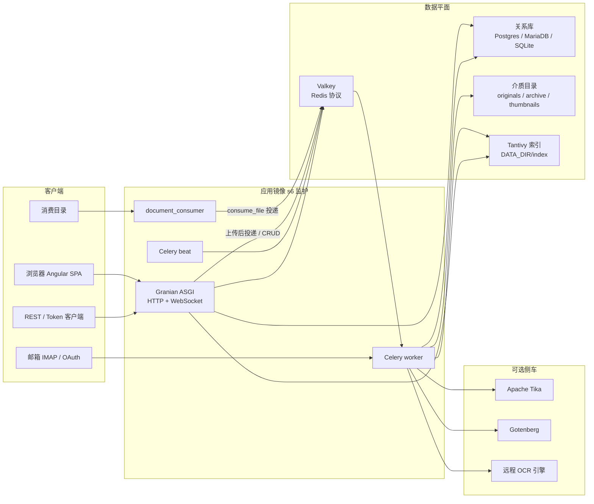

图中“邮箱进入 Worker”是因为拉信任务由 beat 定期投递、由 worker 执行，而不是由 Web 进程在请求线程里阻塞访问 IMAP。Web 只负责配置账号与规则。

## 3. 数据归属与存储布局

### 3.1 三类存储

paperless-ngx 把持久状态分成三类，职责不同，丢失后果也不同。

**关系库**保存所有结构化元数据：用户与组、文档行、标签与层次、对应人、类型、存储路径模板、自定义字段及实例、笔记、条码值、工作流定义与运行记录、邮件账号与规则、已处理邮件、分享链接、任务追踪、UI 设置，以及唯一的应用配置单例。对象权限也在同一库中，由 guardian 的表维护。这里是查询、授权和审计的起点。

**介质目录**保存二进制。原件按 `filename` 放在 `ORIGINALS_DIR`，归档 PDF 按 `archive_filename` 放在 `ARCHIVE_DIR`，缩略图以文档主键命名放在 `THUMBNAIL_DIR`，分享打包文件在 `SHARE_LINK_BUNDLE_DIR`。`Document` 上的路径字段是相对存储根的位置，不是任意绝对路径；属性 `source_path`、`archive_path`、`thumbnail_path` 负责拼出真实文件系统路径。

**派生物目录**位于 `DATA_DIR`：Tantivy 索引、分类模型 pickle、可选 LLM 索引、Celery beat 的日程库、日志。它们可以从关系库和原件重建。导出目录与消费目录是进出系统的交换区，消费成功后源文件会被取走，不应当成长期仓库。

这种划分决定了备份策略：要恢复一套可运行的实例，至少需要关系库转储和介质目录；索引可以在启动或维护任务里重建。把索引或分类模型当成唯一备份是不够的。

### 3.2 目录约定

设置模块用环境变量给出可覆盖的根路径，并在根路径下拼出约定子目录：

- `PAPERLESS_MEDIA_ROOT` → `media/documents/originals|archive|thumbnails`
- `PAPERLESS_DATA_DIR` → `data/index`、`data/llm_index`、分类模型、日志
- `PAPERLESS_CONSUMPTION_DIR` → 默认 `consume`
- `PAPERLESS_SCRATCH_DIR` → 解析与 OCR 的临时工作区
- 可选 `PAPERLESS_TRASH_DIR`：物理删除时把文件移到指定目录而不是直接抹掉

官方 Compose 把 `data` 和 `media` 做成 named volume，把 `consume` 与 `export` 绑定到运行目录旁的文件夹。对架构而言，重要的是“原件与归档件永远在介质树里，用字段名引用”，而不是具体的宿主机路径。文件名生成还受 `StoragePath.path` 模板约束，可以按对应人、日期、ASN 等字段排进子目录；`update_filename_and_move_files` 会在元数据变化后尝试重命名并移动文件，失败则抛出 `CannotMoveFilesException`，避免库路径与盘上对象分叉。

### 3.3 数据库引擎选择

`parse_db_settings` 承认三种引擎：`sqlite`、`postgresql`、`mariadb`。连接由 `PAPERLESS_DBHOST`、`PAPERLESS_DBPORT`、`PAPERLESS_DBNAME`、`PAPERLESS_DBUSER`、`PAPERLESS_DBPASS` 等变量构成。SQLite 适合单进程试用，但同一镜像里同时存在 Web、worker、beat、consumer 四个写者，生产向部署应使用 Postgres 或 MariaDB，以避免文件库的写锁和并发限制。官方之所以把 Postgres 模板与 Tika 模板放在一起推荐，是因为这条进程模型默认就是多进程写库。

无论哪种引擎，领域模型是同一套 Django 模型。软删除、生成列 `content_length`（由 `Length("content")` 持久化，用于统计）、唯一约束（如版本号在同一 `root_document` 下唯一、无主文档名在无所有者时全局唯一）都必须由引擎落实。选型可以换，表语义不能换。

### 3.4 数据归属图

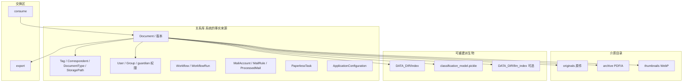

---

## 4. 核心数据模型

`documents/models.py` 是这份架构的词汇表。几乎所有流程都围绕这里的实体旋转。下面按设计角色说明，而不是按文件中的出现顺序做字段清单。

### 4.1 所有者与匹配模型

抽象基类 `ModelWithOwner` 只做一件事：可选外键 `owner` 指向 Django `User`，删除用户时置空而不是级联删除对象。文档、对应人、标签、类型、存储路径、保存的视图、任务、邮件账号与规则都建立在这条所有权之上。所有者为空表示“无主”，在权限模型里通常对更多人可见，具体裁剪见第 11 节。

`MatchingModel` 在所有者之上再加一套自动归类语言：`name`、`match`、`matching_algorithm`、`is_insensitive`。算法枚举是：

| 值 | 常量 | 含义 |
| --- | --- | --- |
| 0 | `MATCH_NONE` | 不自动匹配 |
| 1 | `MATCH_ANY` | 任一单词命中 |
| 2 | `MATCH_ALL` | 全部单词命中 |
| 3 | `MATCH_LITERAL` | 精确匹配 |
| 4 | `MATCH_REGEX` | 正则 |
| 5 | `MATCH_FUZZY` | 模糊词 |
| 6 | `MATCH_AUTO` | 交给训练好的分类器 |

`Correspondent`、`DocumentType`、`StoragePath`、`Tag` 都继承这套语言。入库之后，信号处理器会调用 `documents.matching` 里的 `match_correspondents`、`match_document_types`、`match_tags`、`match_storage_paths`，按用户可见范围挑选候选，再依算法或分类器给出建议或自动赋值。名称在“同一所有者下”唯一；无主对象的名称全局唯一。这避免了两个用户各建一个同名标签时互相踩踏，也避免无主标签被重复创建。

### 4.2 Document：系统的中心实体

`Document` 同时继承 `SoftDeleteModel` 与 `ModelWithOwner`。它表示一份已被系统接受的文件及其文本和归类结果，而不是“一次上传请求”。关键字段可以分成五组。

**归类与展示。** `title`（最长 128，可空，入库时可从文件名、邮件主题或工作流覆盖而来）、`correspondent`、`document_type`、`storage_path`、多对多 `tags`。这些字段决定列表如何分组、文件将落到哪条存储路径模板下。

**文本与检索。** `content` 是“仅文本”的全文，注释写明主要用于搜索；`content_length` 是数据库生成列，避免每次统计都对大文本做 `LENGTH`。`mime_type` 在入库时由解析或 libmagic 确定，不可由用户直接编辑。`get_effective_content()` 规定：若该行是根文档且存在版本，则对外展示与检索应使用最新版本的文本；版本行始终使用自身文本。`suggestion_content` 则在超长文本上取头部约 80 万字与尾部约 20 万字，供分类和建议使用，以免一次把过长文本送进分类器。

**完整性与物理归档。** `checksum` 是原件摘要，`archive_checksum` 是归档件摘要，二者都建索引，用来去重和做一致性检查。`filename`、`archive_filename` 是当前存储名，`original_filename` 保留用户上传时的名字。`archive_serial_number`（ASN）是可选的物理档案序号，范围 0 到 `0xFFFFFFFF`，全局唯一，用来把电子记录与纸质档案位置对应起来。`page_count` 在可知时填写。

**时间。** `created` 是文档的“业务日期”（日期字段，默认为今天，可被元数据或解析结果覆盖），`added` 是进入系统的时间，`modified` 自动更新。搜索、保存的视图和定时工作流都可能按这三个时间过滤。注意 `created` 不是行插入时间，这是有意为之：一封去年的信件，业务日期应是信件日期，而不是扫描当天。

**版本。** `root_document` 指向该版本所属的根文档，`version_index` 与 `version_label` 描述版本次序与可选标签。唯一约束保证同一根下版本号不重复。删除根文档时，会带着同一个 `transaction_id` 软删除全部版本，以便稍后一并恢复。这使“同一份合同的三次修订”在模型上是多行，在用户体验上仍是一份文档的历史。

`Document` **没有**名为 `status` 的业务状态字段。是否在回收站由软删除实现（`deleted_at` 等由 django-softdelete 提供）；是否正在入库要看对应的 `PaperlessTask`；是否有归档件看 `archive_filename` 是否为空。把这些正交事实捏成一个枚举，反而会无法表达“在回收站里但仍有归档件的旧版本”。

### 4.3 标签、对应人、类型与存储路径

`Tag` 在匹配模型之外增加颜色、收件箱标记和树形结构。`tn_parent` 指向父标签，最大嵌套深度为 5（根为 1）。`TagHierarchy` 一次读出全部父子关系，避免在循环里反复查库。给文档添加标签时，`add_nested_tags` 会把祖先一并加上，保证按父标签过滤时能看到子标签下的文档。`is_inbox_tag` 为真的标签会在新文档入库时自动打上，形成“待整理”队列；这是一个约定，不是单独的 Inbox 表。

`Correspondent` 与 `DocumentType` 结构更简单，主要靠匹配算法或分类器赋值。`StoragePath` 额外有一个 `path` 文本模板，决定原件在介质树中的相对位置。路径模板与文档元数据联动：对应人或日期变化后，信号 `update_filename_and_move_files` 负责改名搬家。

### 4.4 自定义字段、笔记与条码

`CustomField` 定义名称与数据类型，类型一旦创建不可改（`editable=False`），以免已有实例的存储列失去意义。支持的类型包括字符串、URL、日期、布尔、整数、浮点、货币、文档链接、单选和长文本。`CustomFieldInstance` 才是落到某份文档上的值，按类型写入不同的 `value_*` 列，并随文档软删除。文档链接类型把多份文档连成图，工作流和保存的视图可以用 `filter_custom_field_query` 做 JSON 编码的查询。

`Note` 挂在文档上，支持纯文本与 Markdown，同样软删除。`DocumentBarcode` 记录页码、值和格式，供后续按条码检索；是否在入库时把条码值持久化，由配置单例中的 `barcode_store_values` 等开关决定。条码还承担分拆文档、写入 ASN、打标签等编排职责，那是插件层的行为，见第 5 节。

### 4.5 任务、分享与配置单例

`PaperlessTask` 是给用户看的后台任务账本，不等于 Celery 自己的结果后端。它记录 `task_id`、任务种类、触发来源、状态、时间戳、等待与执行时长、输入与结果 JSON，以及是否已被用户确认。任务种类覆盖消费、训练分类器、一致性检查、索引优化、拉邮件、LLM 索引、清空回收站、检查工作流、批量更新、再处理、构建分享包、批量删除、应用 AI 建议。触发来源区分定时、网页、API、消费目录、邮件、系统和手动。这个模型让“任务”页面不必直接查询 Celery。

`ShareLink` 用随机 `slug` 把单份文档的原件或归档件暴露给未登录访问者，可设过期时间，并软删除。`ShareLinkBundle` 则把多份文档打包，自带状态：`pending` → `processing` → `ready`，或 `failed`。打包是异步任务 `build_share_link_bundle`，过期包由定时任务清理。

`ApplicationConfiguration` 是单例，存放 OCR 输出类型与模式、归档件生成策略、条码相关开关、远程 OCR 引擎与模式、以及 AI / LLM 相关端点。界面里的“Configuration”改的是这一行，而不是让用户直接改环境变量。环境变量仍是进程级默认值，单例用于运行中覆盖。

`SavedView` 与 `SavedViewFilterRule` 保存用户的过滤、排序和图标，属于界面状态，不影响文档本身。`UiSettings` 以一对一方式挂在用户上，存 JSON。`Workflow*` 系列见第 9 节。

### 4.6 实体关系图

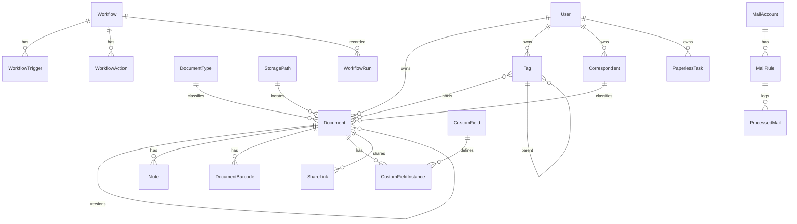

---

## 5. 文档入库主流程

入库是系统最重要的一条路径。设计目标是：无论文件从哪来，只要最终调用同一个任务函数，后续的去重、解析、归类、索引和行为就保持一致。

### 5.1 四条入口

`DocumentSource` 枚举给出四个来源值：`ConsumeFolder = 1`、`ApiUpload = 2`、`MailFetch = 3`、`WebUI = 4`。它们被写入 `ConsumableDocument.source`，并出现在工作流触发器的 `sources` 多选字段里，以便规则只对某一入口生效。来源影响的是元数据覆盖（例如邮件规则可以指定标题来源）和权限默认值，而不是另写一套解析器。

网页与 API 上传由 ViewSet 接收文件，落到暂存位置后投递 `consume_file`。邮件入口在 worker 里生成临时文件再投递，见第 10 节。消费目录是最“无交互”的入口，也是扫描件工作流最常见的方式。

伴随文件一起走的是 `DocumentMetadataOverrides`：可选的标题、对应人、类型、标签、存储路径、业务日期、ASN、所有者、查看/更改权限、自定义字段、版本标签、是否跳过已存在的 ASN、是否强制远程 OCR、以及已识别的条码。覆盖来自上传参数、邮件规则或“消费开始”阶段的工作流。多个来源的覆盖按 `update()` 合并：标题等单值以后者为准，标签与授权列表则做并集。

### 5.2 消费目录监视

`document_consumer` 管理命令把消费目录看成一个可靠的投放口。实现上有几条值得当成架构决策的细节。

第一，它使用原生文件系统事件，而不是纯粹的轮询；同时保留定期全量扫描，防止事件丢失或短时故障导致文件永远躺在目录里。第二，`FileStabilityTracker` 会等待文件大小与修改时间稳定后再投递，避免读到扫描机还在写入的半截 PDF。第三，路径上的子目录名可以映射为标签（`_tags_from_path`），让“按文件夹投递即分类”不必先配工作流。第四，命令通过 `ConsumerFilter` 忽略临时文件和尚未关闭的写入。第五，它只负责 `apply_async`，真正的失败与重试发生在 worker 中。

消费成功后，源文件会从消费目录消失——本机冒烟测试中，放入的 PDF 在消费完成后目录被取空，与这一设计相符。消费目录因此是队列，不是资料库。

### 5.3 consume_file 插件链

`documents.tasks.consume_file` 把一次消费编排成插件序列。每个插件实现能否运行、如何准备、如何执行、如何清理；返回消息表示正常结束，抛出 `StopConsumeTaskError` 表示有意中止（例如条码分拆后由新任务继续），抛出 `ConsumeFileDuplicateError` 表示因校验和重复而拒绝，其他异常则把进度标记为失败并上抛。

默认序列（新文档，而非向已有根文档追加版本）是：

1. `ConsumerPreflightPlugin`：检查文件可读、MIME 是否受支持、是否与已有文档校验和冲突（含回收站中的文档）。重复时返回已存在文档的 id 以及是否在回收站中。
2. `AsnCheckPlugin`：处理 ASN 冲突策略。
3. `CollatePlugin`：双面扫描件的配对与合并（来自 `double_sided.py`）。
4. `BarcodePlugin`：识别条码，可能按分隔符把一份 PDF 拆成多份、写入 ASN、映射标签。
5. 再次 `AsnCheckPlugin`：条码可能刚刚写入 ASN，需要再检查一次。
6. `WorkflowTriggerPlugin`：匹配类型为“消费开始”的工作流，把动作产生的覆盖合并进 `DocumentMetadataOverrides`。
7. `ConsumerPlugin`：选择解析器、抽取文本与缩略图、按策略生成归档件、创建或更新 `Document`、写入条码、调用匹配与分类、保存文件到介质目录。

若 `input_doc.root_document_id` 已有值，说明这是在为已有文档增加版本，序列会缩短为预检加 `ConsumerPlugin`，跳过分拆与消费期工作流，以免一条修订把原件再次切碎。

`ConsumerPlugin.run` 内部大致按进度消息展开：开始 → 解析（可能耗时）→ 生成缩略图 → 加载分类器 → 写库与搬文件 → 成功。进度通过 `ProgressManager` 推到 Channels 层，前端在 `/ws/status/` 上显示。解析在临时目录 `SCRATCH_DIR` 中进行，任务结束时临时目录被销毁，只有成功的原件、归档件和缩略图留在介质树。

去重的关键是原件校验和。同一文件再次投放不会生成第二份在库文档，而是以结构化结果告诉调用方“这是某篇已有文档的重复”。这比在应用层比较文件名更可靠，也使邮件与目录两条入口不会因为文件名不同而重复归档。

### 5.4 落库之后的信号

文档保存成功后，并不是流水线的结束。信号处理器承担一批“衍生一致性”工作：

- `add_inbox_tags`：给新文档打上所有收件箱标签。
- `set_correspondent` / `set_document_type` / `set_tags` / `set_storage_path`：按匹配算法与分类器赋值，前提是用户没有用覆盖把该字段钉死。
- `update_filename_and_move_files`：按存储路径模板生成文件名并移动文件。
- `add_to_index`：把文档写入 Tantivy 索引。
- `run_workflows_added` / `run_workflows_updated`：运行“文档已添加 / 已更新”类工作流。
- `send_websocket_document_updated`：通知在线客户端刷新。
- 在 AI 开启时，维护 LLM 索引中的对应节点。

把这些放在信号里而不是全写进 `ConsumerPlugin`，是为了让“手工编辑文档”“批量修改”“再处理”也能走同一套后置逻辑。代价是信号顺序和失败处理必须小心：例如搬家失败不能悄悄留下错误路径。代码用显式异常和日志处理这类情况，而不是用两阶段提交跨文件系统和数据库。

### 5.5 入库时序图

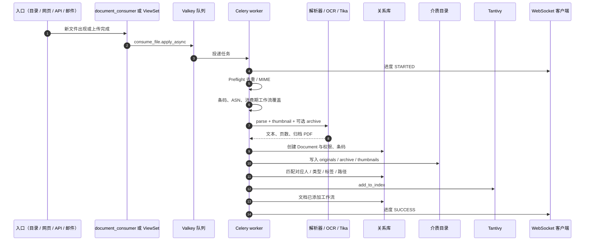

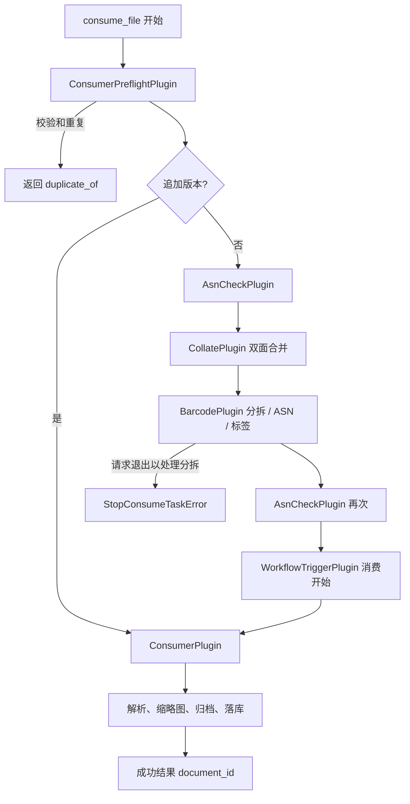

---

## 6. 解析器与 OCR 管线

### 6.1 解析器注册与选择

解析器不通过一个巨大的 `if mime` 树来选择。`paperless.parsers.registry.ParserRegistry` 维护内置与外部解析器，并在启动时 `register_defaults`。默认注册顺序（按权重从低到高添加）为：`TextDocumentParser`、`RemoteDocumentParser`、`TikaDocumentParser`、`MailDocumentParser`、`RasterisedDocumentParser`。每个解析器声明支持的 MIME 类型，并用 `score` 决定“同一类型有多个候选时谁赢”。`get_parser_for_file` 返回得分最高且声明支持该类型的实现。`documents.parsers.is_mime_type_supported` 只是对注册表的薄封装，供预检插件拒绝明显不能处理的文件。

`ParserProtocol` 要求解析器提供名称、版本、解析、缩略图、元数据，以及是否能产出归档件等能力标志。`ConsumerPlugin` 会把选择结果打到日志里（`Parser: {name} v{version}`），便于在任务失败时判断走了哪条管线。若元数据要求远程 OCR，但系统没有配置可用的远程引擎，消费会失败而不是悄悄退回本地 Tesseract——这是有意的显式失败，避免用户以为已经用云端引擎处理。

### 6.2 光栅化文档与 OCRmyPDF

`RasterisedDocumentParser` 是扫描件和多数 PDF 的默认路径，内部以 OCRmyPDF 驱动 Tesseract（以及 Ghostscript、unpaper 等）。配置单例里的字段几乎一一对应到 OCRmyPDF 的命令行语义：

- `output_type`：`pdf` / `pdfa` / `pdfa-1` / `pdfa-2` / `pdfa-3`
- `mode`：`auto`、`force`、`redo`、`off`，对应跳过已有文本、强制 OCR、重做 OCR 或关闭
- `language`：Tesseract 语言，对应 `PAPERLESS_OCR_LANGUAGE` 的运行时覆盖
- `deskew`、`rotate_pages`、`unpaper_clean`、`image_dpi`、`color_conversion_strategy`、`max_image_pixels` 等图像预处理

`auto` 模式的典型行为是：若页面已有文本层，倾向于保留而不是破坏已有文字；若是纯图像扫描件，则光栅化并识别。强制 OCR 会把已有文字光栅化后再识别，适合文本层是乱码或错误语言的文件。这些选择直接影响归档件质量和索引文本的可信度，因此被提升为系统级配置，而不是解析器里的隐式常量。

需要强调的限制：官方镜像预装的 Tesseract 语言通常是英、德、法、意、西以及方向检测 `osd`。把 `PAPERLESS_OCR_LANGUAGE` 设成未安装的语言（例如 `chi_sim`）会在启动系统检查阶段失败。架构上这是“配置必须指向真实能力”；运维上则要先提供语言数据，再改配置。

### 6.3 Tika、文本与邮件解析

`TextDocumentParser` 处理纯文本等简单类型，通常不能也不需要产出 PDF/A 归档件，`should_produce_archive` 会因其 `can_produce_archive` 为假而直接跳过。`TikaDocumentParser` 在启用 Tika 时处理 Office 等格式：先由 Tika 抽取文本和元数据，必要时由 Gotenberg 把文档转成可归档的 PDF。Gotenberg 的启动参数在官方模板中关闭了 Chromium 的 JavaScript，并限制 `file:///tmp/` 白名单，避免把邮件 HTML 里的跟踪像素或脚本带进转换进程。这是安全设计，不是可选项上的疏忽。

`MailDocumentParser` 处理 `.eml`：可以把邮件本身作为一份文档入库，也可以与“附件单独入库”同时发生，取决于邮件规则的 `consumption_scope`。邮件体的 PDF 布局由 `PdfLayout` 决定（文本优先、HTML 优先、仅 HTML、仅文本等）。这样，一封带三份附件的信件在系统里可能变成一封邮件文档加三份附件文档，它们通过元数据或工作流产生的标签被一起找到。

### 6.4 归档件生成策略

是否生成独立的 PDF/A 归档件，由 `should_produce_archive` 与配置 `archive_file_generation` 共同决定，取值为 `auto`、`always`、`never`。逻辑要点是：解析器必须宣称自己能产出归档件；`never` 一律不生成；`always` 在能力允许时生成；`auto` 倾向给扫描件或图像型 PDF 生成归档件，对数码原生、已有良好文本层的 PDF 则可以跳过，以免无谓放大存储和损耗字体。归档件不是替换原件：原件始终保留，归档件是“便于长期阅读和印刷”的派生文件。分享链接可以选择分享原件还是归档件（`ShareLink.FileVersion`）。

### 6.5 OCR 管线图

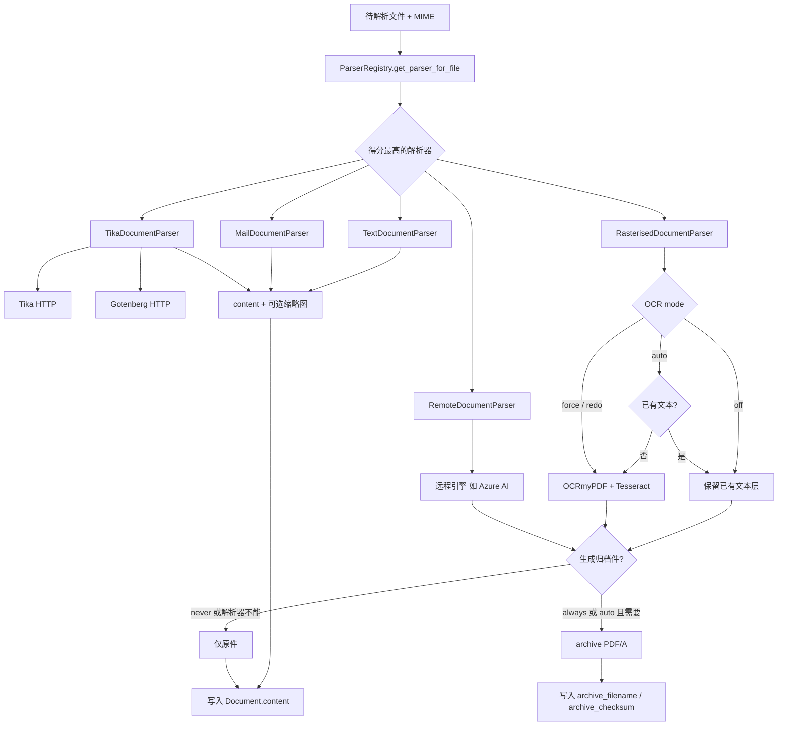

---

## 7. 任务队列与定时调度

### 7.1 经纪器与队列

Celery 的代理 URL 与 Channels 的 Redis URL 都从 `PAPERLESS_REDIS` 解析而来，可以指向同一实例的不同逻辑库，也可以共用。官方模板使用 `redis://broker:6379`。Valkey 在这里扮演三种角色：任务队列、部分结果/状态的传递路径，以及 WebSocket 的发布订阅层。把这三种角色放在同一兼容协议上，减少了再引入一套消息中间件的运维成本，但也意味着经纪器不可用时，入库、定时任务和实时进度会一起停摆。这是有意识的耦合：自托管场景里，少一个会宕机的部件，往往比“队列和通知完全隔离”更重要。

worker 是默认并发消费者。CPU 密集的 OCR 会占用进程较长时间，因此消费任务与“短任务”（例如给单篇文档更新索引）共享同一 worker 时，可能出现短任务排队。3.4.2 没有在源码里强制拆多队列；若部署上要隔离，属于运维扩展，而不是应用已经写死的拓扑。

### 7.2 任务目录

`documents.tasks` 中与架构直接相关的共享任务包括：

- `consume_file`：入库主任务，上一节已说明。
- `index_document` / `remove_document_from_index` / `index_optimize`：维护 Tantivy 索引。
- `train_classifier`：定期或手动重训练自动分类器。
- `sanity_check`：核对数据库记录与磁盘文件、校验和是否一致。
- `bulk_update_documents`：批量改元数据后的后续处理。
- `update_document_content_maybe_archive_file`：再处理文本或归档件。
- `empty_trash`：对过期的软删除文档做物理删除。
- `check_scheduled_workflows` / `run_workflows_for_documents`：定时或批量跑工作流。
- `llmindex_index` / `update_document_in_llm_index` / `remove_document_from_llm_index`：可选 AI 索引。
- `apply_ai_suggestions`：把 AI 建议落到文档字段。
- `build_share_link_bundle` / `cleanup_expired_share_link_bundles`：分享包生命周期。
- `clear_expired_sessions`：清理过期会话。

邮件侧的入口是 `paperless_mail.tasks.process_mail_accounts`。这些任务之所以集中在少量模块里，是为了让 beat、管理命令和 API 上的“手动运行”都引用同一函数名。`PaperlessTask.TaskType` 是面向界面的分类，不必与每个 `@shared_task` 一一同名，但消费、训练、检查、拉信等主要类型都能对上。

### 7.3 PaperlessTask 追踪模型

Celery 自己的状态对终端用户并不友好。系统在任务发布、开始、成功、失败、撤销时，通过信号 `before_task_publish_handler`、`task_prerun_handler`、`task_postrun_handler`、`task_failure_handler`、`task_revoked_handler` 维护 `PaperlessTask` 行。模型注释中写明的状态迁移是：

- `PENDING → STARTED → SUCCESS`
- `PENDING → STARTED → FAILURE`
- `PENDING → REVOKED`（在开始前被取消）

`COMPLETE_STATUSES` 包含成功、失败与撤销。结果 JSON 里可以带 `document_id` 或 `duplicate_of`，于是任务列表能跳回相关文档。`acknowledged` 让用户把已读的失败任务从待处理列表里清掉，而不删除历史。触发来源写入 beat 任务的 headers（`trigger_source: scheduled`），也能从 Web / API / 目录 / 邮件等调用点传入，保证“是谁发起的”可过滤。

这种“应用级任务表”还有一个设计作用：即使 Celery 结果过期，界面仍能回答“昨晚的邮件采集有没有失败”。它不是分布式追踪系统，不记录跨进程的 span，但足够支撑自托管管理。

### 7.4 Celery beat 日程

`parse_beat_schedule` 用环境变量覆盖 crontab，值为 `disable` 的项不会进入日程。默认日程（均可被对应的 `PAPERLESS_*_TASK_CRON` 覆盖）是：

| 名称 | 默认 crontab | 任务 |
| --- | --- | --- |
| 检查所有邮件账号 | 每 10 分钟（实际分钟会按密钥哈希在 10 分钟窗口内打散） | `paperless_mail.tasks.process_mail_accounts` |
| 训练分类器 | 每小时的第 5 分钟 | `documents.tasks.train_classifier` |
| 优化索引 | 每天 00:00 | `documents.tasks.index_optimize` |
| 一致性检查 | 周日 00:30 | `documents.tasks.sanity_check` |
| 清空回收站 | 每天 01:00 | `documents.tasks.empty_trash` |
| 检查并运行定时工作流 | 每小时的第 5 分钟 | `documents.tasks.check_scheduled_workflows` |
| 重建 LLM 索引 | 每天 02:10 | `documents.tasks.llmindex_index` |
| 清理过期分享包 | 每天 02:00 | `documents.tasks.cleanup_expired_share_link_bundles` |
| 清理过期会话 | 每天 03:00 | `documents.tasks.clear_expired_sessions` |

每条任务都设了 `expires`，略短于默认周期，避免上一轮还滞留在队列里时又加入新的同一任务。邮件采集的默认分钟数按 `<PAPERLESS_SECRET_KEY>` 的哈希做偏移，是为了让众多独立实例不要在整点同时去打远程邮箱。密钥在这里只用作稳定的随机种子，不会被写回日志。

beat 把“何时做”从业务代码里拆出来。工作流的 `SCHEDULED` 触发并不自己睡眠，而是等待这条周期任务去扫描到期条件。分类器也不会在每篇文档入库时完整重训，而是按小时汇总，避免训练抢走 OCR 所需的 CPU。

### 7.5 任务状态机与队列图

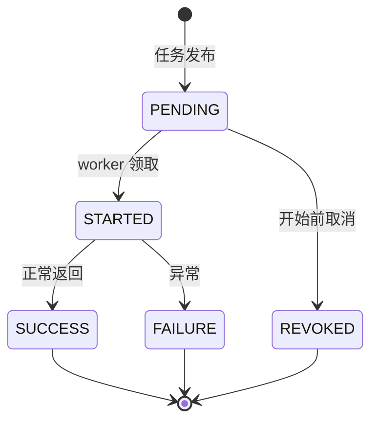

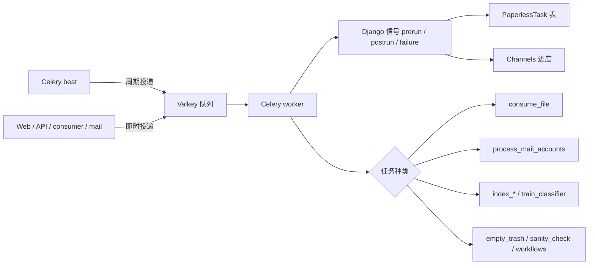

---

## 8. 搜索、分类与索引

### 8.1 Tantivy 全文索引

3.4.2 的检索后端是 Tantivy，索引位于 `INDEX_DIR`（默认 `DATA_DIR/index`）。`documents.search` 包里仍能看到 `whoosh_compat`：这不是说运行时还在写 Whoosh 段文件，而是查询语言、字段种类和分词期望对历史用户与 API 保持兼容。`open_or_rebuild_index` 会在目录不存在、设置指纹不匹配或索引损坏时重建，并用哨兵文件 `.index_settings.json` 记录当前设置。语言或分词相关设置变化后，旧索引会被视为不兼容，这比“带着错误分词继续查”更安全。

索引中的文档文本使用 `get_effective_content()`，因此对有版本的资料，搜索命中的是最新版本的文本，而不是根行上可能过期的副本。标题、对应人等字段也会进入图式，以便 `title_search` 或组合查询。索引优化由每日任务 `index_optimize` 执行，属于维护而不是每次写入都做的合并。

索引与数据库的关系是：**数据库决定“有没有这篇文档、谁能看”，索引决定“文本里能不能搜到”。** 一条被软删除的文档不应继续作为普通搜索结果出现；权限裁剪发生在数据库查询侧，搜索先得到候选 id，再与当前用户可见 id 求交。这个顺序很重要：只信索引、不信权限，会把对象级授权拆穿。

### 8.2 查询入口

文档列表的 ViewSet 在路由上注册为 `documents`，类名是 `UnifiedSearchViewSet`。它可以按常规过滤字段（对应人、类型、标签、日期、自定义字段等）工作，也可以接受 Tantivy 查询参数。搜索相关参数名包括 `text`、`title_search`、`query`、`more_like_id`，并且有互斥校验：不能同时把多种主搜索模式混在一起。复杂查询走 `query`；“与这篇相似”走 `more_like_id`。过滤器仍可与搜索组合，例如在查询词之外再加上相对日期。

把搜索做成“同一套文档端点上的可选模式”，而不是另开一个搜索服务，符合模块化单体的思路：前端仍然请求 `/api/documents/`，只是参数不同。分页、权限、序列化与普通列表共用。

### 8.3 自动分类器

`DocumentClassifier` 把 `MATCH_AUTO` 的对应人、类型、标签、存储路径从“规则”变成“从已有语料学习”。模型文件默认是带签名的 pickle，加载时会校验版本兼容性，损坏或不兼容时可以拒绝加载而不是给出随意预测。训练任务 `train_classifier` 由 beat 定期触发，也可以按任务类型手动运行。入库时 `ConsumerPlugin` 会 `load_classifier()` 一次，供后续多个匹配函数复用，避免在同一任务里反复反序列化模型。

匹配函数的共同结构是：先取出当前用户可见的候选对象，再按各自的 `matching_algorithm` 判断。非自动算法在 `matches()` 里执行单词、正则或模糊比较；自动算法询问分类器，并带阈值，避免低置信度的乱打标签。分类器是对规则系统的补充，不是替换：许多资料库仍然主要靠显式规则和工作流，只有积累了足够多已整理文档之后，自动模式才有意义。

### 8.4 搜索与索引图

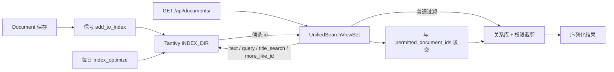

---

## 9. 工作流引擎

工作流是把“如果满足条件，就自动改元数据或对外通知”从一次性脚本提升为可配置对象的机制。模型分成定义侧与运行侧：`Workflow` 聚合多个 `WorkflowTrigger` 与 `WorkflowAction`；每次实际执行产生 `WorkflowRun`（软删除，便于保留历史）。

### 9.1 触发类型

`WorkflowTriggerType` 有五种：

| 值 | 名称 | 何时求值 |
| --- | --- | --- |
| 1 | Consumption Started | 文件尚未落库，在 `WorkflowTriggerPlugin` 中运行，结果写入覆盖对象 |
| 2 | Document Added | 文档首次保存后，由 `run_workflows_added` 运行 |
| 3 | Document Updated | 文档后续更新后，由 `run_workflows_updated` 运行 |
| 4 | Scheduled | 由 `check_scheduled_workflows` 按日期字段加偏移扫描 |
| 5 | Manual | 用户显式触发 |

把“消费开始”和“文档已添加”分成两个时点，是因为前者还能决定入库本身的所有者、权限和标题，后者才能基于已经识别出的文本、对应人和标签做二次处理。定时触发使用 `ScheduleDateField`：基于 `added`、`created`、`modified` 或某个日期型自定义字段，再加上天数偏移，适合“发票入账 30 天后自动打归档标签”这类规则。

触发器还可以限制来源（消费目录、API、邮件、网页），使同一套动作不会在所有入口上意外开火。

### 9.2 过滤条件

触发器带有大量过滤器：路径与文件名（可配匹配算法）、邮件规则、标签的“包含 / 全部包含 / 不包含”、类型与对应人与存储路径的肯定和否定条件、自定义字段查询，以及标题内容等。消费阶段的匹配走 `consumable_document_matches_workflow`，此时还没有 `Document` 行，只能根据文件名、路径、来源和已有覆盖判断。已存在文档则走 `existing_document_matches_workflow`，并可先用 `prefilter_documents_by_workflowtrigger` 在查询级收窄范围，以免定时任务对全库做 Python 循环。

这套过滤故意与保存的视图、搜索过滤器有重叠的概念（标签、类型、日期），但不共用同一张表。工作流是“主动的规则”，保存的视图是“被动的查询”。把二者分开，可以独立授权和独立备份，也不会出现改一个视图却让夜间工作流行为变化的意外。

### 9.3 动作类型

`WorkflowActionType` 包括：

- **Assignment（1）**：赋予对应人、类型、存储路径、标签、所有者、标题、自定义字段、权限等。
- **Removal（2）**：移除上述某些赋值。
- **Email（3）**：发送通知，内容由 `WorkflowActionEmail` 描述，标题和正文支持占位符。
- **Webhook（4）**：HTTP 回调，由 `WorkflowActionWebhook` 描述。
- **Password removal（5）**：去除文档口令保护相关处理。
- **Move to trash（6）**：把文档软删除进回收站。

消费开始阶段的动作不能做“对已有文档软删除”这类需要主键的事，它们的主要价值是填充 `DocumentMetadataOverrides`。已添加 / 已更新 / 定时阶段则可以真正改库、发信、调用 webhook。动作里还可以指定 AI 建议字段（`AISuggestionField`），但只有在 AI 扩展打开且任务跑完后才有实际数据。

工作流引擎因此是系统里最接近“业务编排”的一层。它不替代匹配模型：匹配模型解决“这份文本像不像某张标签”，工作流解决“当它已经像发票并且来自财务邮箱时，还要做什么”。

### 9.4 工作流图

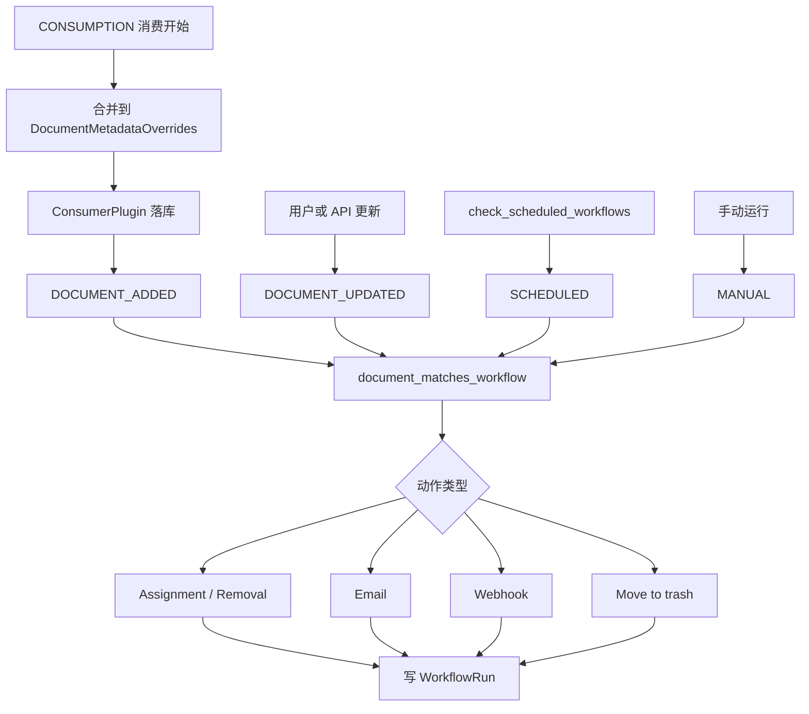

---

## 10. 邮件采集

邮件采集是入库主流程的一种入口，但有自己的账户、规则和幂等记录，因此单独成章。

### 10.1 账号与规则

`MailAccount` 属于某个所有者，支持三种账号类型：普通 IMAP、Gmail OAuth、Outlook OAuth。安全方式为无加密、SSL 或 STARTTLS。口令或刷新令牌保存在库中（部署时需要按自托管惯例保护数据库备份）。字符集默认 UTF-8。规则 `MailRule` 挂在账号下，可启用或停用，指定文件夹（默认 `INBOX`），并按 `order` 排序。

规则决定“什么样的信会被处理、处理后信怎么办、生成的文档元数据从哪来”。过滤项包括发件人、收件人、主题、正文、附件文件名的包含与排除。`ConsumptionScope` 有三种：只处理附件、把整封邮件存为 `.eml`、两者都做。`AttachmentProcessing` 进一步决定是否包含内联附件（例如嵌入图片）；默认更保守的选项是只处理真正的附件，以免把签名图片变成一篇篇无意义文档。`TitleSource` 可选主题、附件名或不由规则赋标题。`CorrespondentSource` 可选不赋值、用邮箱、用显示名、或用指定的对应人。`assign_owner_from_rule` 为真时，规则所有者会成为新文档所有者，这对多用户邮箱很重要。

### 10.2 采集循环

`process_mail_accounts` 由 beat 定期调用，也可指定账号 id。`MailAccountHandler` 登录邮箱（`mailbox_login`），按规则构造检索条件（`make_criterias`），遍历新邮件，把需要消费的文件写入暂存并 `queue_consumption_tasks`，即再次调用 `consume_file`。为避免重复处理，系统用 `ProcessedMail` 记录规则、文件夹、UID、UID validity、主题、收信时间、处理时间和状态、错误信息。UID validity 变化时，同一数字 UID 可能指向不同信件，因此必须一起保存。

采集循环运行在 worker 中，而不是在 Web 请求里。这样 IMAP 延迟不会堵塞界面；失败会写在 `ProcessedMail.error` 和 `PaperlessTask` 上，用户可以在任务页面看到。OAuth 令牌过期时，处理路径应更新或报错，而不是用过期令牌悄悄跳过——具体刷新逻辑在 `paperless_mail.oauth`，属于实现细节，设计上账号表已经预留 `refresh_token` 与 `expiration`。

### 10.3 处理后的动作

规则上的 `MailAction` 决定信在邮箱里的命运：删除、移动到指定文件夹、标为已读且不再处理已读、打旗标且不再处理已打旗、或打上指定标签且不再处理已打标签。这些动作由 `DeleteMailAction`、`MoveMailAction`、`MarkReadMailAction`、`FlagMailAction`、`TagMailAction` 实现。参数字段 `action_parameter` 用于目标文件夹或标签名。

把“系统内入库”和“邮箱内善后”分成两步是必要的：先保证消费任务入队，再改变邮箱状态，减少“信被删了但任务没投递”的窗口。若消费任务随后失败，已移动的信不会自动搬回；运维上应依靠任务失败记录做补救。这是邮件桥接里常见的权衡，源码用动作回调和错误回调（`apply_mail_action`、`error_callback`）把成功与失败路径分开，而不是在 IMAP 与 Celery 之间做分布式事务。

### 10.4 邮件采集流程图

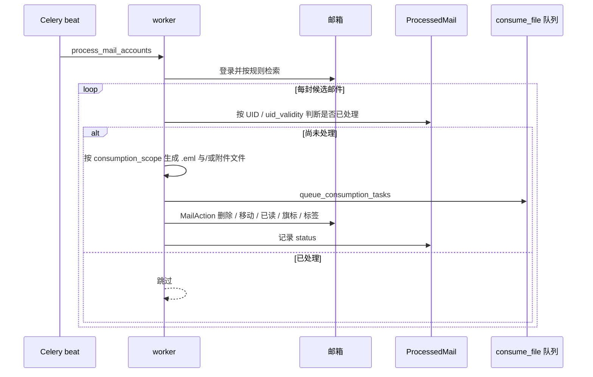

---

## 11. 认证、授权与多用户

### 11.1 认证链路

身份底层仍是 Django 的 `User` / `Group`。认证后端的顺序是 guardian 的对象权限后端、Django 模型后端、allauth 的认证后端。可选地，在启用 HTTP 远程用户时，会把 `RemoteUserBackend` 插到最前，并由 `HttpRemoteUserMiddleware` 读取可配置的请求头（默认 `HTTP_REMOTE_USER`）。这使反向代理上的 SSO 可以把已经认证的用户名传给应用。

会话登录走 allauth，登录页位于 `/accounts/login/`。会话后端是 `cached_db`，默认还记得登录状态（`ACCOUNT_SESSION_REMEMBER`），Cookie 寿命可用 `PAPERLESS_SESSION_COOKIE_AGE` 调整，默认三周。REST 默认认证类包括 Paperless 的 Basic、Token 与 Session；API 版本通过 Accept 头协商，默认版本 10。还可以打开专门针对 API 的远程用户认证。开发模式下会附加一个 Angular 调试用的认证覆盖，生产不应依赖它。

allauth 还提供可选的注册、邮箱验证、MFA（TOTP 发行方名为 Paperless-ngx）、社交账号和 headless 接口。是否允许注册、默认加入哪些组、是否把社交登录的组声明同步为 Django 组，全部由环境变量控制。`PAPERLESS_AUTO_LOGIN_USERNAME` 会插入 `AutoLoginMiddleware`，只适合受信任的演示环境。把这些开关视为架构的一部分是必要的：默认是“有管理员、可关注册的自托管资料库”，而不是“开放的多租户 SaaS”。

### 11.2 所有者与对象权限

授权有两层，必须合在一起理解。

第一层是 Django 模型权限与自定义权限，控制“能不能进这个资源接口”，例如查看文档、管理用户、看统计、清空回收站、确认任务。`PaperlessModelPermissions`、`ViewDocumentsPermissions`、`TrashPermissions` 等类把这些全局能力映射到视图方法。

第二层是对象级授权。每个有所有者的对象都可以被：所有者完全控制（在应用逻辑里通常视为可查看可更改）；其他用户或组通过 guardian 获得 `view` 或 `change` 权限；超级用户绕过限制；无主对象按策略对更多人可见。`set_permissions_for_objects` 在批量赋权时直接维护 `UserObjectPermission` / `GroupObjectPermission` 行，而不调用 guardian 某些会跳过行创建路径的批量辅助函数，以免漏行。覆盖对象里的 `view_users`、`view_groups`、`change_users`、`change_groups` 就是在入库时一次性把这套授权写好，常由工作流或邮件规则注入。

注意：这不是行级安全策略在数据库引擎里强制执行，而是应用查询时的裁剪。任何绕过 ORM 的只读通道都需要自己尊重同一套规则。当前架构下，Hasura 一类的外部 GraphQL 并不存在，主路径都走 Django，风险可控。

### 11.3 查询裁剪

`restrict_queryset_to_visible` 与 `permitted_document_ids` 是列表和搜索的交点。它们根据 `owner` 与 guardian 表构造可见 id 集合，并尽量利用唯一索引，避免把 `object_pk` 对每个对象做昂贵转换。超级用户快捷路径必须排在非活动用户判断之后，因为 guardian 会拒绝非活动用户，而某些辅助函数可能不会。软删除文档默认从普通查询中消失，回收站视图使用 `include_deleted` 一类的显式开关，并要求对应的回收站权限。

`has_perms_owner_aware` 提供单对象上的“所有者或对象权限”判断，供分享以外的细节页使用。公开分享不走这套裁剪，而是凭 `ShareLink.slug` 进入只读下载；过期或已软删除的链接失效。这是受控的例外：分享是把“授权给互联网上持有链接的人”从对象权限里单列出来，避免给 AnonymousUser 批量写 guardian 行。

WebSocket 侧会再次检查。`StatusConsumer` 只接受已认证连接，并把用户加入 `status_updates` 组以及按用户隔离的 `bulk_operations_{id}` 组。推送文档相关事件时，用载荷里的 `owner_id`、`users_can_view`、`groups_can_view` 做 `_can_view` 判断，避免把别人正在消费的文件名广播给无权用户。实时通道与 REST 共用同一套授权观念，只是实现位置不同。

### 11.4 权限模型图

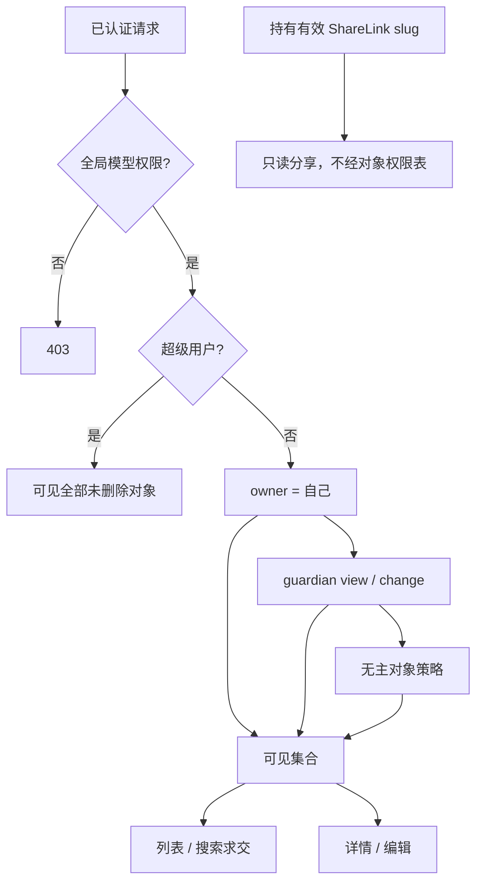

---

## 12. API、前端与实时通道

### 12.1 REST 资源面

`paperless.urls` 中的 `DefaultRouter` 把资源注册为稳定的复数路径，包括对应人、类型、文档（统一搜索视图）、日志、标签、保存的视图、存储路径、任务、用户、组、邮件账号与规则、分享链接与分享包、工作流及其触发器和动作、自定义字段、应用配置、已处理邮件。这些名字就是前端与脚本的契约。API 以 Accept 头做版本控制，当前默认 10，同时允许 9，避免旧客户端在小版本升级后立即断裂。OpenAPI 由 drf-spectacular 提供，标题为 “Paperless-ngx REST API”。

除路由器外，还有上传、预览、下载、缩略图、批量编辑、回收站、系统状态等专用路径，集中在同一 `urlpatterns` 下，由 `documents.views` 中的视图类实现。设计上它们仍属于文档应用，而不是另一个网关进程。匿名可访问的主要是分享链接。管理界面 `/admin/` 继续存在，用于少数尚未或不适合放到 SPA 里的操作。

### 12.2 Angular 前端

`src-ui` 是 Angular 22 应用，包版本与后端相同，为 3.4.2。它在构建后成为静态资源，不再作为运行时的 Node 服务。路由、守护、拦截器位于 `src-ui/src/app` 下，运行时通过环境文件与 API v10 对齐。界面上的仪表盘、文档列表、管理侧栏、任务、日志、设置，都是对上述 REST 资源的编排。前端的“空仪表盘也可以开始上传”只是体验，不代表另有一套前端本地库：文件一旦上传，就进入与消费目录相同的 `consume_file` 路径。

把前端和后端分成两个源码树、却在同一个版本号下发布，是为了让界面迭代不必受 Python 发布流程束缚，同时保证 API 版本协商。架构上应把 SPA 视为接入层的一部分，而不是独立的业务服务。

### 12.3 WebSocket 状态通道

ASGI 应用是 `ProtocolTypeRouter`：HTTP 走 Django，WebSocket 走 `AuthMiddlewareStack` 包起来的 `URLRouter`，唯一业务路径是 `ws/status/`。`StatusConsumer` 在连接后启动 30 秒心跳，并向客户端推送消费进度、文档更新、批量操作状态等事件。通道层默认使用 `channels_redis.pubsub.RedisPubSubChannelLayer`，与 Celery 共用 Redis 协议端点。`ProgressManager` 在消费插件中发送 `ProgressStatusOptions`（如 STARTED、WORKING、SUCCESS、FAILED），这是用户能在界面上看到“正在生成缩略图”的原因。

生产环境是否把 `channels` 列入 `INSTALLED_APPS` 取决于 `DEBUG`：源码只在调试时追加该应用。但 Channels 作为依赖始终存在，ASGI 入口也始终挂接 WebSocket。部署时只要 Granian 以 ASGI 方式运行并配置了通道层，进度推送就可以工作。测试里可以用内存通道层（`PAPERLESS_CHANNELS_BACKEND`）避免依赖外部经纪器。

---

## 13. 文档生命周期与状态机

### 13.1 在库文档没有业务状态字段

前面已经强调：`Document` 不使用“草稿、待审、已归档”这样的状态枚举。若业务上需要“待整理 / 已归档”，实践中是用收件箱标签、普通标签或工作流去表达，而不是改核心模型。这种选择让核心表保持稳定，也让不同家庭或组织用标签表达自己的状态机，而不强迫所有人接受同一套审核流。

系统真正加以硬编码的，是下面几条生命线：进入系统的方式、消费任务是否成功、文档是否被软删除、是否存在归档件、是否存在后续版本、是否对外分享。它们可以同时成立，因此用状态图分别描述，比画一张包罗万象的单圈状态机更准确。

### 13.2 软删除与清空回收站

删除文档调用重写后的 `delete()`：为根文档及其版本生成同一 `transaction_id`，以便 django-softdelete 成组恢复。软删除后，普通列表不可见，回收站可见，文件通常仍留在介质目录，索引则应从常规搜索中退出。`empty_trash` 默认寻找 `deleted_at` 早于现在减去 `EMPTY_TRASH_DELAY` 天的行；延迟由 `PAPERLESS_EMPTY_TRASH_DELAY` 控制，最小为 1，默认 30 天。也可以传入具体 id，立即清空选中项。物理删除时会临时挂上 `cleanup_document_deletion`，用来删除原件、归档件、缩略图以及相关派生数据；若配置了 `PAPERLESS_TRASH_DIR`，文件可能被移到该目录而不是直接抹去。审计日志开启时，已不存在对象的审计行也会被清理。

这条线的设计意图是“删除先可悔”。30 天只是默认值，不是模型约束。定时任务每天 01:00 扫描到期项，避免回收站无限膨胀，也避免用户误解“删除就是立即从磁盘消失”。

### 13.3 版本与归档件

版本使同一逻辑文档可以有多份原件。新版本通过 `ConsumableDocument.root_document_id` 进入缩短后的消费链，避免再次触发分拆。根行继续承载对外的归类与权限，`get_effective_content` 与 `get_effective_barcodes` 指向最新版本。归档件则是每个版本或每份文档自己的派生文件，不存在“全库只有一种归档状态”。分享时选择原件或归档件，是只读导出策略，不改变在库状态。

### 13.4 生命周期状态图

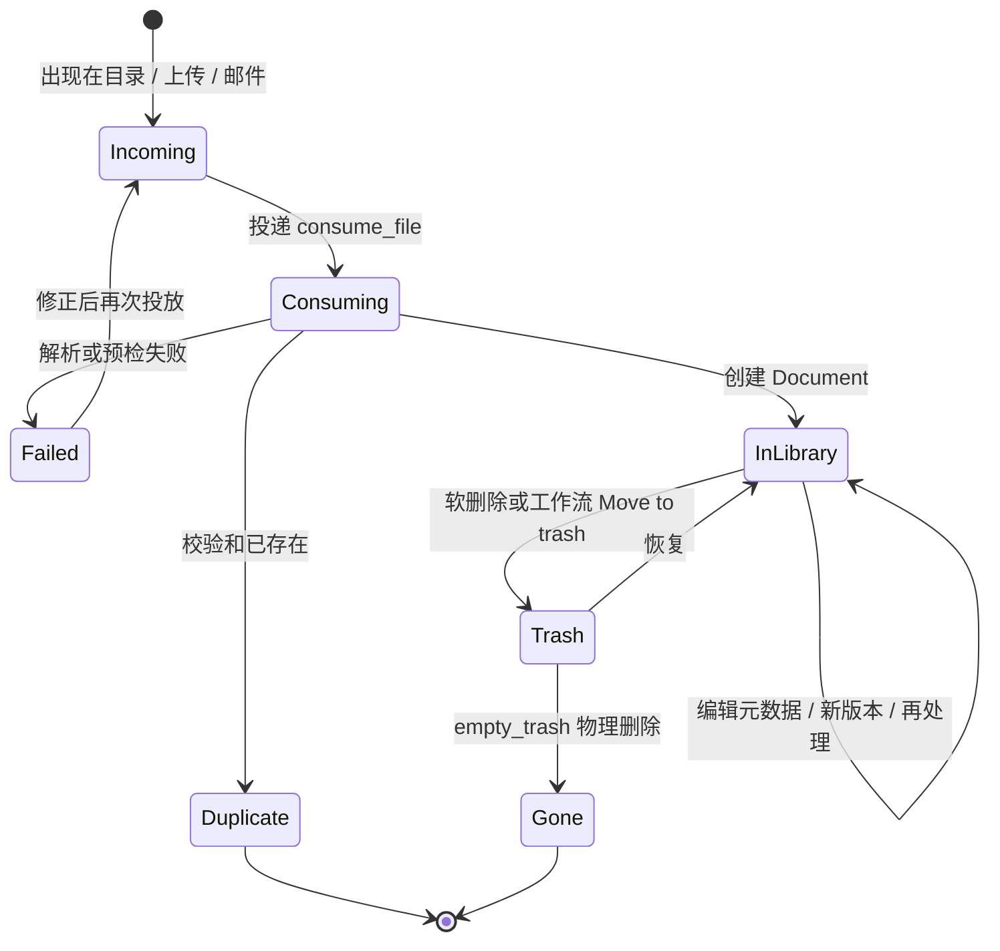

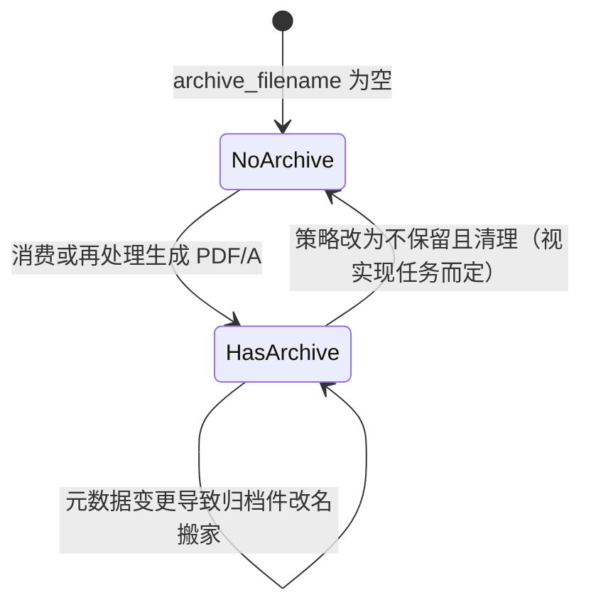

第二张图是派生文件轴，不要与第一张“在库与否”混成一个状态。一篇在回收站里的文档仍然可以带着它的归档件，直到物理删除。

---

## 14. 扩展点：远程 OCR 与 paperless_ai

远程 OCR 与 AI 都刻意放在“可关闭”的位置，以免核心路径依赖外部模型服务。

远程 OCR 的引擎枚举目前包含 Azure AI Document Intelligence；模式为 `always`（所有支持的文档）或 `workflow_only`（仅当工作流把 `remote_ocr` 覆盖打开）。端点、密钥、引擎写在 `ApplicationConfiguration` 中。`RemoteDocumentParser` 参与解析器竞选；只有在请求明确要求或默认打开时，才应胜过本地光栅化解析器。密钥不得写入架构文档或示例仓库。

`paperless_ai` 位于源码树中，提供嵌入、向量存储、提示词、分类建议和索引迁移，但默认不加入 `INSTALLED_APPS`。总开关 `PAPERLESS_AI_ENABLED` 默认为 `NO`。配置单例上的 `ai_enabled` 以及 LLM / 嵌入后端（OpenAI 兼容、Ollama、嵌入还可选 Huggingface）都是运行时参数。`llmindex_*` 任务即使存在于 `documents.tasks`，在功能关闭时也不应成为入库成功的前提。把 AI 写成“文档系统的中枢”不符合 3.4.2 的默认行为；正确的位置是：在文本与元数据已经可靠入库之后，可选地提供相似检索与建议赋值。

---

## 15. 一致性、可靠性与已知限制

一致性首先靠校验和与定时自检。`sanity_check` 把数据库行与磁盘上的原件、归档件、缩略图对照，及早发现手工改盘、备份恢复不完整或搬家失败留下的裂痕。索引和分类模型丢失时可以重建；原件丢失则不可逆，因此备份必须以关系库加介质目录为最小集合。

可靠性方面，消费任务对可预期的重复和分拆使用结构化返回，对不可预期的解析错误标记失败并保留日志。邮件动作与入库任务之间没有两阶段提交。队列任务用 `expires` 防止堆积。Web 进程与 worker 共享代码，但失败隔离在任务级：一份坏文件不应拖垮 Granian。

已知限制应当作为架构的一部分被承认，而不是当作使用说明里的小字。

第一，模块化单体意味着扩容首先是“加 worker 或加机器上的同一镜像”，而不是单独扩一个“OCR 微服务”。若 OCR 成为瓶颈，需要在部署上把重任务与短任务分队列，这要靠 Celery 配置，源码并未写死。

第二，对象权限在应用层实施，直接打开数据库或把介质目录暴露给其他工具时不会自动携带同一套授权。介质文件名也并非密文，拿到磁盘备份即拿到原件。

第三，多语言 OCR 取决于镜像内是否真有语言包，而不是环境变量写了语言代码。系统检查会在启动时卡住错误配置，这是保护，也会让“只改一处环境变量却忘了装包”的部署失败。

第四，经纪器同时服务队列与 WebSocket，经纪器中断会同时影响进度推送与任务执行。官方模板不把经纪器端口发布到宿主机，减少了暴露面，但高可用需要另行设计。

第五，默认关闭的 AI 与远程 OCR 一旦打开，就会引入外部网络依赖、额外密钥和隐私边界。文档内容可能离开本机，这与“自托管资料库”的默认假设不同，需要在启用前单独评估。

第六，`created` 是业务日期，时区由 `PAPERLESS_TIME_ZONE` 交给 Django。容器系统时钟仍可能显示 UTC。定时 crontab 的解释与时区设置有关，迁移实例时要一起考虑，而不能只拷贝数据库。

---

## 16. 架构总结

paperless-ngx 3.4.2 的架构可以收束为四句话。

它是一个以 Django 为核心的模块化单体，用 s6 在同一镜像里同时运行 Web、worker、beat 和目录监视进程，用 Valkey 提供 Redis 协议上的队列与实时通道，用可选的 Tika / Gotenberg 补齐 Office 能力。

它把“文件变成可检索文档”做成一条统一的异步插件流水线，四条入口汇合到 `consume_file`，再用信号把索引、匹配、工作流和通知接在落库之后，避免为每个入口复制一套逻辑。

它的核心数据模型以 `Document` 为中心，用所有者加 guardian 表达多用户，用软删除表达回收站，用根文档与版本表达修订，用原件加归档件表达长期可读性，而不设置单一的业务状态枚举。标签、对应人、类型、存储路径和工作流共同构成可配置的分类与编排层。

它把全文检索（Tantivy）、自动分类、远程 OCR 和 LLM 索引视为可重建或可关闭的派生能力，把关系库与介质目录视为不可替代的事实来源。默认关闭 AI，使系统在没有外部模型的情况下仍然完整。

若要把这套架构当作后续演进的起点，应当优先保持“入库路径唯一”和“权限裁剪发生在查询侧”这两条不变量；任何新的入口或新的智能能力，都应以插件、解析器或可选应用的方式接上，而不是再写一条绕开 `consume_file` 与对象权限的旁路。

---

## 附录 A：本文依据的源码文件

- `src/paperless/version.py`：版本元组 3.4.2
- `src/paperless/settings/__init__.py`：目录约定、安装应用、中间件、认证、Channels、API 版本、AI 开关、回收站延迟
- `src/paperless/settings/custom.py`：beat 日程与数据库设置解析
- `src/paperless/urls.py`、`src/paperless/asgi.py`、`src/paperless/consumers.py`：HTTP / WebSocket 路由与 `StatusConsumer`
- `src/paperless/models.py`：`ApplicationConfiguration` 与 OCR / LLM 枚举
- `src/paperless/parsers/registry.py` 及 `tesseract.py`、`tika.py`、`text.py`、`mail.py`、`remote.py`：解析器注册与实现
- `src/documents/models.py`：核心实体、任务、工作流、分享、自定义字段
- `src/documents/data_models.py`：`DocumentSource`、`ConsumableDocument`、`DocumentMetadataOverrides`
- `src/documents/tasks.py`：`consume_file` 插件顺序与其他共享任务
- `src/documents/consumer.py`：消费插件、归档策略、落库
- `src/documents/permissions.py`：对象权限与查询裁剪
- `src/documents/matching.py`、`src/documents/classifier.py`：规则匹配与自动分类
- `src/documents/search/`：Tantivy 索引与查询
- `src/documents/signals/handlers.py`：入库后信号、任务账本、文件搬家
- `src/documents/management/commands/document_consumer.py`：消费目录监视
- `src/documents/barcodes.py`、`src/documents/double_sided.py`：条码与双面合并插件
- `src/paperless_mail/models.py`、`tasks.py`、`mail.py`：邮件账号、规则与采集循环
- `src/paperless_ai/`：默认关闭的 AI 扩展
- `src-ui/package.json`：前端 Angular 22 与版本 3.4.2
- `docker/compose/docker-compose.postgres-tika.yml`、`docker/rootfs` 下 s6 服务名、`docker/init-flow.md`：进程模型与侧车

