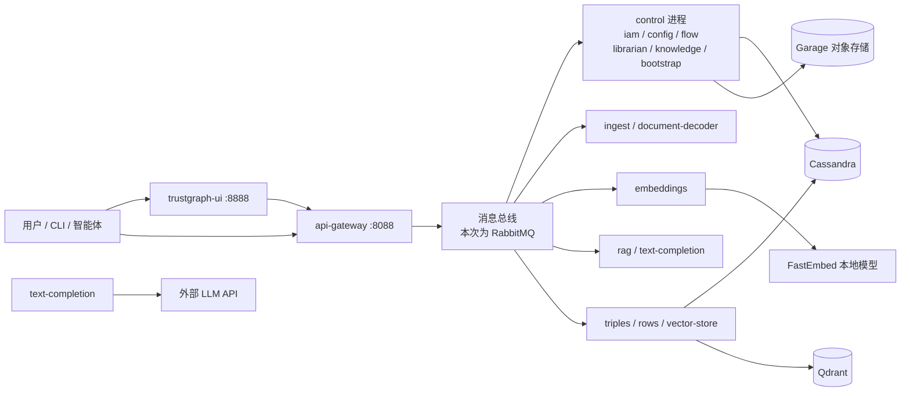
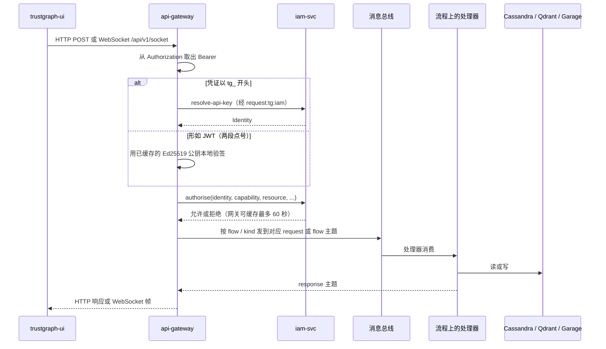
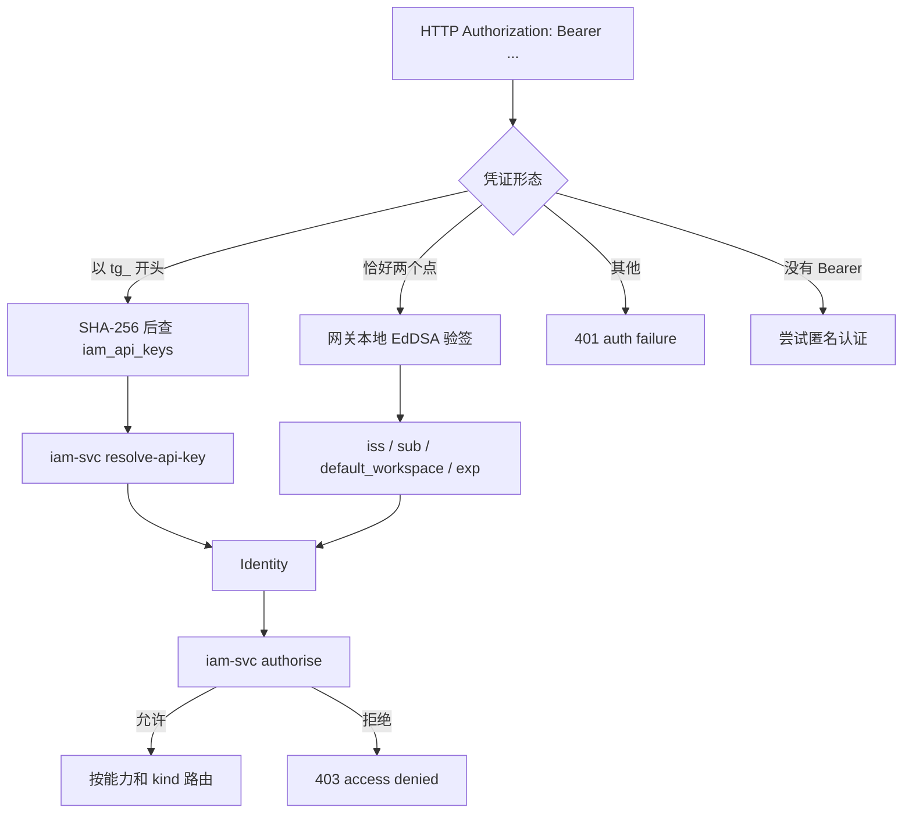
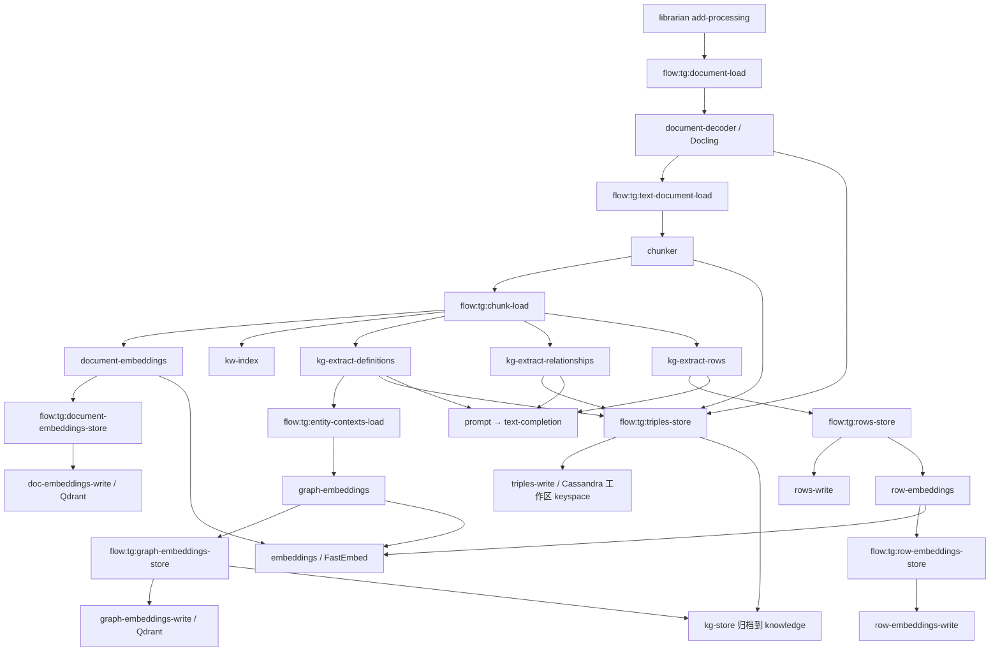

# TrustGraph 架构说明

- **记录时间：** 2026-11-19（Asia/Shanghai）
- **上游项目：** [trustgraph-ai/trustgraph](https://github.com/trustgraph-ai/trustgraph)
- **对照源码：** 本机浅克隆 `/workspace/trustgraph`，分支 `master`，提交 [`17e5d74`](https://github.com/trustgraph-ai/trustgraph/commit/17e5d74)（`release/v2.11 -> master (#1208)`，提交时间 2026-11-12 21:32:18 UTC，即 2026-11-13 05:32 Asia/Shanghai）
- **对照部署：** 官方 2.10 配置生成的 Compose，目录 `/workspace/trustgraph-deploy`。业务镜像为 `trustgraph/trustgraph-flow:2.10.21`、`trustgraph/trustgraph-docling:2.10.21`、`trustgraph/trustgraph-ui:2.3.6`；界面配置 `ui/config/version.json` 中的版本号同为 `2.10.21`
- **官方文档：** [docs.trustgraph.ai](https://docs.trustgraph.ai/)
- **范围：** 本文根据上游源码、技术规格（`docs/tech-specs/`）和本次 Compose 实例整理，说明 TrustGraph 作为知识图谱运行时的结构。官方也支持 Kubernetes，但本次约束只用 Compose，部署主路径不写 K8s。本文不收录源码，也不写入任何密钥、口令或令牌明文。

源码提交已经进入 2.11 合入 `master` 的状态，运行中的发行镜像仍是 2.10.21。下文在描述处理器、队列、存储和 IAM 时，以源码中能核对到的实现为准，并标明本次部署实际启用的组件；两者若有发行版差异，会单独说明，而不是把 2.11 尚未出现在本机镜像里的行为写成已经跑通。

## 目录

1. [定位与要解决的问题](#1-定位与要解决的问题)
2. [整体架构与运行时模型](#2-整体架构与运行时模型)（含 processor-group、AsyncProcessor、请求路径）
3. [源码仓库与 Python 包划分](#3-源码仓库与-python-包划分)
4. [控制面与业务面](#4-控制面与业务面)
5. [消息总线与主题约定](#5-消息总线与主题约定)
6. [数据与存储](#6-数据与存储)
7. [认证、授权与多租户](#7-认证授权与多租户)
8. [文档吸入与知识处理流水线](#8-文档吸入与知识处理流水线)（含大文档流式投递、消息对象与补全适配器）
9. [配置、流程与工作区](#9-配置流程与工作区)（含保留工作区、知识核心与 flow 操作）
10. [界面与网关 API](#10-界面与网关-api)
11. [查询、RAG、智能体与策略](#11-查询rag智能体与策略)
12. [本次 Compose 部署实例](#12-本次-compose-部署实例)
13. [未完全核实的缺口](#13-未完全核实的缺口)

---

## 1. 定位与要解决的问题

### 1.1 TrustGraph 是什么

TrustGraph 给自己的定位不是「又一个图数据库」，也不是只做向量检索的 RAG 框架。上游 README 称它为面向 AI 智能体的开源**本体运行时**（ontology runtime）：把组织自己的本体、文档和数据，变成以 W3C 标准表达的知识，并在每次查询时按策略决定智能体或用户能看到什么。口号是 “Your ontology. Your agents. Your rules.”

它覆盖的标准，按 README 的 “Standards support” 一节，至少包括：

| 标准 | 在栈中的角色（上游表述） |
| --- | --- |
| RDF 1.1 / RDF 1.2 | 知识表示；支持具名图（named graphs） |
| RDF-star / RDF 1.2 quoted triples | 嵌套三元组，用于溯源等场景 |
| SPARQL 1.1 | 图查询（实现上由 TrustGraph 层完成，而不是把查询直接交给 Cassandra） |
| OWL 2 | 用本体引导抽取，并检查 domain、range、subclass 等约束；README 明确写了「不是完整的 OWL 推理机」 |
| SHACL / SHACL-AF | 用高级特性做基于策略的查询过滤 |
| PROV-O | 把答案溯源写成可查询的具名图 |
| JSON-LD | 与 RDF 互通的数据交换 |

也就是说，图存储的后台可以是 Cassandra（本次部署如此），也可以换成 Neo4j、Memgraph 或 FalkorDB；SPARQL、本体约束和策略过滤仍然发生在 TrustGraph 这一层。Cassandra 本身是宽列存储，查询语言是 CQL，并不自带 Cypher 或 SPARQL。

### 1.2 它要解决什么

企业把大模型接到内部文档时，常见的几条裂缝是：

- 只做切片和向量检索时，实体之间的关系、类型约束和来源都容易丢；答案很难回答「这个结论从哪条三元组、哪份文档来」。
- 把知识锁进某个厂商的对象模型后，换模型、换云、换智能体框架的成本很高。
- 多用户、多工作区时，如果只在网关做一次登录检查，查询阶段仍可能把不该看见的三元组送进提示词。
- 文档、结构化表、本体和智能体工具如果不在同一套编排里，就得靠外部工作流把几套系统硬接在一起。

TrustGraph 把这些步骤收进同一套运行时。上游 README 把它概括成三条管道：

1. **EXTRACT（OntologyRAG）：** 从文档和数据中抽出三元组，使它们与本体中的类和属性对齐，并按约束检查。
2. **GROUND（Context Graph）：** 把 RDF 知识放进具名图，并用 PROV-O 把每条知识和来源连起来。
3. **GOVERN（SHACL-AF Policies）：** 每次查询按节点评估策略，结果可以是允许、过滤或判定违规。

出口不仅是 GraphRAG，还包括 SPARQL、智能体和 MCP，并且保留「这个答案是怎么来的」这一条可查询轨迹。

### 1.3 和一般 RAG、超图产品、数据湖的区别

这些对比是为了标明边界，而不是给其他产品打分。

**和「切片 + 向量库 + 提示词」的一般 RAG。** 一般 RAG 的主路径是：文档切块、写入向量库、按相似度取出若干块、交给大模型生成。TrustGraph 也有这条路径，对应本次部署里的 `document-rag`、`document-embeddings` 和 Qdrant。但它同时把块送到知识抽取（定义、关系、本体、结构化行），写入三元组库，再用图游走做 GraphRAG。向量检索在这里是找实体和文档块的一种手段，不是唯一的知识形态。GraphRAG 处理器还会把可解释信息送到 `flow:tg:triples-store:...`，以便把溯源写回图。

**和「只提供图数据库或超图存储」的产品。** Neo4j、Memgraph、FalkorDB 可以替换 Cassandra，成为三元组后台；它们并不代替 TrustGraph 的处理器组、流程蓝图、IAM 和文档库。TrustGraph 要管的是：文档如何进来、抽取如何调用大模型、哪些队列组成一条 flow、谁能访问哪个工作区、查询时如何过滤。图数据库是可插拔的存储，不是整个产品。

**和数据湖 / 数仓。** 数据湖适合保存原始对象和批量分析表。TrustGraph 虽然用 S3 兼容对象存储（本次是 Garage）保存文档字节，用 Cassandra 保存元数据、配置和三元组，但它的查询界面是工作区里的知识服务和 RAG，而不是通用 SQL 或湖仓作业调度。结构化数据会进入 `rows` 表，并可走 NLP 到 GraphQL / 结构化查询，这仍然是运行时内的检索，不是把 TrustGraph 当成数仓。

**和平台厂商的「内置本体」。** README 的对比表强调：数据模型是 W3C RDF / OWL / JSON-LD，而不是厂商对象模型；可以在 Docker、Podman、Kubernetes、任意云或本地模型上运行；访问控制是查询期的 SHACL-AF 策略，而不仅仅是平台权限；审计轨迹是可查询的 PROV-O 具名图。许可证是 Apache 2.0。

### 1.4 这次分析里已经能确认、和尚未展开的能力

已经在源码和本次部署里对上的，包括：processor-group 把多个处理器放进同一进程；消息总线抽象出 Pulsar / RabbitMQ / Kafka；`api-gateway` 把 HTTP / WebSocket 转成总线上的请求；`iam-svc` 做引导、用户、API 密钥和 JWT；`librarian` 管文档元数据和对象字节；`flow-svc` 按蓝图启动流程；Cassandra / Qdrant / Garage 分工；文档吸入后的切块、抽取、写入和 RAG 查询。

README 的 “Core capabilities” 可以和本实例里的模块大致对上，便于阅读官方文档时回到源码位置：

- **Own it（开放标准、知识可迁移）：** RDF 词项与三元组数据类、SPARQL 求值器、知识核心的导入导出、对象存储中的原文档。对应 schema、`sparql-query`、`knowledge` 服务和 librarian。
- **Use it（从本体到知识）：** `kg-extract-ontology`、`ontology` 蓝图、界面上的 Ontology Viewer / Management / VOWL，以及定义 / 关系抽取。默认启动的是 `everything`，本体抽取在默认蓝图里没有列为 flow 键，相关进程仍可能在 `ingest` 容器里待命。
- **Govern it（2.10 的策略过滤）：** `triples-policy` 夹在对外 triples 接口和 `triples-query` 之间；`UserContext` 可随查询传递。这是设计上已经接线的能力，效果取决于是否写入 SHACL-AF 策略，本次未验证。
- **Steer it（2.10 的引导式图游走）：** README 把它列为新能力；源码与界面中有图导航、GraphRAG 的路径长度与子图大小限制。本文没有单独定位「steer」对应的唯一处理器类名，不把某个模块强行命名为它。
- **Prove it（可解释性）：** GraphRAG / Document RAG / 解码器 / 切块器都可以向 `triples-store` 写溯源；`EntityContext.chunk_id`、`Chunk.document_id`、librarian 元数据构成链路。PROV-O 的具体谓词集合以抽取与溯源实现为准，本文未列出全部谓词 IRI。
- **Decide fast（2.10）：** 种子和蓝图里有 `decision-scoring` 接口，另有 `trustgraph-laya` 包提供 `decision-scoring-laya`。本次 launch 的 `rag` 组没有挂 Laya 处理器，调用该 kind 前需要另外部署。

本次 Compose 的 `rag` 组里确实挂了 `triples-policy` 和 `sparql-query`，智能体模式也已种子化。这些模块的源码存在，但本次分析没有用真实文档跑完一条端到端问答来验证策略或溯源的实际效果。后文会写清设计，不把未实测的效果写成已经验证。

---

## 2. 整体架构与运行时模型

### 2.1 系统上下文

TrustGraph 对使用者暴露的是浏览器里的管理界面，以及 `api-gateway` 上的 HTTP / WebSocket API。界面镜像是独立的 `trustgraph-ui`；它不直接写 Cassandra 或 Qdrant，而是调用网关。网关再通过消息总线，把请求交给控制面服务或某条已启动 flow 上的处理器。

大模型不在 TrustGraph 进程内推理（除非另行部署 Ollama、vLLM 等）。本次 `text-completion` 组使用 `trustgraph.model.text_completion.openai.Processor`，通过环境变量 `OPENAI_BASE_URL` 和 `OPENAI_TOKEN` 调用兼容 OpenAI 的接口。嵌入默认走 FastEmbed（`trustgraph.embeddings.fastembed.Processor`），模型名由 flow 参数传入，模板默认是 `sentence-transformers/all-MiniLM-L6-v2`。



### 2.2 不是「一个微服务对应一个业务域」的拆法

如果按常见电商或后台管理系统的思路去找「用户服务、订单服务、目录服务」，会对不上号。TrustGraph 的运行单位是**处理器**（`AsyncProcessor` 的子类）。每个处理器订阅一些主题、向另一些主题发消息，完成一件事：切块、抽关系、写三元组、做一次 GraphRAG 请求等。

这些处理器在源码里都可以作为独立命令启动（见 `trustgraph-flow` 的 `[project.scripts]`，例如 `iam-svc`、`librarian`、`graph-rag`、`api-gateway`）。在资源充足的部署里，官方意图是一个处理器一个进程（或一个容器），以便单独扩缩。`trustgraph.base.processor_group` 的文件头写得很清楚：processor-group 是把多个 `AsyncProcessor` 后裔放进**同一个进程**、共享一个事件循环、一个 Prometheus HTTP 服务和一个 pub/sub 后端池；「供开发和资源受限的部署使用，规模化部署应继续用每处理器一个端点」。

本次 2.10 Compose 正是后一种里的「资源受限」形态：除 `api-gateway` 和 `document-decoder` 单独作为命令运行外，控制面和各数据面都按功能打包进若干 `processor-group` 容器。容器还在，但容器内部是一组处理器，而不是一个单体应用里的多层 MVC。

### 2.3 processor-group 怎么工作

实现位于 `trustgraph-base/trustgraph/base/processor_group.py`。命令行入口是 `processor-group`（由基座包导出；Compose 中 `control`、`ingest`、`embeddings`、`rag`、`rows`、`text-completion`、`triples`、`vector-store` 都执行 `processor-group --log-level INFO -c <launch.yaml>`）。

配置文件是 YAML 或 JSON，形状为：

```yaml
processors:
  - class: trustgraph.iam.service.Processor
    params:
      id: iam-svc
      bootstrap_mode: token
      pubsub_backend: rabbitmq
      rabbitmq_host: rabbitmq
```

`class` 必须是带模块路径的点分名，`_resolve_class()` 用 `importlib` 加载并取出类。每个条目的 `params` 会连同共享的 `taskgroup` 一起传给构造函数。缺省值留在各个处理器类内部，而不是在 group 运行器里写死。

运行模型是「外层一个 TaskGroup，每个处理器再套一层内层 TaskGroup，并由 `_supervise` 看管」：

- 看管任务先调用 `set_processor_id(pid)`，利用 contextvar 把日志打上处理器 id，避免同进程里多路日志混在一起。
- 处理器 `start()` 之后，`run()` 被放进内层任务组。若 `run()` 正常返回，看管者会当作短暂退出，等待 `RESTART_DELAY_SECONDS`（4 秒）再拉起，以对齐容器 `restart: on-failure` 的直觉。
- 若处理器异常退出，同样延迟重启。某个处理器崩溃不会把兄弟处理器一起带走，因为它们各有内层 TaskGroup。
- 收到 `CancelledError` 时停止该路，不再重启。

这一点对运维很重要：`control` 容器里同时跑 IAM、配置、流程、文档库、知识核心、计量和引导。它们共享进程和事件循环，但故障域按处理器隔离；磁盘、内存和 Python 解释器仍然是共用的。若 IAM 把事件循环堵死，同容器里的 `librarian` 也会受影响。这是分组部署的明确代价。

### 2.4 处理器基类：生命周期、并发与配置推送

几乎所有 TrustGraph 处理器都从 `trustgraph.base.async_processor.AsyncProcessor` 下来（或再经过 `FlowProcessor`、`WorkspaceProcessor` 等中间基类）。理解这个基类，比记住每一个具体处理器的文件名更有助于看清运行时。

构造时它会做这几件事：

- 用传入的 `id` 标识自己，并把除 `id` 以外的参数登记到 Prometheus `ProcessorMetrics` 的 Info 指标里（值会转成字符串）。这意味着 launch.yaml 里的主机名、并发度等会出现在指标标签或 info 中；密钥类参数如果被传进来，也有进入指标的风险，所以引导令牌才被设计成走环境变量，而不是写进 YAML。
- 调用 `get_async_pubsub(**params)` 得到总线后端。
- 建立 `ReceiverPool` 和 `SenderPool`。`concurrency` 默认是 1，launch 里多数业务处理器也显式写成 1；`triples-query` 是本次少见的例外，写成了 3。接收池按这个并发度去拉消息、处理、应答。
- 记住配置推送队列（默认 `config_push_queue`）以及配置服务的请求 / 响应队列，超时默认 60 秒。

`start()` 会开始接收配置通知，并可以 `fetch_and_apply_config()`，按工作区或跨工作区拉取某一类配置，再交给已注册的 handler。处理器用 `register_config_handler` / `register_workspace_handler` 订阅变更。例如 `rows-write` 靠配置推送加载结构化 schema；网关则靠配置接收器维护已知工作区。`stop()` 负责关闭连接与任务。独立启动时走 `launch()` / `launch_async()`；在 processor-group 里则由看管任务直接 `start()` 再 `run()`。

`FlowProcessor` 在此之上绑定「当前这条 flow」的主题映射，处理器代码里看到的是逻辑名（如 `input`、`output`、`prompt-request`），真正的 `flow:tg:...` 或 `request:tg:...` 字符串由 flow 启动时替换。`WorkspaceProcessor` 则在工作区出现或删除时增减消费者，适合 librarian、knowledge 这种「每个工作区一条请求队列」的控制面服务。`on_workspace_created` / `on_workspace_deleted` 出现在知识核心服务里，就是这条机制。

把这些合在一起：Compose 里看到的是容器，容器里是 group，group 里是 `AsyncProcessor` 实例，实例里是接收池和发送池，池子后面才是 Cassandra 或大模型。扩缩可以发生在容器级（再起一个同样的 group），也可以在源码支持的前提下改成「每处理器一容器」。本次实例只使用了第一种。

### 2.5 请求进入系统后的主路径


网关是唯一对浏览器和外部客户端开放的数据面入口（本次映射为宿主 `8088`）。界面在 `8888`。一条已认证的业务请求，典型路径如下。



有几条需要单独记住的规则，都来自源码而不是推测：

- 网关注释写明：旧的 `GATEWAY_SECRET` 共享令牌路径已经删除，没有「对所有人开放」的回退。IAM 不可达时，网关无法认证请求。启动时会在有限次数内向 IAM 拉取签名公钥；拿不到时网关仍会监听，但 JWT 校验会在首次请求时重试，失败则统一返回认证失败。
- 凭证判别是廉价的字符串规则：以 `tg_` 开头的当作 API 密钥，交给 IAM 做 `resolve-api-key`；含有两个点、又不带 `tg_` 前缀的当作 JWT，在网关本地用 Ed25519 公钥验证；其他形态直接视为格式错误。所有失败模式都返回同一个 HTTP 401 正文 `{"error":"auth failure"}`，调用方不能区分「缺凭证 / 格式错 / 无效 / 过期 / 已吊销」。这是 `IamAuth.authenticate()` 的明文设计。
- 授权不在网关里写死角色表。网关只调用 IAM 的 `authorise`。OSS 体制的角色与能力集在 `trustgraph.iam.service.iam` 中。
- 工作区是否存在，由网关里的 `known_workspaces` 集合先挡一层。该集合由配置接收器维护，目的是避免把请求发到没有消费者的队列。

### 2.6 界面、网关、处理器与存储的分层

可以把它看成四层，但层与层之间主要靠主题，而不是进程内函数调用：

1. **体验层：** `trustgraph-ui`。本次镜像 `2.3.6`，配置目录挂进容器内的 `trustgraph_ui/ui/config/`。页签、卡片和工作流入口由 JSON 描述，例如 Welcome、Workflows、Demos、Admin。界面还代理了两个外部地址：`/demo-data=https://datasets.app.trustgraph.ai` 和 `/config-svc=https://config-svc.app.trustgraph.ai`（来自 Compose 的 `command`）。这是官方演示数据与配置服务的入口，不是本机 IAM。
2. **入口层：** `api-gateway`（`trustgraph.gateway.service.Api`）。用 aiohttp，`client_max_size` 为 256 MiB。HTTP 审计中间件会在响应后发 `gateway.request` 审计事件。默认端口在源码里是 8888，本次 Compose 显式改成 8088，把 8888 留给 UI。
3. **运行时层：** 各种处理器，包括控制面服务和 flow 内的数据面服务。它们实现同一套异步处理器协议，区别只在订阅的主题和依赖的存储。
4. **状态层：** Cassandra、Qdrant、Garage，以及总线自己的队列状态。处理器崩溃后，持久状态仍在这些后端里；正在传输的 RPC 请求若使用非持久的 request/response 类主题，则可能丢失，需要由调用方重试。

---

### 2.7 几个容易混在一起的词

后面各节会反复出现工作区、集合、流程、知识核心、主题、接口这些词。它们在 TrustGraph 里不是同义词，先对齐一次可以少走弯路。

**工作区（workspace）。** IAM 里的租户边界，也是配置、文档元数据、在线 Cassandra keyspace 名称、以及大多数队列后缀的一部分。本次引导产生的活工作区叫 `default`。以 `_` 开头的是保留工作区，例如模板。一个用户可以有所属工作区，管理员的角色范围是所有工作区。

**集合（collection）。** 工作区内部的知识分桶，出现在 `Metadata.collection`、三元组表的 `collection` 列、行表分区、librarian 的 processing 记录里。种子里有一个名为 `default` 的集合。同一工作区可以有多个集合，删除集合不会删除工作区本身。GraphRAG / SPARQL 请求里也会带 collection，查询默认不会跨集合扫全工作区——具体是否强制，以各查询处理器的实现为准，请求对象上这个字段是显式的。

**流程（flow）与蓝图（flow-blueprint）。** 蓝图是配方，描述有哪些逻辑处理器、主题如何接线、有哪些可调参数。flow 是按蓝图在某个工作区里启动的一次实例，有自己的 id（本次引导为 `default`），并在总线上拥有替换过 `{workspace}` 和 `{id}` 的真实主题。停掉 flow 等于拆掉这条管道的入口和中间队列，并不等于清空该工作区已经写入的图和向量。

**接口（interface）与处理器 id。** 蓝图的 `interfaces` 把对外 kind（如 `graph-rag`、`document-load`）映射到主题。`flow` 段则按 `chunker:{id}` 这种键描述内部接线。网关用户看到的是 kind，processor-group 看到的是类和 id。两者通过蓝图对齐，不是靠同名碰巧一致。

**知识核心（knowledge core）。** 一份可导入导出的知识包，落在 `knowledge` keyspace，包括 kg-core 与 de-core。它和「正在被 GraphRAG 查询的在线图」可以有一份归档镜像关系：吸入时 `kg-store` 一边写在线一边归档；也可以事后 `load-kg-core` 再灌进去。不要把它理解成又一个工作区。

**主题（topic / queue）与对象键。** 主题是总线上的地址。对象键是 Garage 里文档字节的 `object_id`。文档在 librarian 中的 `id`、Cassandra 行里的 `document_id`、消息里的 `Metadata.id` 需要能对得上，溯源才串得起来。大文档路径上，总线消息往往只带 `document_id`，字节仍在对象存储。

## 3. 源码仓库与 Python 包划分


上游仓库是一个多包 Python 项目，而不是单一的 `setup.py` 应用。顶层除文档、容器和测试外，主要包如下。

| 包 | 角色 | 本次部署是否直接用到 |
| --- | --- | --- |
| `trustgraph-base` | 运行时基座：`AsyncProcessor`、processor-group、pubsub 工厂、Cassandra / Qdrant 配置辅助、各类 Client 与 Service 基类、schema 与队列名 | 是，被 `trustgraph-flow` 依赖（声明为 `trustgraph-base>=2.11,<2.12`，以源码为准；运行镜像是 2.10.21，其锁定版本以镜像内为准） |
| `trustgraph-flow` | 主功能包：网关、IAM、配置、流程、文档库、抽取、RAG、存储与查询适配器、文本补全、智能体编排等，绝大多数控制台脚本都在这里 | 是，镜像 `trustgraph/trustgraph-flow:2.10.21` |
| `trustgraph-docling` | 基于 Docling 的文档解码器，入口 `docling-decoder`；`pyproject.toml` 称它是 unstructured 解码器的轻量替代 | 是，独立容器 `document-decoder` |
| `trustgraph-cli` | 命令行工具，例如启动 flow、列出模型、导入本体、管理用户等 | 本机部署未作为容器运行，源码中存在 |
| `trustgraph` | 元包 / 聚合包装 | 未作为独立容器出现 |
| `trustgraph-mcp` | MCP 服务器入口 `mcp-server` | 本次为节省资源去掉了 MCP 服务容器；`rag` 组里仍挂了 `trustgraph.agent.mcp_tool.Service` 作为 flow 内工具调用端 |
| `trustgraph-embeddings-hf` | HuggingFace 嵌入，`embeddings-hf` | 未启用；本次嵌入是 FastEmbed |
| `trustgraph-ocr` / `trustgraph-span` / `trustgraph-cloze` / `trustgraph-laya` | OCR、span 字段抽取、cloze 分类、Laya 决策评分 | 源码存在。`everything` 蓝图里有 `cloze`、`decision-scoring` 等接口，但本次 launch 未为它们单独起对应模型容器 |
| `trustgraph-bedrock` / `trustgraph-vertexai` | AWS Bedrock、Vertex AI / Google AI Studio 的文本补全适配 | 未启用；本次是 OpenAI 兼容接口 |

`trustgraph-flow` 的包描述是：「用灵活的方式运行一组灵活的 AI 处理组件，以构成处理管道。」这和「预组装好的单体知识库应用」不是同一句话：管道的具体形状由 flow 蓝图决定，处理器是可替换的。

基座里几个需要先认识的类型：

- `AsyncProcessor`（`trustgraph-base/trustgraph/base/async_processor.py`）：处理器生命周期与总线连接的核心。
- `FlowProcessor`：在已启动的 flow 上下文中工作，能看到该 flow 的主题映射和工作区。
- `WorkspaceProcessor`：按工作区动态增减消费者。`librarian` 就是这种，队列名会带上 `:{workspace}` 后缀。
- 各种 `*Service` / `*Client`：把「写三元组」「查文档嵌入」「调用提示词服务」等做成可复用的请求—响应或单向发送封装，避免每个处理器手写总线细节。

消息的 schema 集中在 `trustgraph-base/trustgraph/schema/`，按领域拆文件，例如 `iam.py`、`documents.py`、`triples.py`、`retrieval.py`、`llm.py`、`ontology.py`。队列名用 `schema/core/topic.py` 里的 `queue()` 生成，这一点在第 5 节展开。

---

## 4. 控制面与业务面

### 4.1 为什么要分成「控制」和「业务」

控制面回答的是：系统里有哪些工作区、哪条流程在跑、谁可以登录、文档目录里有什么、配置版本是多少。业务面回答的是：这份 PDF 如何变成文本和三元组、这个问题如何做 GraphRAG、SPARQL 如何执行。

本次 Compose 把控制面几乎全部放进 `control` 容器，配置文件是 `launch/control/launch.yaml`。业务面按功能拆到 `ingest`、`embeddings`、`rag`、`text-completion`、`triples`、`rows`、`vector-store`，文档解码器单独用 Docling 镜像。`api-gateway` 两边都要说话，所以单独成容器，不进 processor-group。

### 4.2 `control` 容器里的处理器

下面按 `launch/control/launch.yaml` 的清单逐个说明。除特别注明外，它们都使用 `pubsub_backend: rabbitmq`、`rabbitmq_host: rabbitmq`，Cassandra 副本因子为 1。对象存储密钥只存在该文件和 `.env` 中，本文不抄录。

**`trustgraph.iam.service.Processor`（id: `iam-svc`）。** 默认 keyspace 为 `iam`。`bootstrap_mode` 在 launch 里写成 `token`；令牌本身不写进 YAML，而由容器环境变量 `IAM_BOOTSTRAP_TOKEN` 注入。`service.py` 注明这是为了让令牌不必进入 YAML 和 Git。启动时若是 token 模式且签名密钥表为空，会用该令牌播种管理员与 API 密钥。细节见第 7 节。

**`trustgraph.config.service.Processor`（id: `config-svc`）。** 默认 keyspace 为 `config`。源码文档说明它是双队列体制：

- 系统队列 `config-request`（即 `request:tg:config`）处理跨工作区操作，例如 `getvalues-all-ws`，以及引导程序对保留工作区的写入。注释写明：**网关从不把请求路由到这条系统队列**。
- 每工作区队列 `config-request:<workspace>` 处理该工作区范围内的读写，工作区身份来自队列而不是消息体。

配置以 `(workspace, class, key, value)` 存放，另有 `version` 表做版本递增。变更后会向通知主题推送，供网关和其他处理器刷新缓存。

**`trustgraph.flow.service.Processor`（id: `flow-svc`）。** 管理 flow 蓝图和已启动的 flow。`FlowConfig` 提供列出 / 读取 / 写入 / 删除蓝图，以及列出、获取、启动、停止 flow。启动时会根据蓝图里的主题模板，在总线上确保所需主题存在，并把 `{workspace}`、`{id}` 以及用户参数替换进去。停止时会按重试设置删除该 flow 拥有的主题（`DELETE_RETRIES = 5`，间隔 2 秒）。

**`trustgraph.librarian.Processor`（id: `librarian`）。** 文档库。元数据在 Cassandra keyspace `librarian`（`default_keyspace="librarian"`），对象字节在 S3 兼容存储，默认桶名是 `library`。本次对象端点是 `garage:3900`，region 为 `garage`。它还通过配置服务维护 collection 元数据，并在 `add-processing` 时把文档内容送到 flow 的 `document-load` 一类主题。详见第 8 节。

**`trustgraph.cores.service.Processor`（id: `knowledge`）与 `trustgraph.storage.knowledge.store.Processor`（id: `kg-store`）。** 知识核心（knowledge core）的管理与落盘。默认 keyspace 为 `knowledge`。`KnowledgeTableStore` 中有 `triples`、`graph_embeddings`、`document_embeddings` 三张表，按 `(workspace, document_id)` 分区，用来保存可导入导出的知识核心，而不是在线查询用的实体中心图。在线查询走 `triples` / `vector-store` 组里的另一套表，见第 6 节。`everything` 蓝图里，`kg-store:{id}` 同时订阅 `flow:tg:triples-store:{workspace}:{id}` 和 `flow:tg:graph-embeddings-store:{workspace}:{id}`，因此吸入过程中产生的三元组和实体嵌入会额外归档一份到知识核心。

**`trustgraph.metering.Processor`（id: `metering` 与 `metering-rag`）。** 两份计量处理器。在 `everything` 蓝图里，`metering` 监听 `response:tg:text-completion:{workspace}:{id}`，`metering-rag` 监听 `response:tg:text-completion-rag:{workspace}:{id}`，也就是把对大模型的响应流复制一份做用量统计。它们不在问答路径上做变换。

**`trustgraph.bootstrap.bootstrapper.Processor`（id: `bootstrap`）。** 系统首次启动时的播种器，不是业务 API。本次配置了三个 initialiser，均带 `flag: v1` 和 `overwrite: false`：

1. `trustgraph.bootstrap.initialisers.TemplateSeed`：从 `/etc/trustgraph/template/config.json`（Compose 把 `./trustgraph` 挂到该路径）把模板写入保留的模板工作区。`overwrite: false` 表示再次启动时不会覆盖已有键。
2. `trustgraph.bootstrap.initialisers.WorkspaceInit`：创建工作区 `default`，`source: template`，即从模板工作区复制一份完整配置。它会向 IAM 发 `create-workspace`。注释说明若模板工作区仍空，表示 TemplateSeed 还没完成，应等待。
3. `trustgraph.bootstrap.initialisers.DefaultFlowStart`：在 `default` 工作区启动 `flow_id: default`，蓝图名为 `everything`，描述为 `Default`。

因此，一次干净启动在控制面上的预期结果是：IAM 中有默认工作区和管理员，配置库中有模板与 `default` 工作区的配置，并且已经有一条名为 `default`、类型为 `everything` 的正在运行的 flow。

### 4.3 业务面各组在做什么

**`document-decoder`：** 独立容器，镜像 `trustgraph-docling:2.10.21`，命令 `docling-decoder --pubsub-backend rabbitmq --rabbitmq-host rabbitmq`。它不走 processor-group。在 `everything` 蓝图里，这个逻辑角色叫 `document-decoder:{id}`，输入是 `flow:tg:document-load:...`，输出是 `flow:tg:text-document-load:...`，同时可把溯源三元组写到 `flow:tg:triples-store:...`，并与 librarian 做请求—响应。

**`ingest`：** 切块、四类知识抽取、以及吸入路径上的提示词服务。

| id | 类 |
| --- | --- |
| `chunker` | `trustgraph.chunking.recursive.Processor` |
| `kg-extract-definitions` | `trustgraph.extract.kg.definitions.Processor` |
| `kg-extract-ontology` | `trustgraph.extract.kg.ontology.Processor` |
| `kg-extract-relationships` | `trustgraph.extract.kg.relationships.Processor` |
| `kg-extract-rows` | `trustgraph.extract.kg.rows.Processor` |
| `prompt` | `trustgraph.prompt.template.Processor` |

抽取类的 `concurrency` 在 launch 里均为 1。吸入路径使用 `prompt`（对应 flow 主题 `request:tg:prompt:...`），与 RAG 路径上的 `prompt-rag` 分开，以免问答和抽取抢同一条补全队列。

**`embeddings`：** FastEmbed 嵌入服务，加上把嵌入请求套到文档块、图实体、结构化行上的三个适配器，以及 FlashRank 重排序。

| id | 类 |
| --- | --- |
| `embeddings` | `trustgraph.embeddings.fastembed.Processor` |
| `document-embeddings` | `trustgraph.embeddings.document_embeddings.Processor` |
| `graph-embeddings` | `trustgraph.embeddings.graph_embeddings.Processor` |
| `row-embeddings` | `trustgraph.embeddings.row_embeddings.Processor` |
| `reranker` | `trustgraph.reranker.flashrank.Processor` |

嵌入服务 `trustgraph.embeddings.fastembed.Processor` 默认模型是 `sentence-transformers/all-MiniLM-L6-v2`，与种子 `parameter-type` 中 `embeddings-model` 的默认值一致。它内部用 FastEmbed 的 `TextEmbedding`，并缓存当前已加载的模型名；若某次请求带了不同的 `model`，会在线程里重新加载后再编码。这意味着同一个 `embeddings` 进程可以在 flow 参数切换模型后继续服务，但换模期间该进程是同步加载的，可能出现短暂停顿。`document-embeddings`、`graph-embeddings`、`row-embeddings` 自己不做向量计算，只是向这个服务发请求，再把结果写到各自的 store 主题。

**`text-completion`：** 两个 OpenAI 兼容处理器，`id` 分别为 `text-completion` 和 `text-completion-rag`。参数相同：`max_output_tokens: 4096`，`temperature: 0`，`thinking: off`，`variant: openai`。flow 蓝图里它们分别绑定 `{llm-model}` 和 `{llm-rag-model}`；后者默认受前者控制（`controlled-by: llm-model`）。

**`rag`：** 查询与智能体侧。

| id | 类 | launch 中的要点 |
| --- | --- | --- |
| `agent-manager` | `trustgraph.agent.orchestrator.Processor` | 并发 1 |
| `graph-rag` | `trustgraph.retrieval.graph_rag.Processor` | `entity_limit: 50`，`edge_limit: 30`，`edge_score_limit: 10`，`triple_limit: 30`，`max_path_length: 2`，`max_subgraph_size: 100` |
| `document-rag` | `trustgraph.retrieval.document_rag.Processor` | `doc_limit: 20`，`retrieval_mode: vector` |
| `nlp-query` | `trustgraph.retrieval.nlp_query.Processor` | 自然语言到结构化查询的中间步 |
| `structured-query` | `trustgraph.retrieval.structured_query.Processor` | |
| `structured-diag` | `trustgraph.retrieval.structured_diag.Processor` | 结构化数据诊断 |
| `sparql-query` | `trustgraph.query.sparql.Processor` | |
| `prompt-rag` | `trustgraph.prompt.template.Processor` | RAG / 智能体提示词 |
| `mcp-tool` | `trustgraph.agent.mcp_tool.Service` | flow 内 MCP 工具调用 |

**`triples`：** 在线三元组的写、查，以及查之前的策略过滤。

| id | 类 |
| --- | --- |
| `triples-query` | `trustgraph.query.triples.cassandra.Processor`（并发 3） |
| `triples-write` | `trustgraph.storage.triples.cassandra.Processor` |
| `triples-policy` | `trustgraph.policy.triples.service.Processor` |

蓝图把对外的 `request:tg:triples:...` 先接到 `triples-policy`，再由它转到 `request:tg:unfiltered-triples:...` 上的真正查询处理器。也就是说，默认的 `everything` 流程里，三元组查询不是「直达存储」，而是「先策略、后存储」。

**`rows`：** `trustgraph.storage.rows.cassandra.Processor` 与 `trustgraph.query.rows.cassandra.Processor`，Cassandra 主机为 `cassandra`。

**`vector-store`：** 文档 / 图 / 行三类嵌入的 Qdrant 写与查，`store_uri: http://qdrant:6333`，副本因子和分片数均为 1。

### 4.4 控制面与业务面如何会合

吸入一条文档时，控制面的 `librarian` 先记下元数据、把字节写入 Garage，再向当前 flow 的 `document-load` 发送内容；之后的解码、切块、抽取、写入全部在业务面完成。查询时，界面经网关把请求打到该 flow 的 `graph-rag` 或 `document-rag`；这些处理器又会回调 `librarian`（例如取文档）、回调嵌入服务、回调提示词、回调三元组查询。控制面并不是在吸入结束之后就退出。

---

## 5. 消息总线与主题约定

### 5.1 抽象层

处理器不直接依赖某一种消息产品的客户端 API 作为唯一路径。`trustgraph.base.pubsub.get_async_pubsub()` 按配置键 `pubsub_backend` 选择实现，支持：

| 值 | 实现类 | 默认连接 |
| --- | --- | --- |
| `pulsar`（工厂默认，也是环境变量 `PUBSUB_BACKEND` 的默认） | `AsyncPulsarBackend` | `PULSAR_HOST`，缺省 `pulsar://pulsar:6650` |
| `rabbitmq` | `AsyncRabbitMQBackend` | 主机 `RABBITMQ_HOST`（缺省 `rabbitmq`），端口 5672，用户 / 密码缺省为 `guest` / `guest`，vhost `/` |
| `kafka` | `AsyncKafkaBackend` | `KAFKA_BOOTSTRAP_SERVERS`，缺省 `kafka:9092`；README 称 Kafka 为实验性 |

协议定义在 `async_backend.py`：异步地 `create_consumer` / `create_producer`，消费者可 `acknowledge` 或 `negative_acknowledge`。官方文档和模板的推荐入门组合是 Pulsar。本次为节省内存改用 RabbitMQ，镜像 `rabbitmq:4.1-management`。功能上走同一套处理器，但持久性、积压、多消费者语义以对应后端的实现为准；本文没有做 Pulsar 与 RabbitMQ 的对照压测，不把两者写成完全等价。

源码里不少模块的文档字符串仍写「Pulsar bus」，例如网关 `service.py` 开头。这是历史表述。实际连接已经通过工厂选择后端；本次启动命令都带了 `--pubsub-backend rabbitmq`。

### 5.2 主题命名

`queue(topic, cls='flow', topicspace='tg')` 生成 `CLASS:TOPICSPACE:TOPIC` 形式的标识符。`topicspace` 默认是 `tg`，用来做部署隔离。`cls` 决定运营特性，源码注释给出的四类是：

| cls | 含义（源码注释） | 例子 |
| --- | --- | --- |
| `flow` | 持久的共享工作队列，竞争消费者 | `flow:tg:document-load:{workspace}:{id}` |
| `request` | 非持久的 RPC 请求队列，共享 | `request:tg:config`、`request:tg:graph-rag:{workspace}:{id}` |
| `response` | 非持久的 RPC 响应队列，按订阅者分开 | `response:tg:iam` |
| `notify` | 短暂广播，按订阅者、自动删除 | 配置变更通知 |

控制面服务的基队列一般没有 flow id，例如 IAM、配置、流程、文档库、知识核心。工作区级服务会再加 `:{workspace}`。一条已启动 flow 上的接口则同时带工作区和 flow id，例如 `request:tg:graph-rag:{workspace}:{id}`。`everything` 蓝图的 `interfaces` 段就是这张对照表，网关按 kind 找到对应主题。

### 5.3 两种通信形态

蓝图里的 `interface-description` 把接口分成：

- **`request-response`：** 调用方发请求、等响应。GraphRAG、SPARQL、提示词、嵌入、三元组查询、librarian 都是这类。
- **`send`：** 单向投入一条 flow 主题，不在同一调用里等待「处理完成」。`document-load`、`text-load`、`triples-store`、各类 embeddings-store 属于这类。吸入文档时，UI 通常是先通过 librarian 的请求—响应把对象存好，再触发 processing；真正的解码和抽取沿着 `flow:` 主题异步前进。

`FlowConfig.handle_start_flow` 会收集蓝图中的主题并在总线上创建。流量高峰时，吸入管道的积压会出现在 `flow:` 主题上；查询延迟则更常出现在 `request:` / `response:` 这一对，以及下游 LLM 调用。

---

### 5.4 本次 RabbitMQ 后端如何落实这些约定

`trustgraph.base.async_rabbitmq_backend.AsyncRabbitMQBackend` 使用 `aio-pika`。逻辑主题 `class:topicspace:topic` 会被映射成 fanout 交换机，命名规则是 `topicspace.class.topic`。例如 `request:tg:iam` 对应交换机 `tg.request.iam`，`flow:tg:document-load:default:default` 会按第三个冒号分段后进入同一套规则（`_parse_topic` 用 `split(':', 2)`，因此主题名里后面的 `{workspace}:{id}` 都留在第三段里）。生产者向交换机发布时 routing key 为空，由 fanout 送到所有绑定队列。

消费者按类声明不同队列：

- `flow`：持久（`durable=True`），使用命名队列，多个消费者竞争消费，适合吸入管道这种「做完再删、崩溃后还在」的工作。
- `request`：非持久的命名队列，仍然是竞争消费者，适合 RPC 请求。
- `response` / `notify`：匿名、排他、自动删除的队列，每个订阅者一份，适合把响应或广播送回某一个网关连接或某一个通知接收者。

若主题字符串里没有冒号，实现会把它当成 `tg.flow.{topic_id}` 且持久。交换机本身在声明时是 durable 的；消息是否持久还要看生产者发送时的投递模式（实现里按该类的 durable 标志设置）。消息体是 JSON，由 `dataclass_to_dict` / `dict_to_dataclass` 与 schema 数据类互转；应用属性（例如关联请求的 `id`）放在 AMQP headers 里，网关和各个服务用它把响应对回请求。

这套映射解释了第 5.2 节四种 `cls` 的运维含义。它也解释了为什么在 RabbitMQ 管理界面里看到的不是字面上的 `request:tg:iam`，而是点分的交换机名。本次未把 RabbitMQ 管理端口映射到宿主，要观察积压需要进入容器或增加端口映射。官方默认的 Pulsar 主题命名是同一套逻辑标识，物理布局不同；两者都通过工厂接入，不能从本文直接外推堆积语义完全一样。

## 6. 数据与存储


### 6.1 存储分工总图

```mermaid
flowchart TB
    subgraph cass [Cassandra 5.0.8]
        iamKS[keyspace iam<br/>用户 / 密钥 / 工作区 / 签名密钥]
        cfgKS[keyspace config<br/>工作区配置与版本]
        libKS[keyspace librarian<br/>文档元数据 / processing / 分片上传会话]
        kgKS[keyspace knowledge<br/>知识核心的三元组与嵌入归档]
        wsKS[按工作区命名的 keyspace<br/>在线图 quads_* 与 rows]
    end
    subgraph qd [Qdrant v1.18.0]
        de[文档块向量]
        ge[图实体向量]
        re[结构化行向量]
    end
    subgraph gar [Garage v2.3.0]
        bucket[桶 library<br/>S3 API :3900]
    end
    iam-svc --> iamKS
    config-svc --> cfgKS
    librarian --> libKS
    librarian --> bucket
    kg-store --> kgKS
    triples-write --> wsKS
    rows-write --> wsKS
    doc-embeddings-write --> de
    graph-embeddings-write --> ge
    row-embeddings-write --> re
```

### 6.2 Cassandra：多个 keyspace，而不是一张「图库」

本机 Cassandra 镜像是 `docker.io/cassandra:5.0.8`，数据在命名卷 `cassandra` 中。TrustGraph 按服务建立不同 keyspace，复制策略在建库语句里是 `SimpleStrategy`，副本因子取处理器参数（本次为 1）。

**`iam`。** 表结构在 `trustgraph/tables/iam.py`：

| 表 | 主键 | 内容 |
| --- | --- | --- |
| `iam_workspaces` | `id` | 工作区名称、是否启用、创建时间 |
| `iam_users` | `id` | 用户名、显示名、邮箱、密码哈希、角色集合、启用标记、必须改密、所属工作区、创建时间 |
| `iam_users_by_username` | `username` | 到 `user_id` 的查找表 |
| `iam_api_keys` | `key_hash` | 密钥 id、用户、名称、前缀、过期、创建、最近使用；另有 `user_id` 和 `id` 的二级索引 |
| `iam_signing_keys` | `kid` | 私钥 PEM、公钥 PEM、创建与退役时间 |

该文件顶部的文档字符串仍写「RSA keypairs for JWT signing」，但 `iam.py` 业务逻辑明确使用 **Ed25519 / EdDSA**，网关验签也拒绝非 EdDSA 算法。应以实现代码为准，表注释是过时表述。

**`config`。** `config` 表的主键是 `(workspace, class, key)`，值为文本；`version` 表记录版本。配置类（class）在种子文件里包括 `flow-blueprint`、`prompt`、`parameter-type`、`tool`、`agent-pattern` 等，见第 9 节。

**`librarian`。** 

| 表 | 主键 | 内容 |
| --- | --- | --- |
| `document` | `(workspace, id)` | 时间、kind、标题、注释、元数据（三元组式的 tuple 列表）、标签、`object_id`、`parent_id`、`document_type`；并对 `object_id`、`parent_id` 建索引 |
| `processing` | `(workspace, id)` | 关联的 `document_id`、时间、flow、collection、标签 |
| `upload_session` | `upload_id` | 分片上传会话，含 S3 upload id、`object_id`、总分片、已收到分片的 etag 映射；`default_time_to_live = 86400`（一天后自动过期） |

**`knowledge`。** 知识核心归档：

- `triples`：`PRIMARY KEY ((workspace, document_id), id)`，三元组以 `list<tuple<...>>` 存放，并带元数据。
- `graph_embeddings` / `document_embeddings`：同样按工作区和文档 id 分区，分别存实体嵌入和块嵌入。

这一套是「按文档打包的核心」，用于导入导出和 `kg-store`，不是在线 GraphRAG 查询时扫的主表。

**按工作区命名的 keyspace（在线图与行）。** `trustgraph.storage.triples.cassandra.write.Processor` 使用 `EntityCentricKnowledgeGraph`，并把 `keyspace=workspace` 传入。`EntityCentricKnowledgeGraph` 会把名称消毒（非字母数字下划线改成 `_`，非字母开头则加 `r_` 前缀，再转小写），然后在该 keyspace 中建立：

| 表 | 作用 |
| --- | --- |
| `quads_by_entity` | 主数据。主键 `((collection, entity), role, p, otype, s, o, d, dtype, lang)`。每个实体一个分区，收录它作为主语或宾语参与的所有四元组 |
| `quads_by_collection` | 集合清单，用于按 collection 查询和删除 |
| `collection_metadata` | 集合是否存在及创建时间 |

类注释写明：用 2 张表代替旧的 7 张表（`KnowledgeGraph` 里的 `quads_spog`、`quads_posg` 等仍保留在同一文件中，但本次写入路径走的是实体中心实现），并声称 16 种查询模式都可以在单分区读取内完成。图标识默认是空字符串 `DEFAULT_GRAPH = ""`。`collection` 在这里是工作区之内的知识集合，不是 Cassandra 的 keyspace。

`EntityCentricKnowledgeGraph.insert()` 的写入放大是理解存储成本的关键。一次插入会：

- 在 `quads_by_entity` 为主语写一行，`role='S'`，分区键是 `(collection, s)`；
- 为谓语写一行，`role='P'`，分区键是 `(collection, p)`；
- 为宾语写一行，`role='O'`，分区键是 `(collection, o)`——文档字符串说，若宾语是字面量，则不把字面量当作可独立查询的实体，此时实体行是 3 行而不是把字面量当成完整实体；`otype` 可为 `u`（URI）、`l`（字面量）、`t`（嵌套三元组），未传入时会用宾语是否以 `http://` 或 `https://` 开头做一次向后兼容的自动判断；
- 若图名不是默认图，再为图本身写一行，`role='G'`；
- 再向 `quads_by_collection` 写一行清单。

这些写入放在同一个 `BatchStatement` 里。查询「某个实体参与的所有四元组」因此是单分区读取；代价是每条四元组在磁盘上有多份角色投影。删除一个 collection 则要走清单表再清理实体表，相关实现和分页删除在同一文件及单元测试中，本次未实测删除性能。

结构化行采用同样的「keyspace = 工作区」规则。`rows-write` 在收到对象时执行 `keyspace = workspace`，并确保存在：

- `rows`：主键 `((collection, schema_name, index_name), index_value, row_id)`，`data` 为 `map<text, text>`，另有 `source`
- `row_partitions`：记录某个 collection 下有哪些 schema 和索引，便于删除

`rows-write` 在落盘时还有一条重要限制：它会按 schema 上的索引字段，把同一行复制写入多次，每次对应一个 `index_name` 和 `index_value`（后者由 `build_index_value` 从行数据构造）。`data` 列保存该行全部字段的字符串映射，查询可以走某个索引再回表。如果某个 schema 没有任何索引字段，实现会打出警告并且直接返回，**这些行不会被写入，因而也无法查询**。这与三元组库「每条边都会进实体表」不同，结构化数据必须先在工作区配置里定义带索引的 schema，抽取器产出的行才进得去。`source` 列用于保留来源信息。

因此，新建一个工作区，不仅是 IAM 里多一行，还会在 Cassandra 中按需出现以该工作区命名的 keyspace。这是多租户隔离在存储层的主要手段之一。

### 6.3 Qdrant：三类向量

镜像 `docker.io/qdrant/qdrant:v1.18.0`，存储卷 `qdrant`。处理器通过 `http://qdrant:6333` 访问。本次启用了三对写/查：

- 文档块嵌入：`doc-embeddings-write` / `doc-embeddings-query`
- 图实体嵌入：`graph-embeddings-write` / `graph-embeddings-query`
- 结构化行嵌入：`row-embeddings-write` / `row-embeddings-query`

源码还包含 Milvus 和 Pinecone 的适配器，本次未启动。向量集合的具体命名规则由相应 Qdrant 适配器实现；本文没有在运行中的 Qdrant 里逐一列出集合名，不在这里编造集合名称。写入侧 launch 参数包含 `qdrant_replication_factor: 1` 和 `qdrant_shard_number: 1`。

### 6.4 Garage：对象存储，替代较早文档中的 MinIO

本次对象存储是 `docker.io/dxflrs/garage:v2.3.0`，而不是 MinIO。这与部分 2.11 模板文档以及更早资料仍写 MinIO 的情况不同，以本机 `docker-compose.yaml` 为准。持久卷分 `garage-meta` 和 `garage-data`。配置文件在 `./garage/garage.toml`（其中的密钥不在本文出现）。从配置结构可以确认的监听端口是：

| 端口 | 用途 |
| --- | --- |
| 3900 | S3 API，region 在配置里为 `garage` |
| 3901 | RPC |
| 3902 | S3 web |
| 3903 | 管理 API |
| 3904 | K2V API |

副本因子为 1，元数据引擎为 lmdb。`librarian` 通过 MinIO 兼容客户端访问 S3 API（`trustgraph-flow` 依赖里有 `minio` 包，类名为 `BlobStore`），默认桶名 `library`。`BlobStore.ensure_bucket()` 在桶不存在时会尝试创建。

`garage-init` 是一次性（或可重复执行的）Alpine 容器：安装 `curl` / `jq`，下载 garage CLI，等待 `http://garage:3903/health`，再通过管理 API 取节点 id，用 RPC 配置布局、导入访问密钥并授予建桶权限。脚本本身在成功路径末尾并不强制创建名为 `library` 的桶，而是导入密钥并 `key allow --create-bucket`。若初始化失败，librarian 在访问桶时会遇到权限或桶不存在一类错误。本次实际遇到的情况见第 12 节。

### 6.5 消息队列本身也是一种存储

RabbitMQ 的数据在卷 `rabbitmq` 中。`flow:` 类主题被注释为持久共享队列，吸入管道的中间状态会体现在队列积压上。Cassandra 和 Qdrant 保存的是处理结果，不保存「这一块还在等抽取」的游标；那部分如果要观察，需要看总线和 `librarian` 的 `processing` 表。

### 6.6 官方可替换的存储，但不是本次路径

分析文档和官方模板还允许：用 Neo4j / Memgraph / FalkorDB 替换 Cassandra 作为图后台；用 Milvus 替换 Qdrant；用 Pulsar 或 Kafka 替换 RabbitMQ。这些适配器在 `trustgraph-flow` 的 `storage/` 与 `query/` 目录以及 `[project.scripts]` 中都有对应入口。本次实例没有启用它们，后文不以这些后台为主路径。

---

## 7. 认证、授权与多租户

### 7.1 IAM 是 TrustGraph 自己的服务

身份不由 Auth0、Okta、Keycloak 或 LLM 厂商提供。`iam-svc` 跑在 `control` 容器里，业务逻辑是 `trustgraph.iam.service.iam.IamService`，传输是 `trustgraph.iam.service.service.Processor`，表在 Cassandra keyspace `iam`。另有 `trustgraph.iam.noauth`（脚本 `no-auth-svc`），实现同一套 IAM 契约但全部放行、无数据库、无签名密钥，用于特定开发场景。本次部署使用的是真正的 `iam-svc`，不是 no-auth。

网关通过 `IamClient` 对 `request:tg:iam` / `response:tg:iam` 做请求—响应。协议说明在上游 `docs/tech-specs/iam-protocol.md` 和 `iam.md`。

### 7.2 两种引导模式

`iam-svc` 启动时必须给出 `bootstrap_mode`，只能是 `token` 或 `bootstrap`，否则拒绝启动。来源优先级是：processor-group / 命令行参数，其次环境变量 `IAM_BOOTSTRAP_MODE`。本次 launch 写死 `token`。

**`token` 模式（本次采用）。** 必须同时提供引导令牌（参数或环境变量 `IAM_BOOTSTRAP_TOKEN`）。`auto_bootstrap_if_token_mode()` 在启动时检查是否已有签名密钥：

- 若表已有签名密钥，则认为已经播种过，跳过，并打日志说明。再次重启不会重新播种。只改 `.env` 里的令牌再重启，不会自动改库里已保存的密钥哈希。
- 若表是空的，则调用 `_seed_tables(bootstrap_token)`。

播种会写入：

- 用户名 `admin`、显示名 `Administrator`、角色 `["admin"]`、`must_change_password=True` 的用户，归属工作区 `default`。管理员密码用 `secrets.token_urlsafe(32)` 随机生成并做成 PBKDF2 哈希后入库，**明文不会返回，也不会写进日志**。因此 token 模式下，第一次通常只能用 API 密钥进入，而不是用那个未知的随机密码。
- 一条名为 `bootstrap` 的 API 密钥，密钥明文就是操作员提供的引导令牌，库中只存 SHA-256 十六进制哈希。`prefix` 保存明文的前缀（`tg_` 再加 4 个字符），便于在管理界面辨认，而不是回显全文。
- 一把新的 Ed25519 签名密钥对。

工作区记录本身由 bootstrapper 的 `WorkspaceInit` 通过 IAM 的 `create-workspace` 创建，不在 `_seed_tables` 里直接插入。源码注释把引导令牌视为一次性引导凭证：操作员已经持有它，所以不必再打印。它不会在首次登录后自动作废；要失效，需要另行吊销这条 `bootstrap` 密钥，并从部署配置中去掉明文。

**`bootstrap` 模式。** `auto_bootstrap_if_token_mode` 是空操作。显式的 `bootstrap` 操作只在该模式且表仍为空时可用；其他情况一律返回笼统的认证失败，不区分「模式不对 / 已经播种 / 禁止」。成功时由系统生成一把 `tg_` 前缀的新密钥并返回。源码注释认为这种模式不适合公开暴露。

### 7.3 API 密钥、口令与 JWT 如何分工



**API 密钥。** 常量 `API_KEY_PREFIX = "tg_"`。系统生成新密钥时使用 `tg_` + `secrets.token_urlsafe(24)`。存储只保留哈希，解析是 O(1) 主键查找。网关还有一层明文 SHA-256 到 Identity 的缓存，TTL 60 秒，因此吊销后最多大约一分钟内仍可能被网关当成有效。这是源码写明的撤销延迟窗口。

一个容易踩的陷阱是：IAM 在播种时并不强制校验引导令牌是否带 `tg_` 前缀，它会把你给的字符串如实哈希保存。但网关只把 `tg_` 开头的值当作 API 密钥去解析。若引导令牌是一串十六进制或其他形态，登录时会被判为 `malformed-credential`，页面上同样只看到 `auth failure`。官方安装脚本要求引导令牌以 `tg_` 开头，原因在此。本次部署后来为此重新生成并更新了库中哈希，具体值不写入本文。

**用户名与密码。** `POST /api/v1/auth/login` 走这条路。密码哈希格式为 `pbkdf2-sha256$<迭代次数>$<b64-salt>$<b64-hash>`，迭代次数常量是 600_000。校验使用 `secrets.compare_digest`。成功后签发 JWT。登录签发的声明包括：`iss=trustgraph-iam`，`sub` 为用户 id，`default_workspace`，`iat`，`exp`。`JWT_TTL_SECONDS = 3600`。算法是 EdDSA（Ed25519）。`handle_mint_token` 在此基础上还会放入 `user_context`，供策略感知的下游服务使用。网关的 `Identity` 数据类有 `source` 字段，取值注释为 `"api-key" | "jwt" | "anonymous"`。

**改密与重置。** `POST /api/v1/auth/change-password` 在已认证前提下可用。管理员还可通过 IAM 管理接口 `reset-password`。这些都没有取代 API 密钥，只是并行的一条身份路径。

### 7.4 角色、能力与工作区范围

OSS 体制的角色表在 `iam.py` 的 `ROLE_DEFINITIONS`，网关不编码这些策略。三个角色是：

| 角色 | 工作区范围 | 能力集合（源码常量，原文如此） |
| --- | --- | --- |
| `reader` | `assigned` | `agent`，`graph:read`，`triples:read`，`sparql:read`，`graph-rag:read`，`graph-embeddings:read`，`documents:read`，`document-rag:read`，`document-embeddings:read`，`entity-contexts:read`，`rows:read`，`nlp-query:read`，`structured-query:read`，`row-embeddings:read`，`llm`，`embeddings`，`reranker`，`image-to-text`，`cloze`，`decision-scoring`，`field-extraction`，`ontology`，`nl-sparql`，`sparql-nl-query:read`，`mcp`，`config:read`，`flows:read`，`collections:read`，`knowledge:read`，`keys:self` |
| `writer` | `assigned` | 上述全部，再加上 `graph:write`，`triples:write`，`graph-embeddings:write`，`document-embeddings:write`，`entity-contexts:write`，`documents:write`，`rows:write`，`collections:write`，`knowledge:write` |
| `admin` | `*` | 写者全部，再加上 `config:write`，`flows:write`，`users:read`，`users:write`，`users:admin`，`keys:admin`，`workspaces:admin`，`iam:admin`，`metrics:read`，`mint-token` |

`handle_authorise` 检查：调用者持有的某个角色是否包含所请求的 capability，以及该角色的工作区范围是否覆盖目标工作区。网关把决策缓存起来，且无论体制建议的 TTL 是多少，网关自己的上限是 60 秒（`AUTHZ_CACHE_TTL_MAX`）。拒绝结果也会被短暂缓存，以免用无效请求打满 IAM。

### 7.5 工作区在各层如何出现

- IAM：工作区是一等资源，可创建、列出、更新、停用。用户记录带有一个所属工作区字段；管理员范围是 `*`。
- 配置：每个工作区有自己的 `config` 行，队列是 `request:tg:config:<workspace>`。另有保留名，`is_reserved_workspace()` 用于保护模板等特殊工作区（源码中模板侧使用 `__template__` 一类名称，引导时 TemplateSeed 写入模板，WorkspaceInit 再复制到 `default`）。
- 文档库：`document` 与 `processing` 的分区键包含 `workspace`；对象虽然同在 `library` 桶，但元数据按工作区隔离。librarian 作为 `WorkspaceProcessor`，按工作区增删消费者。
- 在线图和行：Cassandra keyspace 采用工作区名（经消毒）。不同工作区的三元组不在同一 keyspace。
- flow：主题模板含 `{workspace}`，两条同名 flow 在不同工作区是不同的主题集合。
- 网关：请求需要落到某个工作区；未知工作区会在进入总线前被拒绝。

查询请求里还可以携带 `UserContext`（`schema/user_context.py`），供策略感知的服务在网关授权之后再做一次更细的判断。这个对象比角色名更宽，字段包括：`user_id`、`roles`、`assignments`（资源、范围、状态、有效期、限定语）、`entitlements`（资源范围与访问级别）、`organisational_units`、`override_authorities`、`delegation`、`purpose`。`mint-token` 签发的 JWT 会带上 `user_context`；登录签发的 JWT 在源码里只包含 `iss`、`sub`、`default_workspace`、`iat`、`exp`，没有把这份结构放进声明。若策略层依赖 `user_context`，需要确认调用路径用的是哪一种令牌。本次未把这份结构填进真实策略做联调。

「多租户」在这里首先是工作区隔离，而不是独立的一套集群。能力检查发生在网关（调用 IAM），图查询还可能再经过 `triples-policy`。后者是否按用户上下文做 SHACL 过滤，取决于策略服务的配置与图中写入的策略；本次没有用真实策略数据验证过滤效果。

---

### 7.6 IAM 操作一览，以及引导状态接口在做什么

`IamService.handle()` 按 `IamRequest.operation` 分发。本次源码中已经实现、而不是「尚未实现」分支的操作如下。

**认证与引导：** `authenticate-anonymous` 在 OSS 体制下直接返回认证失败，注释式的结果是「不允许匿名访问」。`bootstrap`、`bootstrap-status`、`login`、`resolve-api-key`、`get-signing-key-public`、`change-password`、`whoami`、`mint-token` 构成登录和令牌路径。`authorise` 与 `authorise-many` 供网关做单次或批量授权。

**用户与密钥：** `create-user`、`list-users`、`get-user`、`update-user`、`disable-user`、`enable-user`、`delete-user`、`reset-password`，以及 `create-api-key`、`list-api-keys`、`revoke-api-key`。

**工作区与密钥轮换：** `create-workspace`、`list-my-workspaces`、`list-workspaces`、`get-workspace`、`update-workspace`、`disable-workspace`、`rotate-signing-key`。

未知操作返回 `invalid-argument`。业务异常被拦成 `internal-error`。网关把其中一部分经由 `/api/v1/auth/*` 直接暴露（登录、引导、改密、引导状态），其余经 `/api/v1/iam` 按操作做能力检查后再转发。例如用户管理需要 `users:*`，密钥管理需要 `keys:self` 或 `keys:admin`，具体哪一个操作对应哪一个 capability，以网关 IAM endpoint 的注册表为准；本文没有逐行抄写该注册表，只确认授权决定仍回到 `authorise`。

`handle_bootstrap_status` 的语义需要单独说清，因为它和本次部署的故障现象容易混在一起。这个操作被故意设计成公开可探的：它只回答「当前是否处于 `bootstrap` 模式且表仍为空，因而一次显式 `bootstrap` 会成功」。信息故意收得很窄。在本次使用的 `token` 模式下，这个答案应为「不可用」（`bootstrap_available=false`），界面不应进入「首次引导向导」那种依赖显式 bootstrap 的流程，而应直接走 API 密钥或登录。早期看到的 `bootstrap-status failed: 504`，是网关还没连上 RabbitMQ、整个 HTTP 入口都进不去，而不是 IAM 认为尚未播种。两者不要当成同一件事。

轮换签名密钥（`rotate-signing-key`）会写入新的密钥对并把旧的标记为退役。网关缓存了公钥；轮换之后，在网关重新拉取公钥之前，旧 JWT 仍可能按旧钥验证，新 JWT 则可能暂时失败。源码在启动时拉取公钥，请求时若缺失也会再拉；TTL 窗口与 API 密钥缓存类似，属于需要运维上注意、但本次未实测的一点。

## 8. 文档吸入与知识处理流水线


### 8.1 文档库是吸入的门口

`librarian` 不负责切块或抽三元组。它负责：文档元数据、对象字节、上传会话、父子文档、以及「开始处理」这条命令。`Librarian` 类与 `Processor` 对外的操作名在 `service.py` 的 `impls` 映射中，包括：

| 操作 | 作用 |
| --- | --- |
| `add-document` / `remove-document` / `update-document` | 登记或删除元数据，并与对象存储中的 `object_id` 对应 |
| `get-document-metadata` / `get-document-content` | 读元数据或取出对象字节 |
| `list-documents` / `list-processing` | 按工作区列出 |
| `add-processing` / `remove-processing` | 登记一次处理，并把内容送入指定 flow |
| `begin-upload` / `upload-chunk` / `complete-upload` / `abort-upload` / `get-upload-status` / `list-uploads` | 分片上传；会话表 TTL 为 86400 秒 |
| `add-child-document` / `list-children` | 子文档（例如从一份资料拆出的附件或衍生页） |
| `stream-document` | 流式读取，网关有专门的 `/api/v1/document-stream` |

`add_processing` 路径上，`Processor.load_document()` 会把文档内容送到当前 flow。`CollectionManager` 通过配置服务确保 collection 存在，避免处理写入一个尚未登记的集合。

对象存储客户端是 `BlobStore`。源码里的默认端点是 `ceph-rgw:7480`（面向另一类部署），本次 launch 覆盖为 `garage:3900`。桶名常量是 `library`。若密钥未导入或桶不存在，list / get 一类调用会失败，界面上的 Document Ingestion 就会停在加载数据，而不是简单的「入口点错了」。这属于存储依赖，不是前端路由写错。

`add-processing` 真正把文档送进管道时，走的是 `Processor.load_document()`。它先在该工作区已登记的 flow 表里查找 `processing.flow`，找不到就报 `Invalid flow ID`。然后按文档的 `kind` 选择接口：`text/plain` 走蓝图里的 `text-load`（直接进入文本通道，对应主题模板 `flow:tg:text-document-load:...` 这一侧的可见接口），其他类型走 `document-load`，先交给解码器。如果该 flow 的 `interfaces` 里有 `triples-store`，还会先调用 `emit_document_provenance`，把文档级溯源三元组送进图。该函数做两件事：先发出一套可重复发送的词表引导三元组（`get_vocabulary_triples()`），再发出这份文档的 PROV-O 元数据（`document_triples()`），并附上文档对象上已有的 metadata 三元组。文档 URI 由 `document_uri()` 处理：文档 id 被当作已经是完整 IRI 使用，不会在这里再生成一个。`document_triples` 至少声明该 URI 的类型是 `prov:Entity` 以及 TrustGraph 的文档类型，并在有值时加上 Dublin Core 的标题（同时写 `rdfs:label`）、来源、日期、创建者，以及 TrustGraph 自己的 MIME 类型、页数等谓词。PDF 页数在这个时刻通常还没有，源码注释说要等到抽取阶段才能确定。词表引导的目的，在 `provenance/vocabulary.py` 里写得很清楚：图本身是本体中立、初始为空的，第一次写入 PROV-O 时需要把类和谓词的 `rdfs:label` 种子化，其中包括 PROV-O 的 Entity / Activity / Agent 以及 `was derived from`、`was generated by`、`used`、`was associated with`、`started at` 等，还有 Dublin Core、schema.org、SKOS 和一批以 `TG_` 开头的 TrustGraph 谓词（包含关系、页码、切块下标、模型名、本体、答案与规划类型等）。这些三元组和业务知识写在同一条 `triples-store` 通道里，因此会进入在线图，也可以被 `kg-store` 归档。

送到总线上的并不是把整个文件内联在消息里。`Document` 和 `TextDocument` 数据类都有 `data` / `text` 字节字段，同时也有 `document_id`。注释写明：在大文档流式模式下，若设置了 `document_id`，接收方应从 librarian 取内容，而不是使用内联字段。`load_document` 的实现正是构造一条 `data` 或 `text` 为空、`document_id` 已填写、`Metadata` 中带上 `id`、`root` 和 `collection` 的消息，发到对应 flow 主题后立刻注销临时生产者。解码器和切块器因此必须能回头问 librarian。这避免了把几十兆 PDF 塞进总线消息（网关 HTTP 上限是 256 MiB，但总线消息走这条优化路径更合理），也解释了为什么对象存储一旦 Access Denied，不仅列表页转圈，处理管道也无法把内容取出来。

分片上传是另一条进门方式：`begin-upload` 在对象存储发起 multipart，会话记入 `upload_session`；`upload-chunk` 记录分片 etag；`complete-upload` 完成后才形成完整对象。会话 TTL 一天，中断的上传会自动消失。

### 8.2 `everything` 蓝图上的吸入主路径

本次引导启动的默认 flow 使用蓝图 `everything`，描述为 “Graph RAG + Document RAG + knowledge cores”。把 `flow` 段里的主题连起来，吸入路径如下（`{workspace}` 和 `{id}` 在启动 flow 时被替换，默认工作区是 `default`，flow id 是 `default`）。



分步说明如下。

**解码。** `document-decoder` 订阅 `document-load`，产出文本到 `text-document-load`。上游 README 列出的文档类型包括 PDF、DOCX、XLSX、PPTX、HTML、Markdown、CSV。具体能稳定处理哪些子类型，以 Docling 解码器实现和镜像内版本为准；本文没有对每一种格式做实测清单。解码器也可以向 `triples-store` 写溯源三元组，并向 librarian 查询或回写。

**切块。** `chunker`（递归切块器 `trustgraph.chunking.recursive.Processor`，组件名在源码里是 `chunker`）从 `text-document-load` 读入，向 `chunk-load` 写出。实现位于 `trustgraph/chunking/recursive/chunker.py`。它按分隔符表 `SEPARATORS = ["\n\n", "\n", " ", ""]` 递归切分：先尽量在段落边界（空行）切开，再退到换行、空格，最后才按字符硬切。切出的片段会按目标长度合并，并保留重叠。处理器代码里的缺省是 `chunk_size=2000`、`chunk_overlap=100`；种子配置的 `parameter-type` 则把 overlap 默认写成 50，范围 0 到 8000，切块大小默认 2000、最大 32768。本次 `everything` flow 启动时会把参数类型里的值替换进 chunker 的 `parameters`，因此运行中的默认应以 flow 参数为准（overlap 为 50），而不是处理器类自己的 100。源码中还有 `chunker-token`（按 token 切），本次 launch 用的是 recursive。切块器同样可向 `triples-store` 写信息，并会与 librarian 通信。

**文档嵌入与关键词。** `document-embeddings` 对每个块调用共享的 `embeddings` 服务，写入 `document-embeddings-store`，再由 `doc-embeddings-write` 落到 Qdrant。`kw-index` 也订阅 `chunk-load`，为关键词检索建索引；`document-rag` 在查询时可以同时问向量和关键词服务。本次 `document-rag` 的 `retrieval_mode` 在 launch 里是 `vector`。

**定义与关系抽取。** `kg-extract-definitions`（`trustgraph.extract.kg.definitions`，文件头称它对文本块做实体分析，输出图边以及供嵌入用的实体 / 上下文）和 `kg-extract-relationships` 都订阅 `chunk-load`，并通过 `prompt` → `text-completion` 调用大模型。定义抽取器作为 `FlowProcessor`，在 `on_message` 里处理块，用 `to_uri` 把名称变成 URI，再分别 `emit_triples` 和 `emit_ecs`（实体上下文）。实体上下文的数据结构是 `EntityContext`：包含实体 `Term`、一段 `context` 文本、来源 `chunk_id`，以及可选的 `rdf_type` 和属性。一批上下文打包成 `EntityContexts`，送到 `entity-contexts-load`，供 `graph-embeddings` 向量化后写入 Qdrant。关系抽取把 `Triples` 批消息送到 `triples-store`。提示词模板在配置的 `prompt` 类中，例如 `template.extract-definitions`、`template.extract-relationships`、`template.extract-concepts`、`template.extract-topics`、`template.extract-rows`。抽取结果在进入存储前仍是 TrustGraph 自己的 `Term` / `Triple`，而不是直接的 CQL 行。

**本体抽取。** `everything` 的 flow 段里，本次列出的键没有 `kg-extract-ontology:{id}`；该处理器出现在 `ontology` 蓝图中。`ingest` 容器仍然启动了 `kg-extract-ontology` 这个进程，但默认 `everything` flow 是否接通它，要以蓝图为准：默认吸入路径以 definitions + relationships 为主，本体引导的抽取是另一条蓝图的重点。`config.json` 里另有 `template.extract-with-ontologies` 模板，供本体相关抽取使用。

**结构化行。** `kg-extract-rows` 同样从 `chunk-load` 出发（在 `structured` 蓝图里这是主路径；`everything` 也包含 rows 相关处理器和接口）。抽取结果进入 `rows-store`，再分别写 Cassandra 行表，以及行嵌入到 Qdrant。

**在线存储与知识核心。** `triples-write` 订阅 `triples-store`，写入当前工作区 keyspace 的实体中心图。`kg-store` 同时订阅 `triples-store` 和 `graph-embeddings-store`，把同一批结果归档到 `knowledge` keyspace。查询走在线表；核心用于导入导出和「知识包」管理。

### 8.3 查询侧如何接上这条管道

吸入完成后，查询不再经过 `document-load`，而是走请求—响应接口：

- **Document RAG：** 问句 → 嵌入 → 在 Qdrant 查文档块（并可问关键词索引）→ `prompt-rag` → `text-completion-rag`。launch 中 `doc_limit` 为 20。它也会连 librarian，并可以把可解释信息送到 `triples-store`。
- **Graph RAG：** 问句先抽概念并向量化，再查图实体嵌入，从 Cassandra 取相邻三元组，按 `max_path_length: 2`、`max_subgraph_size: 100` 等限制展开，必要时用 `reranker` 打分，再交给 `prompt-rag`。实现主要在 `trustgraph/retrieval/graph_rag/graph_rag.py` 的 `Query` 类（含概念抽取、取向量等）和 `rag.py` 的 `Processor`。
- **SPARQL：** `sparql-query` 把请求转到三元组查询接口。由于蓝图里对外的 `triples` 先经过 `triples-policy`，SPARQL 的底层模式匹配也会经过策略层，再到达 `triples-query`。SPARQL 求值器在 `trustgraph/query/sparql/algebra.py`：用 rdflib 解析出代数树，通过 `TriplesClient` 按三元组模式流式查询，再在内存里做连接、过滤、投影。连接、排序、分组、去等阻塞算子会在边界把上游物化成列表。默认 `limit` 在求值入口是 10000。Cassandra 不直接执行 SPARQL。
- **结构化查询：** `structured-query` 组合 `nlp-query` 和 `rows-query`。`nlp-query`（`trustgraph.retrieval.nlp_query`，默认 id 同名）的模块文档写明：它把自然语言问题转成 GraphQL，并且分两步——先选择相关 schema，再生成 GraphQL。默认模板名是 `schema-selection` 和 `graphql-generation`，对应种子里的 `template.schema-selection`、`template.graphql-generation`。它从配置类 `schema`（可用参数 `config_type` 覆盖）读取 `RowSchema` 与字段定义，经 `prompt-rag` 调用模型，请求/响应类型是 `QuestionToStructuredQueryRequest` / `QuestionToStructuredQueryResponse`。`structured-query` 拿到生成的查询后再问 `rows-query`，从 Cassandra 行表取数。界面上的 GraphQL Query 和 Table Explorer 都落在这条能力上，只不过一个是直接执行 GraphQL，一个是浏览表。`structured-diag` 用于诊断结构化数据（CSV / JSON / XML 等，对应 `template.diagnose-*`），走吸入侧的 `prompt` 而不是 `prompt-rag`。行查询并不把 GraphQL 直接丢给 Cassandra。`trustgraph.query.graphql` 是一套共享工具：用 Strawberry 按 `RowSchema` 动态生成 schema（`GraphQLSchemaBuilder`），并提供 `IntFilter`、`StringFilter`、`FloatFilter` 以及排序方向。过滤键的解析支持常见后缀，例如字段名本身表示相等，`_gt` / `_gte` / `_lt` / `_lte` / `_in` 等表示比较或包含，解析结果再交给具体的 rows 查询后端去对照 `index_value` 或数据映射。这就是界面上 GraphQL Query 能「对着结构化数据执行」的实现位置，也解释了为什么 `trustgraph-flow` 要依赖 `strawberry-graphql`。

若工作区还没有定义带索引的 schema，前面说过行写会跳过，这条查询路径也就没有数据可问。
- **智能体：** `agent-manager` 使用 `trustgraph.agent.orchestrator.Processor`。种子配置里有三种模式：`react`（交错推理与工具，默认最多 10 轮）、`plan-then-execute`（先计划再逐步执行，最多 15 步、重计划深度 2）、`supervisor`（拆成子目标并行，最多 5 个子智能体）。任务类型有 `general`、`research`、`risk-assessment`、`summarisation`，并规定各自允许的模式。默认工具包括 `knowledge-query` 和 `llm-completion`。编排器在蓝图中会连接到 graph-rag、prompt-rag、embeddings、librarian、mcp-tool 等主题。

提示词并不由 GraphRAG 或抽取器直接拼字符串调用 OpenAI。中间还有 `trustgraph.prompt.template.Processor`：它订阅 `request:tg:prompt:...` 或 `request:tg:prompt-rag:...`，按配置里的模板名取出 Jinja 风格模板（种子中的键以 `template.` 开头，另有 `system`），填入变量，再向对应的 `text-completion` 或 `text-completion-rag` 发请求，把模型输出返回给调用方。这样更换提示词只改配置，不必重启抽取器；计量处理器则挂在补全的响应主题上，统计的是真正出站的那一次模型调用。抽取路径用 `prompt`，问答和智能体用 `prompt-rag`，两套模板服务可以指向不同模型参数。

所有这些查询路径，只要用到大模型，就会经过 `text-completion` 或 `text-completion-rag`。若 `OPENAI_TOKEN` 仍是占位符或无效，界面可以先登录，但问答和抽取会在补全这一步失败。这与「能否登录」是分开的。

### 8.4 另外两条蓝图

种子 `config.json` 中还有：

- **`ontology`：** 描述为 “Ontology RAG + knowledge cores”。flow 包含 `kg-extract-ontology`、图嵌入、GraphRAG、SPARQL、三元组策略与读写，但不包含 document-rag、rows、nlp-query 那一组。标签是 `onto-rag`、`kgcore`。
- **`structured`：** 描述为 “Structured data extraction and querying”。主路径是 `kg-extract-rows`、行存储与行嵌入、`nlp-query`、`structured-query`、`structured-diag`，没有三元组写入和 GraphRAG。标签是 `structured`。

`flow-svc` 允许在工作区内放入或修改蓝图，再 `start-flow`。本次引导只自动启动了 `everything` 这一条。

---

### 8.5 管道上流动的主要数据对象

总线消息不是自由 JSON，而是 `trustgraph-base` 里的数据类。几个贯穿吸入和查询的类型值得单独列出，以免把「文档」「块」「三元组」混成同一个东西。

**文档与块**（`schema/documents.py`）：

- `Document`：二进制文档（PDF 等），字段为 `metadata`、`data`、`document_id`。
- `TextDocument`：文本，字段为 `metadata`、`text`、`document_id`。
- `Chunk`：切出的文本块，含 `chunk` 字节、`document_id` 以及可选 `attributes`。注释说明切块之后会同时带上 id 和内容，下游既做计算，又写溯源。
- 抽取阶段还会用到较浅的结构：`Definition`、`Topic`、`Relationship`（含 `o_entity` 表示宾语是否实体）、`Fact`。

**元数据** `Metadata` 出现在上述对象中，吸入时至少会带上文档 id、root（通常等于文档 id）和 collection。后面的三元组、嵌入批次也带同一套 metadata，以便按集合写入，并在 GraphRAG 时按集合检索。

**词项与三元组**（`schema/core/primitives.py` 与 `schema/triples.py`）：

- `Term` 可以是 IRI、字面量、空白节点，或嵌套三元组（RDF-star / quoted triple）。Cassandra 归档表和在线图写入时，都会把这四种形态编码进去（归档侧用 `<<TRIPLE>>` / `<<BLANK>>` 前缀或 JSON；在线实体中心图用 `otype`、`dtype`、`lang` 等列区分字面量）。
- `Triple` 是 `s`、`p`、`o`，并可带图名 `g`。
- `Triples` 是带 metadata 的一批三元组，是 `triples-store` 主题上的主消息。
- `TriplesQueryRequest` 用可空的 `s`/`p`/`o` 做模式匹配，`g` 为 `None` 表示默认图，`"*"` 表示所有图；可开 `streaming`，默认 `batch_size=20`。响应 `TriplesQueryResponse` 用 `is_final` 标记是否最后一批。请求里还可以带 `user_context`，供策略层使用。
- `SparqlQueryRequest` 的 `limit` 默认 10000，与求值器入口一致；同样支持流式和 `user_context`。响应按变量顺序列出 `SparqlBinding`。

**查询对象**还有文档嵌入查询、图嵌入查询、行查询、GraphRAG / Document RAG 请求等，定义在 `schema/embeddings.py`、`schema/retrieval.py` 等文件。网关的 dispatch 层负责把 HTTP JSON 转成这些数据类，再放到对应主题。本文不把每一个字段表都展开，但阅读源码或对接 API 时应以这些 schema 为准，而不是假设存在一组 REST 资源「/documents/{id}/triples」。

### 8.6 文本补全适配器在本实例中的默认值

`trustgraph.model.text_completion.openai.Processor` 从环境变量 `OPENAI_TOKEN`、`OPENAI_BASE_URL` 读取密钥和基址；若基址为空，则回落到 `https://api.openai.com/v1`。代码里的缺省模型名是 `gpt-3.5-turbo`，缺省温度 0.0，缺省最大输出 4096，`thinking` 默认 `off`。本次 launch 再次写了 `max_output_tokens: 4096`、`temperature: 0`、`thinking: off`、`variant: openai`。若没有提供 API 密钥，构造函数会把密钥设成字符串 `"not-set"` 并仍然创建客户端，而不是拒绝启动——因此容器可以是「健康」的，直到第一次补全才失败。flow 参数里的 `{llm-model}` / `{llm-rag-model}` 会在启动 flow 时覆盖默认模型名；具体默认枚举以配置里的 `parameter-type` 为准，本文不把未在种子中完整展开的模型列表写死。

该适配器继承 `LlmService`，所以对上仍是总线主题，而不是让 GraphRAG 直接持有一个 OpenAI SDK 实例。换 Claude、Ollama、Azure、vLLM 等，只换这个处理器类和对应环境变量，蓝图里的 `text-completion` 接口名可以保持不变。源码中这些适配器都以独立脚本存在；本次只启用了 OpenAI 兼容这一对。

### 8.7 溯源标识在抽取期和查询期是两套命名空间

`trustgraph-base/trustgraph/provenance/uris.py` 把 URI 分成两类，避免把「文档是怎么被切出来的」和「这个问题是怎么被回答的」混在同一套标识里。

抽取期（文档侧）使用的规则是：文档 IRI 由外部提供（注释中的例子形态是 `https://trustgraph.ai/doc/...`，函数 `document_uri` 原样返回）；派生对象用 UUID URN，例如 `urn:page:{uuid}`、`urn:section:{uuid}`、`urn:chunk:{uuid}`、`urn:image:{uuid}`。活动（Activity）和抽取子图使用 `https://trustgraph.ai/activity/{id}`、`https://trustgraph.ai/subgraph/{id}`；组件作为 PROV Agent 时使用 `https://trustgraph.ai/agent/{component}`。`derived_entity_triples()` 会为派生实体声明类型、`prov:wasDerivedFrom` 指向父对象，并记录产生它的 Activity 与 Agent，可选字段包括页码、切块序号、字符偏移和长度、切块大小与重叠、MIME、表格或图片数量等。

查询期使用 `urn:trustgraph:` 前缀，与抽取期的 `https://trustgraph.ai/` 分开。同一文件注释给出的术语链是：Question（问了什么，后续一切的锚点）→ Grounding（把问题分解成概念）→ Exploration（先看这个空间里知道些什么）→ Focus（收窄到真正相关的部分）→ Synthesis（把相关片段织成答案）。对应的函数包括 `question_uri`、`grounding_uri`、`exploration_uri`、`focus_uri` 等。GraphRAG 把可解释信息送到 `triples-store`，走的就是把这类查询期实体写回图的设计。本文没有逐步跟踪一次 GraphRAG 调用实际写出了哪些 URN，但命名空间和阶段划分在源码里是明确的。

溯源谓词的命名空间集中在 `trustgraph/provenance/namespaces.py`，便于和 RDF 前缀对照（下列为源码常量，不是猜的缩写）：

| 前缀常量 | 命名空间 IRI | 本次已在词表或辅助函数中出现的例子 |
| --- | --- | --- |
| `PROV` | `http://www.w3.org/ns/prov#` | `Entity`、`Activity`、`Agent`、`wasDerivedFrom`、`wasGeneratedBy`、`used`、`wasAssociatedWith`、`startedAtTime` |
| `DC` | `http://purl.org/dc/elements/1.1/` | `title`、`source`、`date`、`creator` |
| `RDF` / `RDFS` | `http://www.w3.org/1999/02/22-rdf-syntax-ns#` 与 `http://www.w3.org/2000/01/rdf-schema#` | `type`、`label` |
| `SCHEMA` | `https://schema.org/` | `DigitalDocument`、`description`、`keywords`、`name` |
| `SKOS` | `http://www.w3.org/2004/02/skos/core#` | `definition` |
| `TG` | `https://trustgraph.ai/ns/` | 文档侧如 `contains`、`pageCount`、`mimeType`、`chunkIndex`、`llmModel`、`ontology`、`embeddingModel`；查询侧如 `query`、`concept`、`entity`、`selectedEdge`、`reasoning`、`score`、`chunkCount`、`selectedChunk`，以及 `EdgeSelection`、`ChunkSelection` 等类型 |

GraphRAG 与 Document RAG 在 Focus 阶段对边或块打分后，会用到 `TG_EDGE_SELECTION` / `TG_CHUNK_SELECTION` 这类类型。它们和业务实体写在同一张图里，靠 URI 命名空间和类型区分。

## 9. 配置、流程与工作区


### 9.1 配置是按工作区分组的键值，而不是一份全局 YAML 代替一切

系统级的进程拓扑由 Compose 和各 `launch.yaml` 决定：哪些处理器在哪个容器、连哪台 Cassandra、用哪个总线。工作区级的「有哪些蓝图、提示词、工具、参数类型、智能体模式」，则活在 `config-svc` 的 Cassandra 表里，启动时由 `TemplateSeed` 从 `trustgraph/config.json` 灌入。

本次种子文件顶层键为：

| 类名 | 作用 | 本次种子中的要点 |
| --- | --- | --- |
| `flow-blueprint` | 流程蓝图 | `everything`、`ontology`、`structured` |
| `interface-description` | 接口类型说明 | 如 `document-load` 是可见的 `send`，`graph-rag` 是 `request-response` |
| `parameter-type` | 启动 flow 时可调参数的类型 | `chunk-size`、`chunk-overlap`、`embeddings-model`、`llm-model`、`llm-temperature`、`reranker-model` 等 |
| `prompt` | 系统提示词与各类模板 | 含抽取、问答、智能体规划、CSV/JSON/XML 诊断、GraphQL 生成等 |
| `tool` | 智能体工具 | `knowledge-query`、`llm-completion` |
| `agent-pattern` / `agent-task-type` | 编排模式与任务类型 | 见上一节 |
| `collection` | 默认集合 | `default` 集合的描述与标签 |
| `mcp` | MCP 工具配置 | 种子中有 `duckduckgo` 一项；本次未部署独立 MCP 服务器 |
| `token-cost` | 若干模型的单价表 | 用于计量，不是运行必备 |

`FlowConfig.resolve_parameters()` 会把用户在启动 flow 时提交的参数与类型默认值合并。`everything` 的参数段里，`llm-model` 不是 advanced，其余如温度、RAG 用模型、切块大小等标记为 advanced；`llm-rag-model` 可由 `llm-model` 控制。

配置服务的 `push()` 会把变更发给订阅者。网关的 `ConfigReceiver` 据此更新已知工作区等状态。处理器也可以监听配置，例如 `rows-write` 的 `on_schema_config` 按工作区加载结构化 schema。

### 9.2 启动一条 flow 时发生了什么

`handle_start_flow` 大致做这些事（实现见 `flow/service/flow.py`）：

1. 读取指定蓝图，解析参数。
2. 用工作区、flow id 和参数替换主题模板，得到一套真实主题名。
3. 在总线后端上确保这些主题存在。
4. 把这条 flow 的记录写入配置，使网关和界面能列出它，并使 `/api/v1/flow/{flow}/service/{kind}` 能解析到主题。

停止 flow 时则做反向清理，删除该 flow 拥有的主题，并带重试。已经写入 Cassandra / Qdrant / Garage 的知识不会因为停止 flow 而自动删除；停的是处理管道和查询入口，不是知识库本身。删除 collection 或知识核心才是清数据的路径，由相应存储处理器和 librarian / knowledge 服务提供。

### 9.3 工作区与模板的关系

第一次启动：

1. IAM 在 token 模式下播种管理员和签名密钥（若表空）。
2. TemplateSeed（常量 `TEMPLATE_WORKSPACE = "__template__"`）把 `config.json` 写入模板工作区。种子文件的顶层键就是配置类，内层键是条目，值在写入前会 `json.dumps`。若这是干净的首次运行（没有旧 flag），会写入全部条目；若 flag 变化后再次运行，则看 `overwrite`：为真时整表覆盖，为假时只补模板里还没有的键，以保留操作员对模板的修改。本次 launch 是 `overwrite: false`。
3. WorkspaceInit 创建 IAM 工作区 `default`，并从模板复制配置。
4. DefaultFlowStart 用蓝图 `everything` 启动 `default` flow。

之后若在界面或 API 中创建新工作区，需要同时在 IAM 中启用该工作区，并由配置服务为它准备队列和一份配置（`provision_from_template` 一类逻辑存在于配置服务）。本次没有逐步实测「再创建一个工作区并启动第二条 flow」的完整过程，这一段以源码中的引导与配置服务为准，不写成已经在本机点过一遍。

---

### 9.4 配置服务的操作与保留工作区

工作区范围内，`Configuration.handle_workspace()` 识别的操作是：`get`、`list`、`getvalues`、`delete`、`put`，以及一次性拉取该工作区配置的 `config`。系统队列上额外允许 `getvalues-all-ws`、`getkeys-all-ws`，也可以在系统队列里指定工作区去执行上述读写——这是引导程序写入模板工作区时用的路径。网关不把外部请求送到系统队列，避免普通 API 调用绕过工作区边界去改模板。

保留工作区由 `is_reserved_workspace()` 定义：凡是以 `_` 开头的工作区 id 都算保留，典型例子是 `__template__`，用来放出厂种子配置。保留工作区仍可用标准配置 API 读写（否则引导无法播种），但**变更通知会被抑制**。订阅了配置推送的服务因此不会把模板内容误当成线上工作区的活配置。这是「模板」和「default 工作区」必须分开的原因：改模板不应让正在跑的 `default` flow 立刻改参数；要把模板应用到新工作区，走的是 WorkspaceInit / `provision_from_template` 这类复制过程。

`put` / `delete` 之后会递增 `version` 并 `push`。网关和其他处理器按版本刷新。`overwrite: false` 的 TemplateSeed 在重复启动时只补缺失键，不会把你在 `default` 工作区里改过的提示词或工具定义清掉——因为那些改动在 `default` 里，不在被跳过覆盖的模板写入路径上。反过来，若有人直接改了 `__template__` 且以后新建工作区从模板复制，新工作区会带到新模板；已经存在的 `default` 不受影响。

### 9.5 知识核心与集合：和在线库的关系

知识核心由 `trustgraph.cores.service.Processor`（id `knowledge`）和 `KnowledgeManager` 管理，请求经工作区队列到达。已实现的操作分为两套：

- **三元组 / 图嵌入核心（kg-core）：** `list-kg-cores`、`get-kg-core`、`put-kg-core`、`delete-kg-core`、`load-kg-core`、`unload-kg-core`。
- **文档嵌入核心（de-core）：** 对应的 list / get / put / delete / load。

`put` 把核心写入 `knowledge` keyspace 的归档表。`load` 则把归档内容重新灌进当前 flow 的在线通道（例如再送到 triples-store 或文档嵌入存储），让查询侧能用到一份导出的知识包；`unload` 是反向操作。`get` 可以流式返回。管理器里还有把核心与 librarian 文档树互相转换的辅助方法（`_stream_library_docs`、`_put_library_blob` 等），用于把文档库中的对象一并打包。网关的 `/api/v1/import-core` 与 `/api/v1/export-core` 以及 `/api/v1/{kind}` 中的 `knowledge` 都指向这组操作。本次实例没有实际导入一份官方 demo core，因此只描述接口与表，不描述加载后的图规模。

集合（collection）是工作区之内的知识分桶，出现在三元组表的 `collection` 列、行表的分区键、librarian 的 processing 记录，以及种子配置的 `collection` 类中。`CollectionManager` 通过配置服务实现这些能力。对外的集合管理请求由 librarian 处理器上的 `process_collection_request` 分发，已实现的操作是 `list-collections`、`update-collection`、`delete-collection`；`ensure_collection_exists` 则在吸入处理前由内部调用。网关 kind `collection-management` 对到这组队列。`add-processing` 会先确保集合存在。删除集合时，`triples-write` / `rows-write` 等实现里有按工作区和集合清理 Cassandra 的方法；向量侧也有对应的生命周期规格（`docs/tech-specs/vector-store-lifecycle.md`）。这些删除路径本次未在运行实例上试行。

### 9.6 流程服务的操作集合

为便于对照网关 `kind=flow` 的请求体，把 `FlowConfig.handle()` 识别的操作列在这里：`list-blueprints`、`get-blueprint`、`put-blueprint`、`delete-blueprint`、`list-flows`、`get-flow`、`start-flow`、`stop-flow`。除此之外返回 `bad-operation`。蓝图与正在运行的 flow 是两份对象：删蓝图不会自动停掉已按该蓝图启动的 flow；停 flow 也不会从配置里删掉蓝图。界面上的 Default 流程，对应的是引导时 `DefaultFlowStart` 写下的那条 `flow_id=default` 记录。

## 10. 界面与网关 API


### 10.1 界面如何挂到网关

`trustgraph-ui` 在本次部署中监听容器内 8888，并映射到宿主 `http://127.0.0.1:8888/`。它是独立镜像，不嵌入 `trustgraph-flow`。Compose 把 `./ui/config` 挂进 Python 包内的 UI 配置目录。`version.json` 记录 `version: "2.10.21"`。`tabs.json` 给出四个顶层页签：Welcome、Workflows、Demos、Admin（Admin 的 `hidden` 为 false）。`navigation.json` 默认进入 `urn:tab:welcome`。

`components.json` 列出可加载的组件 id，例如 `welcome`、`ingest`、`context-graph-navigator`、`graph-rag`、`document-rag`、`agent`、`ontology`、`sparql`、`graphql`、`prompts`、`schemas` 等。Workflows 页的卡片全部来自 `tabs/home.json`，与后端能力的对应关系如下（标题为配置中的英文原文）：

| 卡片 | 目标组件 | 配置中的说明 |
| --- | --- | --- |
| Document Ingestion | `urn:component:ingest` | 加载文档并处理成知识 |
| Search | `urn:component:search` | 在知识图谱上做语义搜索 |
| Context Graph Explorer | `urn:component:context-graph-navigator` | 可视化浏览上下文图 |
| Graph RAG Query | `urn:component:graph-rag` | 带知识图谱溯源的提问 |
| Agent Query | `urn:component:agent` | 带溯源的多步推理智能体 |
| Document RAG Query | `urn:component:document-rag` | 带根据的语义文档问答 |
| Graph Navigator | `urn:component:graph-navigator` | 浏览任意图，不要求事先有 schema |
| Prompt Management | `urn:component:prompts` | 浏览、编辑和测试提示词模板 |
| Agent Console | `urn:component:agent-config` | 配置智能体模式、任务类型和工具 |
| Table Explorer | `urn:component:table-explorer` | 跨 schema 搜索结构化数据 |
| Ontology Visualisation | `urn:component:vowl` | 用 VOWL 表示法可视化本体 |
| Ontology Viewer | `urn:component:ontology` | 浏览类、属性与关系 |
| Ontology Management | `urn:component:ontology-manage` | 创建、编辑、校验和导出 OWL 本体 |
| Schema Management | `urn:component:schemas` | 定义与管理结构化数据 schema |
| SPARQL Query | `urn:component:sparql` | 对知识图谱执行 SPARQL |
| GraphQL Query | `urn:component:graphql` | 对结构化数据执行 GraphQL |

Admin 页（`tabs/admin.json`）提供 User Management、Workspace Management、API Key Management，并注明需要管理员权限。Demos 页用于加载官方演示数据集，界面还把 `/demo-data` 代理到 `datasets.app.trustgraph.ai`。这些卡片是体验层入口，真正的计算仍经过第 10.2 节的网关路径。

界面如何拼出网关基址（例如是否默认反向代理到 `:8088`，或由浏览器访问时改写），以镜像内前端代码为准；本分析仓库不收录 UI 源码，本文不强行写出未打开过的前端常量。已经能确定的是：浏览器先打开 8888 上的界面，业务调用落到 8088 上的 `api-gateway`。登录页同时提供 API Key 和 Username 两种方式，对应第 7 节的两条认证路径。

上游还提供一组 TypeScript 包供自行做界面：`@trustgraph/trustkit`、`@trustgraph/client`、`@trustgraph/react-provider`、`@trustgraph/react-state`、`@trustgraph/portal`。本次用的是官方 `trustgraph-ui` 镜像，没有再单独部署这些包。

### 10.2 网关路由

路由集中在 `trustgraph/gateway/endpoint/manager.py` 和若干 endpoint 类。`EndpointManager` 注明：更具体的路径要注册在通用 `/api/v1/{kind}` 之前，以便 aiohttp 正确匹配。已经在源码中出现的路径如下。

| 路径 | 方法 | 作用 |
| --- | --- | --- |
| `/api/v1/auth/login` | POST | 未认证；用户名密码换 JWT |
| `/api/v1/auth/bootstrap` | POST | 未认证；IAM 的显式 bootstrap 操作（仅 `bootstrap` 模式且库空时有意义） |
| `/api/v1/auth/bootstrap-status` | 见 `auth_endpoints.py` | 查询引导状态；本次早期故障里界面报过 `bootstrap-status failed: 504`，原因是网关尚未连上总线，而不是这个路径本身写错 |
| `/api/v1/auth/change-password` | POST | 已认证改密 |
| `/api/v1/iam` | POST | 注册表驱动的 IAM 管理，按操作做授权后转发 |
| `/api/v1/i18n/packs/{lang}` | 由 i18n 端点提供 | 界面语言包 |
| `/api/metrics` | 由 metrics 端点提供 | 把请求转到 Prometheus（源码默认 `PROMETHEUS_URL=http://prometheus:9090`）。本次 Compose 去掉了 Prometheus，这个入口在本实例中没有对应后端 |
| `/api/v1/{kind}` | POST | 工作区级服务，如 `config`、`flow`、`librarian`、`knowledge`、`collection-management` |
| `/api/v1/socket` | GET（WebSocket） | 多路复用入口。`SocketEndpoint` 在 `in_band_auth=True` 时**跳过握手阶段的认证**：握手总是成功，由 `Mux` 的首帧认证协议再把关。源码注释给出两个理由：浏览器如果在握手上收到 401，会把失败当成永久性的、不再重连；另外，长连接也可以在会话中途再发一帧认证消息来刷新凭证。消息类型支持文本和二进制；连接关闭时会做短暂的 dispatcher 清理（实现里等待 1 秒）再关掉套接字。单帧大小在创建 `WebSocketResponse` 时设为 50 MiB 量级（`max_msg_size=52428800`，见 `endpoint/socket.py` 或同类文件） |
| `/api/v1/flow/{flow}/service/{kind}` | POST | 某条 flow 上的数据面服务，如 `graph-rag`、`document-rag`、`sparql` |
| `/api/v1/flow/{flow}/service/{kind:thru/.+}` | POST | 带 `thru/` 前缀的透传类 kind |
| `/api/v1/flow/{flow}/import/{kind}`、`/export/{kind}` | 相应端点 | 按 kind 导入或导出（文档嵌入、图嵌入、实体上下文、行等，dispatch 目录下有对应实现） |
| `/api/v1/import-core`、`/api/v1/export-core` | 相应端点 | 知识核心的导入导出 |
| `/api/v1/document-stream` | POST 与 GET | 文档流 |

这些 URL 上的 `{kind}` 并不是随意字符串。`gateway/dispatch/manager.py` 里有明确的注册表，构造 `DispatcherManager` 时必须传入 `auth`，注释禁止在没有认证器的情况下创建管理器。

**按 flow 的请求—响应 kind**（`request_response_dispatchers`）：`agent`、`text-completion`、`prompt`、`mcp-tool`、`graph-rag`、`document-rag`、`embeddings`、`graph-embeddings`、`document-embeddings`、`triples`、`rows`、`nlp-query`、`structured-query`、`structured-diag`、`row-embeddings`、`sparql`、`reranker`、`image-to-text`、`cloze`、`decision-scoring`、`field-extraction`、`ontology`、`nl-sparql`、`sparql-nl-query`。它们对应 `/api/v1/flow/{flow}/service/{kind}`。其中一部分（如 `cloze`、`decision-scoring`、`nl-sparql`）在源码和蓝图接口里存在，但本次 launch 并未为它们单独部署模型容器，调用这些 kind 时很可能没有消费者。

**系统与工作区级 kind**（`global_dispatchers`）：系统侧目前注册的是 `iam`；工作区侧是 `config`、`flow`、`librarian`、`knowledge`、`collection-management`。它们走 `/api/v1/{kind}`，队列使用 schema 中的默认请求 / 响应名，除非启动参数覆盖。

**单向发送：** `text-load`、`document-load`。**导出：** `triples`、`graph-embeddings`、`document-embeddings`、`entity-contexts`。**导入：** 上述导出项再加上 `rows`。

Dispatcher 会按 `(workspace, flow_id, kind)` 缓存；flow 停止时必须丢掉缓存并 `stop()` 旧的订阅，否则可能继续绑在已删除的响应队列上。注释把这一点写得很清楚。`mux` 负责 WebSocket 上把多路请求复用到不同 kind，并在首帧做认证。本文不展开前端点击、文件选择框或浏览器桌面环境的行为分析。

单条 HTTP 请求的授权参数里会带上 capability 与资源，具体 mapping 在 endpoint 与 registry 中。失败时认证问题统一 401 `auth failure`，授权失败统一 403 `access denied`。审计中间件额外记录 `request_id`、方法、路径、客户端 IP（尊重 `X-Forwarded-For` 首段）、状态、耗时、身份与工作区等，事件名是 `gateway.request`。

网关启动参数还可以覆盖配置、流程、知识、文档库的请求 / 响应队列名，注释写明这是为多租户部署准备的。本次 Compose 未覆盖这些名字，使用 schema 中的默认值。另有 `--timeout`（本次 600 秒）和独立的 Prometheus metrics 端口默认 8000。

### 10.3 从打开界面到列出文档，请求会经过哪些层

把前面的认证、网关 kind 和 librarian 串成一条「什么都还没上传、只是打开 Document Ingestion」的路径，有助于检查故障到底卡在哪一层。下面不涉及具体令牌值。

1. 浏览器请求 `http://127.0.0.1:8888/`，由 `trustgraph-ui` 返回页面和配置（页签、卡片、组件 id）。这一步不经过 IAM。若只是静态资源失败，问题在 UI 容器或端口 8888，而不是总线。
2. 登录页提交 API 密钥或用户名密码。界面把密钥作为 `Authorization: Bearer ...` 调到网关 `8088`。密钥路径会打 `request:tg:iam` 的 `resolve-api-key`；密码路径走 `POST /api/v1/auth/login`。若网关连不上 RabbitMQ，这里就会超时或 504，界面可能把错误显示在 bootstrap-status 或通用的后端不可达上。
3. 认证成功后，后续请求都带同一类 Bearer。打开 Document Ingestion 时，界面通常会向 `/api/v1/librarian` 发 `list-documents` 一类操作（kind 为 `librarian`），网关先 `authorise`（需要 `documents:read` 这类能力），再把请求送到 `request:tg:librarian:{workspace}`。
4. `librarian` 在 Cassandra keyspace `librarian` 里列出该工作区的 `document` 行。若这一步只读元数据，还不需要 Garage。若界面还要取预览、对象是否存在，或初始化时去探桶，就会访问 `library` 桶。本次实例里，吸入页一直停在加载，是因为对象存储访问被拒绝，而不是 list 的路由写错。
5. 用户选择文件上传后，才会走 `add-document` / 分片上传，再 `add-processing`。此时才进入第 8 节的 `document-load` 管道，并依赖解码器、切块、抽取和有效的补全密钥。

用这五步可以区分：UI 挂了、网关或总线挂了、IAM 凭证格式不对、librarian 元数据异常、对象存储未就绪、以及大模型不可用。它们的表现有时都像「页面转圈」，但日志和依赖各不相同。

### 10.4 CLI 与外部集成


`trustgraph-cli` 提供命令行，与界面走同一类网关 API，而不是直连 Cassandra。`trustgraph-mcp` 可以把 TrustGraph 能力暴露成 MCP 服务器；本次未部署该容器。智能体也可以经网关调用 `agent` 接口。反向网关 `rev-gateway` 在 `[project.scripts]` 中存在，本次 Compose 未启用，本文不把它写成正在运行的组件。

---

## 11. 查询、RAG、智能体与策略

### 11.1 三元组查询与策略夹层

在线查询不扫描 `knowledge.triples` 归档表，而是问 `triples-query`（`trustgraph.query.triples.cassandra.Processor`）。它按工作区打开对应 keyspace 的 `EntityCentricKnowledgeGraph`，用 `quads_by_entity` / `quads_by_collection` 回答模式匹配。写入则由 `triples-write` 完成。

在 `everything` 与 `ontology` 蓝图里，对外暴露的 triples 请求主题先接到 `triples-policy`，再转到 `unfiltered-triples`。策略处理器与查询处理器因此可以独立扩缩。README 把 2.10 的治理能力概括为：每条查询按节点评估 SHACL-AF，结果为允许、过滤或违规。源码中另有 `policy_event` schema 和 `PolicyEventPublisher`。本次没有装载自定义策略并观察过滤前后的三元组差集，所以只描述这条夹层已经被蓝图接上，不描述具体策略语言在本实例中的效果。

### 11.2 SPARQL 求值策略

`trustgraph.query.sparql` 用 rdflib 的 SPARQL 插件解析查询，得到代数树，再由 `algebra.py` 递归求值。基本图模式（BGP）通过 `TriplesClient` 转成底层三元组查询；连接默认尝试哈希连接或按选择度做 bind join；`OPTIONAL`、`MINUS`、`UNION`、`FILTER`、`BIND`、`GROUP BY`、`ORDER BY`、切片、`GRAPH`、`VALUES` 以及 `EXISTS` 都有对应处理函数。求值是异步生成器，但阻塞算子会物化上游。这解释了为什么官方可以在 Cassandra 上宣称支持 SPARQL：图查询语言在 TrustGraph 层，存储层只提供模式检索。

复杂查询的代价因此也包括：可能把大量中间解载入网关或 SPARQL 处理器所在进程的内存。入口 `limit` 默认 10000 是一道闸，不是数据库侧的规划器。

### 11.3 GraphRAG 的限制参数

本次 launch 给 `graph-rag` 的限制是理解其「不会把整个图灌进提示词」的直接证据：

- `entity_limit: 50`
- `edge_limit: 30`，`edge_score_limit: 10`
- `triple_limit: 30`
- `max_path_length: 2`
- `max_subgraph_size: 100`

实现文件中有带 TTL 的 LRU 缓存（默认 `max_size=5000`，`ttl=300` 秒），用于减轻重复的概念或子图查询。GraphRAG 会调用嵌入、图嵌入查询、提示词、重排序，并连 librarian；可解释输出可写回 `triples-store`。真正生成自然语言答案的，仍是 `text-completion-rag`。

Document RAG 则更接近经典向量 RAG，`doc_limit: 20`，`retrieval_mode: vector`。两者共用同一套补全和嵌入基础设施，但检索的对象分别是子图和文档块。

### 11.4 智能体编排

`trustgraph.agent.orchestrator` 在源码中拆出 `react_pattern`、`plan_pattern`、`supervisor_pattern`、`meta_router`、`aggregator` 等模块。种子配置决定默认可用模式和任务类型。编排器本身不内置业务知识，而是通过工具去问 `knowledge-query`（自然语言问题，面向领域知识库）或 `llm-completion`（非领域问题）。蓝图还为编排器接上了 MCP 工具主题；是否有可用的外部 MCP 服务器，取决于部署。本次去掉了独立 MCP 容器，因此除非另行接入，否则 MCP 工具调用没有对应外部进程。

源码中仍有 `agent-manager-react`（`trustgraph.agent.react`）这一较老的入口；本次 launch 使用的是 `trustgraph.agent.orchestrator.Processor`，id 仍叫 `agent-manager`。

### 11.5 计量与成本表

`metering` 与 `metering-rag` 订阅补全响应主题。种子里的 `token-cost` 为若干 Claude、GPT、Llama、Mistral、Cohere、Ollama 等模型提供了单价条目，供计量换算。没有这份表也可以完成补全，只是用量统计可能缺少单价。

---

### 11.6 提示词目录：系统把哪些任务交给了大模型

种子配置里的 `prompt` 类，相当于一张「会调用 LLM 的任务清单」。除 `system` 外，本次文件中出现的模板键包括：

- 抽取：`template.extract-concepts`、`template.extract-definitions`、`template.extract-relationships`、`template.extract-rows`、`template.extract-topics`、`template.extract-with-ontologies`、`template.agent-kg-extract`
- 问答与合成：`template.question`、`template.document-prompt`、`template.kg-synthesis`
- 结构化诊断与查询生成：`template.diagnose-csv`、`template.diagnose-json`、`template.diagnose-structured-data`、`template.diagnose-xml`、`template.graphql-generation`、`template.schema-selection`
- 智能体：`template.agent-react`、`template.pattern-select`、`template.plan-create`、`template.plan-step-execute`、`template.plan-synthesise`、`template.supervisor-decompose`、`template.supervisor-synthesise`、`template.task-type-classify`

看不到「一个通用 chat 模板包打天下」：抽取、诊断、规划和问答是分开的模板，并且吸入与 RAG 还分属两套 prompt 处理器。改提示词应通过配置服务写入相应工作区的 `prompt` 类，而不是改处理器代码。界面的 Prompt Management 就是这条配置的编辑入口。

### 11.7 故障域、副本与可观测性上的架构含义

本次实例几乎所有状态型后端的副本因子都是 1：Cassandra keyspace 用 `SimpleStrategy` 且 `replication_factor=1`，Qdrant 的 `qdrant_replication_factor` 与 `qdrant_shard_number` 为 1，Garage 配置里 `replication_factor = 1`。这与单机 Compose 的目标一致，也意味着其中任何一个卷或容器丢失，对应那一类数据没有在栈内的第二份副本。处理器崩溃可以由 processor-group 在 4 秒后拉起，但正在处理的非持久 RPC 可能丢失；持久的 `flow:` 消息按 RabbitMQ 后端声明可以留下，具体是否已经落盘还取决于代理的确认与持久设置，本文未抓包验证。

`control` 把 IAM、配置、文档库和引导放在同一进程，故障会相互影响，但重启后 IAM 不会重复播种，配置 TemplateSeed 默认不覆盖已有键，这降低了「重启导致被重置」的风险。`api-gateway` 单独成容器，界面在网关重启期间会表现为后端不可达，这与第 12 节里因 iptables 导致的 504 症状相似，需要看网关日志才能区分。

可观测性方面，处理器和网关代码里有 Prometheus 指标（例如 `tg_gateway_auth_failure_total`、`tg_iam_request_total`、切块大小等），网关还提供 `/api/metrics` 去反代 Prometheus。本次去掉了 Prometheus、Grafana 和 Loki，这些指标默认没有长期存储和告警。计量处理器仍在消费补全响应，但没有配套的仪表板。官方完整模板把监控加回来之后，才比较接近「可观察的生产形态」。本实例的定位是把运行时跑起来并理清架构，而不是一套带监控闭环的生产部署。

## 12. 本次 Compose 部署实例


### 12.1 实例从哪里来、做了哪些裁剪

部署目录是 `/workspace/trustgraph-deploy`，由官方配置生成器得到的 2.10 `deploy.zip` 解出，不是从本仓库的源码现场编译。主文件是 `docker-compose.yaml`。官方完整模板还包含 Grafana、Prometheus、Loki 和 MCP 等；本次为节省内存去掉了这些，并选用 RabbitMQ 而不是官方入门推荐的 Pulsar。带监控的对照文件仍留在 `docker-compose.with-monitoring.yaml`，但不是当前运行组合。约束是只用 Compose，不用 Kubernetes / Minikube。

官方 Compose 文档建议给 TrustGraph 留出大约 12 GB 以上内存和 8 核。本分析机是 Debian 13、8 核、约 15 GiB 内存；部署前曾出现可用内存偏低的情况，因此才做了上述裁剪。详细的安装与资源对照见 [analysis.md](./analysis.md) 和 [docker-install.md](./docker-install.md)。

### 12.2 十六个 Compose 服务

`docker-compose.yaml` 中定义了 16 个服务（无额外自定义 networks 键，使用 Compose 默认网桥），命名卷为 `cassandra`、`qdrant`、`rabbitmq`、`garage-meta`、`garage-data`。

| 服务名 | 镜像 | 宿主端口 | 命令要点 |
| --- | --- | --- | --- |
| `api-gateway` | `trustgraph/trustgraph-flow:2.10.21` | 8088 | `api-gateway --pubsub-backend rabbitmq --rabbitmq-host rabbitmq --timeout 600 --port 8088` |
| `trustgraph-ui` | `trustgraph/trustgraph-ui:2.3.6` | 8888 | `service`，并代理 demo-data 与官方 config-svc |
| `control` | 同 flow 镜像 | 无 | `processor-group -c /etc/trustgraph/launch/launch.yaml`；注入 `IAM_BOOTSTRAP_TOKEN`；挂载 `launch/control` 与 `trustgraph/` 模板 |
| `ingest` | 同 flow 镜像 | 无 | processor-group，挂载 `launch/ingest` |
| `embeddings` | 同 flow 镜像 | 无 | processor-group，挂载 `launch/embeddings` |
| `rag` | 同 flow 镜像 | 无 | processor-group，挂载 `launch/rag` |
| `text-completion` | 同 flow 镜像 | 无 | processor-group，挂载 `launch/text-completion`；注入 `OPENAI_BASE_URL`、`OPENAI_TOKEN` |
| `triples` | 同 flow 镜像 | 无 | processor-group，挂载 `launch/triples` |
| `rows` | 同 flow 镜像 | 无 | processor-group，挂载 `launch/rows` |
| `vector-store` | 同 flow 镜像 | 无 | processor-group，挂载 `launch/vector-store` |
| `document-decoder` | `trustgraph/trustgraph-docling:2.10.21` | 无 | `docling-decoder --pubsub-backend rabbitmq --rabbitmq-host rabbitmq` |
| `cassandra` | `cassandra:5.0.8` | 无对外映射 | 卷 `cassandra`；环境含 `JVM_OPTS` |
| `qdrant` | `qdrant/qdrant:v1.18.0` | 无对外映射 | 卷 `qdrant` |
| `rabbitmq` | `rabbitmq:4.1-management` | 无对外映射 | 卷 `rabbitmq`；用户环境由 Compose 注入，本文不列出 |
| `garage` | `dxflrs/garage:v2.3.0` | 无对外映射 | `/garage -c /etc/garage/garage.toml server` |
| `garage-init` | `alpine:3.23.2` | 无 | 一次性初始化脚本，需从 Alpine 软件源安装 `curl`/`jq`，再下载 garage CLI |

业务处理器与中间件都在同一 Compose 项目网桥上，用服务名互访：`cassandra:9042`、`qdrant:6333`、`rabbitmq:5672`、`garage:3900` 等均未再映射到宿主（除网关和 UI 外）。要在宿主上直接连这些中间件，需要另行做端口映射，当前配置没有这样做。

### 12.3 已经发生、需要记一笔的运维要点

这些不是架构的「设计决策」，而是本机把官方 2.10 Compose 跑起来时实际遇到的问题。写在这里是为了让架构说明和真实运行状况对得上，细节仍以专项记录为准。

**容器互访被 iptables-legacy 丢掉。** 界面能打开，但出现 `Backend unreachable` 和 `bootstrap-status failed: 504`。网关日志是连接 `rabbitmq:5672` 超时。原因是本机同时存在 iptables-nft 与 iptables-legacy，legacy 的 FORWARD 策略为 DROP，且只覆盖了默认桥 `docker0`，没有 Compose 网桥。处理是在 legacy FORWARD 链放行该网桥。完整现象、对照实验和命令见 [docker-network.md](./docker-network.md)。这与 TrustGraph 应用代码无关，但会让所有需要总线的服务表现为认证或 bootstrap 失败。

**`garage-init` 因 Alpine 软件源超时而未完成，`library` 桶和访问密钥没有按脚本建好。** librarian 访问对象存储时出现 Access Denied，Document Ingestion 会停在加载数据。后来在 Garage 中补建了桶并导入访问密钥，文档库才恢复。初始化脚本依赖外网拉取 `apk` 包和 garage CLI，在受限网络里是一个现实风险。脚本成功时授予建桶权限，桶也可以由 `BlobStore.ensure_bucket()` 创建；初始化没跑完时，这两步都不会发生。

**引导令牌必须能被网关识别为 API 密钥，也即以 `tg_` 开头。** IAM 可以接受并保存其他形态的字符串，但登录路径不会把它送去 `resolve-api-key`。已经播种后再改 `.env` 不会自动换哈希，需要同时更新 `iam_api_keys` 中的记录。本次为此重新生成过符合格式的引导密钥并更新了库；令牌明文不写入本仓库。管理员随机密码在首次播种时未向操作员展示，用户名登录需在已用 API 密钥进入之后再设置或重置。

**大模型密钥与登录无关。** `text-completion` 使用 `OPENAI_BASE_URL` 与 `OPENAI_TOKEN`。未提供有效密钥时，管理界面仍可认证，抽取和问答会在补全调用处失败。

### 12.4 运行时的预期状态

一次成功引导并且对象存储可用之后，预期是：

- 浏览器打开 `http://127.0.0.1:8888/`，用 API 密钥（或之后设置的用户名密码）进入，状态为已认证，工作区和流程为 Default。
- Document Ingestion 可以列出文档（新实例是 0 documents），并接受上传。
- 上传后的处理依赖 `document-decoder`、`ingest`、`embeddings`、`text-completion` 以及存储组都在运行，并且补全接口可用。
- 监控栈和 MCP 服务器不在本实例中；`/api/metrics` 没有本机 Prometheus。

源码中的 Kubernetes 清单和官方云上部署指南不在本次路径里。若以后改用官方推荐的 Pulsar 或补回监控，应重新生成或对照完整模板，而不是在这份裁剪后的 Compose 上假设它们已经存在。

---

## 13. 未完全核实的缺口

下面这些点在源码或文档中有线索，但本次没有用运行实例或足够的代码路径完全核实。文中已避免把它们写成既成事实。

- **端到端吸入与问答效果。** 架构和蓝图是清楚的，但本文没有记录一份真实 PDF 从上传到 GraphRAG / Document RAG 给出带溯源答案的实测结果，也没有统计切块数量、三元组数量或延迟。
- **SHACL-AF 策略在本实例中的具体行为。** `triples-policy` 已接入默认蓝图，策略事件和用户上下文在源码中存在；未装载示例策略，也未对照「过滤前 / 过滤后」的查询结果。
- **OWL 约束检查的完整程度。** README 声明不是完整 OWL 推理机，只用本体引导抽取并检查部分约束。未逐条核对 domain / range / subclass 的实现覆盖面。
- **Qdrant 集合命名、副本在单机上的实际表现，以及关键词索引 `kw-index` 的存储位置。** launch 里有 `kw-index` 处理器，脚本中还有 `kw-index-fts5`；本次未打开 Qdrant 控制台或 FTS 文件来列出集合。
- **新建第二个工作区、启动非 `everything` 蓝图、导入知识核心、MCP 外部工具等路径。** 源码和种子配置支持，本实例未逐项操作。
- **2.11 源码与 2.10.21 运行镜像之间的行为差。** 对照源码是 `17e5d74`（2.11 合入 master），运行镜像是 2.10.21。下文若有只存在于 2.11 源码、但 2.10 镜像尚未包含的改动，需要以镜像内代码或发行说明再核一次。本文尽量使用两边都能对上的结构（processor-group、IAM token 模式、Garage、flow 蓝图、实体中心图等），并标明版本来源。
- **界面如何配置网关 URL、WebSocket 自动重连、以及浏览器文件选择等前端细节。** 按要求不把前台交互故障作为分析重点；UI 镜像内部实现未在本仓库展开。
- **Pulsar 与 RabbitMQ 在持久性、顺序、积压上的差异。** 只确认两者都由同一工厂接入，未做对照测试。
- **`KnowledgeGraph` 七表模式与 `EntityCentricKnowledgeGraph` 二表模式的迁移关系。** 写入路径当前使用后者；旧类仍在 `cassandra_kg.py`。是否存在自动迁移，本文未核实。

官方文档入口仍建议作为补充阅读：[部署总览](https://docs.trustgraph.ai/deployment/)、[Docker Compose](https://docs.trustgraph.ai/deployment/compose.html)、[本体说明](https://docs.trustgraph.ai/learn/ontologies.html)、以及仓库内 `docs/tech-specs/` 下的 IAM、pubsub、flow、多租户等规格。本文以源码和本机 2.10 Compose 实例为第一依据。
